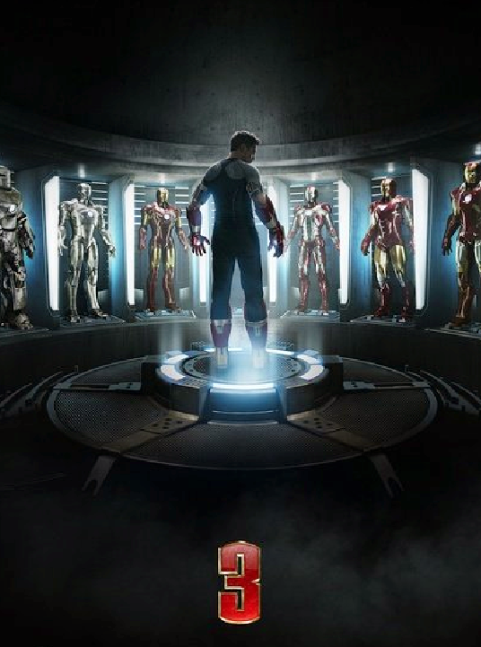

上一篇<a href="http://ahbundance.blogspot.com/2013/04/oblivion.html" style="font-family: Verdana, Arial, Tahoma, 宋体; font-size: 14px; line-height: 23px;">【电影】Oblivion 看后感</a>

 

哟！ 看电影咯

照旧 先来一个预告片

 

<iframe allowfullscreen='allowfullscreen' webkitallowfullscreen='webkitallowfullscreen' mozallowfullscreen='mozallowfullscreen' width='320' height='266' src='https://www.youtube.com/embed/uiSusKPLW1g?feature=player_embedded' frameborder='0'></iframe>

======================笔者废话======================

杀死人的预告片啊

对热血男性来说 应该没有什么免疫力的吧 这次又要创什么票房了吧

 

准备好了今晚去看首映&nbsp;

热血心情忍不住预先吧博客写下

电影票~ 啦啦啦啦 买不到的朋友 等第二期吧~

（难的得瑟下）

 

 

=====================影片介绍====================== 
 

Ironman 3 
托尼·斯塔克将遭遇到一个能力似乎没有界限的强敌的挑战。这个人毁坏了斯塔克的生活，而斯塔克[3]只有依靠着自己精良的高科技的装备才能去寻找究竟是谁才是幕后的元凶。在寻找的过程中，斯塔克非常依赖自己的钢铁服，每一次转折都在测试着他的勇气。当他最终找到强敌， 并且准备展开反戈一击的时候，斯塔克顿时发现了自己一直以来都面对着一个巨大的问题：到底是战衣造就了一个男人，还是这个男人成就了一套衣服! 
 
================看后感=============== 
 

有人说钢铁侠 褪去了盔甲 便是普通的富家子弟

事实并非全部

如果没有 Tony 拥有超群智慧

临危不乱 在绝境中制造出第一代钢铁套装

钢铁盔甲就不会出现

是否如此 这一集会演示这一点 
内容就自己看吧 
 

这是财富 智慧 个性 产出的超级衣服

这也是我对其着迷的地方

帅 牛 
 

每一集都有让人眼界一开的地方

第一部创造出的钢铁衣

第二部随身变身包

复仇者联盟中的跟踪变身箱

第三部预告中以及知道 每个部件会单独的穿上

接着就是预告的钢铁人军团

不过到底有多少套Ironman套装呢？

这期又有什么特别卖点呢

自己看吧

 
特别让我联想到的一个故事 
成功人士很多都曾经失去一切 
一无所有 
但是最后还是会获得 
不是因为他有工具所以有成就 
而是因为他就是成就. 
 
=====================预告中精彩对白======================

 

MANDARIN：ladies，children，sheep.Some people call me a terrorist.I consider myself a teacher.Lesson number1、heroes，there is no such thing。 
翻译 满大人：女士们，孩子们，懦夫们。很多人认为我是恐怖分子，但我自认为是一名导师。给你们上的第一节课内容是，英雄，从不存在。

TONY STARK：I hope I can protect the one thing i can't live without 
托尼·斯达克：我只愿能为我毕生挚爱遮挡风雨。另一版本翻译：托尼·斯达克：我希望我能保护好我所不能失去的东西。（相对比较符合语境）

I'm gonna offer the choice.Do you want an empty life.or a meaning ful death? 
我会给你一个选择,你是想要苟且偷生,还是死得其所?

Today is the first day...of what's left of you life 
今天就是...你余生的第一天

Things are different now.I have to protect the one thing that I can't live without.That's you. 
情况不一样了,我必须要保护我唯一离不了的人.那就是你.

I'm Tony Stark,I built those stuff,I got a great girl,And occasinally,saved the world.So I Can't tight sleep 
我是托尼史塔克,我制造了这些东西,我有个超级好的女朋友.我还偶尔拯救一下世界.所以..我睡不好

=========================待续=========================

上一篇<a href="http://ahbundance.blogspot.com/2013/04/oblivion.html">【电影】Oblivion 看后感</a>

 

 

 

 

