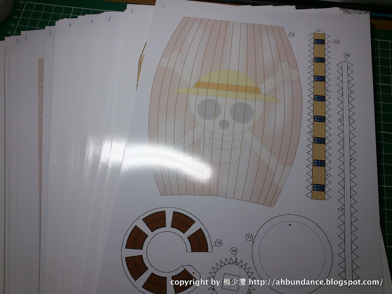
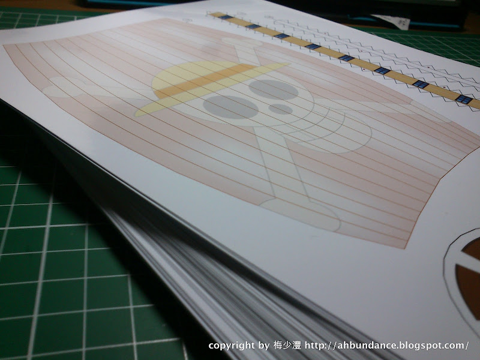

 
 
外面下雨了 如果在海上是不是正在暴风雨呢

 

船匠准备着制作千阳号 预备迎接着未来的冒险

 

 

 

 
 
其它制作链接 
 
<h3 class="post-title entry-title" itemprop="name" style="background-color: white; color: #333333; font-family: Arial, Tahoma, Helvetica, FreeSans, sans-serif; font-size: 18px; font-weight: normal; margin: 0px; position: relative;">
<a href="http://ahbundance.blogspot.com/2013/04/hitman-colt-m1911-11-3d-paper-model.html" style="color: #6699cc; text-decoration: none;">【纸模型】Hitman COLT M1911 1:1 3D Paper Model</a></h3>
<h3 class="post-title entry-title" itemprop="name" style="background-color: white; color: #333333; font-family: Arial, Tahoma, Helvetica, FreeSans, sans-serif; font-size: 18px; font-weight: normal; margin: 0px; position: relative;">
<a href="http://ahbundance.blogspot.com/2013/04/freedom-2.html">【纸模型】试作~Freedom 练习 （2）</a></h3>
 

 

 
 