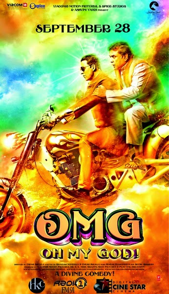

 

 

导演:&nbsp;<a href="http://movie.douban.com/search/Umesh%20Shukla" rel="v:directedBy" style="color: #666699; cursor: pointer; text-decoration: none;">Umesh Shukla</a>

编剧:&nbsp;<a href="http://movie.douban.com/search/Umesh%20Shukla" style="color: #666699; cursor: pointer; text-decoration: none;">Umesh Shukla</a>&nbsp;/&nbsp;<a href="http://movie.douban.com/search/Bhavesh%20Mandalia" style="color: #666699; cursor: pointer; text-decoration: none;">Bhavesh Mandalia</a> 
主演:&nbsp;<a href="http://movie.douban.com/celebrity/1138139/" rel="v:starring" style="color: #666699; cursor: pointer; text-decoration: none;">Paresh Rawal</a>&nbsp;/&nbsp;<a href="http://movie.douban.com/celebrity/1049615/" rel="v:starring" style="color: #666699; cursor: pointer; text-decoration: none;">阿克谢·库玛尔</a>&nbsp;/&nbsp;<a href="http://movie.douban.com/celebrity/1054259/" rel="v:starring" style="color: #666699; cursor: pointer; text-decoration: none;">米特胡恩·查克拉博蒂</a>&nbsp;/&nbsp;<a href="http://movie.douban.com/celebrity/1292904/" rel="v:starring" style="color: #666699; cursor: pointer; text-decoration: none;">Govind Namdeo</a>&nbsp;/&nbsp;<a href="http://movie.douban.com/celebrity/1048343/" rel="v:starring" style="color: #666699; cursor: pointer; text-decoration: none;">Mahesh Manjrekar</a>&nbsp;/&nbsp;<a href="http://movie.douban.com/search/Nidhi%20Subbaiah" rel="v:starring" style="color: #666699; cursor: pointer; text-decoration: none;">Nidhi Subbaiah</a>&nbsp;/&nbsp;<a href="http://movie.douban.com/celebrity/1036880/" rel="v:starring" style="color: #666699; cursor: pointer; text-decoration: none;">康柯纳·森·沙尔玛</a>&nbsp;/&nbsp;<a href="http://movie.douban.com/celebrity/1282317/" rel="v:starring" style="color: #666699; cursor: pointer; text-decoration: none;">Prabhu Deva</a>&nbsp;/&nbsp;<a href="http://movie.douban.com/celebrity/1274180/" rel="v:starring" style="color: #666699; cursor: pointer; text-decoration: none;">索娜什·辛哈&nbsp;</a>/&nbsp;<a href="http://movie.douban.com/celebrity/1017831/" rel="v:starring" style="color: #666699; cursor: pointer; text-decoration: none;">萨尔曼·汗</a> 
类型:&nbsp;剧情&nbsp;/&nbsp;喜剧 
制片国家/地区:&nbsp;印度 Indian 
语言:&nbsp;印地语 Hindi 
上映日期:&nbsp;2012-09-28(印度) 
片长:&nbsp;125分钟 
又名:&nbsp;噢，我的神啊 
 
<h2 style="background-color: white; color: #007722; font-family: Arial, Helvetica, sans-serif; font-size: 15px; font-weight: normal; line-height: 22px; margin: 24px 0px 3px; padding: 0px;">
偶滴神啊的剧情简介&nbsp;&nbsp;·&nbsp;&nbsp;·&nbsp;&nbsp;·&nbsp;&nbsp;·&nbsp;&nbsp;·&nbsp;&nbsp;·</h2>

　　售卖佛像的古董商人坎杰（Paresh Rawal 饰）是个无神论者。他把佛像视为玩具，不明白那些花招百出的宗教仪式，希望把女儿培养成飞行员，把儿子培养成板球球员。古董店寄托着他全部的希望和感情。 　　某一天热闹的祭祀仪式上，坎杰为了把参与活动的儿子揪回去，开了神的玩笑，被教派的头目警告会遭到神的报应。当天天气突然由晴转阴，且引发了一场地震。其它店铺无一受损，唯有坎杰的店被震的面目全非。本以为投了保险可以挽回损失的坎杰被保险公司告知这属于不可抗力的天灾人祸，不在承保范围内。一无所有的坎杰一纸状书把神告上了法庭。而被告人则是那些借助神灵名义四处捞金的教派头目们。一场看似离奇的官司就这样展开，而神灵（阿克谢•库玛尔 Akshay Kumar 饰）本人似乎也对此事很感兴趣，他隐藏在人群中，来到了坎杰身边，也改变了坎杰对宗教的看法 
 
============看后感============ 
看完这部电影对回忆特别感慨， 
我亦是无神论者，小时候因为家庭宗教而当众辱骂过神。被打得很惨呢... 

 

不算《贫穷区的千万富翁 》这就是我第一部看的印度片了。我给8.5分 
 
作为剧情片 这个剧情我非常喜欢尤其是无神论的述说，不是信奉某个宗教的人会说出口的。 
虽然此片只是虚构 但是这一段让我不得不承认无神论主义者比传教士更适合成为虔诚的信仰者。分享~ 
<iframe allowfullscreen='allowfullscreen' webkitallowfullscreen='webkitallowfullscreen' mozallowfullscreen='mozallowfullscreen' width='320' height='266' src='https://www.youtube.com/embed/ZieFNV2sxCw?feature=player_embedded' frameborder='0'></iframe> 
 
作为喜剧片 唱歌好笑 跳舞好笑 对白好笑（不知道是不是翻译的人厉害呢）表情动作也好笑 
 
看似荒唐又奇幻的故事，却又是惊艳的深刻饱满！一场宗教神信仰的辩证讨论，一人挑战权威沦为众人指骂对象再到揭示真谛万人敬仰的英雄，影片给人与神双方立场没有绝对的好坏更使得本片熠熠生辉！宗教磨灭但也不能当生意做。 
 
你有信念更不需要宗教。 
信念便是信仰。 
 
下载链接：http://www.tom365.com/movie_2004/html/14039.html

