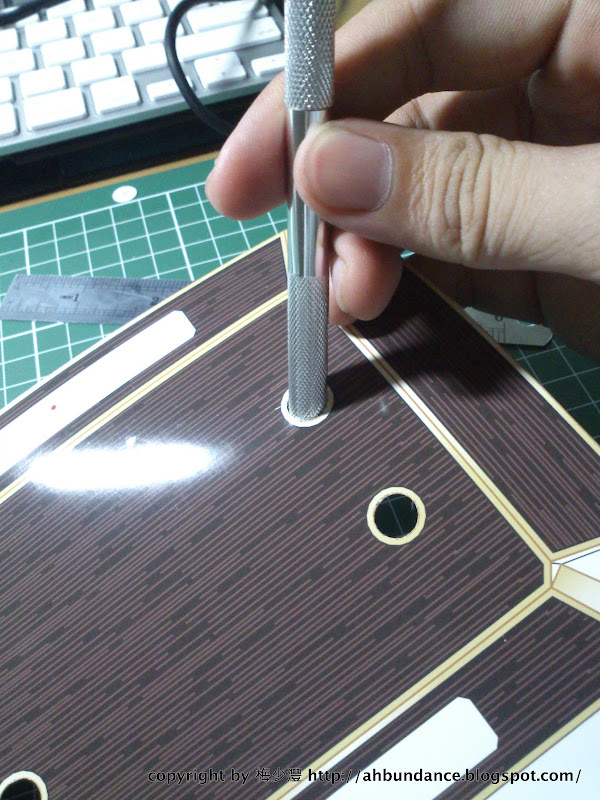
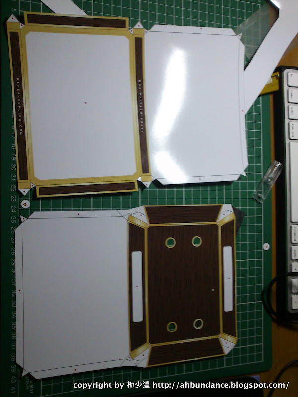
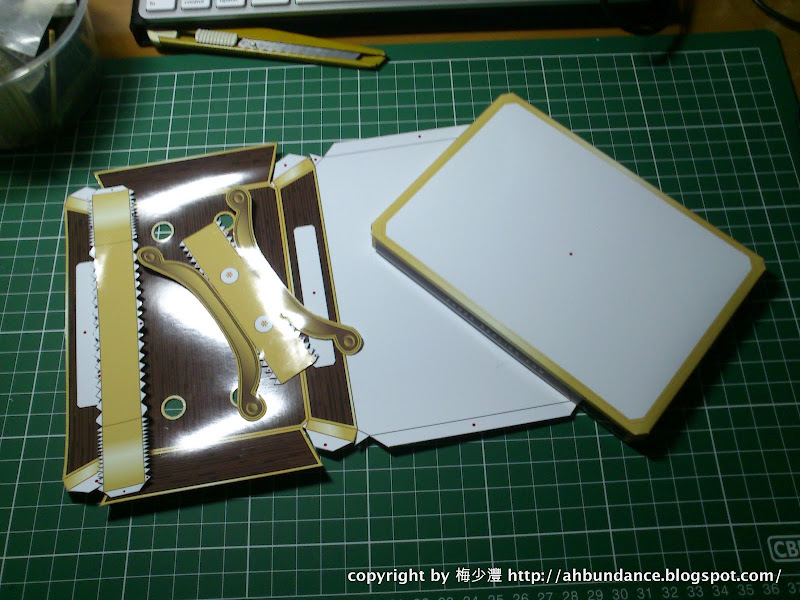
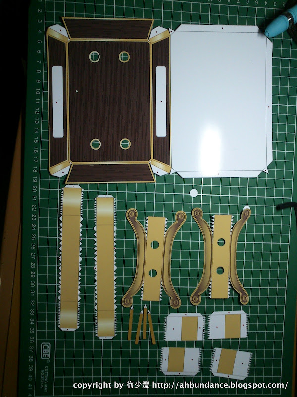
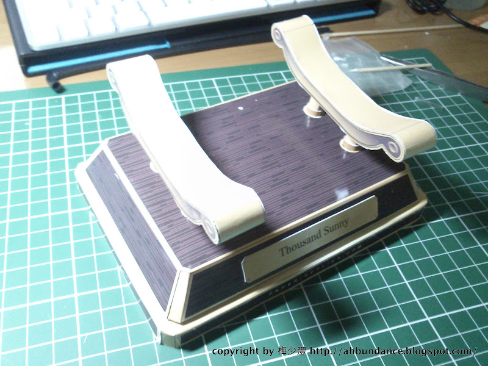
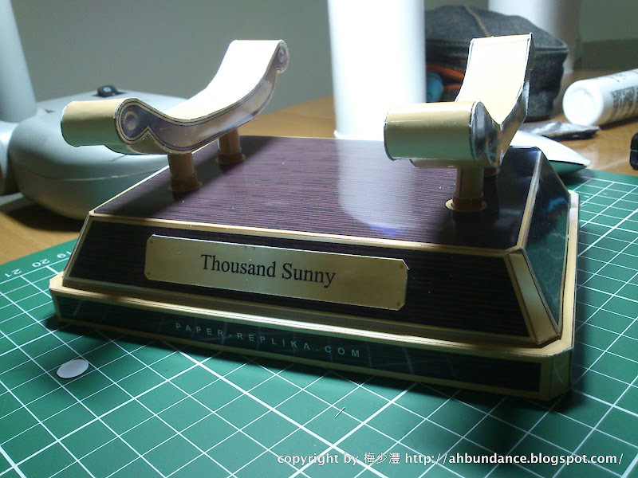
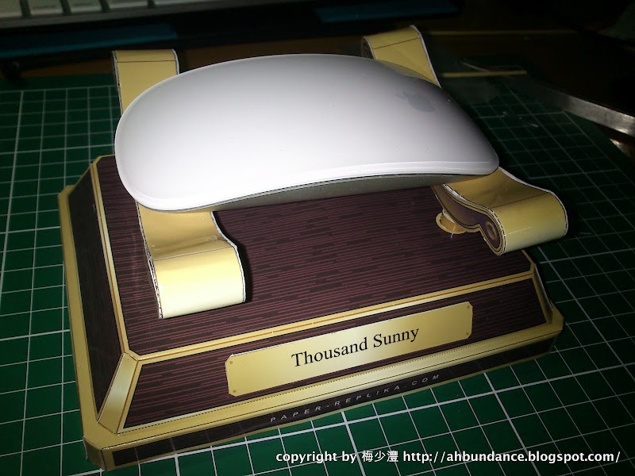

<a href="http://ahbundance.blogspot.com/2013/04/blog-post_28.html">上一篇 ：海贼王千阳号 开造</a>

最近还真忙

时间都没有分配过来

忙绿的是就别说了

 

开造以后

第一个先做的是底座

因为有了底座船身才有地方放咯

黄金底座开工~

 

这是割开圆圆的洞后 磨边

 

 

 

 

 

 

 

滑鼠上架试压~

 

这个耗时应该不到1小时吧主要大部件都很容易割

&nbsp;就托架弯弯的有点难度 扭曲不好 白边都出来了

也只能过后补了

 

<a href="http://ahbundance.blogspot.com/2013/05/blog-post_4.html">下一篇 【纸模型】海贼王千阳号：船底</a>

 

