

点击查看历史更新:

<h3>

<a href="http://ahbundance.blogspot.com/2013/05/1.html">【纸模型】海贼王千阳号 之 黄金底座 完成</a>

<a href="http://ahbundance.blogspot.com/2013/05/blog-post_4.html">【纸模型】海贼王千阳号：船底</a>

</h3>
 

<a href="/assets/img/blog/e8508655c625.jpg" imageanchor="1" style="margin-left: 1em; margin-right: 1em;">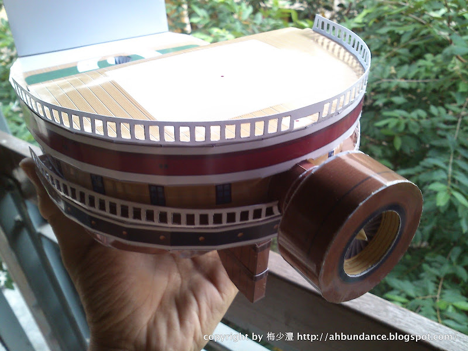</a>

 

终于吧第一部分的船身给弄好了，

大部件反而更多出现露白的地方...显示我真的需要更细心一点

 

这个部分最累人的应该是栏杆部分吧，

一堆小洞实在有够累人的&nbsp;

填充物我都是用多余的废纸制作的

不做填充 只是用纸张折出形状用物理原理来做支撑

 

主船杆的洞忘了割 只能用挖的了

不过这种挖法我觉得还比较稳定 过后可以上胶

所以就不勉强割出来了

 

可能是因为纸张材质的问题

白胶难贴很多时候会爆开要重新加胶&nbsp;

可能是亮面脱开的缘故

这个教训以后 还是别使用这种纸张了

觉得过后补上光面油比较靠谱

 

好了看照片吧~

 

<a href="/assets/img/blog/b0e21e61694c.jpg" imageanchor="1" style="margin-left: 1em; margin-right: 1em;">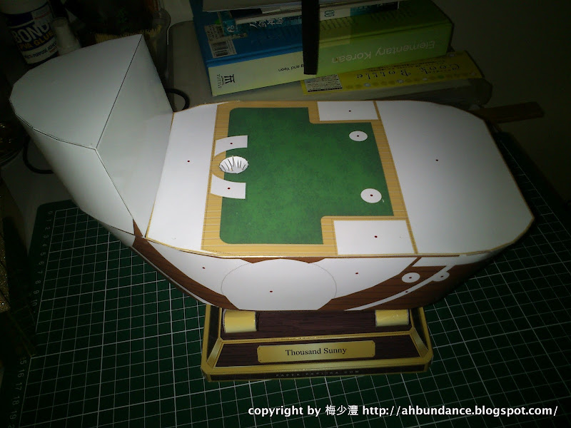</a>

 

<a href="/assets/img/blog/b58f5fd788a4.jpg" imageanchor="1" style="margin-left: 1em; margin-right: 1em;">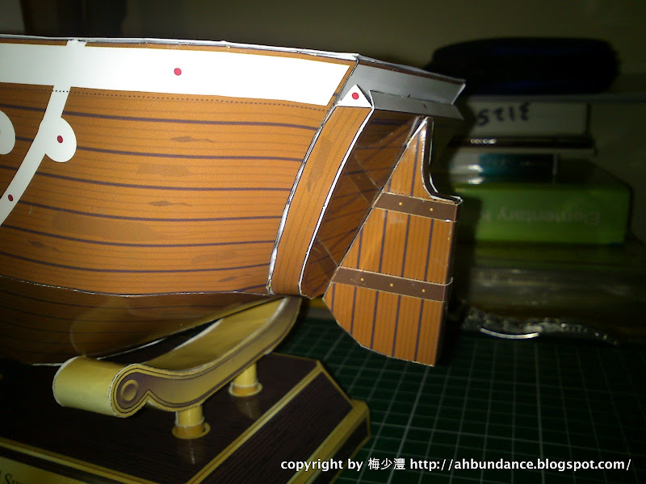</a>

 

<a href="/assets/img/blog/87c3653b173b.jpg" imageanchor="1" style="margin-left: 1em; margin-right: 1em;">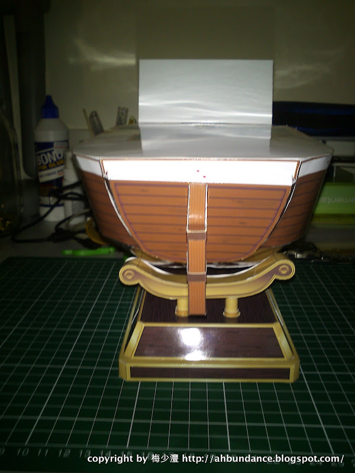</a>

 

<a href="/assets/img/blog/436f60e8a128.jpg" imageanchor="1" style="margin-left: 1em; margin-right: 1em;">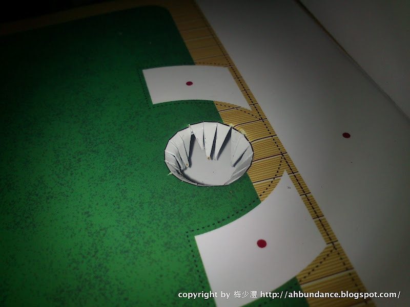</a>

 

<a href="/assets/img/blog/7c3477b66462.jpg" imageanchor="1" style="margin-left: 1em; margin-right: 1em;">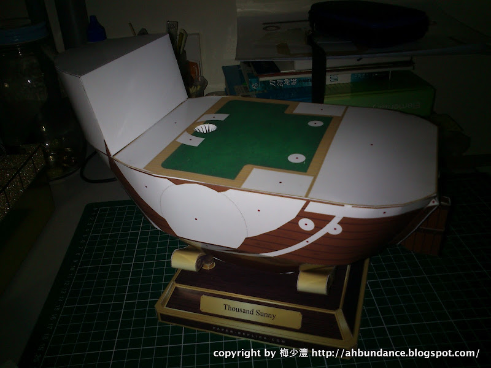</a>

 

<a href="/assets/img/blog/abae33615d2d.jpg" imageanchor="1" style="margin-left: 1em; margin-right: 1em;">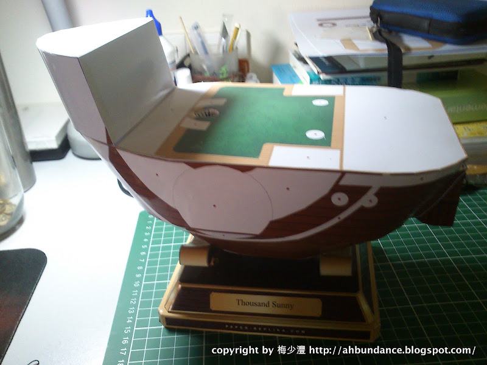</a>

 

<a href="/assets/img/blog/5185a82ef8ad.jpg" imageanchor="1" style="margin-left: 1em; margin-right: 1em;">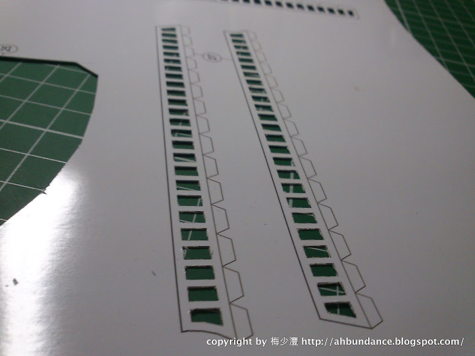</a>

 

<a href="/assets/img/blog/696c0aac4adb.jpg" imageanchor="1" style="margin-left: 1em; margin-right: 1em;">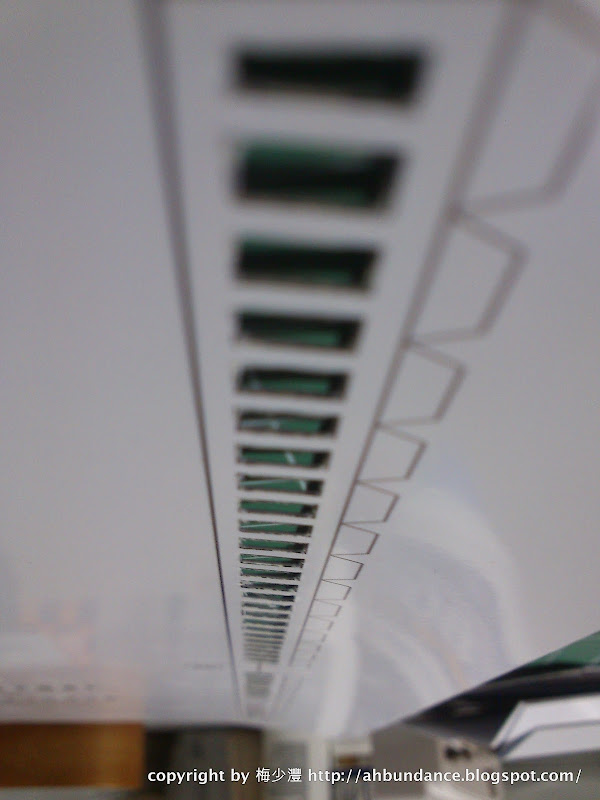</a>

 

<a href="/assets/img/blog/b8bca49c1266.jpg" imageanchor="1" style="margin-left: 1em; margin-right: 1em;">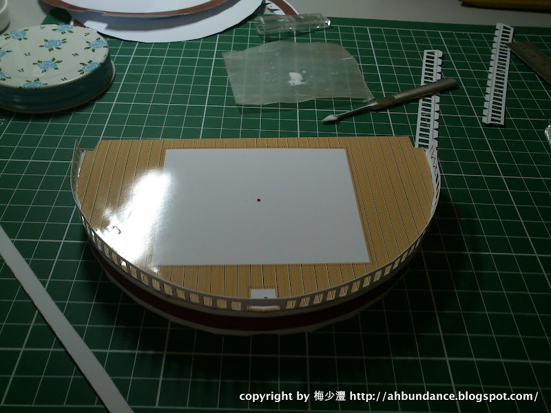</a>

 

<a href="/assets/img/blog/9658a400b481.jpg" imageanchor="1" style="margin-left: 1em; margin-right: 1em;">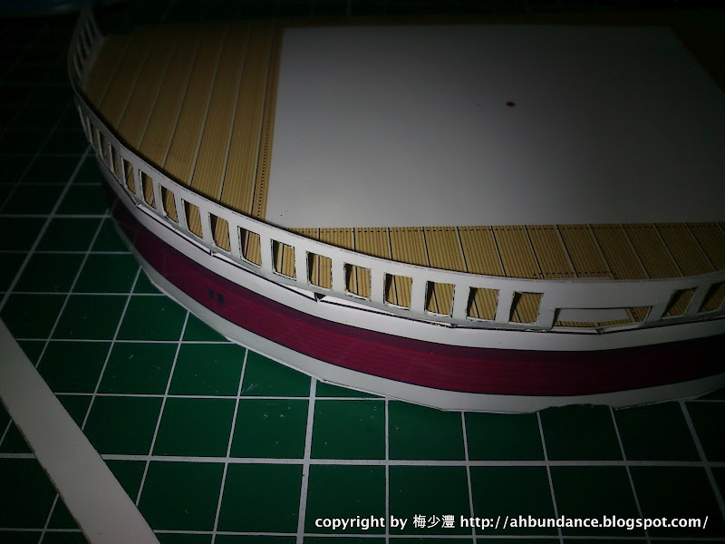</a>

 

<a href="/assets/img/blog/cb473628057c.jpg" imageanchor="1" style="margin-left: 1em; margin-right: 1em;">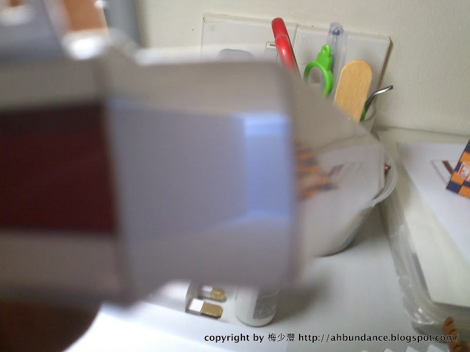</a>

 

<a href="/assets/img/blog/2cf8b6bae96c.jpg" imageanchor="1" style="margin-left: 1em; margin-right: 1em;">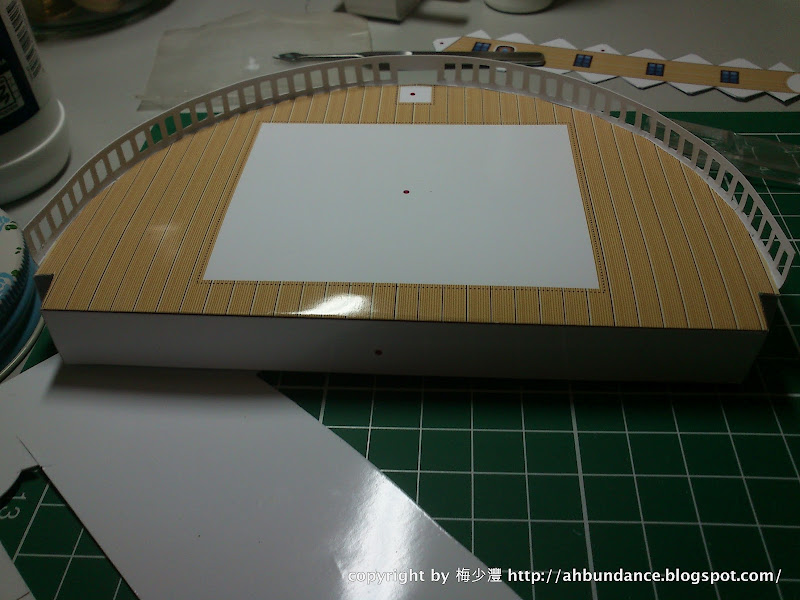</a>

 

<a href="/assets/img/blog/4f5f1d83d37e.jpg" imageanchor="1" style="margin-left: 1em; margin-right: 1em;">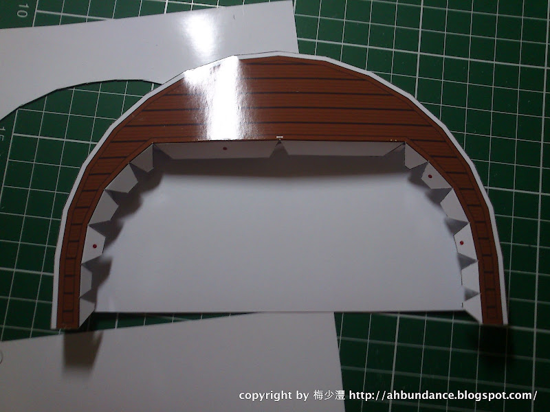</a>

 

<a href="/assets/img/blog/4e894dcd5b97.jpg" imageanchor="1" style="margin-left: 1em; margin-right: 1em;">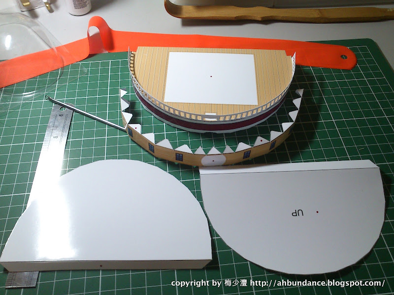</a>

 

<a href="/assets/img/blog/d779b9ef1274.jpg" imageanchor="1" style="margin-left: 1em; margin-right: 1em;">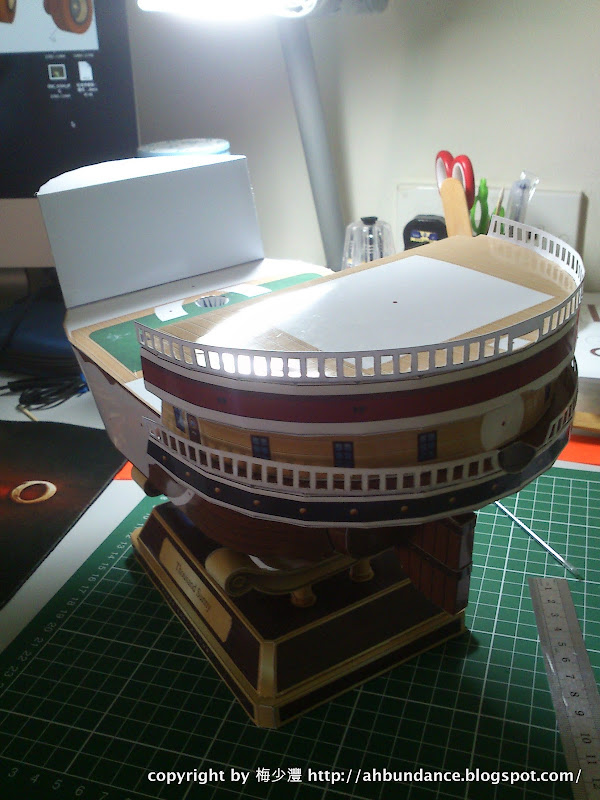</a>

 

<a href="/assets/img/blog/320c710e8dbd.jpg" imageanchor="1" style="margin-left: 1em; margin-right: 1em;">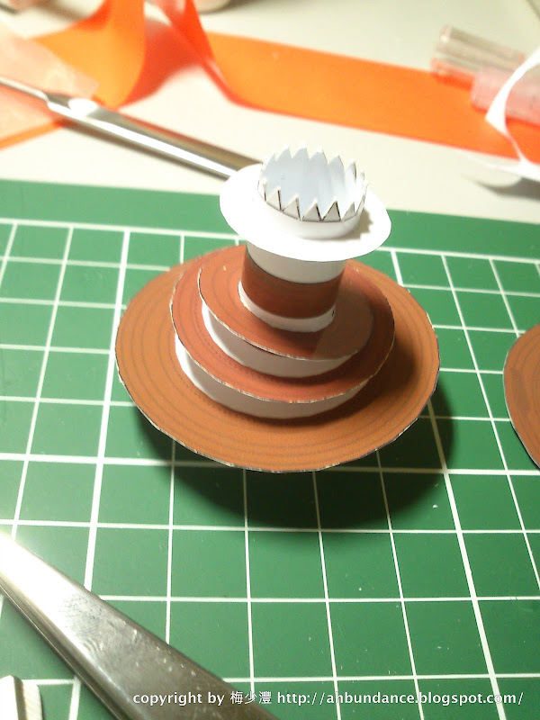</a>

 

<a href="/assets/img/blog/e41f37142752.jpg" imageanchor="1" style="margin-left: 1em; margin-right: 1em;">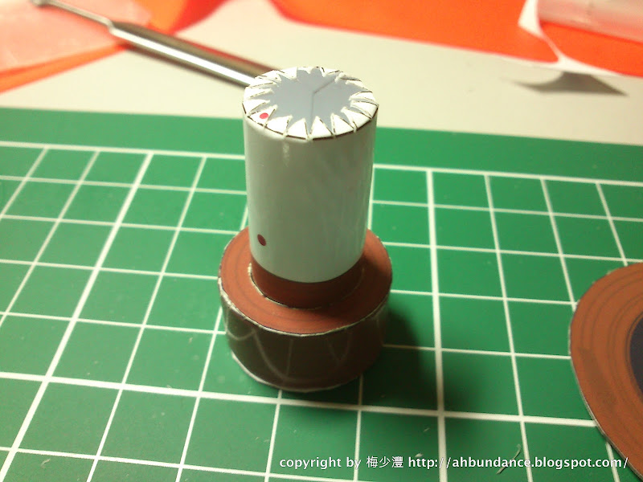</a>

 

<a href="/assets/img/blog/a646b806d0cd.jpg" imageanchor="1" style="margin-left: 1em; margin-right: 1em;">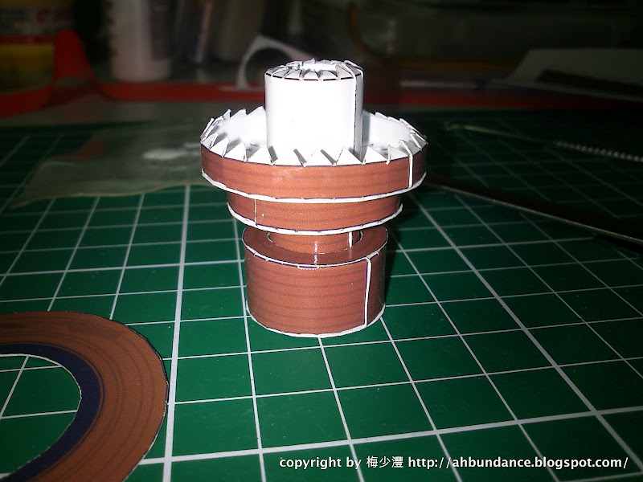</a>

 

<a href="/assets/img/blog/d48264e1585b.jpg" imageanchor="1" style="margin-left: 1em; margin-right: 1em;">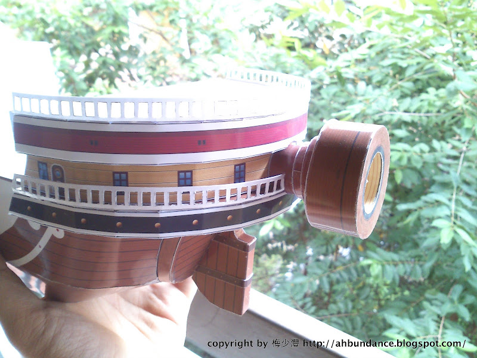</a>

 

 

 

<a href="/assets/img/blog/f776c0b058fc.jpg" imageanchor="1" style="margin-left: 1em; margin-right: 1em;">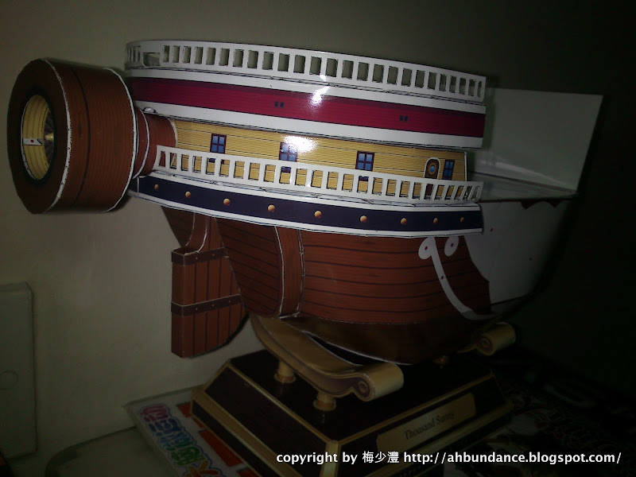</a>

 

下一篇 
<h3 class="post-title entry-title" itemprop="name" style="background-color: white; color: #333333; font-family: Arial, Tahoma, Helvetica, FreeSans, sans-serif; font-size: 18px; font-weight: normal; margin: 0px; position: relative; text-align: center;">
<a href="http://ahbundance.blogspot.com/2013/05/blog-post_17.html">【纸模型】海贼王千阳号：进度贴 船头甲板船身</a></h3>

 

