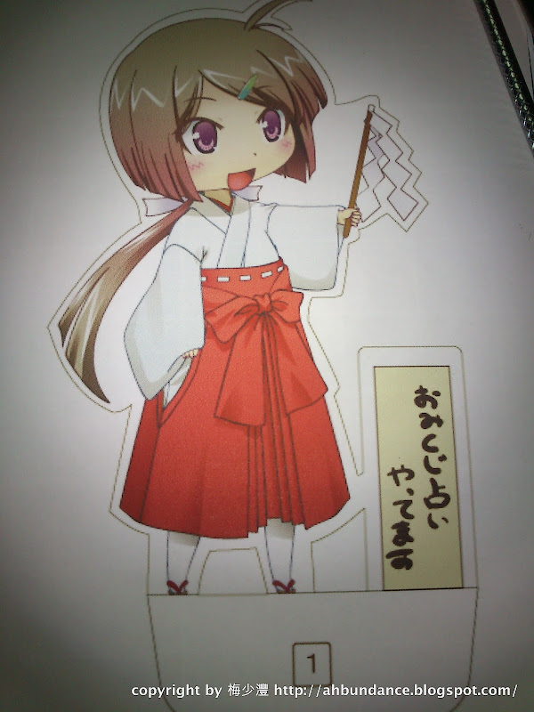
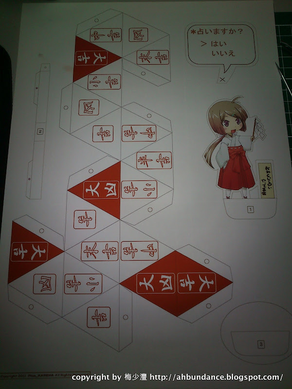
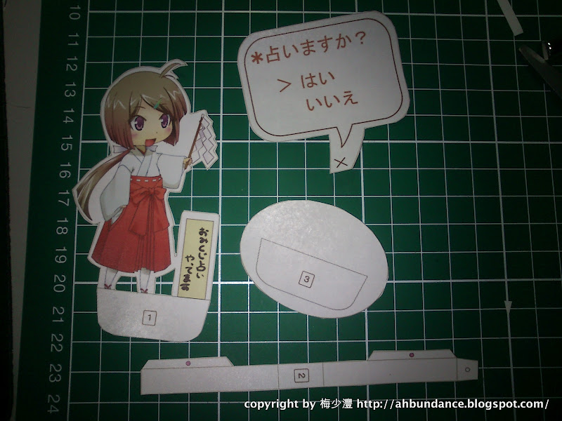
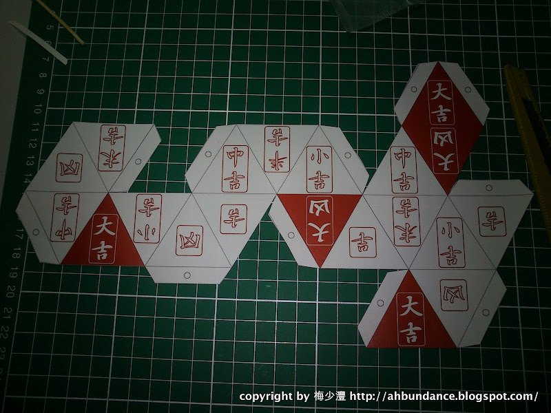
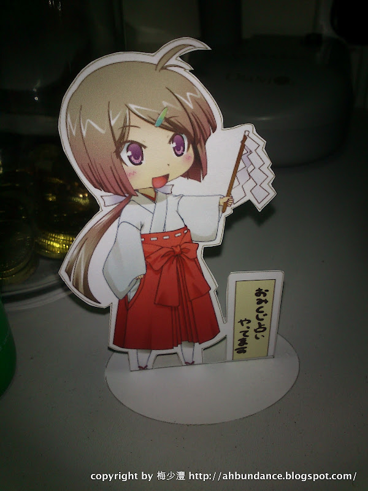
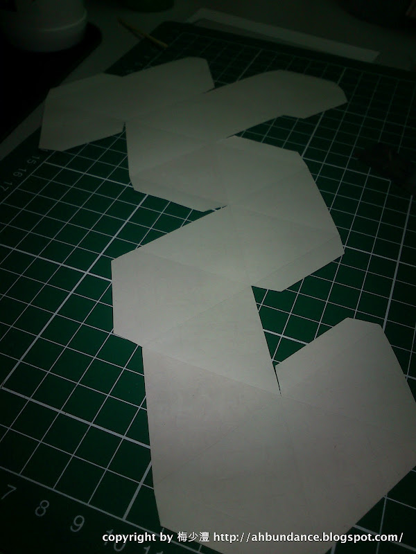
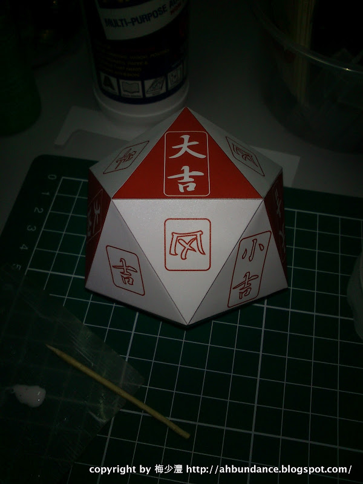
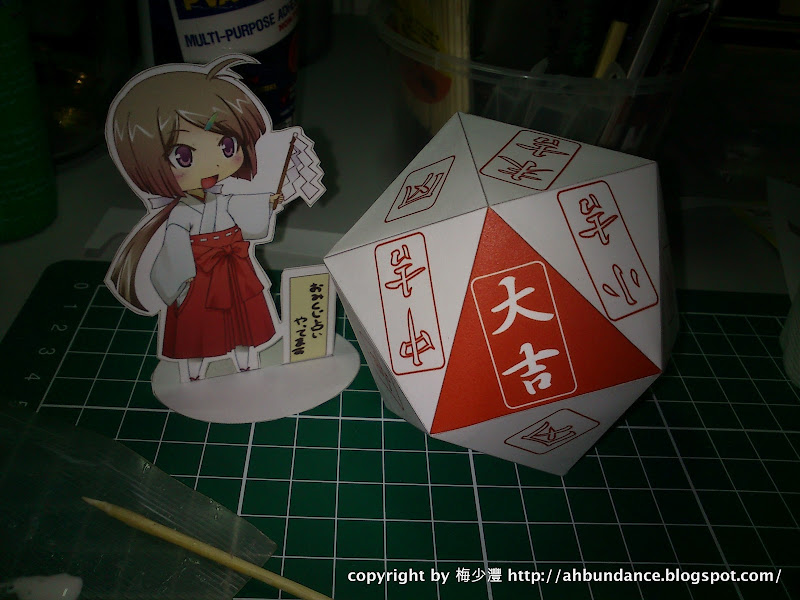
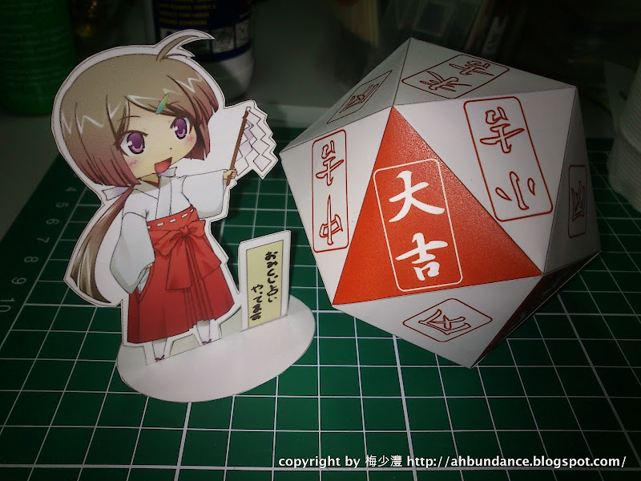
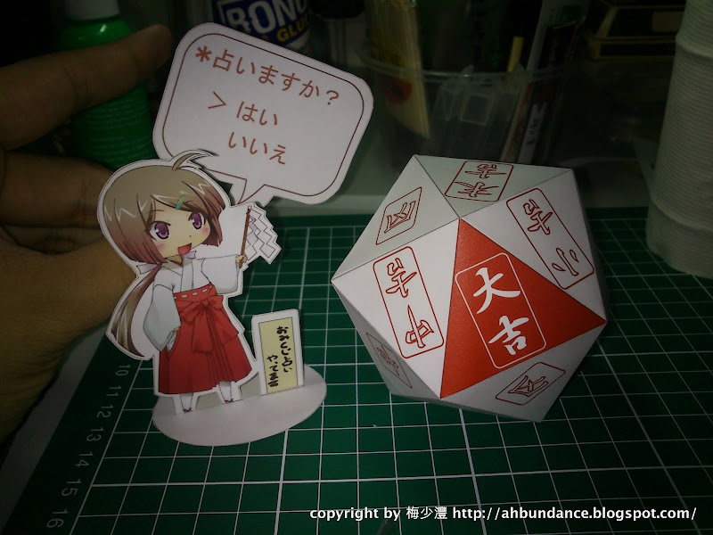

最近好忙啊!

這個是不是藉口呢?

應該總可以找到時間用的吧

在有空的時間 當然還是得陪家人 還有休息啊

 

千陽號一個星期來只完成了左右甲板

今晚還得出去忙&nbsp;

可是不做點什麼心裏又不踏實

決定做個簡易模型 換換心情~&nbsp;

 

打開電腦到各種網站去圖紙堆搜搜&nbsp;

哇哈 找到一個很有趣 又簡單的

小巫女給你占卜咯!!!

 

因為沒有備用厚紙 只能將就點用95gms的紙打印了

小巫女 没什么技术成分啦 剪开 贴脚 解决

塞子 用一些tisu作為填充物

原则上是有一个对话框的 可是贴在小巫女手上&nbsp;

纸张太软了 直接会软掉 这个就不放在那里了&nbsp;

用我的手代替吧(最后一张)

有兴趣制作的朋友也可以在下面的链接去下载图纸来源~

嘻嘻嘻

 

 

 

 

 

 

 

 

 

 

 

 

福利:

图纸来源 : http://pluskareha.web.fc2.com/download/dl-001etc.html&nbsp;

