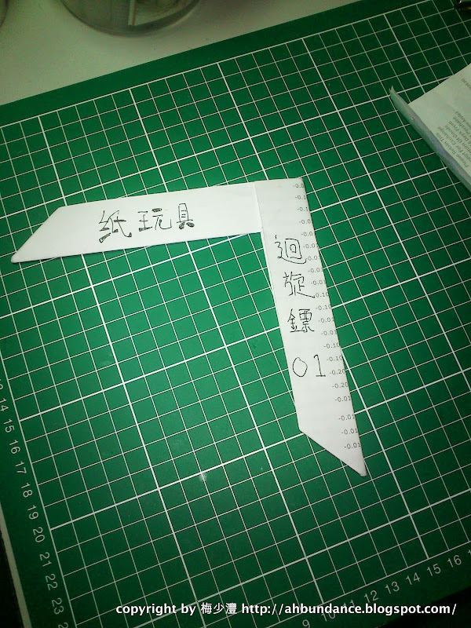

最近有壓力啊!

最好的方法還是自製一些東西把玩,

這個幾分鐘便能完成的小玩具 
 
 
這叫做回力標 
顧名思義 丟出去飛回來 
飛鏢的一類 
英文叫做boomerang 
这个是用纸做的自然就是 Paper&nbsp;Boomerang 
非常有趣的一種小玩具 
 
還記得小時候有過一把50cm長塑料制的 
可還是我從來就沒有成功"回力"過 
雖然有廣大的空地 
一丟出去回頸太大 根本無法用手去接(那時候應該是10多歲吧) 
 
現在好了這個紙質的 就算回來也不會傷到自己 
來玩吧~ 
以下是我在家裡客廳玩的視頻 
 
<iframe allowfullscreen="" frameborder="0" height="315" src="http://www.youtube.com/embed/GGeeioVVhRc?rel=0" width="560"></iframe> 
材料很簡單 就一張A4紙張 有如製作紙飛機一樣 
隨便說它就有大好處! 
 
帥 
帥 
帥 
帥 
帥 
帥 
. 
. 
. 
. 
好啦 開玩笑的 
主要是 
1.廢物利用-環保(我用打印錯的紙和外面拿的傳單哈) 
2.好玩(運動的一種 比起在平板上面滑動我還是喜歡動) 
3.不會受傷(你拿鐵片來做我的話我無言) 
4.簡單製作(我附了教程 在下面可以點進去看) 
5.健康(沒有電腦的輻射,沒有網絡遊戲沉迷的隱患,而且可以動動身體) 
6.最重要的是 免費!(做給孩子玩也是一個不錯的選擇啊!) 
 

 

 

<iframe allowfullscreen="" frameborder="0" height="315" src="http://www.youtube.com/embed/WuyBB-kC_Vo?rel=0" width="560"></iframe>

 

 

 

 

 

