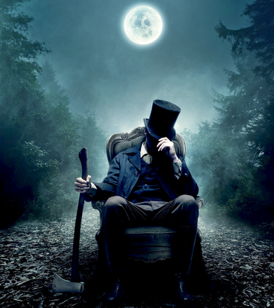

 
 

 

黑暗無論在哪一個時代都會純在 
即使近代暗黑的角落一樣衍生著無數生命的靈魂 
我們甚至比人類更早的存在 
 
我們同類生物有將近兩千七百多個種族組群 
可惜的是我們智慧以及壽命都有限 
 
名字以及知識幾乎都是由人類創造的 
 
無可否認 
在我們生存的這個時代也就只有人類屬於擁有較高等智慧的生物 
 
布魯赫族 
這是我給自己種族引用最高貴的尊稱 
它代表著最適合戰鬥的氏族 
雖然我們族群並沒有對任何生命帶來威脅 
 
但是我們也必須依靠其它生命來維持我們的種族生存 
 
布魯赫是我最喜歡的名字 
如我說的我們種族之間並沒有高等智慧 
這個名字固然不是我取的 
它來自愛爾蘭人類的一名作家 
他透過人類始祖對我們種族演化創造的傳說 
改編成現代的故事《德古拉》 
沒錯 就是吸血鬼的故事 
吸血鬼有十三個家族布魯赫族只是其中一支 
 
說到這裏你也許已經知道了我的身份 
我們就是傳說中吸血鬼的真身 
吸血鬼來自我們的其中一支種族 
只是我們並不如吸血鬼一般強大 
所有在人類故事中的故事都已經被神化了 
 
我們依靠著黑暗, 
依靠著生命之血來生存 
依靠著高速飛翔的翼以及能夠隱藏在黑暗的身軀 
讓我們種族得以生存以及繁殖 
 
由於我們是依靠別的生命來存活 
我不得不感謝這個世界的生命感謝人類 
但是也因為人類 我們常有生命危險 
我們生命不長 也沒有足夠的智慧 
在被危害的時候根本沒有任何反擊的餘地 
 
我是布魯赫族裡面第 n+99 代的繁殖者 
n在人類的語言來說是多到無法計數的數目 
而我們的數字只有00-99 我的下一代會迴歸到n+00 
也就是一個新的輪迴 
這個輪迴只是因為我們的智慧沒法擁有更多的數字 
就像羅馬輪盤一樣 
據說人類因為智慧發達還產生了一​​種感覺叫做恐懼 
將原本不夠位置計算的一個輪盤當做是世界末日 
因為沒有足夠的表情神經 我無法笑 
我只保持我的眼睛在最大的視角表達我的笑意 
 
上一代繁殖者,也就是我母親 
在生產我後為了補充營養捕食的途中被人類殺害 
她不但沒有活到老 還死無全屍 
可惡的人類把她殺害後還將她手翅膀分開 
最後遺棄在下水道 
 
雖然我們種族都知道這些 
但是我們心裏並沒有任何仇恨 
可能是因為思考能力沒有人類般的發達 
又或者是當我們發現仇恨的時候基本壽命不是即將結束便是已被殺害 
我從出生開始命中註定只為繁殖而生 
整個過程從交配到生產根本不需要任何思考 
本能已經能夠讓我們達到目的 
所以思考能力根本不需要存在我們的生命中 
這是幸運的 
因為如此 我們沒有人類的七情六慾 
不會悲傷或憤怒 
 
對可惡的人類來說這絕對是好事 
因為這樣他們才能活的那麼自在 
沒有我們種族的報復 
 
我們生存在黑暗如果要報復的話 
人類雖然不會滅亡但也不會活的那麼自在 
 
我出生這一代正好在我們繁殖的旺季 
炎熱的天氣以及漆黑的夜晚都是我們吸取營養的好機會 
 
在我面前的你既身為人類 
對我們來說也是吸取營養的一種生命而已 
雖然我襲擊你在先 
現在栽在你手裏我也就認了 
但是你們自己去覺悟吧 
我並沒有報復的能力 
但是我們種族間已經有許多異變 
能讓你們的生命消失 
未來的異變絕對是未知的 
人類你們覺----悟----吧! 
. 
. 
. 
. 
. 
. 
人:"可惡的蚊子,又叮我!! 死吧" 
 
[祝朋友們晚上小心帶有病毒的黑斑蚊] 
作者:麪包仙人 上