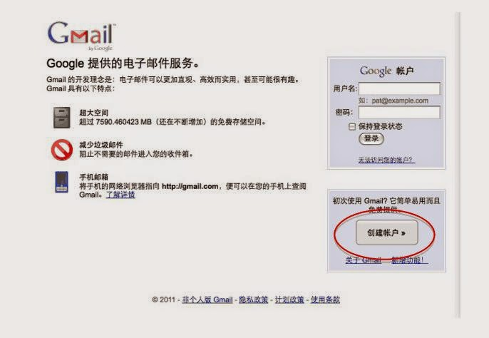
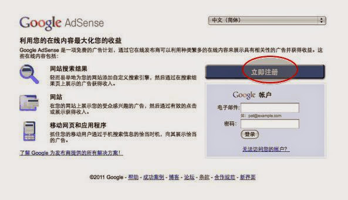
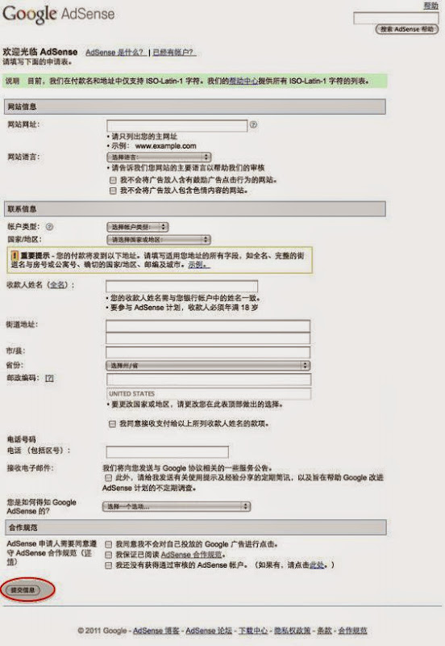
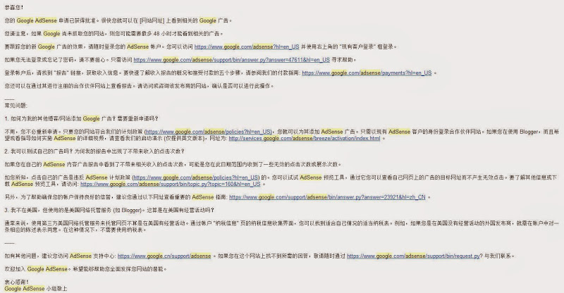
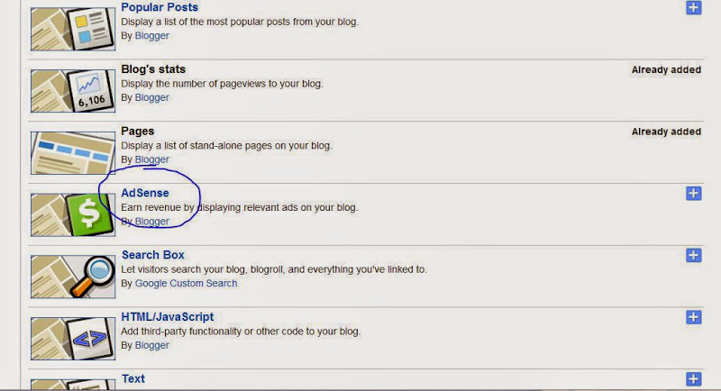
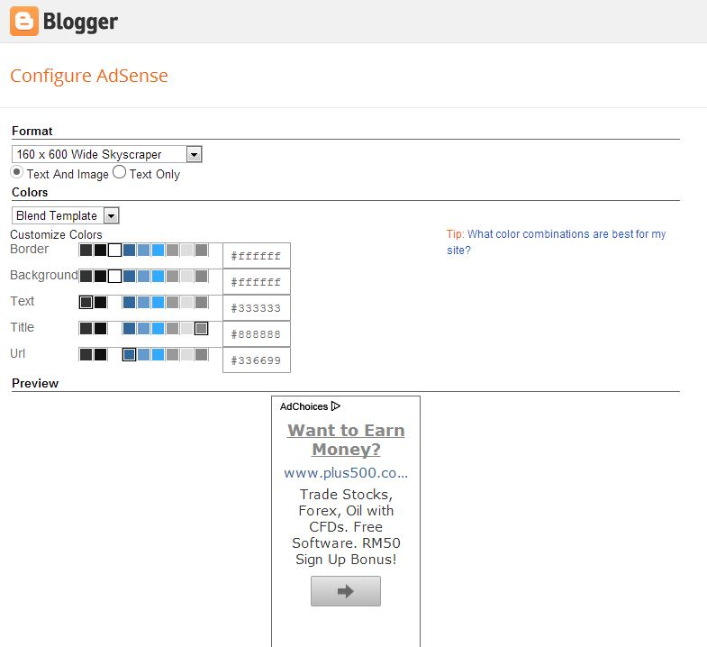
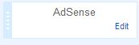

忽然睡不着...

提早来写写如何在blog 导入google 广告来赚钱吧

忽然写这个干嘛？

 

除了一名认识挺久的网友特别收益外

仙人居浏览量一直都不是很高

发一些大家都会想知道的内容看看有木有朋友支持咯

嘿嘿

 

首先我自己也不是什么达人

纯属自己摸索摸索 发现的东西

 

已经知道的朋友们或知道更多的朋友们也欢迎留言与我分享更多知识

看不明白的朋友欢迎询问（确实有人来再说哈）

 

声明

本教学提供给正在使用blogspot 的朋友们

尚未有blogspot的朋友如需要教学再联络我吧

 

====================

如果已经有相关账号的请自行跳过

 

<b>》》》》1.注册google mail 注册链接 <a href="https://mail.google.com/">https://mail.google.com/</a>&nbsp;《《《《</b>

 

 

<b>》》》》2.注册google adsense 账号<a href="https://www.google.com/adsense/">&nbsp;https://www.google.com/adsense/</a>《《《《</b>

请确认您填写的资料都是真实并且正确的 否则后果自负

<b> </b>

 

 

<b>》》》》3.等待google 审核（审核通过后会受到一封google adsense的邮件）《《《《</b>

<b>里面也很清楚的说了遇到问题该怎么处理 所以请耐心阅读。</b>

<b> </b>

 

 

<b> </b>

<b>》》》》4.导入广告 -《《《《《</b>

<b>通过通过部落格 Layout 设置</b>

<b>在自带排版一般都会有&nbsp;<a href="http://www.blogger.com/display?blogID=4992341535248761164&amp;mode=layout-v2&amp;pageToken=APq4FmBE4gc14UEcCV7n2QtmD5pVHnLAPUUoKDRNqqXXEOCLv2qeyc8MME73_LfaYX16zIrbz84LkrUN62Td3fEdkkfeUBZfk0kMNYxcMb4Beh7x6UnN6d4%3D&amp;security_token=AOuZoY67dEvSA4YJa5vuCoQLVPKoaqm0ng:1369767691619" id="layout-addgadget" style="color: #1155cc; font-family: sans-serif; font-size: 11px; line-height: 14px; text-decoration: none;">Add a Gadget</a>&nbsp;的按钮点击</b>

 

 

<b>选择adsense后 会出现编辑框</b>

<b>选择格式 大小 颜色</b>

<b> </b>

 

<b>完成后在layout里面就会出现下图 随时可以修改</b>

 

<b>注意：修改后需要等几分钟时间才能显示 如果是首次添加 最长48小时</b>

<b>（参考你收到的邮件）</b>

<b> </b>

<b> </b>

<b>》》》》5. 宣传你的博客 《《《《</b>

博客自己是不会无故出现浏览量的，如果你没有持续的更新或者持续的有内容给别人看

结果会是可能几年后都没有100美金（最少100美金才能申请提款）

 

 

<b>》》》》6.检测你的努力《《《&nbsp;</b>

<b>登入&nbsp;<a href="https://www.google.com/adsense/">https://www.google.com/adsense/</a></b>

图表怎么看 我就不教导了

 

由于我也是新手之一，搞了整个月只有2块钱... 你们就别踩我了

怎么领钱等我有100美金后再写

 

 

吐槽下 这个世界是很不公平的&nbsp;

很多美女们 拍几张照片 FB开个粉丝页 浏览量说就能超越了我无数的努力

嗯...开玩笑的

想要在这一块挖金不是那么容易的

建议还是结合兴趣&nbsp;

不让最后别来怪我说你发了多少贴 浪费了多少时间哈

 

去吧

祝大家赚钱愉快

