

千阳号啊千阳号

决定不补边就注定了失败了

不过宁可失败也不愿烂尾

我必须把你完成

即使再怎么难看也得完成

白边实在让我有够不爽

不过也因此自己得以实验削薄技巧

让厚纸旁边薄薄的贴起来不是减少白边的出现咯

难度还是有的 一错手就会把图形给毁了&nbsp;

为完整作品加油~！

 

================杂图区================

<a href="/assets/img/blog/c5d9864a1796.jpg" imageanchor="1" style="clear: left; float: left; margin-bottom: 1em; margin-right: 1em;">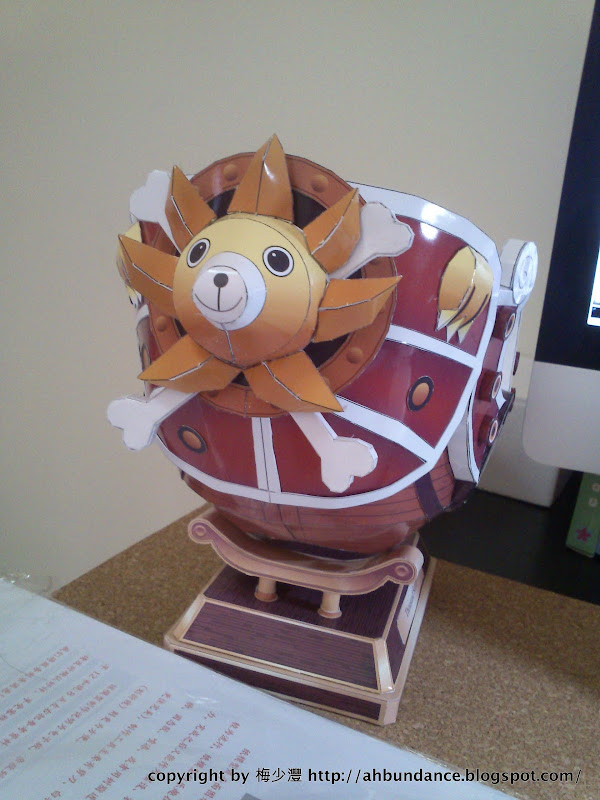</a><a href="/assets/img/blog/c5d9864a1796.jpg" imageanchor="1" style="clear: left; float: left; margin-bottom: 1em; margin-right: 1em;"> </a><a href="/assets/img/blog/c5d9864a1796.jpg" imageanchor="1" style="clear: left; float: left; margin-bottom: 1em; margin-right: 1em;"> </a><a href="/assets/img/blog/c5d9864a1796.jpg" imageanchor="1" style="clear: left; float: left; margin-bottom: 1em; margin-right: 1em;"> </a><a href="/assets/img/blog/c5d9864a1796.jpg" imageanchor="1" style="clear: left; float: left; margin-bottom: 1em; margin-right: 1em;"> </a><a href="/assets/img/blog/0a2e01485dd6.jpg" imageanchor="1" style="margin-left: 1em; margin-right: 1em;">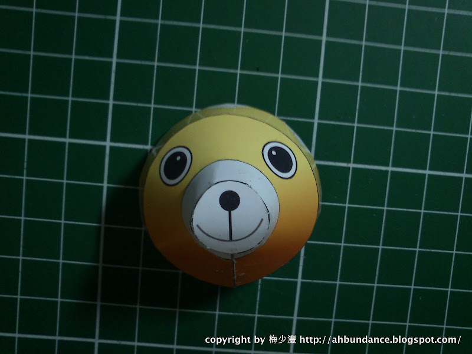</a>

 
<table align="center" cellpadding="0" cellspacing="0" class="tr-caption-container" style="margin-left: auto; margin-right: auto; text-align: center;"><tbody>
<tr><td style="text-align: center;"><a href="/assets/img/blog/85ee0f33ecab.jpg" imageanchor="1" style="margin-left: auto; margin-right: auto;">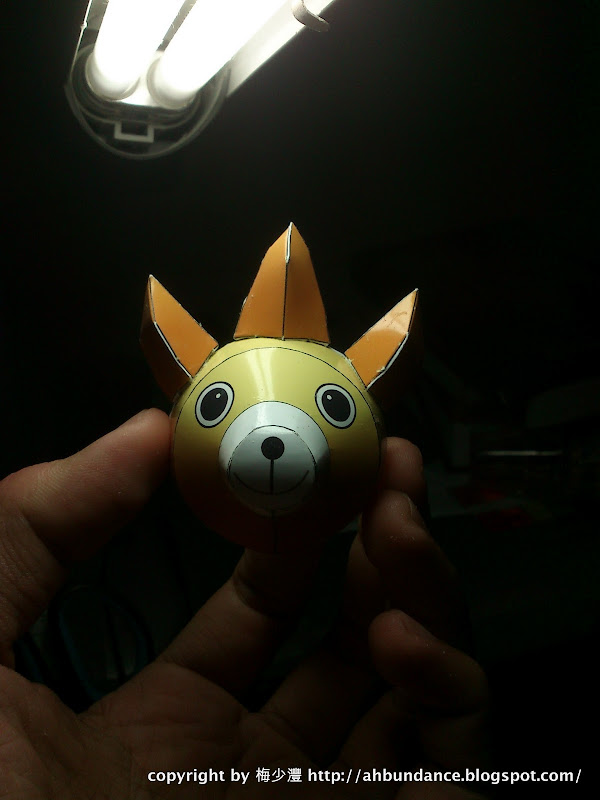</a></td></tr>
<tr><td class="tr-caption" style="text-align: center;">狮子小头出来了</td></tr>
</tbody></table>

<a href="/assets/img/blog/c76eb9d649a4.jpg" imageanchor="1" style="margin-left: 1em; margin-right: 1em;">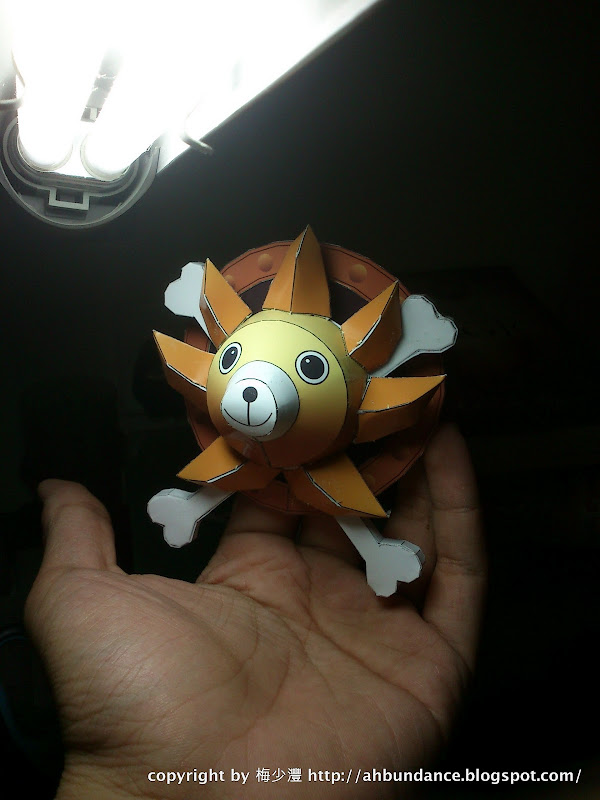</a>

 
 
<table align="center" cellpadding="0" cellspacing="0" class="tr-caption-container" style="margin-left: auto; margin-right: auto; text-align: center;"><tbody>
<tr><td style="text-align: center;"><a href="/assets/img/blog/9de65359d84e.jpg" imageanchor="1" style="margin-left: auto; margin-right: auto;">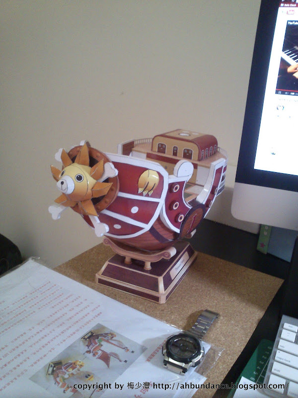</a></td></tr>
<tr><td class="tr-caption" style="text-align: center;">总算是有个千阳号的样子了</td></tr>
</tbody></table>
 

<a href="/assets/img/blog/2083cb22f763.jpg" imageanchor="1" style="margin-left: 1em; margin-right: 1em;">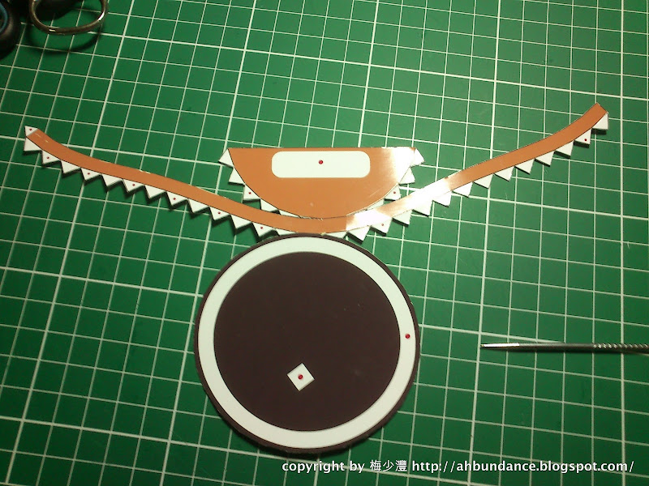</a>

 

<a href="/assets/img/blog/6b536f544217.jpg" imageanchor="1" style="margin-left: 1em; margin-right: 1em;">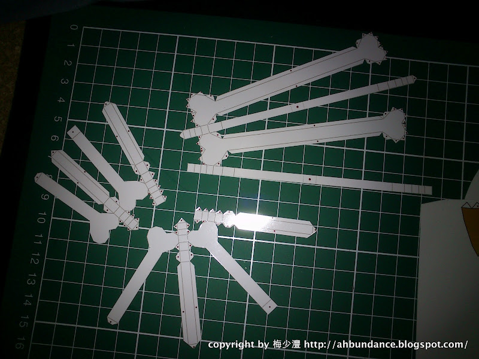</a>

 

<a href="/assets/img/blog/2d209a4d8694.jpg" imageanchor="1" style="margin-left: 1em; margin-right: 1em;">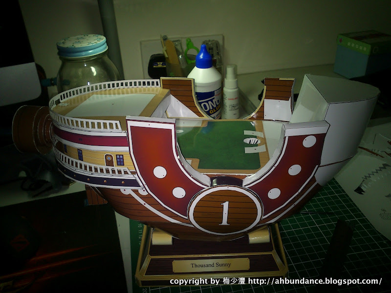</a>

 

<a href="/assets/img/blog/bcc32bf1cb82.jpg" imageanchor="1" style="margin-left: 1em; margin-right: 1em;">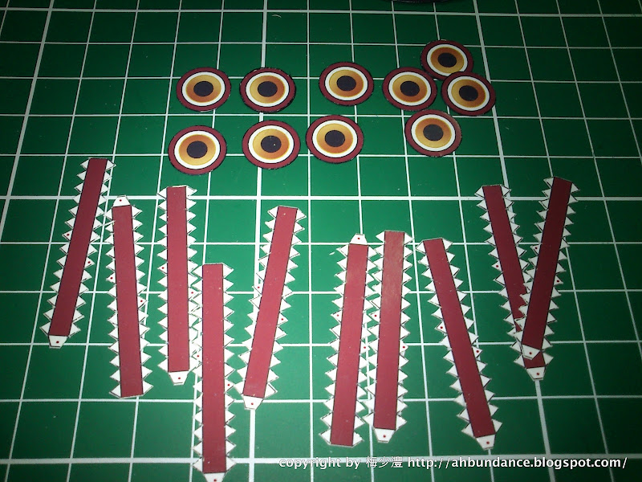</a><a href="/assets/img/blog/e6ab11f71cd7.jpg" imageanchor="1" style="margin-left: 1em; margin-right: 1em;">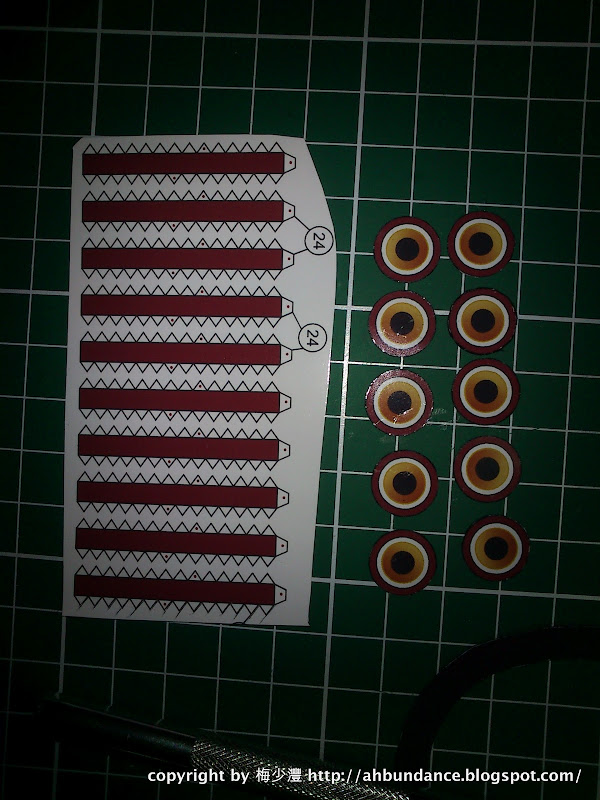</a>

 

<a href="/assets/img/blog/aba7b8de00b0.jpg" imageanchor="1" style="margin-left: 1em; margin-right: 1em;">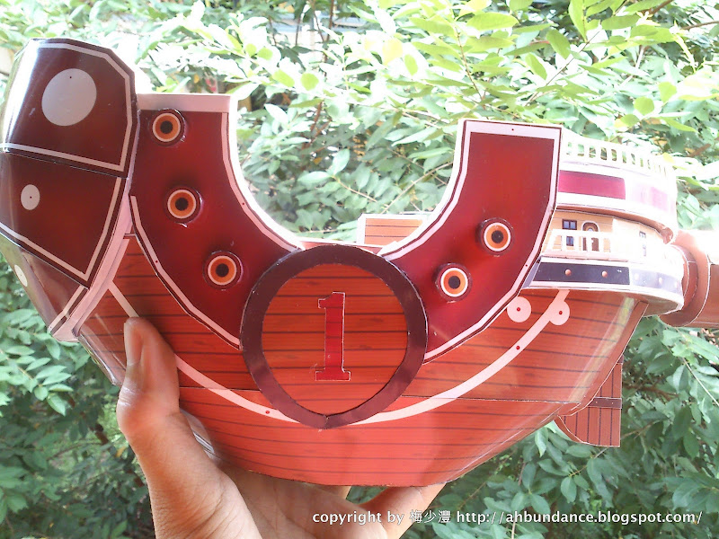</a>

 
 
<table align="center" cellpadding="0" cellspacing="0" class="tr-caption-container" style="margin-left: auto; margin-right: auto; text-align: center;"><tbody>
<tr><td style="text-align: center;"><a href="/assets/img/blog/d70090354870.jpg" imageanchor="1" style="margin-left: auto; margin-right: auto;">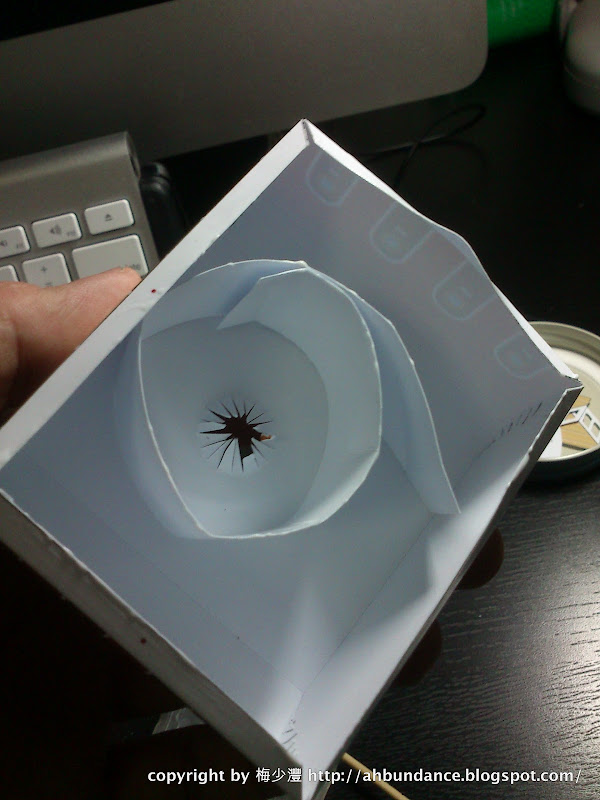</a></td></tr>
<tr><td class="tr-caption" style="text-align: center;">随便制作的硬化架构</td></tr>
</tbody></table>

<a href="/assets/img/blog/191a09550202.jpg" imageanchor="1" style="margin-left: 1em; margin-right: 1em;">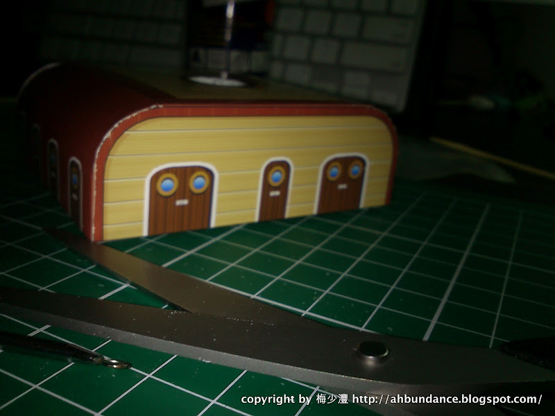</a>

 
 

<a href="/assets/img/blog/e9b1310ef7ce.jpg" imageanchor="1" style="margin-left: 1em; margin-right: 1em;">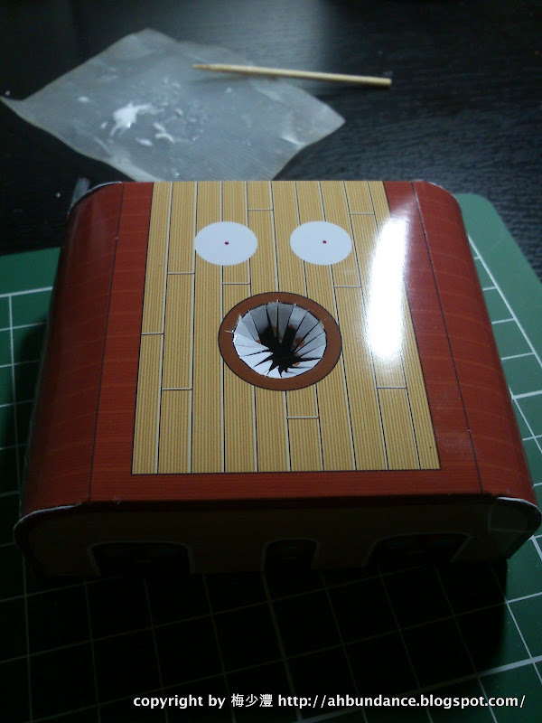</a>

 
<table align="center" cellpadding="0" cellspacing="0" class="tr-caption-container" style="margin-left: auto; margin-right: auto; text-align: center;"><tbody>
<tr><td style="text-align: center;"><a href="/assets/img/blog/0ee3fcd413c9.jpg" imageanchor="1" style="margin-left: auto; margin-right: auto;">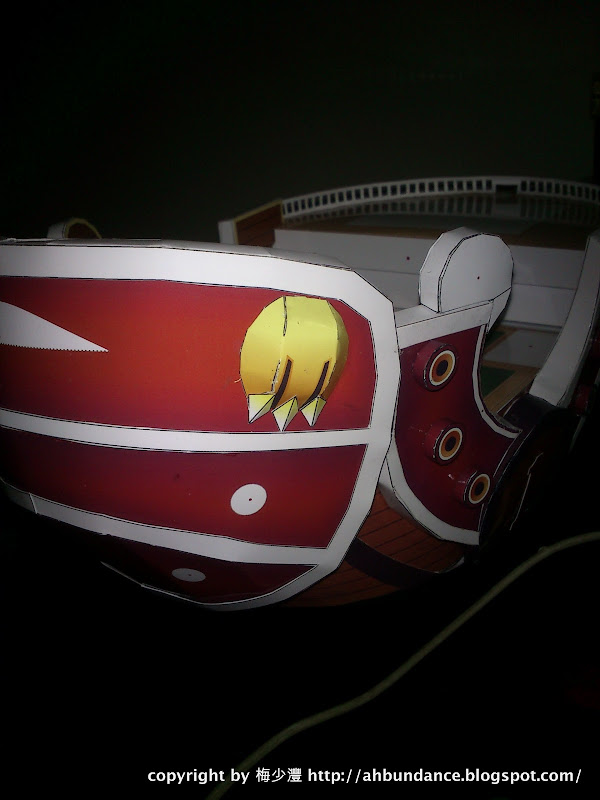</a></td></tr>
<tr><td class="tr-caption" style="text-align: center;">爪子</td></tr>
</tbody></table>
 

<a href="/assets/img/blog/bd627605b2e5.jpg" imageanchor="1" style="margin-left: 1em; margin-right: 1em;">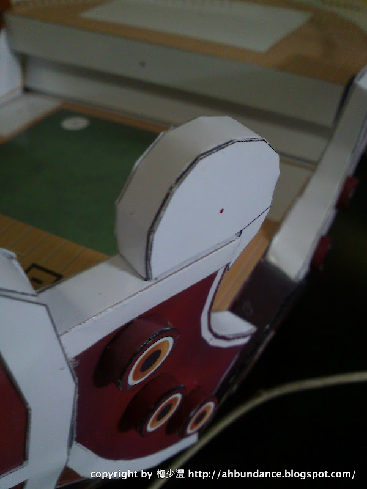</a>

 

<a href="/assets/img/blog/0a56d46f123a.jpg" imageanchor="1" style="margin-left: 1em; margin-right: 1em;">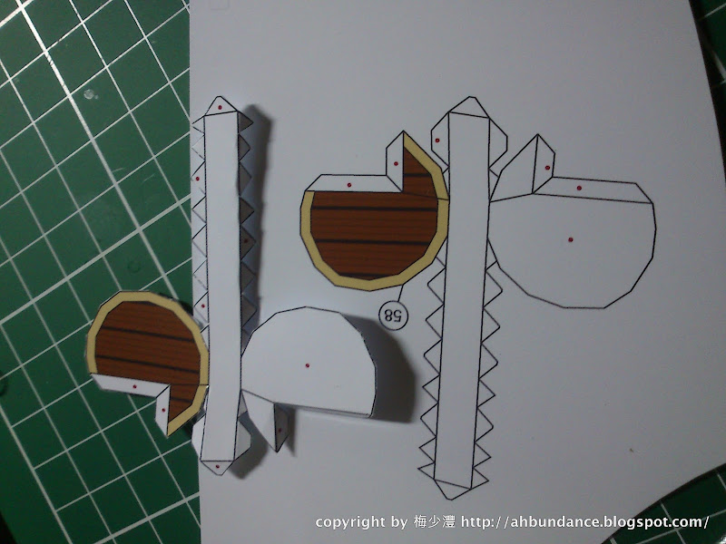</a>

 

<a href="/assets/img/blog/b9a926a117ea.jpg" imageanchor="1" style="margin-left: 1em; margin-right: 1em;">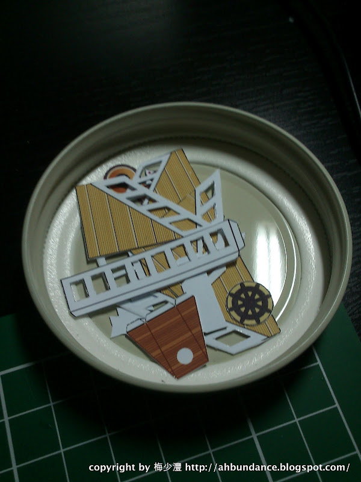</a>

 

<a href="/assets/img/blog/55574e2355cd.jpg" imageanchor="1" style="margin-left: 1em; margin-right: 1em;">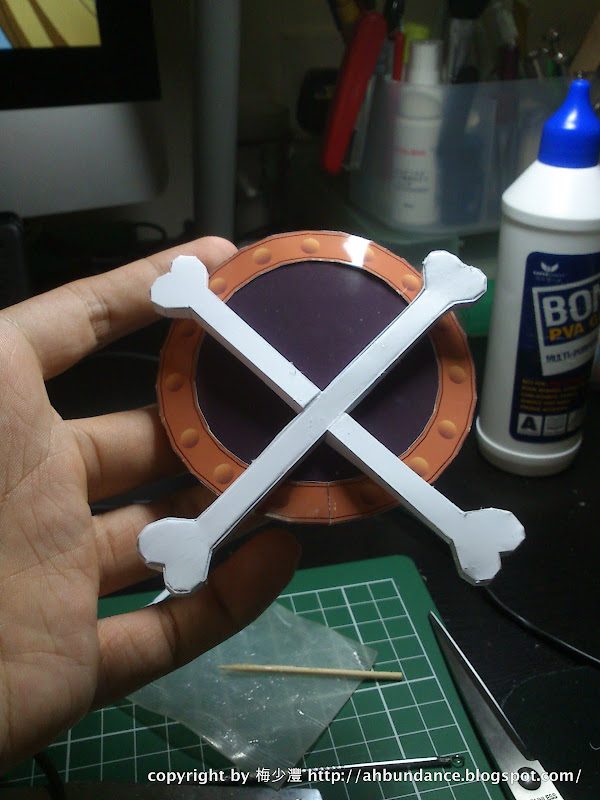</a>

 

<a href="/assets/img/blog/353a32169e57.jpg" imageanchor="1" style="margin-left: 1em; margin-right: 1em;">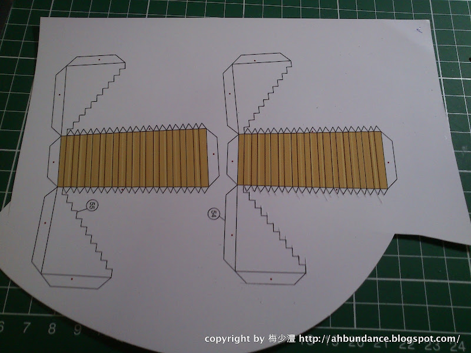</a>

 
 