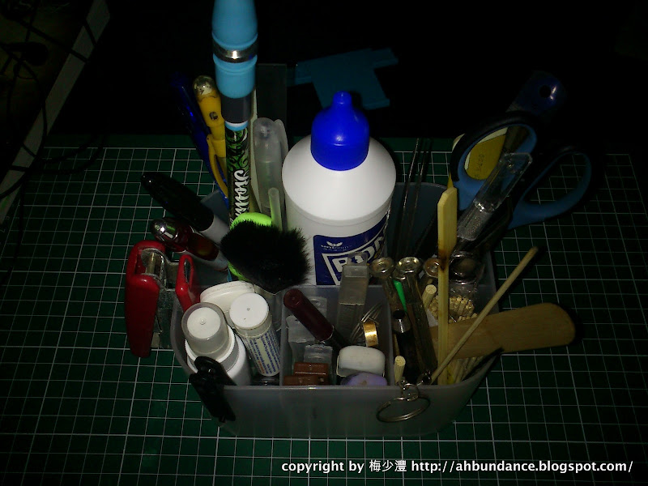
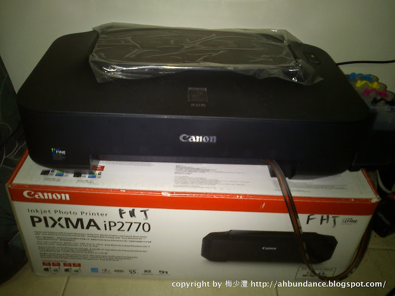
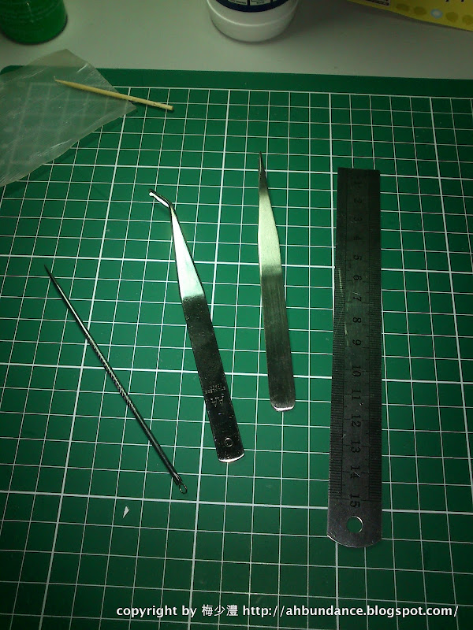
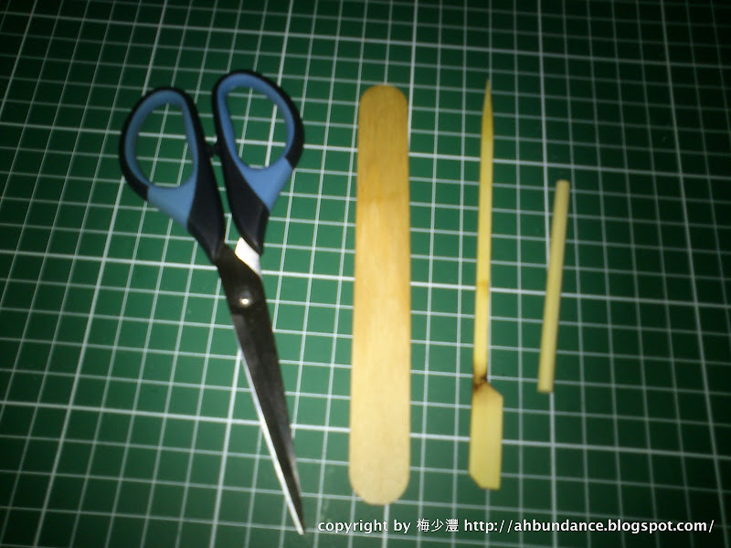
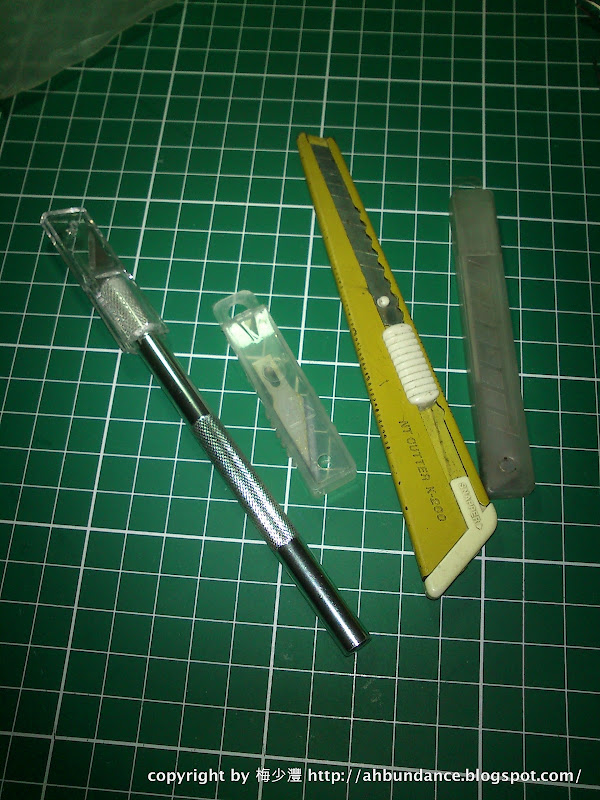
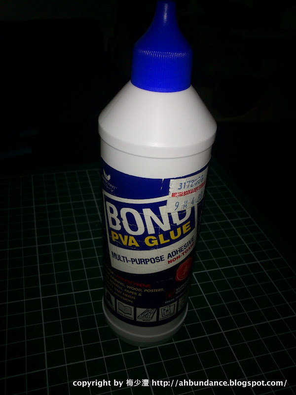
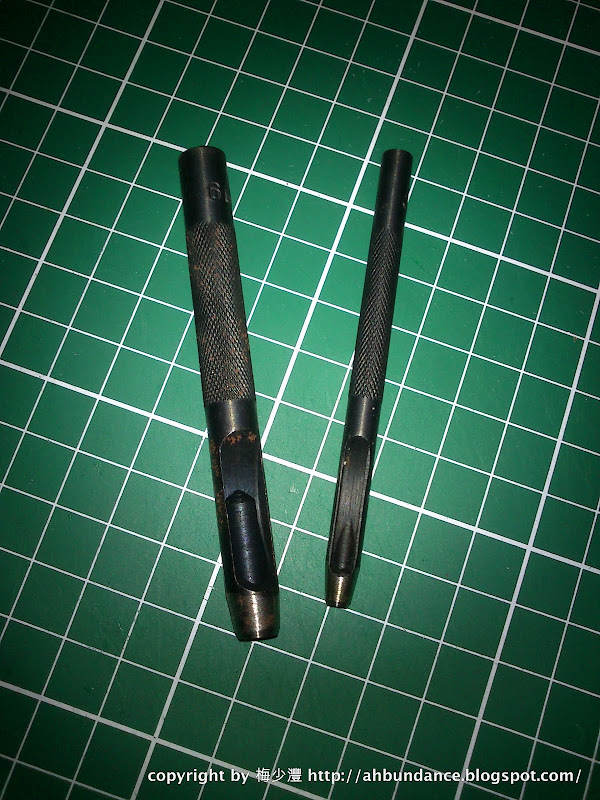
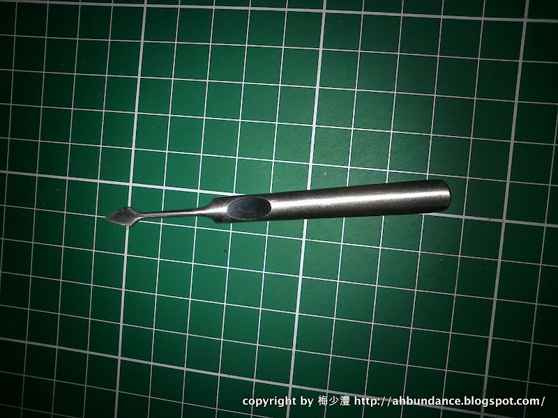

我用的纸模型制作工具~&nbsp;

6格笔筒~

 

纸模型主要的还是打印机咯

我选择的是canon ip2770

有2800dpi

我觉得够用了&nbsp;

有钱玩镭射的朋友别鄙视我啊

 

 

背景 切割板

左上角 牙签+塑料卡 主要用来放白胶

下面四钢 左到右 1.青春棒(代替画线笔,尖头自己磨圆)

2.弯嘴钳 3.直钳(太小的部分用来代替手指)

4.钢尺(画线 切割必备)

 

剪刀+ 各种小木块 木条我纯属觉得未来会用到就存着咯

 

笔刀+美工刀 以及预备的刀片 
笔刀在切割板的保护下 可以降低磨损 
 

白胶 干得比较慢 正好适合用来帖纸

那样可以慢慢移动位置

干后是透明的

 

打孔器 某一天在5元点看到的 买来存着

可能将来有用吧

 

磨刀石 不解释了

 

这个有时我会拿来代替牙签刮胶

无意中在五金店找到的

实际用途好像是拿来刮指甲的== 无所谓啦 能用就好

 

目前就只有这些~

以后看制作什么有用到才算吧

噢 对了 还有一卷磁铁 就不上传了。

 

 

