<b>前言：</b> 
说到出国... 
一般朋友都会露出羡慕的眼光吧，实际上我在北京打了个喷嚏就走了。。。 
 
2013年6月30日上午8：40am 
从 AirAsia飞机下来，走着一段直接被阳光亲吻的道路。 
阳光的热情让我汗流侠背。 
马来西亚...我回来了。 
回忆起这整个星期的辛酸，真够累人啊。 
 
<b>时光倒流：数月前</b> 
接到消息，我女朋友的哥哥结婚了， 
婚礼她不得不参与，我便说：“我们回去参加婚礼同时见见家长吧~” 
哎哟 机票怎么每隔一天反而越来越贵了呢... 
 
<b>时光流逝：出发当日</b> 
2013年6月21日下午6时 
我今天才知道 AirAsia 的飞机是从另外一个飞机场上飞机的... 
这个机场和国际机场不一样，与其说是平民机场不如说更像菜市场... 
 
不过还是挺有趣的可以从地面近距离观望接触飞机。 
（一般机场是直接从机场上过桥上飞机的） 
 

<a href="/assets/img/blog/de48a738f1b0.jpg" imageanchor="1" style="margin-left: 1em; margin-right: 1em;">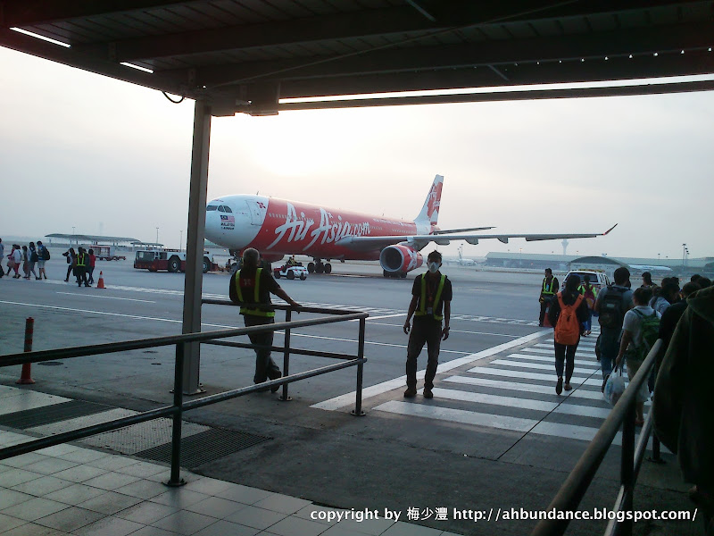</a>

 
 
6个小时的飞机，不舒服可是一件让人非常痛苦的事啊 
傍晚7时上飞机，预计到达时间 凌晨2时。 
 
<b>AirAsia 的飞机</b> 
印象中是第一次乘搭， 
机舱椅子是非常好的皮制作的，可惜椅背几乎是90度。 
长时间乘坐那个腰和颈项的痛苦更不是随便叫两声能表达得了 了...... 
 
坏事传千里，不久前不小心之前已经听过传闻了， 
AirAsia航空公司非常懂得开源节流，也是传说中开销最底的航空公司。 
不愧是几乎破产被收购改造的公司啊~ 
 
怕冷的朋友请自行带好寒衣或被子， 
怕腰痛的朋友请自行携带小枕头或代替品垫腰吧， 
当然，这只是我小小惜金的看法~ 
AirAsia还是有提供上述服务的，不同的是以出租收费的服务方式。 
8块以上出租被子，U型挂颈枕头要30块（我自己带的外面买RM3）!@%!%# 
 
如果有打算在AirAsia飞机上面吃飞机餐的话。 
还是建议预先在网络订购。 
飞机菜单上稍微让人想吃的基本上都要预定才有， 
不然选择的却就很少。 
一盒饭价格在RM15 400ml的矿泉水要RM4块。 
 
这次我两就这样花了RM38 吃的飞机场 
两份+两瓶水+杯面...  
会点杯面的原因是飞机场不合女朋友的胃口让我给吃完了， 
这个杯面菜单RM6，我们巧妙的让它变成免费了。 
（怎么变成免费我就不教坏大家了有兴趣的朋友可以试下问我~ ） 
其实杯面比较好吃...... 
 
纠结的习惯让我们在飞机上菜单发现了一个小小的错误， 
什么叫鸡肉肉狗？（热狗嘛） 

<a href="/assets/img/blog/850bc1615738.jpg" imageanchor="1" style="margin-left: 1em; margin-right: 1em;">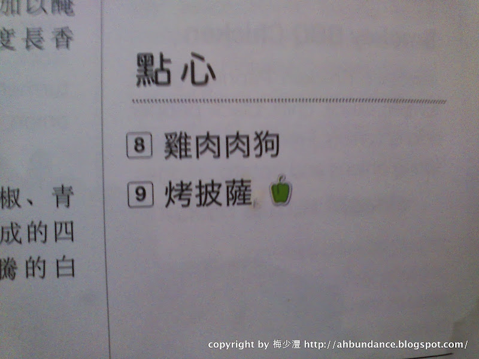</a>

 
 
<b>这只是态度问题：</b> 
第一次到达北京， 
...请问去火车站的客运车还有吗？ 
飞机场的??柜台：“最后一班12点 已经没了” 
... 
悲剧的离开走到外面，不服气的再问一个 
...请问去火车站的客运车还有吗？ 
客运站的柜台：...(用手指指了一下)上车。 
面无表情一副不耐烦的样子。 
 
我看了看 上面的牌子的却写着12点30分最后班车。 
还是别纠结为何还有了... 
 
 
虽然外面非常凉快， 
车这么一上，汗水就把我给侵湿了。 
 
没有窗，没开空调。车本身就是熄火的。 
马来西亚炎热让我习惯了一点，只要是室内空间都比外面凉快的。 
巴士（客运车）是不会不开冷气的... 
人在他乡，入乡随俗吧。 

 

 
<b>北京电车站</b> 
凌晨3点多了，站外人流比马来西亚KLCC公园最多人的时间还多人 
还有许多是在地上睡觉， 
他们不是乞丐，据说只是省钱的农民身边都有行李。 
这个时间1号售票厅已经关门了。 
2售票厅竟然在完全黑暗的小巷里， 
诡异的小巷子，让我纠结得很。 
要不是人人都往内走我也许不会考虑进去。 
 
即使入口在阴森的小巷里屋内也是非常宽阔的， 
同样一群人在排队，靠墙靠柱子的位置都有人睡觉。 
 
仔细看来，睡觉的人都非常安静，即使周围很多人说话吵闹 
睡觉的始终安静非常，动也不动。 
用睡死来形容也不为过。 
 
由于硬座软座软卧的票卖完了， 
买了软卧的车座。 
 
在中国北京的第一餐， 
加州牛肉面... 对 是美国加州。 
这个貌似快餐的面店是连锁店。 
虽说美国加州牛肉面，实际上这种面也就只有中国有了吧。 
虽然味道挺不错的，但主要原因还是材料味精太过于足够了。 
明白就好，也不纠结了。 
 
睡觉的人多了，看了也就习惯了。 
想来也是车都要等好久的时间， 
不过这位仁兄让我实在佩服， 
椅子都有把手的，他完全克服了中间的障碍， 
脚利用把手固定，身体弓睡避开中间的把手... 
更强的，椅子下面有3个已吃过的碗面，和<b>西瓜......</b> 

 
 
 
<b>所谓的软卧~</b> 
软卧顾名思义就是软的可以睡觉的床， 
6个小时要命的飞机，来到这里我终于可以好好睡第一觉了。 
遇上了一位热情的大哥 在车厢里聊了聊天， 
到这里我才明白，我听力没有想象中好。 
因为许多中国人说的中文我都听不懂啊... 

<a href="/assets/img/blog/03b992bdde74.jpg" imageanchor="1" style="margin-left: 1em; margin-right: 1em;">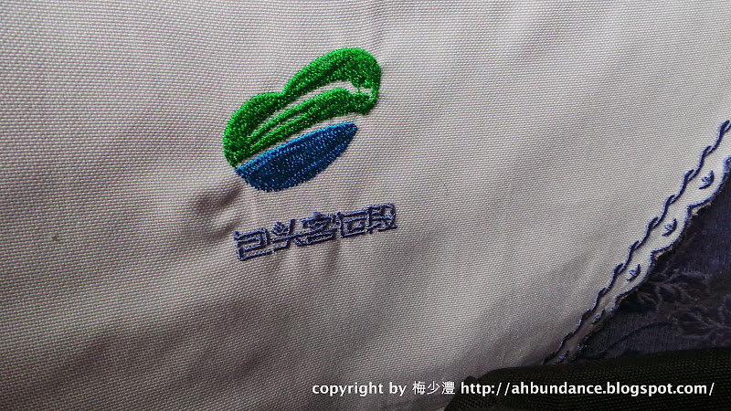</a>

图：这个包头客 让我想起了马来人...

 

<a href="/assets/img/blog/f1ee9f7f1fcb.jpg" imageanchor="1" style="clear: left; float: left; margin-bottom: 1em; margin-right: 1em;">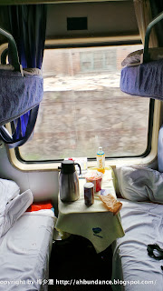</a><a href="/assets/img/blog/bd57339f20bc.jpg" imageanchor="1" style="margin-left: 1em; margin-right: 1em;">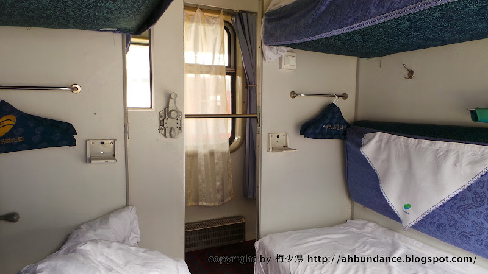</a>

 

 
<b>早起的太阳 ... 晒屁股~</b> 
这一趟软卧从<b>北京</b>车站到<b>沈阳&nbsp;</b>要花10个小时 
在火车上睡觉期间我发现了地球地理位置最大的差异点， 
太阳4点亮出头了，看着天亮还以为自己快到了， 
结果是一半都还没到。到达 
 
<b>沈阳 客运车站的转接</b> 
接下来的路程将不如前一段路可以躺着睡了， 
都是客运车（巴士）3小时的路途。 
等待下午3点车的时间， 
我们到附近食档吃了些道地小食。 
地三鲜，饭以及冷面。 
地三鲜是茄子、土豆、辣椒过油煎脆后焖的。味道十分香浓。 
实际上在旅行结束后我才发现全程没有一道菜让我比这道更喜欢了... 
也许是因为我内心素食主义的缘故吧。 
 

<a href="/assets/img/blog/3da6506a3421.jpg" imageanchor="1" style="margin-left: 1em; margin-right: 1em;">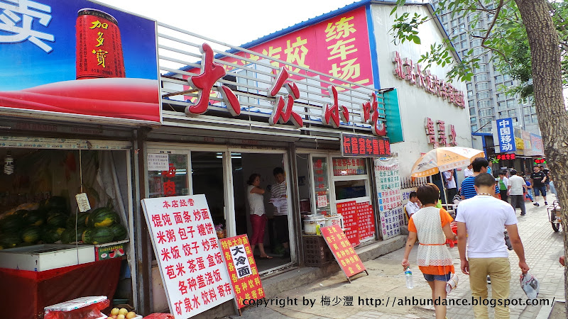</a>

 
 

<a href="/assets/img/blog/06d0c8078596.jpg" imageanchor="1" style="margin-left: 1em; margin-right: 1em;">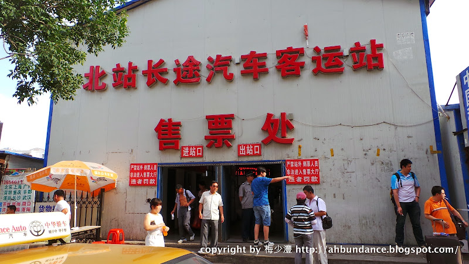</a>

图：沈阳客运车(巴士)站

 
 
<b>梅河口百信宾馆</b> 
事先有研究了一下地图，根据公里计算， 
我们差不多已经快绕东马一周了吧... 
吃了晕车药，勉强算是昏睡吧。 
我们的第一站地面休息地在已经到了， 
2天封闭的肠胃VS 浓厚中国气息的厕所, 
战斗总算是熬到胜利了, 
到宾馆第一件事当然是稀里哗啦 淅沥沥哗啦啦... 
 
恐怖事件发生了... 貌似还行的厕所...堵了== 
打了个电话去服务柜台，对方回复了一句 不关我事 就挂电话了... 
晕，可怜我的她厕所洁癖纠结了... 
晦气的事还是不多说了出去看看夜景吧。 
 
晚上出去吃饭 走走，风景还是挺不错的。 
月亮还特别亮呢~ 
 

<a href="/assets/img/blog/25acb12ad5c3.jpg" imageanchor="1" style="margin-left: 1em; margin-right: 1em;">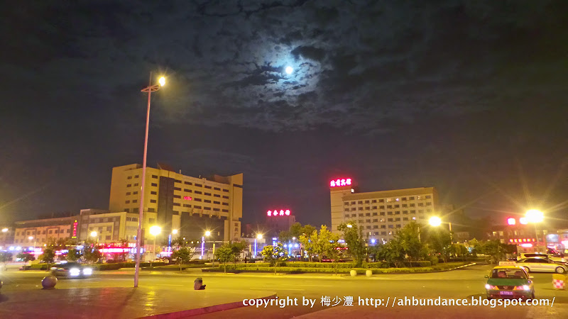</a>

图：梅河口宾馆旁夜景

<a href="/assets/img/blog/eaf7d3c6f2fc.jpg" imageanchor="1" style="margin-left: 1em; margin-right: 1em;">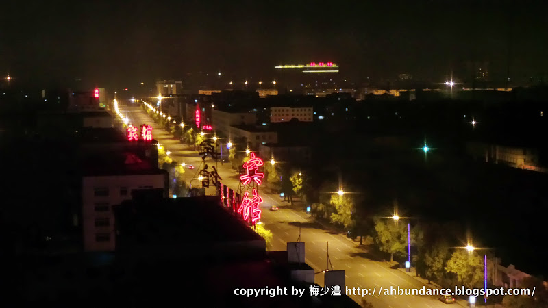</a>

图：梅河口窗外夜景

 

<b>6小时长途巴士 to 长白县朝鲜族自治区</b>

6小时是什么概念？

早上9点上班的朋友们 你们还有2个小时就下班了。

坐在办公室没事干的朋友们，

比起这一坐你们自由多了，至少可以上个厕所...

 

一路下来天空都飘着许多白点，

仔细看来竟然是蒲公英！

这些漫天漂浮的蒲公英是在是另外一番风味。

感觉下雪似的。

 

天气也非常好，温度介于19-20度之间，

凉风吹起让虽然疲惫的我心情却非常愉快。

 

<a href="/assets/img/blog/2fa27a6dcec5.jpg" imageanchor="1" style="margin-left: 1em; margin-right: 1em;">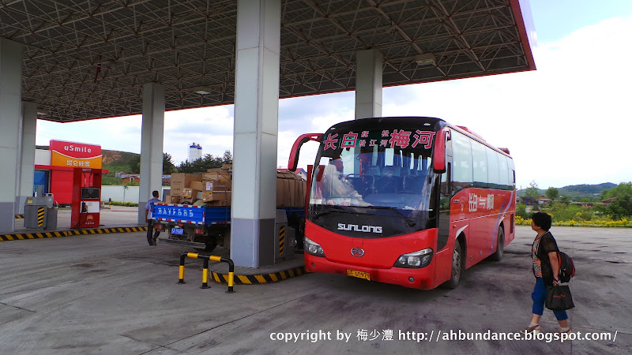</a>

图：梅河口》长白中途天油站

<a href="/assets/img/blog/3d832d1e9c66.jpg" imageanchor="1" style="margin-left: 1em; margin-right: 1em;">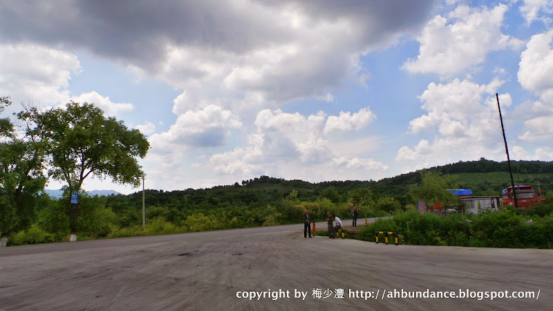</a>

图：天气非常好

 

晚上6点总算是到达了第一个主要目的地“长白县朝鲜族自治区”

 

<b>下一篇：<a href="http://ahbundance.blogspot.com/2013/07/blog-post_4.html">中国之旅②</a></b><b><u>靠近自然生活的长白县</u></b>

