上一篇 <a href="http://ahbundance.blogspot.com/2013/07/blog-post_4.html">中国之旅②靠近自然生活的长白县</a> 
 
哥哥的婚礼 
不要脸的暗爽~为何？ 
大家都叫我妹夫 哎哟 不好意思啦 &nbsp;=///= 
不过也就勉为其难认了吧~ 
 
这次千山涉水的过来， 
总算是主要目的兑现的时候了， 
如一开始所言，此次旅行是参加女朋友哥哥的婚礼， 
不知为何，此次婚礼安排在女方家乡。 
而男方亲戚就只有爸爸、妹妹、还有我这个预支的妹夫。 
 
婚前一晚~ 
大家都忙绿非常， 
包红包、包福袋（花生，瓜子，糖果，香烟(...?)）还有各种东西准备， 
我这个预支妹夫基本没什么能帮得上忙的地方， 
加上语言不通，在没我得事后，回房间就直接清肠胃睡觉了~ 
只道第二天7点就得出发， 
 
早起的太阳 早起的新郎 
凉凉的天气，早上接近6点 
显然长白的太阳比马来西亚的勤力多了， 
太阳日上三更其实只在上午6点不到。 
在这里早起真的比较容易啦！ 
门铃响了...要出发？ 
额 不是7点吗... 
中途语言不通到底是谁告错时间了我到最后也没搞清楚。 
秒速从半裸的睡梦中换上唯一一套稍微正式的衣服， 
出现在我们称之为洞房的地方， 
第一次全程参与婚礼，而且还是异国的， 
我的好奇也即将开估。 
 
6月28日上午6点30分，挤入洞房。 
新娘都还没接就闹新房了？ 
当然那是我的愚见,这是拍摄的计划而已， 
不过也相对于闹新房了吧。 
接下来一系列流程语言不通的我都是既不清楚也没办法当场搞明白的。 
唯有接受这些疑问去百度百科补给大家了， 
（预想知道请到页面下查阅） 
 
<b>超扯快速流程说明</b> 
<b>酒店中</b> 
当中爸爸坐床（原因未明） 
往鞋子塞钱（原因未明） 
父亲儿子对话（内容未明） 
妹妹未来妹夫对话（意义未明） 
走红地毯飞奔接新娘（地点不明） 
<b>娘家</b> 
车队播音乐 
接新娘，拍摄，背走 
（由于里面说话内容没人翻译， 
我自行观山赏花这里正所谓北山面北朝鲜...没错是北朝鲜回头再说这个） 
回婚礼厅。 
<b>酒店婚礼庁</b> 
司仪唱歌（歌词不明） 
各种歌舞（人物不明） 
 
我唱歌=。= 
生平不爱学唱歌 自己会唱什么歌都不知道， 
我说我当场唱马来西亚国歌而且还忘词你信吗？ 
 
亲戚跳舞 (朝鲜舞) 
轮流祝贺（内容不明） 
我的祝贺跳舞... 
 
入乡随俗，主持人竟然叫我们跳朝鲜舞， 
我哪懂啊...闷骚的我还真的有点参与不了 硬着头皮上了，其实男方家人都不懂... 
 
各种预言（吃面，抛盘子，据说是预测过后生男还是生女） 
省略若干内容...... 
 
<b>我的早餐啊T_T</b> 
将近12点，一个上午里似懂非懂的我只有一样事情是清晰的。 
咕噜咕噜咕噜咕噜咕噜咕噜咕噜... 
早上6点到10点都没吃东西... 
 
流程继续： 
跳完唱完红包拿完后， 
又上车了（方向不明） 
原来去了一个长白什么乡的旅游景点， 
一群人穿着朝鲜古装跳舞， 
新娘新郎也穿古装, 
挺新奇也挺热闹的， 
大家都在跳舞，由于我手脚实在不听使唤， 
唯有乖乖当个伪摄影师拍照逃难了&gt;.&lt; 
然后上花轿。 
结束后回到酒店。 
同一个位置已经从红地毯高台变成酒席之地。 
 
<b>酒席之差别</b> 
同样是九道菜 是否意味着长长久久呢？ 
与马来西亚一贯得酒席差别： 
中午1点开席， 
九道菜 同时上桌， 
内容：牛，蒸鱼，烤鸡，超赞的东坡肉，炒年糕，山野蔬菜，山楂+桃子甜品 和其它不知名的美食。 
另外中国的白米果然名不虚传， 
在任何地方吃的白米都比马来西亚的所谓香米好多了。 
相机没电了... 所以酒席的内容没拍下来。 
这次婚礼也就这么过去了。 
因为顶多了数桌 晚上我们还是吃同样的酒席。 
 
这是我们在长白的最后一天， 
第二天中午我们就得离开长白继续赶路了。 
 
<b>待续：<a href="http://ahbundance.blogspot.com/2013/07/blog-post_11.html">中国之旅④ 终极幸运之旅</a>...</b> 
<table align="center" cellpadding="0" cellspacing="0" class="tr-caption-container" style="margin-left: auto; margin-right: auto; text-align: center;"><tbody>
<tr><td style="text-align: center;"><a href="/assets/img/blog/4a7589cc6984.jpg" imageanchor="1" style="margin-left: auto; margin-right: auto; text-align: center;">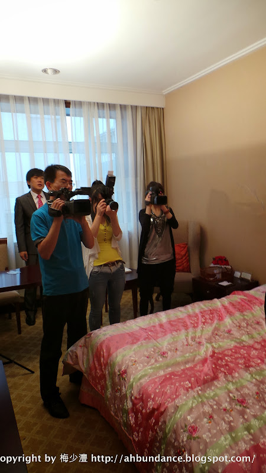</a></td></tr>
<tr><td class="tr-caption" style="text-align: center;">闹新房拍摄</td></tr>
</tbody></table>
<table align="center" cellpadding="0" cellspacing="0" class="tr-caption-container" style="margin-left: auto; margin-right: auto; text-align: center;"><tbody>
<tr><td style="text-align: center;"><a href="/assets/img/blog/0ea5a8a01881.jpg" imageanchor="1" style="margin-left: auto; margin-right: auto;">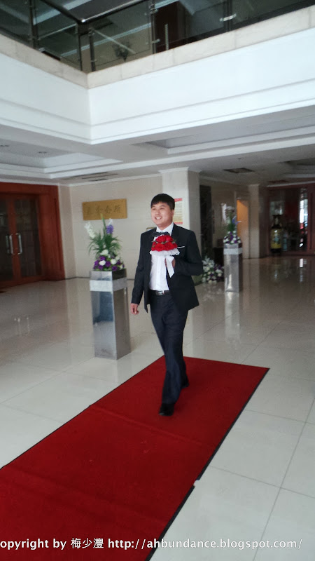</a></td></tr>
<tr><td class="tr-caption" style="text-align: center;">红地毯出去咯&nbsp;</td></tr>
</tbody></table>
<table align="center" cellpadding="0" cellspacing="0" class="tr-caption-container" style="margin-left: auto; margin-right: auto; text-align: center;"><tbody>
<tr><td style="text-align: center;"><a href="/assets/img/blog/473863867bc1.jpg" imageanchor="1" style="margin-left: auto; margin-right: auto;">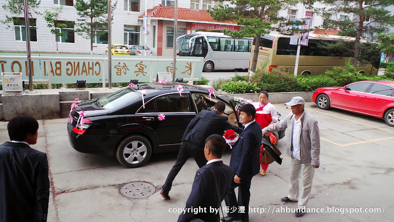</a></td></tr>
<tr><td class="tr-caption" style="text-align: center;">准备出发接新娘</td></tr>
</tbody></table>
<table align="center" cellpadding="0" cellspacing="0" class="tr-caption-container" style="margin-left: auto; margin-right: auto; text-align: center;"><tbody>
<tr><td style="text-align: center;"><a href="/assets/img/blog/206e4c32995a.jpg" imageanchor="1" style="margin-left: auto; margin-right: auto;">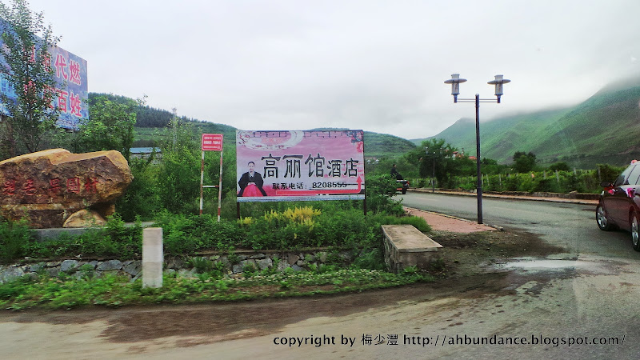</a></td></tr>
<tr><td class="tr-caption" style="text-align: center;">前往果园的方向</td></tr>
</tbody></table>
<table align="center" cellpadding="0" cellspacing="0" class="tr-caption-container" style="margin-left: auto; margin-right: auto; text-align: center;"><tbody>
<tr><td style="text-align: center;"><a href="/assets/img/blog/89a9866c2bc4.jpg" imageanchor="1" style="margin-left: auto; margin-right: auto;">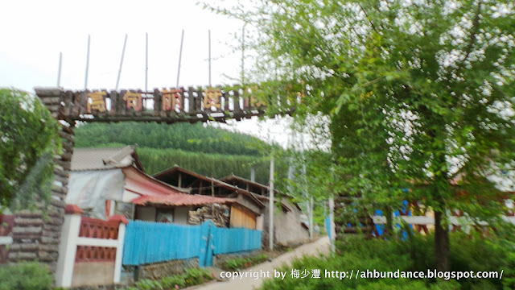</a></td></tr>
<tr><td class="tr-caption" style="text-align: center;">这个貌似称之为“果园”</td></tr>
</tbody></table>
 
<table align="center" cellpadding="0" cellspacing="0" class="tr-caption-container" style="margin-left: auto; margin-right: auto; text-align: center;"><tbody>
<tr><td><a href="/assets/img/blog/282dcd5e36dc.jpg" imageanchor="1" style="margin-left: auto; margin-right: auto;">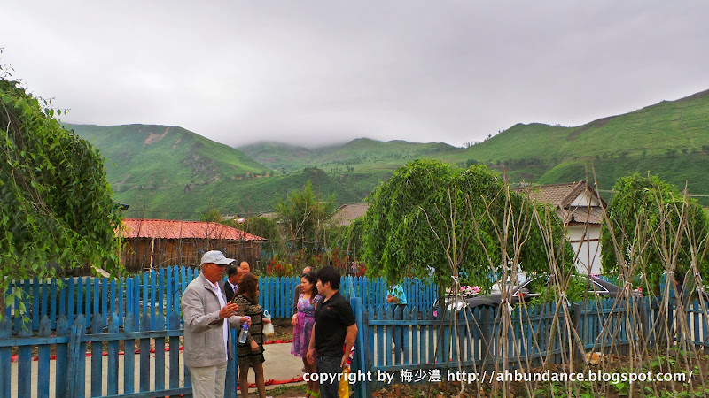</a></td></tr>
<tr><td class="tr-caption" style="font-size: 13px;">山间风水好啊！</td></tr>
</tbody></table>

<a href="/assets/img/blog/7afe13230ab8.jpg" imageanchor="1" style="margin-left: 1em; margin-right: 1em;">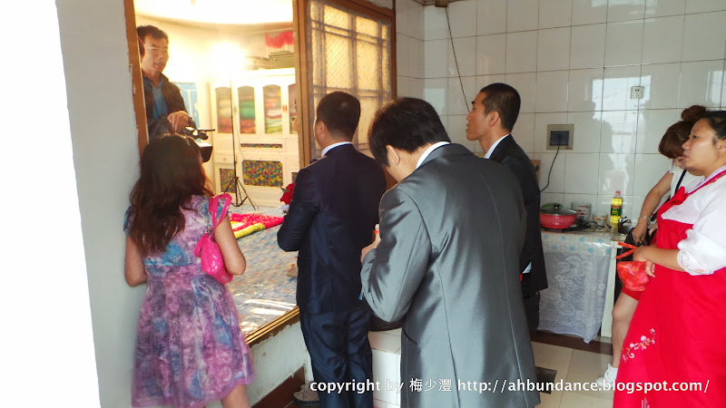</a>

 

<a href="/assets/img/blog/859f1551d9b7.jpg" imageanchor="1" style="margin-left: 1em; margin-right: 1em;">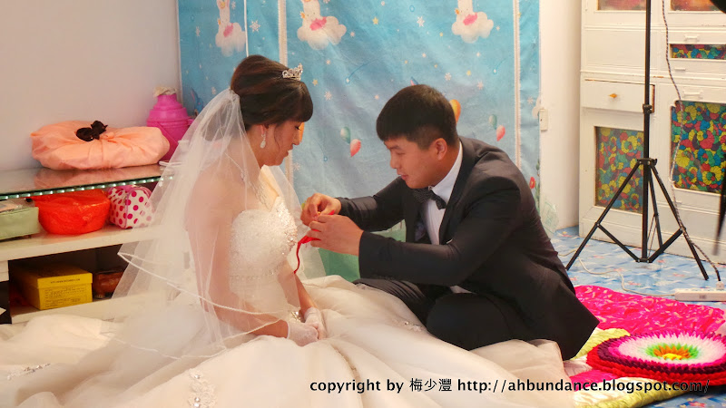</a>

<a href="/assets/img/blog/276a0d9b0bb1.jpg" imageanchor="1" style="margin-left: 1em; margin-right: 1em;">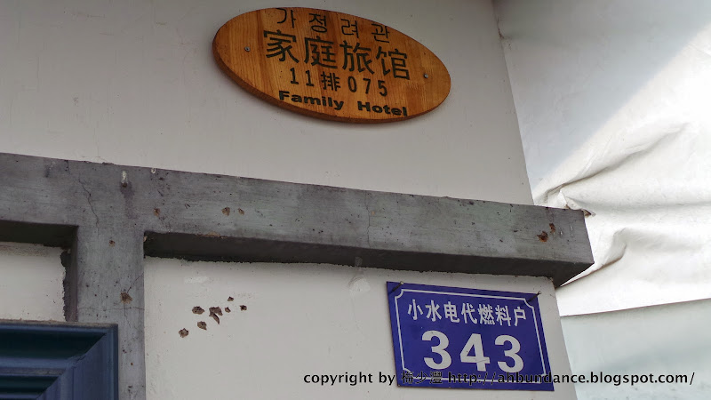</a>

<a href="/assets/img/blog/edeca7c32957.jpg" imageanchor="1" style="margin-left: 1em; margin-right: 1em;">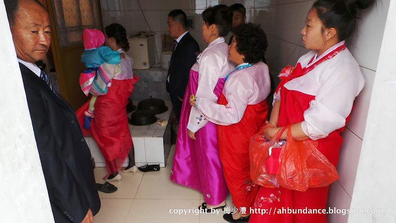</a>

<a href="/assets/img/blog/c7591b1a0a13.jpg" imageanchor="1" style="margin-left: 1em; margin-right: 1em;">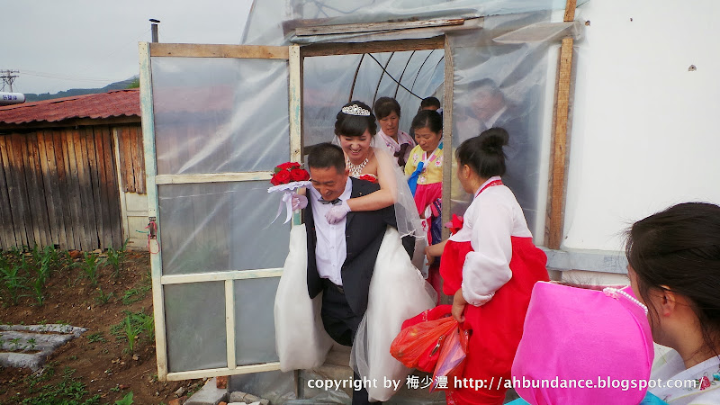</a>

<a href="/assets/img/blog/481cd2f001af.jpg" imageanchor="1" style="margin-left: 1em; margin-right: 1em;">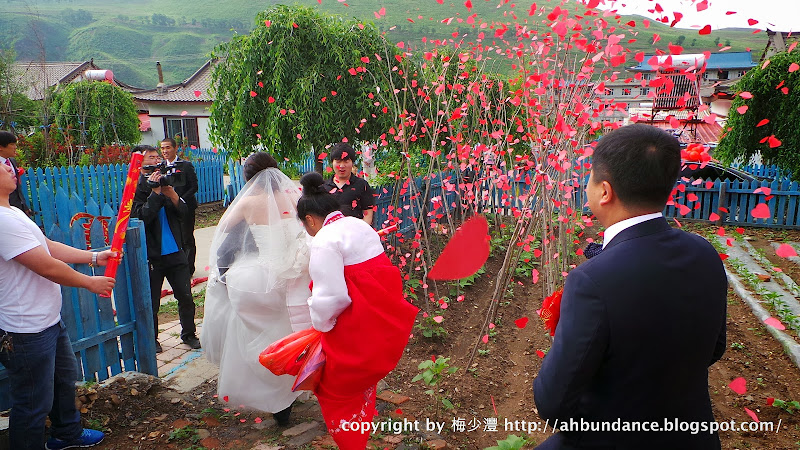</a>

 

<a href="/assets/img/blog/6e5349002ddd.jpg" imageanchor="1" style="margin-left: 1em; margin-right: 1em;">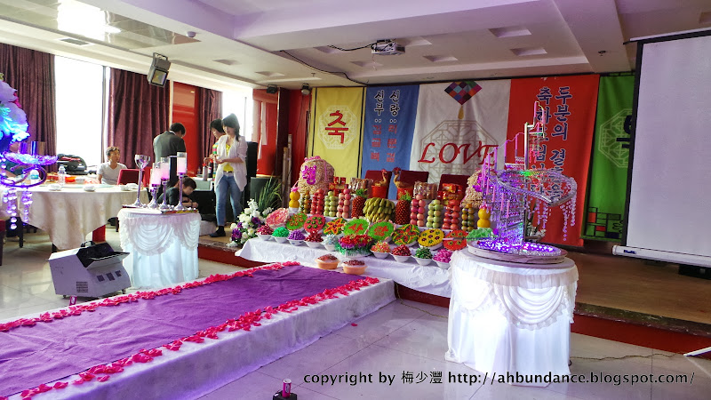</a>

 
<table align="center" cellpadding="0" cellspacing="0" class="tr-caption-container" style="margin-left: auto; margin-right: auto; text-align: center;"><tbody>
<tr><td style="text-align: center;"><a href="/assets/img/blog/51da6d9501dd.jpg" imageanchor="1" style="margin-left: auto; margin-right: auto;">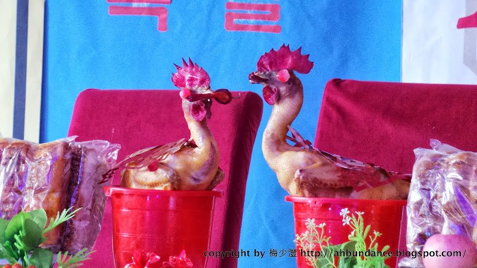</a></td></tr>
<tr><td class="tr-caption" style="text-align: center;">这个...其实对我来说有点恶心</td></tr>
</tbody></table>
<table align="center" cellpadding="0" cellspacing="0" class="tr-caption-container" style="margin-left: auto; margin-right: auto; text-align: center;"><tbody>
<tr><td style="text-align: center;"><a href="/assets/img/blog/e6f1098e6501.jpg" imageanchor="1" style="margin-left: auto; margin-right: auto;">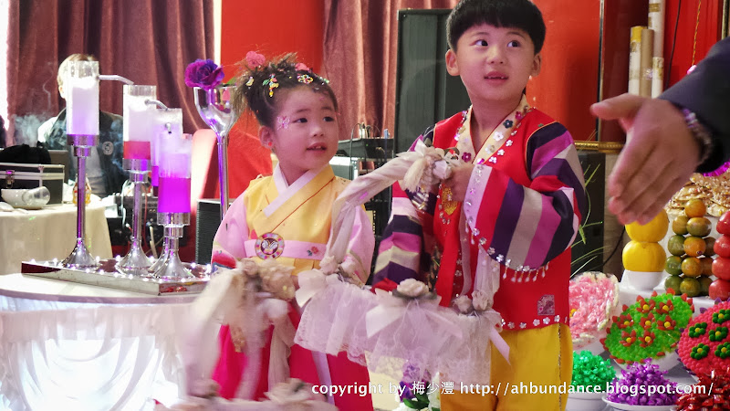</a></td></tr>
<tr><td class="tr-caption" style="text-align: center;">童男童女？</td></tr>
</tbody></table>
 
<table align="center" cellpadding="0" cellspacing="0" class="tr-caption-container" style="margin-left: auto; margin-right: auto; text-align: center;"><tbody>
<tr><td style="text-align: center;"><a href="/assets/img/blog/4d97180b1127.jpg" imageanchor="1" style="margin-left: auto; margin-right: auto;">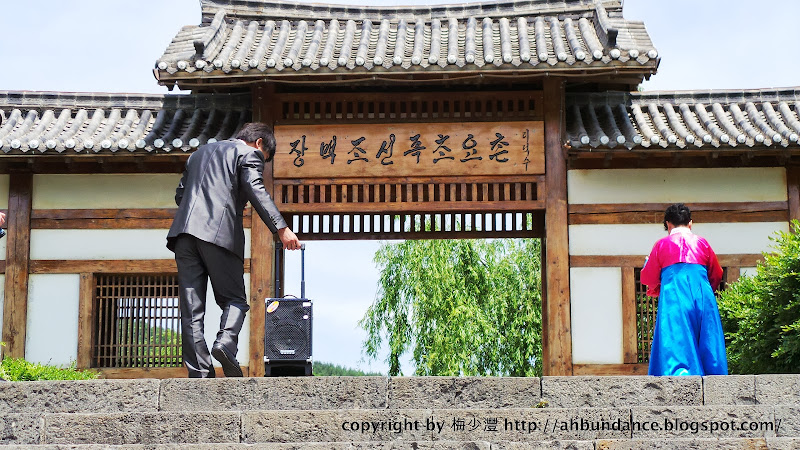</a></td></tr>
<tr><td class="tr-caption" style="text-align: center;">光鲜亮丽的主持人，随身便拖着个大喇叭，有趣！</td></tr>
</tbody></table>
 

<a href="/assets/img/blog/50b022435395.jpg" imageanchor="1" style="margin-left: 1em; margin-right: 1em;">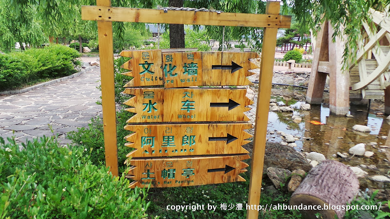</a>

<a href="/assets/img/blog/4cf6c0f7317a.jpg" imageanchor="1" style="margin-left: 1em; margin-right: 1em;">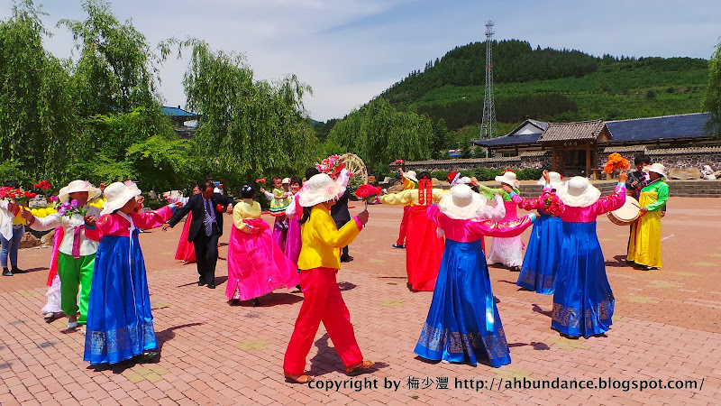</a>

<a href="/assets/img/blog/2b5bb898de20.jpg" imageanchor="1" style="margin-left: 1em; margin-right: 1em;">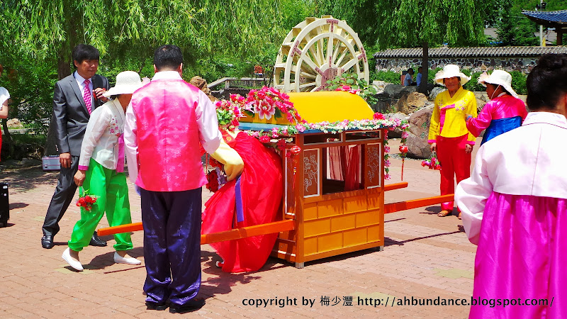</a>

<a href="/assets/img/blog/6b4919448ee4.jpg" imageanchor="1" style="margin-left: 1em; margin-right: 1em;">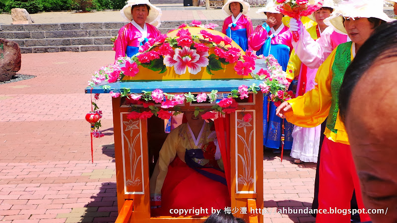</a><a href="/assets/img/blog/60cd23ca41c6.jpg" imageanchor="1" style="margin-left: 1em; margin-right: 1em;">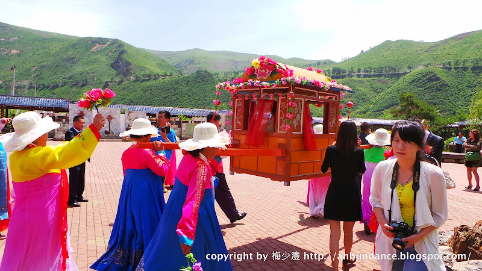</a>

<a href="/assets/img/blog/d3fbd71d3b8a.jpg" imageanchor="1" style="margin-left: 1em; margin-right: 1em; text-align: center;">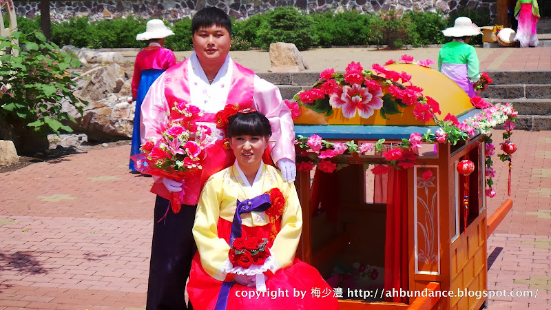</a> 
<a href="/assets/img/blog/237f25170d6c.jpg" imageanchor="1" style="margin-left: 1em; margin-right: 1em; text-align: center;">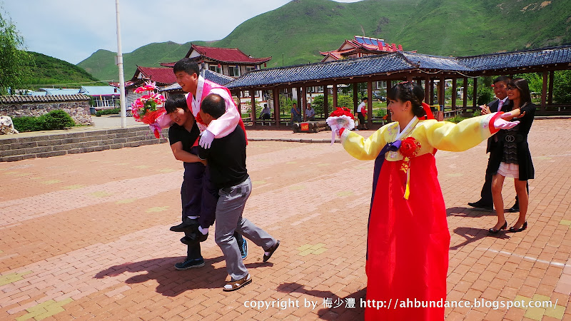</a> 

 

 

 

朝鲜族婚礼习俗（取自百度知道...） 
<pre accuse="aContent" class="recommend-text mb-10" id="recommend-content-1091278014" style="background-color: #f1fedd; color: #333333; font-family: arial, 'courier new', courier, 宋体, monospace; font-size: 14px; line-height: 24px; margin-bottom: 10px; padding: 0px; white-space: pre-wrap; word-wrap: break-word;">朝鲜族婚俗中，定婚前，一般也要经过提亲、请婚、定吉日、送聘礼等程序。

　　姑娘和小伙的接触传话，需要一个"媒人"。首先，男方家要让媒人到女方家"看善"，与汉族的"相亲"相似，如满意，小伙正式向姑娘求婚，女方若也同意，男方家就往女方送"四柱"。四柱就是在一张纸上写着姓名和星辰宿象（出生的年月日时）女方再拿姑娘的四柱与之对"穹合"。

　　所谓"穹合"，就是指男女的属相是否相顺而不相克。如二人生肖相合，女方就经媒人通知男方家，说两个人的"穹合"相对，男方可"择日"确定举行婚礼的日期并送彩礼到女方家，一般要有"青缎"、"红缎"等。 到了婚期，新郎须由长辈护送亲自去迎娶，按规定的时间进到女方家，把带来的一对木刻的大雁献上去，比喻今后要像大雁一样比翼双飞，永不分离。

　　随后举行"醮礼"，女方在正室中央按东西方向合放两张桌子，中间放青松翠竹，松竹上披青红线；桌两边放上木雁，摆上酒食，在主礼者引导下，西边的新郎向对面的新娘敬酒，新娘谢拜回敬。

　　接着，新郎入上房接受女方为他准备的"大桌"，上摆鱼肉、水果、糕饼、糖果之类食品，在接爱"大桌"时，新郎要正襟危坐，不苟言笑，并且说一些礼让双亲和宾客的话，以免失礼。这个程序之后，新郎才可骑马领轿娶回新娘。 六十年金婚温旧梦

　　朝鲜族还有一种特殊的婚礼，称为"归婚礼"，如果一对夫妻结婚六十周年依然健在，且子女中无人夭折，同时拥有孙子孙女，就可进行归婚礼。

　　婚礼上，两人必须穿上结婚时穿过的礼服，其隆重程度不亚於年青人，这天，子女、亲戚按辈份远近，年龄大小依次向老两口敬酒并跪拜以示祝福。随后，幸福的两位老人坐上一辆婚车，绕村一周，左邻右舍，男女老幼纷纷前来祝福，祝福他们健康长寿。
　　朝鲜族现有18万多人,约占吉林市人口总数的4.3%,朝鲜族是一个勤劳、智慧、乐观的民族,素以能歌善舞著称。朝鲜族是一个热情奔放的民族,喜载歌载舞,他们的农乐舞、龙鼓舞、婚礼舞、刀舞和槌衣舞倍受青睐。在大力弘扬传统民间文化的同时,我市的民族工艺品,如绘画、雕刻、草编、剪纸、刺乡等也具有鲜明的民族民间特色和浓厚的东北风格。

　　朝鲜族的婚礼习俗非常热闹
　　尊老习俗备受称道,有一日四餐的饮食习惯。还有一个独特的习俗“捣衣”劳动。每到中秋左右,妇女们都要拆洗被褥衣服,进行晒喷浆,待其半干后叠成长方形在砧上捶打,这就是“捣衣”。

　　永吉县兴光村朝鲜族民俗村,已被辟为旅游景点。主要旅游活动有：村民与游客共同歌舞联欢；到村民家中参观民族生活习俗；在具有民族特点的火炕上品尝朝鲜族风味餐。朝鲜族的米饭、米酒、打糕、冷面、小咸菜、山野菜、狗肉全席等风味饮食和充满热情的招待令游客留连忘返。

　　中国的朝鲜族有200余万人,主要居住在东北三省,其中吉林省占60%以上。朝鲜族有自己的语言文字,但语系未定。朝鲜族在我国各少数民族中,是物质生活比较好、问哈水平较高的民族。他们长期以垦荒为业,为开发培植我国高寒水稻,种植东北优质大米做出了贡献。朝鲜族的歌舞蛮声全国。朝鲜族人酷爱体育,讲究卫生,文明礼貌,特别是尊老爱幼的美德受到各族人民的好评。

　　服饰：像我们印象中的一样,朝鲜族的民族服饰极有特色。年轻女子往往穿着质地华贵、色彩艳丽的长衣裙,中年女子也一样身着漂亮的长筒裙,只是颜色以素色为主；男子则喜穿短上衣,外加坎肩,裤腿宽大,外出多穿长袍。儿童也着长裙,并在衣裙的袖口处配上七彩缎,色彩明亮。

　　民俗：朝鲜族的房子都以木搭架、屋顶四面坡用谷草或稻草、瓦片覆盖,墙壁多为泥墙刷白灰。现在砖瓦结构的住宅日益增多。

　　朝鲜族婚礼仪式隆重,分别在女方和男方家两次举行。朝鲜族家庭“男主外,女主内”风俗盛行,父子关系是一切人伦关系的基础,讲究父慈子孝,长子赡养父母。

　　朝鲜族有独特的家庭节日,如回甲节（六十周岁生日）、回婚节（结婚六十周年纪念日）。</pre>
 