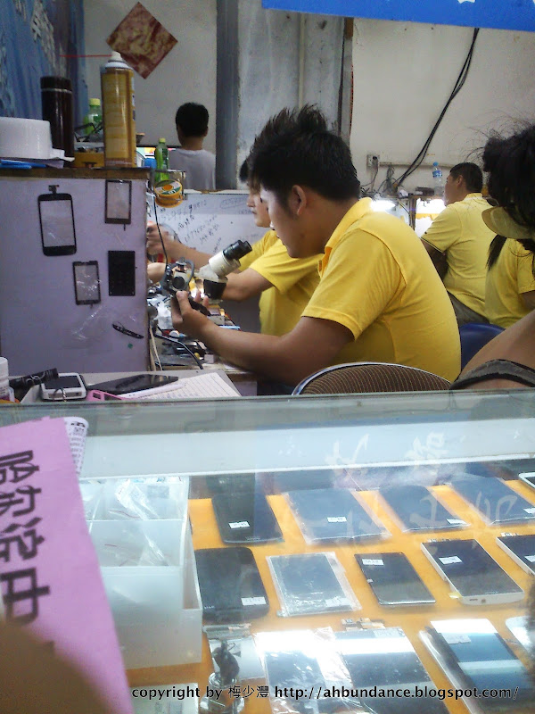
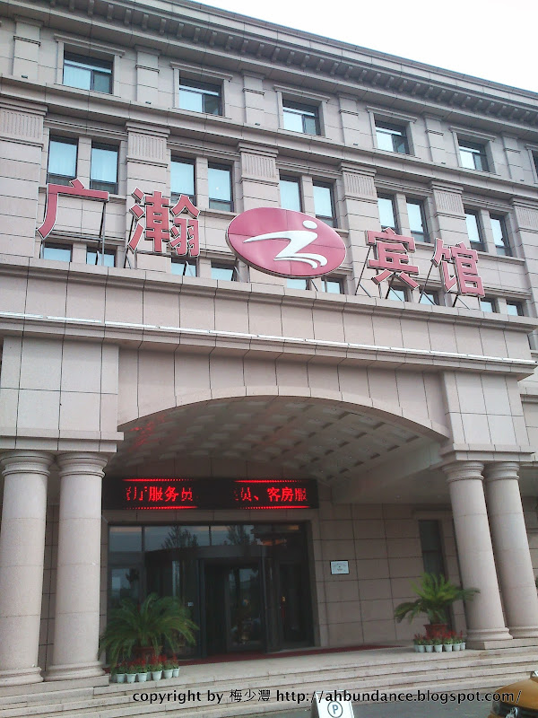
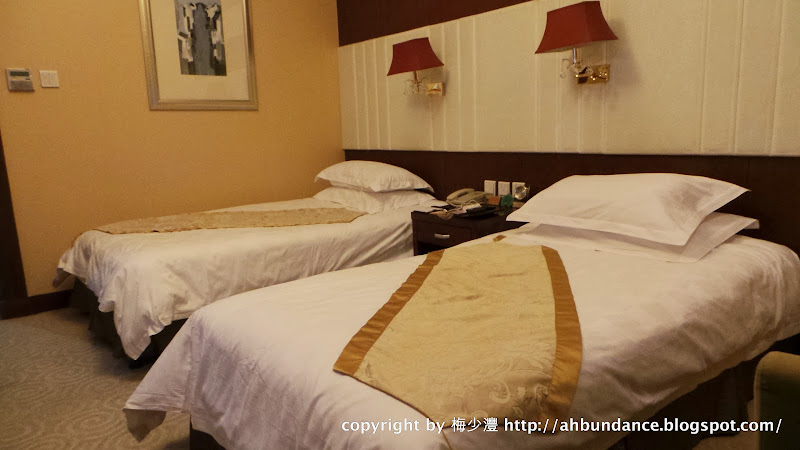
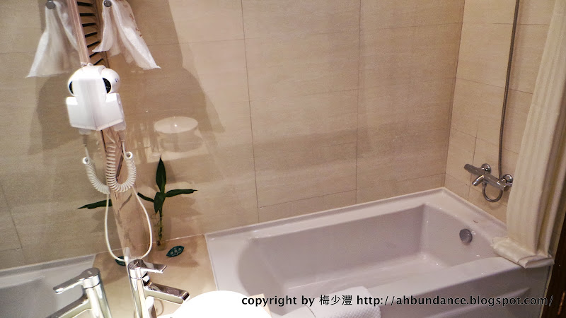
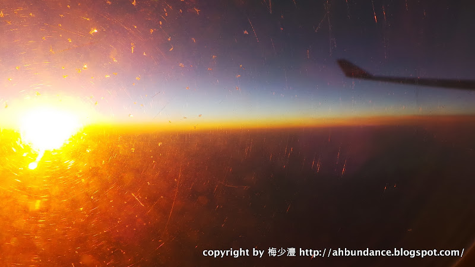

上一篇：<a href="http://ahbundance.blogspot.com/2013/07/blog-post_7.html">中国之旅③长白朝鲜族的婚礼</a>

 

<b>三顾毛驴哈尔滨手机之旅</b> 
从长白回到哈尔滨转眼又是11个小时的巴士。 
颈快断了，腰也快散架了人生这虽然不算是最痛苦的， 
但作为一个马来西亚人来说，这轮番赶路还真不是一般能承受的。 
下车后的经历不得不狠狠地批判一下中国的德士, 
个人大意把手机掉在车上也就自认倒霉了， 
但是一说地方名都摇头不载这个才吐血， 
中国果然是人多你这个不顺路走一个街口客户多着呢... 
 
在女朋友的姐夫家过了一晚， 
这一晚我默默的为我们的手机哀悼... 
我可怜的女孩又是纠结了好长的时间啊... 
 
因为手机不见了，一早带去已经坏了的手机更加是我们的希望了。 
老早听说中国修手机便宜， 
这就到哈尔滨客运车站附近的一家电子城买希望去了。 
 
手机坏的是电板，多半是之前摔过 加上刷机电压出问题。 
母板就这样报销了... 
马来西亚 HTC 服务柜台说要修800块马币， 
而且还得预先给200马币检查费 我老早就失去希望了. 
到了这里，问了好几家都说没零件不修。 
好不容易 也不知道第几家了 一拿机子就把我们家的HTC扒光... 
这一番扒光不一般啊，电板上的电路板都一块一块的测电检查， 
手术灯亮了2小时多只见小H不但被扒光而且还挑逗的将内脏一块一块的拆出贴回， 
奇迹出现了...几个月连灯都不亮的手机出现了开机画面... 
此为[<b>一顾</b>]. 
 
兴高采烈的去乘搭客运车到我们下一个目的地“大庆” 
这个6小时来回是必经之路，因为这是主要目的之一拜见未来岳母大人！ 
（当然是我一厢情愿那么想而已啦） 
 
 
<table align="center" cellpadding="0" cellspacing="0" class="tr-caption-container" style="margin-left: auto; margin-right: auto; text-align: center;"><tbody>
<tr><td style="text-align: center;"></td></tr>
<tr><td class="tr-caption" style="text-align: center;">如果没有发生后来的事情，此刺猬头大哥必让我五体投地的尊重...</td></tr>
</tbody></table>
二度悲剧， 
这个中国到处都有喊去哪里的票 那里的车， 
我们这里就有一个教训，同样价格其实可以坐到更好的， 
却被相貌可亲的阿姨给拖去了。。。 
这一趟车，司机连冷气都不开， 
惹得一车人怒喊才得以降温。 
 
吃了一口晦气， 
我迫不及待地想测试手机功能到底， 
却很失望的发现声音并没有声音， 
因此女朋友也把我给骂了一番，我怎么就没当场测试清楚呢... 
 
这个见岳母过程基本没什么特别， 
就大家语言不通只是沟通了几句， 
幸运的是一路来见到的人都是非常友善亲切的， 
晚上去超市替伯母家备增添了一些粮食， 
冒着雨闷着客运车都不愿意载的气走路回家。 
 
由于还得赶已经预订好的飞机， 
所以第二天一早就离开了大庆， 
当晚，我放置了电话卡入手机内却实在没有收线， 
我知道手机天线也没有反应了... 
 
回到哈尔滨马上就回到修手机的地方， 
遗憾的刺猬头大哥竟然说要下班， 
也就不过下午3点... 
此乃【二顾】 
 
基本已经放弃的我， 
在女朋友的强烈坚持力下， 
找到了另外一个能将手机扒光挑逗的师父 
这一查又是一个小时， 
可是结果是悲剧的， 
说确认是天线发射零件坏了，可是现在没有零件... 
终究<b>三顾手机店，无果而回</b> 
 
花了360人民币得到了一台HTC版本的IPOD, 
无从泄愤啊... 
唯有一到有wifi之地拼死下载游戏玩算了。 
虽然心里是这么打算的， 
但中国wifi 没有当地手机号根本无法登入，Wifi难寻啊!! 
 
<b>天灾付出的代价</b> 
到了晚上还因为错过了去机场的巴士, 
花了一百五人民币去机场。 
 
雷雨对你影响有多大？ 
一般情况你没感觉吧，我也没有。 
可是对于飞机...这可是大事。 

 

我们因此从晚上9点等到将近凌晨2点，

因为没带足够的换洗衣物，

在大庆的1日我们都是臭着过的。

这种时候自觉身体难受只想在香浴中度过了。

原定计划我们应该已经到达北京我们便宜网络订购的酒店房间里了，

却因为雷雨北京飞机停飞而遭受到延误了，

不幸中的大型，

HLJA航空公司贴心将我们这群“难民”安排到一家不错的酒店中，

疲惫不堪的身体，到酒店也没力气与众人挣房间了。

也就听天由命去安排吧，

我们拿到了508，五楼是最高的房间了，有浴缸。

据说越高的越好 到酒店直接就泡浴缸了舒坦一下心情，

 

中途还有人敲门送晚餐，一罐粥饼干和果汁。

这个时候什么管不着了，睡了。

这一觉算睡得最香了。

 

<a href="/assets/img/blog/f2ded309fe9b.jpg" imageanchor="1" style="clear: left; float: left; margin-bottom: 1em; margin-right: 1em;"> </a>

&nbsp;被安排的酒店

 

<b>第二天</b>

我得到了充满歉意的早餐，

像酒席般的套餐，

也结识到一名西北野大学工的总经理(不是叫做院长让我挺纠结的)

 

一路下来虽然赚了个不错的酒店，

却损失了我在中国唯一一天真正旅游的时间。

一直到下午4点才起飞，我损失了去紫荆城参关的机会，

换来的是差不多可以写机场一日游的心得了。

 

可悲的是机场并没有什么好介绍的，

东西除了贵也就没什么特别了，

大部分餐厅都有限制每个人最低消费，

机场网吧也是，68人民币一个人，11点结算，

机场看包的一回就是80 跟大小计算，

休息酒店一个小时就得120...

 

最终我们在机场底层的快餐“吉野家”，

讨论研究把玩着我购买的小书之一【九型人格】

把108道题都一一做了，就这样

我们度过了最后在北京的时间，

两点我们上了回马来西亚的亚航飞机。

 

在飞机上看日出成了我这一趟旅程最欢乐的惊喜。

 

我们是两人去，这也是唯一让我们安慰的地方，

遇到种种让我深信如果我不在，

我的她可不知道发疯抓狂多少回了。

我们互相陪伴、互相协调、互相安慰、互相依靠，

结束了这次中国之旅。

 

完结

 

下期：番外篇：中国之旅⊙杂记

 

 

 
 