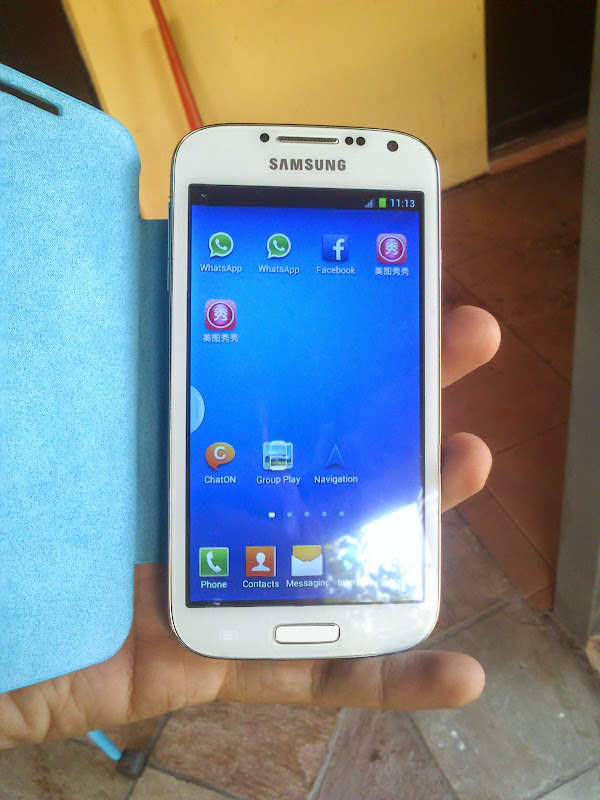

<b>什么叫做韩国产的CLONE 手机？</b> 
传闻说这是韩国制作的高仿手机，据说高配置版本有99%复制。 
这是不是真的呢？ 
 
今天我为了满足自己的好奇 为自我牺牲入手了一台。 
给大家真实的答案。 
 
 
 
目录： 
好奇1：网络售卖的翻版（CLONE 99%）传闻是韩国产，这到底是不是真的？ 
好奇2：高清OLED屏幕到底有多高清？ 
好奇3：99%配置是否真实？ 
好奇4：电容量如何？ 
好奇5：用软件\玩游戏可以吗？ 
结论：它的价值。 
 
<b>好奇1：网络售卖的翻版（CLONE 99%）商人说是韩国产，这到底是不是真的？</b> 
DO YOU REALLY BELIEVE THIS SHIT？ 
韩国是自尊心超强的国家，让他们去出山寨．．．算了吧 
当然不是因为这么主观的原因让我说不是韩国产的。 
机子上的内容（全部写made in Korea） 
可是有一个地方非常神奇的 出现了联通电信...... 
这个大家知道什么情况了吧。 
别CLONE了这只是高品质山寨而已..... 
 
图片： 

 
<b>好奇2：高清OLED屏幕到底有多高清？</b> 
这一点我倒承认 的却很清晰 确实是OLED，其实OLED成本比旧款LED便宜 
而且更省电，山寨会用上也不出奇 
高清程度可比拟真的机器 
可是偷鸡了0.2寸，用山寨的别自作聪明用有屏幕显示的smart cover， 
那只会让你的山寨漏洞百出。 
 
<b>好奇3：99%配置是否真实？</b> 
打开设置内看配置，哇塞！真的一模一样呐！ 
慢着怎么怪怪的，显示比例怎么怪怪的。 
储存 10GB 下载一堆软件后 下面图表显示占用比例50% 可是是500MB/10GB 
RAM 2GM 显示比例90% 可是文字是 400MB/2GB 
 
好了，说到这里大家明白了吧 
所有内容是可以改变的，软件是开源 你有功底的话爱改多少都行。 
只是改图比例可能比较麻烦 被省略掉了吧。 
RAM有512 
容量只有1GB 
 
也许真的有高配版本哦，你愿意去尝试吗？ 
 
<b>好奇4：电容量如何？</b> 
正版的一样的容量 2800左右，用起来 那么大的屏幕 可以连续玩着用6个小时 
待机还是能待上大半天的。 
还算ok。 
 
<b>好奇5：</b>&nbsp;<b>用软件、玩游戏可以吗？</b> 
当然可以毕竟还是安卓 随便去market下载就可以了， 
切水果，temple run，上上网 看看youtube 都没问题。 
只要不同时开几个 基本不会卡。 
但是要注意高热问题... 
 
<b>结论：它的价值。</b> 
RM500-800块左右据说有不同配置，我测试的是便宜的一台。 
但是你不需要去lowyat找 因为整个lowyat 都不懂这个东西， 
只有特定的供应商在网络上销售。 
一部512ram 其它功能都还ok并且高清大屏幕的手机 
RM500 这个价位其实个人觉得是合理的。 
 
<b>适合什么人呢？</b> 
对喜欢名牌又没有钱的朋友， 
因为模仿确实很像，不很小心的查看根本看不出来。 
 
对于没什么要求又只是想拿来玩游戏的朋友， 
加一个外置充电器已经是不错的选择了。 
 
对八卦的朋友..(我) 
我女朋友老骂我，总是对什么东西都好奇要搞清楚的笨蛋 
 
实际上我研究后就厌倦了 
转手卖给一位没有什么要求只是想玩游戏的马来朋友。 
他可是喜欢得很，并且非常高兴。 
让我更加坚信这个东西是有它存在的价值的。 
只是...他是不是适合你我来说而已。 
（俺注重实用型 用着超实用3防手机 SONY ACTIVE） 
 
免责申明 
以上纯属个人言论。不针对任何人、事、物。 
实际情况还请各位有兴趣研究者自行研究并给与评价。 
真实与否请各位自行判断。感谢。 
 
转发请注明我的博客 
麵包仙人居 
<a href="http://ahbundance.blogspot.com/">http://ahbundance.blogspot.com/</a>