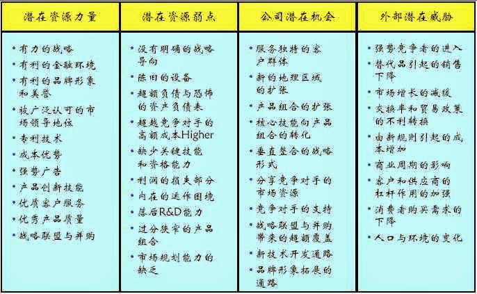
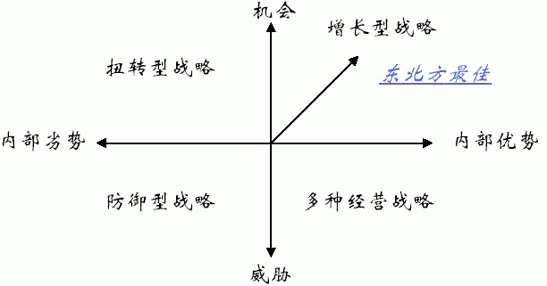
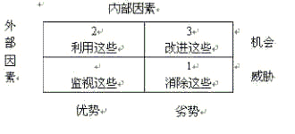

<h1 class="firstHeading" style="background-color: white; border-bottom-color: rgb(213, 213, 213); border-bottom-style: solid; border-bottom-width: 1px; color: #1860ac; font-family: sans-serif; font-size: 1.6em; line-height: 1.4em; margin: 0px 0px 0.25em; unicode-bidi: embed;">
SWOT分析模型</h1>

SWOT分析模型（SWOT Analysis）

　　SWOT分析法（也称TOWS分析法、道斯矩阵）即态势分析法，20世纪80年代初由<a href="http://wiki.mbalib.com/wiki/%E7%BE%8E%E5%9B%BD%E6%97%A7%E9%87%91%E5%B1%B1%E5%A4%A7%E5%AD%A6" style="color: #173abd; margin: 0px; text-decoration: none;" title="美国旧金山大学">美国旧金山大学</a>的<a href="http://wiki.mbalib.com/wiki/%E7%AE%A1%E7%90%86%E5%AD%A6" style="color: #173abd; margin: 0px; text-decoration: none;" title="管理学">管理学</a>教授<a href="http://wiki.mbalib.com/wiki/%E9%9F%A6%E9%87%8C%E5%85%8B" style="color: #173abd; margin: 0px; text-decoration: none;" title="韦里克">韦里克</a>提出，经常被用于企业<a href="http://wiki.mbalib.com/wiki/%E6%88%98%E7%95%A5%E5%88%B6%E5%AE%9A" style="color: #173abd; margin: 0px; text-decoration: none;" title="战略制定">战略制定</a>、<a href="http://wiki.mbalib.com/wiki/%E7%AB%9E%E4%BA%89%E5%AF%B9%E6%89%8B%E5%88%86%E6%9E%90" style="color: #173abd; margin: 0px; text-decoration: none;" title="竞争对手分析">竞争对手分析</a>等场合。

 
<h2 style="border-bottom-color: rgb(206, 195, 156); border-bottom-style: solid; border-bottom-width: 1px; font-size: 1.4em; line-height: 1.4em; margin: 1.5em 0px 0.25em; padding-bottom: 0.2em; unicode-bidi: embed;">
SWOT分析模型简介</h2>

　　在现在的<a href="http://wiki.mbalib.com/wiki/%E6%88%98%E7%95%A5%E8%A7%84%E5%88%92" style="color: #173abd; margin: 0px; text-decoration: none;" title="战略规划">战略规划</a>报告里，SWOT分析应该算是一个众所周知的工具。来自于<a href="http://wiki.mbalib.com/wiki/%E9%BA%A6%E8%82%AF%E9%94%A1%E5%92%A8%E8%AF%A2%E5%85%AC%E5%8F%B8" style="color: #173abd; margin: 0px; text-decoration: none;" title="麦肯锡咨询公司">麦肯锡咨询公司</a>的SWOT分析，包括分析企业的优势（Strengths）、劣势（Weaknesses）、机会（Opportunities）和威胁（Threats）。因此，SWOT分析实际上是将对企业内外部条件各方面内容进行综合和概括，进而分析组织的优劣势、面临的机会和威胁的一种方法。

　　通过SWOT分析，可以帮助企业把资源和行动聚集在自己的强项和有最多机会的地方；并让企业的战略变得明朗。

<h2 style="border-bottom-color: rgb(206, 195, 156); border-bottom-style: solid; border-bottom-width: 1px; font-size: 1.4em; line-height: 1.4em; margin: 1.5em 0px 0.25em; padding-bottom: 0.2em; unicode-bidi: embed;">
SWOT模型含义介绍</h2>

　　优劣势分析主要是着眼于企业自身的实力及其与<a href="http://wiki.mbalib.com/wiki/%E7%AB%9E%E4%BA%89%E5%AF%B9%E6%89%8B" style="color: #173abd; margin: 0px; text-decoration: none;" title="竞争对手">竞争对手</a>的比较，而机会和威胁分析将注意力放在外部环境的变化及对企业的可能影响上 。在分析时，应把所有的内部因素（即优劣势）集中在一起，然后用外部的力量来对这些因素进行评估。

1、 机会与威胁分析（environmental opportunities and threats）

　　随着经济、科技等诸多方面的迅速发展，特别是世界<a href="http://wiki.mbalib.com/wiki/%E7%BB%8F%E6%B5%8E%E5%85%A8%E7%90%83%E5%8C%96" style="color: #173abd; margin: 0px; text-decoration: none;" title="经济全球化">经济全球化</a>、一体化过程的加快，全球信息网络的建立和<a href="http://wiki.mbalib.com/wiki/%E6%B6%88%E8%B4%B9%E9%9C%80%E6%B1%82" style="color: #173abd; margin: 0px; text-decoration: none;" title="消费需求">消费需求</a>的多样化，企业所处的环境更为开放和动荡。这种变化几乎对所有企业都产生了深刻的影响。正因为如此，环境分析成为一种日益重要的企业职能。

　　环境发展趋势分为两大类：一类表示<a href="http://wiki.mbalib.com/wiki/%E7%8E%AF%E5%A2%83%E5%A8%81%E8%83%81" style="color: #173abd; margin: 0px; text-decoration: none;" title="环境威胁">环境威胁</a>，另一类表示<a href="http://wiki.mbalib.com/wiki/%E7%8E%AF%E5%A2%83%E6%9C%BA%E4%BC%9A" style="color: #173abd; margin: 0px; text-decoration: none;" title="环境机会">环境机会</a>。环境威胁指的是环境中一种不利的发展趋势所形成的挑战，如果不采取果断的战略行为，这种不利趋势将导致公司的<a href="http://wiki.mbalib.com/wiki/%E7%AB%9E%E4%BA%89%E5%9C%B0%E4%BD%8D" style="color: #173abd; margin: 0px; text-decoration: none;" title="竞争地位">竞争地位</a>受到削弱。环境机会就是对<a href="http://wiki.mbalib.com/wiki/%E5%85%AC%E5%8F%B8%E8%A1%8C%E4%B8%BA" style="color: #173abd; margin: 0px; text-decoration: none;" title="公司行为">公司行为</a>富有吸引力的领域，在这一领域中，该公司将拥有<a href="http://wiki.mbalib.com/wiki/%E7%AB%9E%E4%BA%89%E4%BC%98%E5%8A%BF" style="color: #173abd; margin: 0px; text-decoration: none;" title="竞争优势">竞争优势</a>。

　　对环境的分析也可以有不同的角度。比如，一种简明扼要的方法就是<a href="http://wiki.mbalib.com/wiki/PEST%E5%88%86%E6%9E%90%E6%A8%A1%E5%9E%8B" style="color: #173abd; margin: 0px; text-decoration: none;" title="PEST分析模型">PEST分析</a>，另外一种比较常见的方法就是<a href="http://wiki.mbalib.com/wiki/%E6%B3%A2%E7%89%B9%E4%BA%94%E5%8A%9B%E5%88%86%E6%9E%90%E6%A8%A1%E5%9E%8B" style="color: #173abd; margin: 0px; text-decoration: none;" title="波特五力分析模型">波特的五力分析</a>。

2、 优势与劣势分析（Strengths and Weaknesses）

　　识别环境中有吸引力的机会是一回事，拥有在机会中成功所必需的<a href="http://wiki.mbalib.com/wiki/%E7%AB%9E%E4%BA%89%E8%83%BD%E5%8A%9B" style="color: #173abd; margin: 0px; text-decoration: none;" title="竞争能力">竞争能力</a>是另一回事。每个企业都要定期检查自己的优势与劣势，这可通过“企业经营管理检核表”的方式进行。企业或企业外的咨询机构都可利用这一格式检查企业的<a href="http://wiki.mbalib.com/wiki/%E8%90%A5%E9%94%80" style="color: #173abd; margin: 0px; text-decoration: none;" title="营销">营销</a>、<a href="http://wiki.mbalib.com/wiki/%E8%B4%A2%E5%8A%A1" style="color: #173abd; margin: 0px; text-decoration: none;" title="财务">财务</a>、制造和<a href="http://wiki.mbalib.com/wiki/%E7%BB%84%E7%BB%87%E8%83%BD%E5%8A%9B" style="color: #173abd; margin: 0px; text-decoration: none;" title="组织能力">组织能力</a>。每一要素都要按照特强、稍强、中等、稍弱或特弱划分等级。

当两个企业处在同一市场或者说它们都有能力向同一顾客群体提供产品和服务时，如果其中一个企业有更高的赢利率或赢利潜力，那么，我们就认为这个企业比另外一个企业更具有竞争优势。换句话说，所谓竞争优势是指一个企业超越其<a href="http://wiki.mbalib.com/wiki/%E7%AB%9E%E4%BA%89%E5%AF%B9%E6%89%8B" style="color: #173abd; margin: 0px; text-decoration: none;" title="竞争对手">竞争对手</a>的能力，这种能力有助于实现企业的主要目标——<a href="http://wiki.mbalib.com/wiki/%E8%B5%A2%E5%88%A9" style="color: #173abd; margin: 0px; text-decoration: none;" title="赢利">赢利</a>。但值得注意的是：竞争优势并不一定完全体现在较高的赢利率上，因为有时企业更希望<a href="http://wiki.mbalib.com/wiki/%E5%A2%9E%E5%8A%A0%E5%B8%82%E5%9C%BA%E4%BB%BD%E9%A2%9D" style="color: #173abd; margin: 0px; text-decoration: none;" title="增加市场份额">增加市场份额</a>，或者多奖励管理人员或雇员。

　　竞争优势可以指消费者眼中一个企业或它的产品有别于其竞争对手的任何优越的东西，它可以是<a href="http://wiki.mbalib.com/wiki/%E4%BA%A7%E5%93%81%E7%BA%BF" style="color: #173abd; margin: 0px; text-decoration: none;" title="产品线">产品线</a>的宽度、产品的大小、<a href="http://wiki.mbalib.com/wiki/%E8%B4%A8%E9%87%8F" style="color: #173abd; margin: 0px; text-decoration: none;" title="质量">质量</a>、<a href="http://wiki.mbalib.com/wiki/%E5%8F%AF%E9%9D%A0%E6%80%A7" style="color: #173abd; margin: 0px; text-decoration: none;" title="可靠性">可靠性</a>、适用性、风格和形象以及服务的及时、态度的热情等。虽然竞争优势实际上指的是一个企业比其竞争对手有较强的综合优势，但是明确企业究竟在哪一个方面具有优势更有意义，因为只有这样，才可以扬长避短，或者以实击虚。

　　由于企业是一个整体，而且竞争性优势来源十分广泛，所以，在做优劣势分析时必须从整个<a href="http://wiki.mbalib.com/wiki/%E4%BB%B7%E5%80%BC%E9%93%BE" style="color: #173abd; margin: 0px; text-decoration: none;" title="价值链">价值链</a>的每个环节上，将企业与<a href="http://wiki.mbalib.com/wiki/%E7%AB%9E%E4%BA%89%E5%AF%B9%E6%89%8B" style="color: #173abd; margin: 0px; text-decoration: none;" title="竞争对手">竞争对手</a>做详细的对比。如产品是否新颖，制造工艺是否复杂，<a href="http://wiki.mbalib.com/wiki/%E9%94%80%E5%94%AE%E6%B8%A0%E9%81%93" style="color: #173abd; margin: 0px; text-decoration: none;" title="销售渠道">销售渠道</a>是否畅通，以及价格是否具有竞争性等。如果一个企业在某一方面或几个方面的优势正是该行业企业应具备的<a href="http://wiki.mbalib.com/wiki/%E5%85%B3%E9%94%AE%E6%88%90%E5%8A%9F%E8%A6%81%E7%B4%A0" style="color: #173abd; margin: 0px; text-decoration: none;" title="关键成功要素">关键成功要素</a>，那么，该企业的综合竞争优势也许就强一些。需要指出的是，衡量一个企业及其产品是否具有竞争优势，只能站在现有潜在用户角度上，而不是站在企业的角度上。

　　企业在维持竞争优势过程中，必须深刻认识自身的资源和能力，采取适当的措施。因为一个企业一旦在某一方面具有了竞争优势，势必会吸引到<a href="http://wiki.mbalib.com/wiki/%E7%AB%9E%E4%BA%89%E5%AF%B9%E6%89%8B" style="color: #173abd; margin: 0px; text-decoration: none;" title="竞争对手">竞争对手</a>的注意。一般地说，企业经过一段时期的努力，建立起某种竞争优势;然后就处于维持这种竞争优势的态势，竞争对手开始逐渐做出反应;而后，如果竞争对手直接进攻企业的优势所在，或采取其它更为有力的策略，就会使这种优势受到削弱。

　　而影响<a href="http://wiki.mbalib.com/wiki/%E4%BC%81%E4%B8%9A%E7%AB%9E%E4%BA%89%E4%BC%98%E5%8A%BF" style="color: #173abd; margin: 0px; text-decoration: none;" title="企业竞争优势">企业竞争优势</a>的持续时间，主要的是三个关键因素：

<ul style="margin: 10px; padding-left: 15px; unicode-bidi: embed;">
<li style="margin: 0px 0px 0px 10px; unicode-bidi: embed;">1、建立这种优势要多长时间?</li>
<li style="margin: 0px 0px 0px 10px; unicode-bidi: embed;">2、能够获得的优势有多大？</li>
<li style="margin: 0px 0px 0px 10px; unicode-bidi: embed;">3、竞争对手做出有力反应需要多长时间？</li>
</ul>

　　如果企业分析清楚了这三个因素，就会明确自己在建立和维持竞争优势中的地位了。

　　显然，公司不应去纠正它的所有劣势，也不是对其优势不加利用。主要的问题是公司应研究它究竟是应只局限在已拥有优势的机会中，还是去获取和发展一些优势以找到更好的机会。有时，<a href="http://wiki.mbalib.com/wiki/%E4%BC%81%E4%B8%9A%E5%8F%91%E5%B1%95" style="color: #173abd; margin: 0px; text-decoration: none;" title="企业发展">企业发展</a>慢并非因为其各部门缺乏优势，而是因为它们不能很好地协调配合。例如有一家大电子公司，工程师们轻视<a href="http://wiki.mbalib.com/wiki/%E9%94%80%E5%94%AE%E5%91%98" style="color: #173abd; margin: 0px; text-decoration: none;" title="销售员">销售员</a>，视其为“不懂技术的工程师”；而<a href="http://wiki.mbalib.com/wiki/%E6%8E%A8%E9%94%80%E4%BA%BA%E5%91%98" style="color: #173abd; margin: 0px; text-decoration: none;" title="推销人员">推销人员</a>则瞧不起服务部门的人员，视其为“不会做生意的推销员”。因此，评估内部各部门的工作关系作为一项<a href="http://wiki.mbalib.com/wiki/%E5%86%85%E9%83%A8%E5%AE%A1%E8%AE%A1" style="color: #173abd; margin: 0px; text-decoration: none;" title="内部审计">内部审计</a>工作是非常重要的。

　　<a href="http://wiki.mbalib.com/wiki/%E6%B3%A2%E5%A3%AB%E9%A1%BF%E5%92%A8%E8%AF%A2%E5%85%AC%E5%8F%B8" style="color: #173abd; margin: 0px; text-decoration: none;" title="波士顿咨询公司">波士顿咨询公司</a>提出，能获胜的公司是取得公司内部优势的企业，而不仅仅是只抓住公司核心能力。每一公司必须管好某些基本程序，如<a href="http://wiki.mbalib.com/wiki/%E6%96%B0%E4%BA%A7%E5%93%81%E5%BC%80%E5%8F%91" style="color: #173abd; margin: 0px; text-decoration: none;" title="新产品开发">新产品开发</a>、原材料采购、对订单的销售引导、对客户订单的现金实现、顾客问题的解决时间等等。每一程序都创造价值和需要内部部门协同工作。虽然每一部门都可以拥有一个<a href="http://wiki.mbalib.com/wiki/%E6%A0%B8%E5%BF%83%E8%83%BD%E5%8A%9B" style="color: #173abd; margin: 0px; text-decoration: none;" title="核心能力">核心能力</a>，但如何管理这些优势能力开发仍是一个挑战。

 

<h2 style="border-bottom-color: rgb(206, 195, 156); border-bottom-style: solid; border-bottom-width: 1px; font-size: 1.4em; line-height: 1.4em; margin: 1.5em 0px 0.25em; padding-bottom: 0.2em; unicode-bidi: embed;">
SWOT分析模型的方法</h2>

　　在适应性分析过程中，企业<a href="http://wiki.mbalib.com/wiki/%E9%AB%98%E5%B1%82%E7%AE%A1%E7%90%86%E4%BA%BA%E5%91%98" style="color: #173abd; margin: 0px; text-decoration: none;" title="高层管理人员">高层管理人员</a>应在确定内外部各种变量的基础上，采用杠杆效应、抑制性、脆弱性和问题性四个基本概念进行这一模式的分析。

　　1.<a href="http://wiki.mbalib.com/wiki/%E6%9D%A0%E6%9D%86%E6%95%88%E5%BA%94" style="color: #173abd; margin: 0px; text-decoration: none;" title="杠杆效应">杠杆效应</a>（优势+机会）。杠杆效应产生于内部优势与外部机会相互一致和适应时。在这种情形下，企业可以用自身内部优势撬起外部机会，使机会与优势充分结合发挥出来。然而，机会往往是稍瞬即逝的，因此企业必须敏锐地捕捉机会，把握时机，以寻求更大的发展。

　　2.抑制性（机会+劣势）。抑制性意味着妨碍、阻止、影响与控制。当环境提供的机会与企业内部资源优势不相适合，或者不能相互重叠时，企业的优势再大也将得不到发挥。在这种情形下，企业就需要提供和追加某种资源，以促进内部资源劣势向优势方面转化，从而迎合或适应外部机会。

　　3.脆弱性（优势+威胁）。脆弱性意味着优势的程度或强度的降低、减少。当环境状况对公司优势构成威胁时，优势得不到充分发挥，出现优势不优的脆弱局面。在这种情形下，企业必须克服威胁，以发挥优势。

　　4.问题性（劣势+威胁）。当企业内部劣势与企业外部威胁相遇时，企业就面临着严峻挑战，如果处理不当，可能直接威胁到企业的生死存亡。

 

<h2 style="border-bottom-color: rgb(206, 195, 156); border-bottom-style: solid; border-bottom-width: 1px; font-size: 1.4em; line-height: 1.4em; margin: 1.5em 0px 0.25em; padding-bottom: 0.2em; unicode-bidi: embed;">
WOT分析步骤</h2>

1、 确认当前的战略是什么？

2、 确认<a href="http://wiki.mbalib.com/wiki/%E4%BC%81%E4%B8%9A%E5%A4%96%E9%83%A8%E7%8E%AF%E5%A2%83" style="color: #173abd; margin: 0px; text-decoration: none;" title="企业外部环境">企业外部环境</a>的变化（<a href="http://wiki.mbalib.com/wiki/%E6%B3%A2%E7%89%B9%E4%BA%94%E5%8A%9B%E5%88%86%E6%9E%90%E6%A8%A1%E5%9E%8B" style="color: #173abd; margin: 0px; text-decoration: none;" title="波特五力分析模型">波特五力</a>或者<a href="http://wiki.mbalib.com/wiki/PEST%E5%88%86%E6%9E%90%E6%A8%A1%E5%9E%8B" style="color: #173abd; margin: 0px; text-decoration: none;" title="PEST分析模型">PEST</a>）

3、 根据企业资源组合情况，确认企业的关键能力和关键限制。

4、 按照<a href="http://wiki.mbalib.com/wiki/GE%E7%9F%A9%E9%98%B5" style="color: #173abd; margin: 0px; text-decoration: none;" title="GE矩阵">通用矩阵</a>或类似的方式打分评价

　　把识别出的所有优势分成两组，分的时候以两个原则为基础：它们是与行业中潜在的机会有关，还是与潜在的威胁有关。用同样的办法把所有的劣势分成两组，一组与机会有关，另一组与威胁有关。

5、将结果在SWOT分析图上定位

 

 

或者用SWOT分析表，将刚才的优势和劣势按机会和威胁分别填入表格。

 

 

6、&nbsp;<a href="http://wiki.mbalib.com/wiki/%E6%88%98%E7%95%A5%E5%88%86%E6%9E%90" style="color: #173abd; margin: 0px; text-decoration: none;" title="战略分析">战略分析</a>

<h2 style="border-bottom-color: rgb(206, 195, 156); border-bottom-style: solid; border-bottom-width: 1px; font-size: 1.4em; line-height: 1.4em; margin: 1.5em 0px 0.25em; padding-bottom: 0.2em; unicode-bidi: embed;">
成功应用SWOT分析法的简单规则</h2>
<ul style="margin: 10px; padding-left: 15px; unicode-bidi: embed;">
<li style="margin: 0px 0px 0px 10px; unicode-bidi: embed;">进行SWOT分析的时候必须对公司的优势与劣势有客观的认识；</li>
<li style="margin: 0px 0px 0px 10px; unicode-bidi: embed;">进行SWOT分析的时候必须区分公司的现状与前景；</li>
<li style="margin: 0px 0px 0px 10px; unicode-bidi: embed;">进行SWOT分析的时候必须考虑全面。</li>
<li style="margin: 0px 0px 0px 10px; unicode-bidi: embed;">进行SWOT分析的时候必须与<a href="http://wiki.mbalib.com/wiki/%E7%AB%9E%E4%BA%89%E5%AF%B9%E6%89%8B" style="color: #2153b0; margin: 0px; text-decoration: none;" title="竞争对手">竞争对手</a>进行比较，比如优于或是劣于你的竞争对手；</li>
<li style="margin: 0px 0px 0px 10px; unicode-bidi: embed;">保持SWOT分析法的简洁化，避免复杂化与过度分析；</li>
<li style="margin: 0px 0px 0px 10px; unicode-bidi: embed;">SWOT分析法因人而异。</li>
</ul>

　　一旦使用SWOT分析法决定了关键问题，也就确定是<a href="http://wiki.mbalib.com/wiki/%E5%B8%82%E5%9C%BA%E8%90%A5%E9%94%80" style="color: #173abd; margin: 0px; text-decoration: none;" title="市场营销">市场营销</a>的目标。SWOT分析法可与<a href="http://wiki.mbalib.com/wiki/PEST_analysis" style="color: #173abd; margin: 0px; text-decoration: none;" title="PEST analysis">PEST analysis</a>和<a href="http://wiki.mbalib.com/wiki/Porter%27s_Five-Forces_analysis" style="color: #173abd; margin: 0px; text-decoration: none;" title="Porter's Five-Forces analysis">Porter's Five-Forces analysis</a>等工具一起使用。市场营销课程的学生之所以热衷于SWOT分析法是因为它的易学性与易用性。运用SWOT分析法的时候，要将不用的要素列入相关的表格当中去，很容易操作。

[<a href="http://wiki.mbalib.com/w/index.php?title=SWOT%E5%88%86%E6%9E%90%E6%A8%A1%E5%9E%8B&amp;action=edit&amp;section=6" style="color: #2153b0; margin: 0px; text-decoration: none;" title="编辑段落: SWOT模型的局限性">编辑</a>]

 
<h2 style="border-bottom-color: rgb(206, 195, 156); border-bottom-style: solid; border-bottom-width: 1px; font-size: 1.4em; line-height: 1.4em; margin: 1.5em 0px 0.25em; padding-bottom: 0.2em; unicode-bidi: embed;">
SWOT模型的局限性</h2>

　　与很多其他的战略模型一样，SWOT模型已由<a href="http://wiki.mbalib.com/wiki/%E9%BA%A6%E8%82%AF%E9%94%A1%E5%92%A8%E8%AF%A2%E5%85%AC%E5%8F%B8%E7%AE%80%E4%BB%8B" style="color: #173abd; margin: 0px; text-decoration: none;" title="麦肯锡咨询公司简介">麦肯锡</a>提出很久了，带有时代的局限性。以前的企业可能比较关注<a href="http://wiki.mbalib.com/wiki/%E6%88%90%E6%9C%AC" style="color: #173abd; margin: 0px; text-decoration: none;" title="成本">成本</a>、<a href="http://wiki.mbalib.com/wiki/%E8%B4%A8%E9%87%8F" style="color: #173abd; margin: 0px; text-decoration: none;" title="质量">质量</a>，现在的企业可能更强调<a href="http://wiki.mbalib.com/wiki/%E7%BB%84%E7%BB%87%E6%B5%81%E7%A8%8B" style="color: #173abd; margin: 0px; text-decoration: none;" title="组织流程">组织流程</a>。例如以前的电动打字机被印表机取代，该怎么转型？是应该做印表机还是其他与机电有关的产品？从SWOT分析来看，电动打字机厂商优势在机电，但是发展印表机又显得比较有机会。结果有的朝印表机发展，死得很惨；有的朝剃须刀生产发展很成功。这就要看，你要的是以机会为主的成长策略，还是要以能力为主的成长策略。SWOT没有考虑到企业改变现状的主动性，企业是可以通过寻找新的资源来创造企业所需要的优势，从而达到过去无法达成的<a href="http://wiki.mbalib.com/wiki/%E6%88%98%E7%95%A5%E7%9B%AE%E6%A0%87" style="color: #173abd; margin: 0px; text-decoration: none;" title="战略目标">战略目标</a>。

　　在运用SWOT分析法的过程中，你或许会碰到一些问题，这就是它的适应性。因为有太多的场合可以运用SWOT分析法，所以它必须具有适应性。然而这也会导致反常现象的产生。基础SWOT分析法所产生的问题可以由更高级的<a href="http://wiki.mbalib.com/wiki/POWER_SWOT%E5%88%86%E6%9E%90%E6%B3%95" style="color: #173abd; margin: 0px; text-decoration: none;" title="POWER SWOT分析法">POWER SWOT分析法</a>得到解决。

[<a href="http://wiki.mbalib.com/w/index.php?title=SWOT%E5%88%86%E6%9E%90%E6%A8%A1%E5%9E%8B&amp;action=edit&amp;section=7" style="color: #2153b0; margin: 0px; text-decoration: none;" title="编辑段落: SWOT分析法案例分析">编辑</a>]

 
<h2 style="border-bottom-color: rgb(206, 195, 156); border-bottom-style: solid; border-bottom-width: 1px; font-size: 1.4em; line-height: 1.4em; margin: 1.5em 0px 0.25em; padding-bottom: 0.2em; unicode-bidi: embed;">
SWOT分析法案例分析</h2>

<i style="margin: 0px;">注：以下的SWOT分析案例并不是最新的，但仍有参考和借鉴价值。</i>

[<a href="http://wiki.mbalib.com/w/index.php?title=SWOT%E5%88%86%E6%9E%90%E6%A8%A1%E5%9E%8B&amp;action=edit&amp;section=8" style="color: #2153b0; margin: 0px; text-decoration: none;" title="编辑段落: 案例一：中国电信的SWOT分析">编辑</a>]

 
<h3 style="font-size: 1.33em; margin: 1.5em 0px 0.25em; unicode-bidi: embed;">
案例一：中国电信的SWOT分析</h3>

　　在已经过去的一年里，<a href="http://wiki.mbalib.com/wiki/%E4%B8%AD%E5%9B%BD%E7%94%B5%E4%BF%A1" style="color: #173abd; margin: 0px; text-decoration: none;" title="中国电信">中国电信</a>的新闻热点、焦点不断。电信资费的调整、中国电信南北大分拆以及中国电信将面临入世挑战等让人们瞩目。在新的一年里，中国电信又将上演一场“与狼共舞”的惊险剧目。面对激烈的<a href="http://wiki.mbalib.com/wiki/%E5%B8%82%E5%9C%BA%E7%AB%9E%E4%BA%89" style="color: #173abd; margin: 0px; text-decoration: none;" title="市场竞争">市场竞争</a>，对中国电信进行SWOT分析,也许能让大家对<a href="http://wiki.mbalib.com/wiki/%E4%B8%AD%E5%9B%BD%E7%94%B5%E4%BF%A1" style="color: #173abd; margin: 0px; text-decoration: none;" title="中国电信">中国电信</a>未来的发展有一个清醒的、客观的认识。

　　&nbsp;中国电信的优势(strength)和劣势(weakness)分析

　　自20世纪80年代中期起，<a href="http://wiki.mbalib.com/wiki/%E4%B8%AD%E5%9B%BD%E7%94%B5%E4%BF%A1" style="color: #173abd; margin: 0px; text-decoration: none;" title="中国电信">中国电信</a>经历了近20年的高速发展，已经形成了规模效益。尽管此间经历了邮电分营、<a href="http://wiki.mbalib.com/wiki/%E6%94%BF%E4%BC%81%E5%88%86%E5%BC%80" style="color: #173abd; margin: 0px; text-decoration: none;" title="政企分开">政企分开</a>、移动寻呼剥离、分拆重组等一系列的改革，但在中国的电信业市场上，中国电信仍具有较强的竞争和发展优势。主要表现在<a href="http://wiki.mbalib.com/wiki/%E5%AE%A2%E6%88%B7%E8%B5%84%E6%BA%90" style="color: #173abd; margin: 0px; text-decoration: none;" title="客户资源">客户资源</a>、网络基础设施、<a href="http://wiki.mbalib.com/wiki/%E4%BA%BA%E6%89%8D%E5%82%A8%E5%A4%87" style="color: #173abd; margin: 0px; text-decoration: none;" title="人才储备">人才储备</a>、服务质量等方面：

　　1、中国电信市场引入<a href="http://wiki.mbalib.com/wiki/%E7%AB%9E%E4%BA%89%E6%9C%BA%E5%88%B6" style="color: #173abd; margin: 0px; text-decoration: none;" title="竞争机制">竞争机制</a>后，中国电信与<a href="http://wiki.mbalib.com/wiki/%E4%B8%AD%E5%9B%BD%E7%A7%BB%E5%8A%A8" style="color: #173abd; margin: 0px; text-decoration: none;" title="中国移动">中国移动</a>、<a href="http://wiki.mbalib.com/wiki/%E4%B8%AD%E5%9B%BD%E8%81%94%E9%80%9A" style="color: #173abd; margin: 0px; text-decoration: none;" title="中国联通">中国联通</a>、<a href="http://wiki.mbalib.com/wiki/%E4%B8%AD%E5%9B%BD%E7%BD%91%E9%80%9A" style="color: #173abd; margin: 0px; text-decoration: none;" title="中国网通">中国网通</a>等运营商展开激烈竞争。中国电信南北分拆后，在保留原有大部分固定电话网和数据通信业务的同时，继承了绝大部分的客户资源、保持良好的客户关系，在市场上占领了绝对的优势。1.79亿的固定电话用户，1500多万的数据通信用户，为中国电信发展业务，增加收入奠定了良好的基础。

　　2、中国电信基础网络设施比较完善。改革开放20多年来，中国电信己建成了覆盖全国，以光缆为主、卫星和微波为辅的高速率、大容量、具有一定规模、技术先进的基础传输网、接入网、交换网、数据通信网和智能网等。同时DWDM传输网，宽带接入网相继建设数据通信网络和智能网不断扩容。中国电信的网络优势已经成为当前<a href="http://wiki.mbalib.com/wiki/%E4%BC%81%E4%B8%9A%E5%8F%91%E5%B1%95" style="color: #173abd; margin: 0px; text-decoration: none;" title="企业发展">企业发展</a>的<a href="http://wiki.mbalib.com/wiki/%E6%A0%B8%E5%BF%83%E8%83%BD%E5%8A%9B" style="color: #173abd; margin: 0px; text-decoration: none;" title="核心能力">核心能力</a>，同时具备了向相关专业延伸的基础和实力。

　　3、中国电信在发展过程培养和储备了一大批了解本地市场、熟悉通信设备的电信管理和技术的能力较高、结构合理的管理和专业人才。同时中国电信还积累了大量丰富的<a href="http://wiki.mbalib.com/wiki/%E8%BF%90%E8%90%A5%E7%AE%A1%E7%90%86" style="color: #173abd; margin: 0px; text-decoration: none;" title="运营管理">运营管理</a>经验，拥有长期积累的网络管理经验、良好的运营技能和较为完善的<a href="http://wiki.mbalib.com/wiki/%E6%9C%8D%E5%8A%A1%E7%B3%BB%E7%BB%9F" style="color: #173abd; margin: 0px; text-decoration: none;" title="服务系统">服务系统</a>。

　　4、中国电信日趋完善的服务质量。中国电信成立了集团<a href="http://wiki.mbalib.com/wiki/%E5%AE%A2%E6%88%B7%E6%9C%8D%E5%8A%A1%E4%B8%AD%E5%BF%83" style="color: #173abd; margin: 0px; text-decoration: none;" title="客户服务中心">客户服务中心</a>，为跨省市的<a href="http://wiki.mbalib.com/wiki/%E9%9B%86%E5%9B%A2%E5%AE%A2%E6%88%B7" style="color: #173abd; margin: 0px; text-decoration: none;" title="集团客户">集团客户</a>解决进网需求；中国电信还建立了一点受理、一站购齐的服务体系，最大限度地方便用户；紧接着中国电信推出了首问负责制，解决了企业在向用户提供服务过程中的相互扯皮、相互推委的问题；另外，中国电信还设立了服务热线(10000)、投诉热线(180)等，建立了与用户之间的沟通服务，提供互动式服务。

　　虽然中国电信具有一定的发展优势，但我们应该辨正地看待这些优势。<a href="http://wiki.mbalib.com/wiki/%E8%BE%A9%E8%AF%81%E6%B3%95" style="color: #173abd; margin: 0px; text-decoration: none;" title="辩证法">辩证法</a>告诉我们，优势和劣势都是相对的，即在一定的条件下，优势很可能就转变成劣势。中国电信虽然拥有丰富的客户资源、完善的网络设施以及大量的储备人才，但缺乏现代企业发展所必需的<a href="http://wiki.mbalib.com/wiki/%E6%88%98%E7%95%A5%E8%A7%82%E5%BF%B5" style="color: #173abd; margin: 0px; text-decoration: none;" title="战略观念">战略观念</a>、<a href="http://wiki.mbalib.com/wiki/%E5%88%9B%E6%96%B0%E8%A7%82%E5%BF%B5" style="color: #173abd; margin: 0px; text-decoration: none;" title="创新观念">创新观念</a>、人力资源开发管理、人文环境建设以及与此相适应的市场制度环境。业内人士认为，中国电信拥有资源优势，但却缺乏资源运作优势。一旦不慎，优势很可能就转变成劣势。目前，中国电信的劣势主要表现在以下几方面：

　　1、<a href="http://wiki.mbalib.com/wiki/%E4%BC%81%E4%B8%9A%E6%88%98%E7%95%A5%E7%AE%A1%E7%90%86" style="color: #173abd; margin: 0px; text-decoration: none;" title="企业战略管理">企业战略管理</a>与发展的矛盾。一方面是企业决策层只重视当前战术和策略，忽视长远战略，湮没在日常经营性事物中，不能统观大局；另一方面企业缺乏应对复杂多变环境的企业运作战略策划人才。这个问题是当前实现企业持续发展、保持长久竞争优势的核心问题。

　　2、企业内部创新与发展的矛盾。面向<a href="http://wiki.mbalib.com/wiki/%E8%AE%A1%E5%88%92%E7%BB%8F%E6%B5%8E" style="color: #173abd; margin: 0px; text-decoration: none;" title="计划经济">计划经济</a>的职能化业务流程、<a href="http://wiki.mbalib.com/wiki/%E7%AE%A1%E7%90%86%E6%A8%A1%E5%BC%8F" style="color: #173abd; margin: 0px; text-decoration: none;" title="管理模式">管理模式</a>、组织模式已经呈现出与快速发展的不适应，并逐步成为制约电信企业参与全球化竞争的主要因素。<a href="http://wiki.mbalib.com/wiki/ERP" style="color: #173abd; margin: 0px; text-decoration: none;" title="ERP">ERP</a>、管理和组织模式的改革创新以及企业特色人文环境的建设是实施<a href="http://wiki.mbalib.com/wiki/%E4%BC%81%E4%B8%9A%E5%8F%91%E5%B1%95%E6%88%98%E7%95%A5" style="color: #173abd; margin: 0px; text-decoration: none;" title="企业发展战略">企业发展战略</a>应考虑的焦点问题。

　　3、中国电信现有的基础设施不能为用户提供<a href="http://wiki.mbalib.com/wiki/%E7%89%B9%E8%89%B2%E6%9C%8D%E5%8A%A1" style="color: #173abd; margin: 0px; text-decoration: none;" title="特色服务">特色服务</a>。中国电信虽然拥有比较完善的网络基础设施，但这大都不是根据市场的实际需要建设的，而是为了满足普遍服务的需要。

　　4、拆分让中国电信由主体电信企业降级到一个区域性的电信企业。新中国电信的主要阵地将固守在南方市场，而北方市场将由新<a href="http://wiki.mbalib.com/wiki/%E4%B8%AD%E5%9B%BD%E7%BD%91%E9%80%9A" style="color: #173abd; margin: 0px; text-decoration: none;" title="中国网通">中国网通</a>占领。即使受到拆分影响，但中国电信的实力仍然最强，只是苦于无全国网络，无法开展全国性的业务。

　　&nbsp;中国电信的机会(opportunity)和威胁(threat)分析

　　 我国国民经济的快速发展以及加入<a href="http://wiki.mbalib.com/wiki/WTO" style="color: #173abd; margin: 0px; text-decoration: none;" title="WTO">WTO</a>，将为我国的<a href="http://wiki.mbalib.com/wiki/%E4%BF%A1%E6%81%AF%E5%8C%96%E5%BB%BA%E8%AE%BE" style="color: #173abd; margin: 0px; text-decoration: none;" title="信息化建设">信息化建设</a>和通信发展提供前所未有的发展机遇。同时也为中国电信提供了巨大的机会，主要表现为：

　　1、国民经济的持续快速发展，形成了潜力巨大的<a href="http://wiki.mbalib.com/wiki/%E5%B8%82%E5%9C%BA%E9%9C%80%E6%B1%82" style="color: #173abd; margin: 0px; text-decoration: none;" title="市场需求">市场需求</a>，为中国电信提供了更大的发展空间。据有关研究报告测算：中国到完成加入<a href="http://wiki.mbalib.com/wiki/WTO" style="color: #173abd; margin: 0px; text-decoration: none;" title="WTO">WTO</a>的各项承诺之后的2005年，其<a href="http://wiki.mbalib.com/wiki/GDP" style="color: #173abd; margin: 0px; text-decoration: none;" title="GDP">GDP</a>和<a href="http://wiki.mbalib.com/wiki/%E7%A4%BE%E4%BC%9A%E7%A6%8F%E5%88%A9" style="color: #173abd; margin: 0px; text-decoration: none;" title="社会福利">社会福利</a>收入将分别提高1955亿元和1595亿元<a href="http://wiki.mbalib.com/wiki/%E4%BA%BA%E6%B0%91%E5%B8%81" style="color: #173abd; margin: 0px; text-decoration: none;" title="人民币">人民币</a>，占当年<a href="http://wiki.mbalib.com/wiki/GDP" style="color: #173abd; margin: 0px; text-decoration: none;" title="GDP">GDP</a>的1．5%和1．2%。本地经济<a href="http://wiki.mbalib.com/wiki/%E6%AF%94%E8%BE%83%E4%BC%98%E5%8A%BF" style="color: #173abd; margin: 0px; text-decoration: none;" title="比较优势">比较优势</a>的重新<a href="http://wiki.mbalib.com/wiki/%E9%85%8D%E7%BD%AE%E8%B5%84%E6%BA%90" style="color: #173abd; margin: 0px; text-decoration: none;" title="配置资源">配置资源</a>所带来的巨大<a href="http://wiki.mbalib.com/wiki/%E6%94%B6%E7%9B%8A" style="color: #173abd; margin: 0px; text-decoration: none;" title="收益">收益</a>将进一步增强当地经济实力。而且入世将推动外资的引进和内需的拉动。入世后各地将极大改善<a href="http://wiki.mbalib.com/wiki/%E6%8A%95%E8%B5%84%E7%8E%AF%E5%A2%83" style="color: #173abd; margin: 0px; text-decoration: none;" title="投资环境">投资环境</a>，法律透明度提高和<a href="http://wiki.mbalib.com/wiki/%E5%9B%BD%E6%B0%91%E5%BE%85%E9%81%87" style="color: #173abd; margin: 0px; text-decoration: none;" title="国民待遇">国民待遇</a>的实现将吸引大量外来<a href="http://wiki.mbalib.com/wiki/%E8%B5%84%E6%9C%AC" style="color: #173abd; margin: 0px; text-decoration: none;" title="资本">资本</a>，本地<a href="http://wiki.mbalib.com/wiki/%E4%BC%81%E4%B8%9A%E5%AE%9E%E5%8A%9B" style="color: #173abd; margin: 0px; text-decoration: none;" title="企业实力">企业实力</a>将得到提高和增强。企业电信消费水平随之提高。<a href="http://wiki.mbalib.com/wiki/%E5%8A%B3%E5%8A%A8%E5%8A%9B%E5%B8%82%E5%9C%BA" style="color: #173abd; margin: 0px; text-decoration: none;" title="劳动力市场">劳动力市场</a>结构的调整和转移必然带来社会人员的大量流动，同时拉动巨大的通信需求，话务市场将进一步激活。

　　2、电信业法律法规不断健全完善，电信业将进入依法管理的新阶段，为中国电信的发展创造了公平、有序的<a href="http://wiki.mbalib.com/wiki/%E7%AB%9E%E4%BA%89%E7%8E%AF%E5%A2%83" style="color: #173abd; margin: 0px; text-decoration: none;" title="竞争环境">竞争环境</a>。随着电信业法制的健全，政府的经济职能将发生根本的转变，政府会把企业的<a href="http://wiki.mbalib.com/wiki/%E6%8A%95%E8%B5%84%E5%86%B3%E7%AD%96%E6%9D%83" style="color: #173abd; margin: 0px; text-decoration: none;" title="投资决策权">投资决策权</a>和生产经营权交给企业，让企业经受<a href="http://wiki.mbalib.com/wiki/%E5%B8%82%E5%9C%BA%E7%BB%8F%E6%B5%8E" style="color: #173abd; margin: 0px; text-decoration: none;" title="市场经济">市场经济</a>的考验。这意味着政府将给中国电信进一步松绑，给予应有的自主权，有利于中国电信按市场经济规律运作。

　　3、中国政府大力推进国民经济和<a href="http://wiki.mbalib.com/wiki/%E7%A4%BE%E4%BC%9A%E4%BF%A1%E6%81%AF%E5%8C%96" style="color: #173abd; margin: 0px; text-decoration: none;" title="社会信息化">社会信息化</a>的<a href="http://wiki.mbalib.com/wiki/%E6%88%98%E7%95%A5%E5%86%B3%E7%AD%96" style="color: #173abd; margin: 0px; text-decoration: none;" title="战略决策">战略决策</a>，为中国电信的发展创造了历史性的机会。“三大上网工程”(政府上网、企业上网、家庭上网)造就了我国<a href="http://wiki.mbalib.com/wiki/%E6%B6%88%E8%B4%B9%E8%83%BD%E5%8A%9B" style="color: #173abd; margin: 0px; text-decoration: none;" title="消费能力">消费能力</a>强劲的信息产业市场，为我国信息产业市场创造良好环境的同时，使我国成为全球最大的信息产业市场之一。

　　4、中国加入<a href="http://wiki.mbalib.com/wiki/WTO" style="color: #173abd; margin: 0px; text-decoration: none;" title="WTO">WTO</a>后电信市场逐步对外开放，将加快企业的国际化进程，有利于企业的<a href="http://wiki.mbalib.com/wiki/%E7%BB%8F%E8%90%A5%E7%AE%A1%E7%90%86" style="color: #173abd; margin: 0px; text-decoration: none;" title="经营管理">经营管理</a>、运作机制、人才培养与国际接轨。同时可促进中国电信借鉴国外公司的管理经验，积极地推进思维、技术、体制创新，提高产品档次，降低<a href="http://wiki.mbalib.com/wiki/%E6%88%90%E6%9C%AC" style="color: #173abd; margin: 0px; text-decoration: none;" title="成本">成本</a>，完善服务质量，改进<a href="http://wiki.mbalib.com/wiki/%E8%90%A5%E9%94%80%E7%AD%96%E7%95%A5" style="color: #173abd; margin: 0px; text-decoration: none;" title="营销策略">营销策略</a>，增强<a href="http://wiki.mbalib.com/wiki/%E6%A0%B8%E5%BF%83%E7%AB%9E%E4%BA%89%E5%8A%9B" style="color: #173abd; margin: 0px; text-decoration: none;" title="核心竞争力">核心竞争力</a>。

　　5、电信市场潜力巨大。首先，我国经济发展不平衡，地区之间、消费层次之间的差异决定了电信需求的多层次和多样化，而通信技术的飞速发展，促进电信企业的网络升级换代和业务的推陈出新，在固定电话网与计算机通信的融合点上开发新业务潜力巨大，激发出新的消费需求。因而，从总体上看，我国电信市场孕育着巨大的需求潜力。其次，从固定电话看，中国电信平均主线普及率只有13．8%，远低于发达国家平均水平。主线收入、盈利水平和<a href="http://wiki.mbalib.com/wiki/%E5%B8%82%E5%9C%BA%E8%A7%84%E6%A8%A1" style="color: #173abd; margin: 0px; text-decoration: none;" title="市场规模">市场规模</a>也与发达国家平均水平相差甚远，发展的空间和潜力仍旧巨大。最后，从中国电信的其他业务看，<a href="http://wiki.mbalib.com/wiki/%E4%BA%92%E8%81%94%E7%BD%91" style="color: #173abd; margin: 0px; text-decoration: none;" title="互联网">互联网</a>和固网智能网业务的市场规模和盈利能力将随着<a href="http://wiki.mbalib.com/wiki/%E4%BC%81%E4%B8%9A%E5%A4%96%E9%83%A8%E7%8E%AF%E5%A2%83" style="color: #173abd; margin: 0px; text-decoration: none;" title="企业外部环境">企业外部环境</a>层次的提高而不断扩大。

　　6、移动牌照的发放。信息产业部部长吴基传曾经在公众场合说过，中国将拥有四个综合电信运营商，他们能够经营固定、移动、数据和其他各种基础电信业务，这意味着将再发两张移动牌照。目前，移动通信领域是潜力最大，也是竞争最激烈的通信领域，将成为各电信企业的必争之地。一旦中国电信拿到了移动牌照，那么移动领域将是中国电信的又一<a href="http://wiki.mbalib.com/wiki/%E4%B8%BB%E8%90%A5%E4%B8%9A%E5%8A%A1" style="color: #173abd; margin: 0px; text-decoration: none;" title="主营业务">主营业务</a>。

　　 正所谓机会与威胁同在。任何事件的影响都是相对的，中国电信在迎接巨大机会的同时也将面临巨大的威胁，具体表现在以下几个方面：

　　1、电信市场竞争格局由局部转向全面、简单转向多元。首先，在竞争趋势方面，国内市场竞争将由<a href="http://wiki.mbalib.com/wiki/%E4%BB%B7%E6%A0%BC%E7%AB%9E%E4%BA%89" style="color: #173abd; margin: 0px; text-decoration: none;" title="价格竞争">价格竞争</a>向核心<a href="http://wiki.mbalib.com/wiki/%E8%83%BD%E5%8A%9B%E5%88%9B%E6%96%B0" style="color: #173abd; margin: 0px; text-decoration: none;" title="能力创新">能力创新</a>竞争过渡。在过渡期间，<a href="http://wiki.mbalib.com/wiki/%E5%B8%82%E5%9C%BA%E4%BB%BD%E9%A2%9D" style="color: #173abd; margin: 0px; text-decoration: none;" title="市场份额">市场份额</a>的抢夺将成为<a href="http://wiki.mbalib.com/wiki/%E5%B8%82%E5%9C%BA%E8%B7%9F%E9%9A%8F%E8%80%85" style="color: #173abd; margin: 0px; text-decoration: none;" title="市场跟随者">市场跟随者</a>的发展重点。其次，入世后的国际资本竞争压力也将逐步增大。国外电信运营商将通过<a href="http://wiki.mbalib.com/wiki/%E5%85%BC%E5%B9%B6" style="color: #173abd; margin: 0px; text-decoration: none;" title="兼并">兼并</a>，联合和收购等方式实现全球服务化的速度不断加快。中国电信市场的ICP、EMAIL、数据库、传真、<a href="http://wiki.mbalib.com/wiki/%E8%A7%86%E9%A2%91%E4%BC%9A%E8%AE%AE" style="color: #173abd; margin: 0px; text-decoration: none;" title="视频会议">视频会议</a>等增值业务首当其冲地受到较大冲击，对电信企业的稳定增长产生影响。

　　2、中国电信<a href="http://wiki.mbalib.com/wiki/%E4%BA%BA%E6%89%8D%E6%B5%81%E5%A4%B1" style="color: #173abd; margin: 0px; text-decoration: none;" title="人才流失">人才流失</a>较为严重。国内外许多公司采用高薪、高福利等政策吸引中国电信人才，造成中国电信人才严重流失。这一现象至今仍未得到解决。人才的流动是竞争的必然结果，是关系到中国电信生存发展的关键问题。因此，如何体现人才价值、发挥人才潜能，是中国电信必须正视的一个问题。

　　3、非对称管制对中国电信的影响。中国电信在经营许可、互联互通、电信资费、电信普遍服务等方面受到相对严格的行业管制。在目前的中国电信市场上，管制的不平等已经制约了中国电信的发展，在日趋激烈的电信市场竞争形势下，不尽快进行改革，中国电信只有一死。新中国电信公司不久后也将通过上市进行机制转换，实现与<a href="http://wiki.mbalib.com/wiki/%E4%B8%AD%E5%9B%BD%E8%81%94%E9%80%9A" style="color: #173abd; margin: 0px; text-decoration: none;" title="中国联通">中国联通</a>、<a href="http://wiki.mbalib.com/wiki/%E4%B8%AD%E5%9B%BD%E7%A7%BB%E5%8A%A8" style="color: #173abd; margin: 0px; text-decoration: none;" title="中国移动">中国移动</a>相同的机制平台，从而开展有效的公平竞争。

[<a href="http://wiki.mbalib.com/w/index.php?title=SWOT%E5%88%86%E6%9E%90%E6%A8%A1%E5%9E%8B&amp;action=edit&amp;section=9" style="color: #2153b0; margin: 0px; text-decoration: none;" title="编辑段落: 案例二：某炼油厂SWOT分析">编辑</a>]

 
<h3 style="font-size: 1.33em; margin: 1.5em 0px 0.25em; unicode-bidi: embed;">
案例二：某炼油厂SWOT分析</h3>

　　某炼油厂是我国最大的炼油厂之一，至今已有50多年的历史。目前已成为具有730万吨/年原油加工能力，能<a href="http://wiki.mbalib.com/wiki/%E7%94%9F%E4%BA%A7" style="color: #173abd; margin: 0px; text-decoration: none;" title="生产">生产</a>120多种石油化工产品的燃料-润滑油-化工原料型的综合性炼油厂。该厂有6种产品获国家金质奖，6种产品获国家银质奖，48种产品获114项优质产品证书，1989年获国家质量管理奖，1995年8月通过国际<a class="new" href="http://wiki.mbalib.com/w/index.php?title=GB/T19002-ISO9002&amp;action=edit" style="color: red; margin: 0px; text-decoration: none;" title="GB/T19002-ISO9002">GB/T19002-ISO9002</a><a href="http://wiki.mbalib.com/wiki/%E8%B4%A8%E9%87%8F%E4%BD%93%E7%B3%BB%E8%AE%A4%E8%AF%81" style="color: #173abd; margin: 0px; text-decoration: none;" title="质量体系认证">质量体系认证</a>，成为我国炼油行业首家获此殊荣的企业。

　　该厂研究开发能力比较强，能以自己的基础油研制生产各种类型的润滑油。当年<a href="http://wiki.mbalib.com/wiki/%E5%BE%B7%E5%9B%BD%E5%A4%A7%E4%BC%97" style="color: #173abd; margin: 0px; text-decoration: none;" title="德国大众">德国大众</a>的<a class="new" href="http://wiki.mbalib.com/w/index.php?title=%E6%A1%91%E5%A1%94%E7%BA%B3&amp;action=edit" style="color: red; margin: 0px; text-decoration: none;" title="桑塔纳">桑塔纳</a>落户上海，它的发动机油需要用昂贵的<a href="http://wiki.mbalib.com/wiki/%E5%A4%96%E6%B1%87" style="color: #173abd; margin: 0px; text-decoration: none;" title="外汇">外汇</a>进口。1985年厂属研究所接到任务后，立即进行调研，建立实验室。在短短的一年时间内，成功地研究出符合<a href="http://wiki.mbalib.com/wiki/%E5%BE%B7%E5%9B%BD%E5%A4%A7%E4%BC%97" style="color: #173abd; margin: 0px; text-decoration: none;" title="德国大众">德国大众</a>的公司标准的油品，拿到了<a class="new" href="http://wiki.mbalib.com/w/index.php?title=%E6%A1%91%E5%A1%94%E7%BA%B3&amp;action=edit" style="color: red; margin: 0px; text-decoration: none;" title="桑塔纳">桑塔纳</a>配套用油的认可证，1988年开始投放市场。以后，随着<a href="http://wiki.mbalib.com/wiki/%E5%A4%A7%E4%BC%97%E5%85%AC%E5%8F%B8" style="color: #173abd; margin: 0px; text-decoration: none;" title="大众公司">大众公司</a>产品标准的提高，该厂研究所又及时研制出符合标准的<a href="http://wiki.mbalib.com/wiki/%E6%96%B0%E4%BA%A7%E5%93%81" style="color: #173abd; margin: 0px; text-decoration: none;" title="新产品">新产品</a>，满足了<a class="new" href="http://wiki.mbalib.com/w/index.php?title=%E6%A1%91%E5%A1%94%E7%BA%B3&amp;action=edit" style="color: red; margin: 0px; text-decoration: none;" title="桑塔纳">桑塔纳</a>、<a href="http://wiki.mbalib.com/wiki/%E5%A5%A5%E8%BF%AA" style="color: #173abd; margin: 0px; text-decoration: none;" title="奥迪">奥迪</a>的生产和全国特约维修点及市场的用油。

　　但是，该炼油厂作为一个生产型的国有老厂，在传统体制下，产品的<a href="http://wiki.mbalib.com/wiki/%E7%94%9F%E4%BA%A7" style="color: #173abd; margin: 0px; text-decoration: none;" title="生产">生产</a>、销售都由国家统一配置，负责销售的人员只不过是作些<a href="http://wiki.mbalib.com/wiki/%E8%AE%B0%E8%B4%A6" style="color: #173abd; margin: 0px; text-decoration: none;" title="记账">记账</a>、统账之类的工作，没有真正做到面向市场。在向<a href="http://wiki.mbalib.com/wiki/%E5%B8%82%E5%9C%BA%E7%BB%8F%E6%B5%8E" style="color: #173abd; margin: 0px; text-decoration: none;" title="市场经济">市场经济</a>转轨的过程中，作为<a href="http://wiki.mbalib.com/wiki/%E6%94%AF%E6%9F%B1%E5%9E%8B%E4%BA%A7%E4%B8%9A" style="color: #173abd; margin: 0px; text-decoration: none;" title="支柱型产业">支柱型产业</a>的大中型企业，主要产品在一定程度上仍受到国家的<a href="http://wiki.mbalib.com/wiki/%E5%AE%8F%E8%A7%82%E8%B0%83%E6%8E%A7" style="color: #173abd; margin: 0px; text-decoration: none;" title="宏观调控">宏观调控</a>，在产品营销方面难以适应竞争激烈的市场。该厂负责市场销售工作的只有30多人，专门负责润滑油销售的就更少了。

　　上海市的<a href="http://wiki.mbalib.com/wiki/%E5%B0%8F%E5%8C%85%E8%A3%85" style="color: #173abd; margin: 0px; text-decoration: none;" title="小包装">小包装</a>润滑油市场每年约2.5万吨，其中进口油占65%以上，国产油处于劣势。之所以造成这种局面，原因是多方面的。一方面在产品宣传上，进口油全方位大规模的广告攻势可谓是细致入微。到处可见有关进口油的灯箱、<a href="http://wiki.mbalib.com/wiki/%E5%B9%BF%E5%91%8A%E7%89%8C" style="color: #173abd; margin: 0px; text-decoration: none;" title="广告牌">广告牌</a>、出租车后窗玻璃、代销点柜台和加油站墙壁上的宣传招贴画，还有电台、电视台和<a href="http://wiki.mbalib.com/wiki/%E6%8A%A5%E7%BA%B8%E5%B9%BF%E5%91%8A" style="color: #173abd; margin: 0px; text-decoration: none;" title="报纸广告">报纸广告</a>和<a href="http://wiki.mbalib.com/wiki/%E6%96%B0%E9%97%BB%E5%8F%91%E5%B8%83%E4%BC%9A" style="color: #173abd; margin: 0px; text-decoration: none;" title="新闻发布会">新闻发布会</a>、<a href="http://wiki.mbalib.com/wiki/%E6%9C%89%E5%A5%96%E4%BF%83%E9%94%80" style="color: #173abd; margin: 0px; text-decoration: none;" title="有奖促销">有奖促销</a>、赠送等各种形式。而国产油在这方面的表现则是苍白无力，难以应对。另外，该厂油品过去大都是大桶散装，大批量从厂里直接售了，供应大企业大机构，而很少以<a href="http://wiki.mbalib.com/wiki/%E5%B0%8F%E5%8C%85%E8%A3%85" style="color: #173abd; margin: 0px; text-decoration: none;" title="小包装">小包装</a>上市，加上销售点又少，一般用户难以买到经济实惠的国产油，而只好使用昂贵的进口油。

　　根据该炼油厂的上述情况，我们可以利用SWOT方法进行分析。根据分析结果，为了扭转该炼油厂在<a href="http://wiki.mbalib.com/wiki/%E5%B8%82%E5%9C%BA%E8%90%A5%E9%94%80" style="color: #173abd; margin: 0px; text-decoration: none;" title="市场营销">市场营销</a>方面的被动局面，应该考虑采取如下措施：制订<a href="http://wiki.mbalib.com/wiki/%E8%90%A5%E9%94%80%E6%88%98%E7%95%A5" style="color: #173abd; margin: 0px; text-decoration: none;" title="营销战略">营销战略</a>；增加营销人员和销售点；增加产品<a href="http://wiki.mbalib.com/wiki/%E5%B0%8F%E5%8C%85%E8%A3%85" style="color: #173abd; margin: 0px; text-decoration: none;" title="小包装">小包装</a>；实施<a href="http://wiki.mbalib.com/wiki/%E5%93%81%E7%89%8C%E6%88%98%E7%95%A5" style="color: #173abd; margin: 0px; text-decoration: none;" title="品牌战略">品牌战略</a>；开展送货上门和<a href="http://wiki.mbalib.com/wiki/%E5%94%AE%E5%90%8E%E6%9C%8D%E5%8A%A1" style="color: #173abd; margin: 0px; text-decoration: none;" title="售后服务">售后服务</a>；开发研制新产品；继续提高<a href="http://wiki.mbalib.com/wiki/%E4%BA%A7%E5%93%81%E8%B4%A8%E9%87%8F" style="color: #173abd; margin: 0px; text-decoration: none;" title="产品质量">产品质量</a>和降低<a href="http://wiki.mbalib.com/wiki/%E4%BA%A7%E5%93%81%E6%88%90%E6%9C%AC" style="color: #173abd; margin: 0px; text-decoration: none;" title="产品成本">产品成本</a>；发挥产品质量和价格优势；宣传<a href="http://wiki.mbalib.com/wiki/ISO9002" style="color: #173abd; margin: 0px; text-decoration: none;" title="ISO9002">ISO9002</a>认证效果；通过研究开发提高竞争能力。

[<a href="http://wiki.mbalib.com/w/index.php?title=SWOT%E5%88%86%E6%9E%90%E6%A8%A1%E5%9E%8B&amp;action=edit&amp;section=10" style="color: #2153b0; margin: 0px; text-decoration: none;" title="编辑段落: 案例三：沃尔玛(Wal-Mart)SWOT分析">编辑</a>]

 
<h3 style="font-size: 1.33em; margin: 1.5em 0px 0.25em; unicode-bidi: embed;">
案例三：沃尔玛(Wal-Mart)SWOT分析</h3>
<dl style="margin: 0.2em 0px 0.5em; unicode-bidi: embed;"><dd style="line-height: 1.5em; margin: 0px 0px 0.1em 2em; unicode-bidi: embed;">优势Strengths.</dd></dl>
<ul style="margin: 10px; padding-left: 15px; unicode-bidi: embed;">
<li style="margin: 0px 0px 0px 10px; unicode-bidi: embed;"><a href="http://wiki.mbalib.com/wiki/%E6%B2%83%E5%B0%94%E7%8E%9B" style="color: #2153b0; margin: 0px; text-decoration: none;" title="沃尔玛">沃尔玛</a>是著名的零售业品牌，它以物美价廉、货物繁多和<a href="http://wiki.mbalib.com/wiki/%E4%B8%80%E7%AB%99%E5%BC%8F%E8%B4%AD%E7%89%A9" style="color: #2153b0; margin: 0px; text-decoration: none;" title="一站式购物">一站式购物</a>而闻名。</li>
</ul>
<ul style="margin: 10px; padding-left: 15px; unicode-bidi: embed;">
<li style="margin: 0px 0px 0px 10px; unicode-bidi: embed;"><a href="http://wiki.mbalib.com/wiki/%E6%B2%83%E5%B0%94%E7%8E%9B" style="color: #2153b0; margin: 0px; text-decoration: none;" title="沃尔玛">沃尔玛</a>的销售额在近年内有明显增长,并且在<a href="http://wiki.mbalib.com/wiki/%E5%85%A8%E7%90%83%E5%8C%96" style="color: #2153b0; margin: 0px; text-decoration: none;" title="全球化">全球化</a>的范围内进行扩张.(例如,它收购了英国的零售商<a href="http://wiki.mbalib.com/wiki/ASDA" style="color: #2153b0; margin: 0px; text-decoration: none;" title="ASDA">ASDA</a>)</li>
</ul>
<ul style="margin: 10px; padding-left: 15px; unicode-bidi: embed;">
<li style="margin: 0px 0px 0px 10px; unicode-bidi: embed;">沃尔玛的一个<a href="http://wiki.mbalib.com/wiki/%E6%A0%B8%E5%BF%83%E7%AB%9E%E4%BA%89%E5%8A%9B" style="color: #2153b0; margin: 0px; text-decoration: none;" title="核心竞争力">核心竞争力</a>是由先进的<a href="http://wiki.mbalib.com/wiki/%E4%BF%A1%E6%81%AF%E6%8A%80%E6%9C%AF" style="color: #2153b0; margin: 0px; text-decoration: none;" title="信息技术">信息技术</a>所支持的国际化<a href="http://wiki.mbalib.com/wiki/%E7%89%A9%E6%B5%81" style="color: #2153b0; margin: 0px; text-decoration: none;" title="物流">物流</a>系统.例如, 在该系统支持下,每一件商品在全国范围内的每一间卖场的<a href="http://wiki.mbalib.com/wiki/%E8%BF%90%E8%BE%93" style="color: #2153b0; margin: 0px; text-decoration: none;" title="运输">运输</a>、销售、<a href="http://wiki.mbalib.com/wiki/%E5%82%A8%E5%AD%98" style="color: #2153b0; margin: 0px; text-decoration: none;" title="储存">储存</a>等<a href="http://wiki.mbalib.com/wiki/%E7%89%A9%E6%B5%81" style="color: #2153b0; margin: 0px; text-decoration: none;" title="物流">物流</a>信息都可以清晰地看到。信息技术同时也加强了沃尔玛高效的<a href="http://wiki.mbalib.com/wiki/%E9%87%87%E8%B4%AD" style="color: #2153b0; margin: 0px; text-decoration: none;" title="采购">采购</a>过程。</li>
</ul>
<ul style="margin: 10px; padding-left: 15px; unicode-bidi: embed;">
<li style="margin: 0px 0px 0px 10px; unicode-bidi: embed;">沃尔玛的一个<a href="http://wiki.mbalib.com/wiki/%E7%84%A6%E7%82%B9%E6%88%98%E7%95%A5" style="color: #2153b0; margin: 0px; text-decoration: none;" title="焦点战略">焦点战略</a>是<a href="http://wiki.mbalib.com/wiki/%E4%BA%BA%E5%8A%9B%E8%B5%84%E6%BA%90" style="color: #2153b0; margin: 0px; text-decoration: none;" title="人力资源">人力资源</a>的开发和管理。优秀的人才是沃尔玛在商业上成功的关键因素，为此沃尔玛投入时间和金钱对优秀员工进行培训并建立忠诚度。</li>
</ul>
<dl style="margin: 0.2em 0px 0.5em; unicode-bidi: embed;"><dd style="line-height: 1.5em; margin: 0px 0px 0.1em 2em; unicode-bidi: embed;">劣势Weaknesses</dd></dl>
<ul style="margin: 10px; padding-left: 15px; unicode-bidi: embed;">
<li style="margin: 0px 0px 0px 10px; unicode-bidi: embed;">沃尔玛建立了世界上最大的食品零售帝国。尽管它在信息技术上拥有优势，但因为其巨大的业务拓展，这可能导致对某些领域的控制力不够强。</li>
</ul>
<ul style="margin: 10px; padding-left: 15px; unicode-bidi: embed;">
<li style="margin: 0px 0px 0px 10px; unicode-bidi: embed;">因为沃尔玛的商品涵盖了服装、食品等多个部门，它可能在适应性上比起更加专注于某一领域的竞争对手存在劣势。</li>
</ul>
<ul style="margin: 10px; padding-left: 15px; unicode-bidi: embed;">
<li style="margin: 0px 0px 0px 10px; unicode-bidi: embed;">该公司是全球化的，但是目前只开拓了少数几个国家的市场。</li>
</ul>
<dl style="margin: 0.2em 0px 0.5em; unicode-bidi: embed;"><dd style="line-height: 1.5em; margin: 0px 0px 0.1em 2em; unicode-bidi: embed;">机会Opportunities</dd></dl>
<ul style="margin: 10px; padding-left: 15px; unicode-bidi: embed;">
<li style="margin: 0px 0px 0px 10px; unicode-bidi: embed;">采取<a href="http://wiki.mbalib.com/wiki/%E5%B9%B6%E8%B4%AD" style="color: #2153b0; margin: 0px; text-decoration: none;" title="并购">收购、合并</a>或者<a href="http://wiki.mbalib.com/wiki/%E6%88%98%E7%95%A5%E8%81%94%E7%9B%9F" style="color: #2153b0; margin: 0px; text-decoration: none;" title="战略联盟">战略联盟</a>的方式与其他国际<a href="http://wiki.mbalib.com/wiki/%E9%9B%B6%E5%94%AE%E5%95%86" style="color: #2153b0; margin: 0px; text-decoration: none;" title="零售商">零售商</a>合作，专注于欧洲或者<a href="http://wiki.mbalib.com/wiki/%E5%A4%A7%E4%B8%AD%E5%8D%8E%E5%8C%BA" style="color: #2153b0; margin: 0px; text-decoration: none;" title="大中华区">大中华区</a>等特定市场。</li>
<li style="margin: 0px 0px 0px 10px; unicode-bidi: embed;">沃尔玛的卖场当前只开设在在少数几个国家内。因此，拓展市场（如中国，印度）可以带来大量的机会。</li>
<li style="margin: 0px 0px 0px 10px; unicode-bidi: embed;">沃尔玛可以通过新的商场地点和商场形式来获得<a href="http://wiki.mbalib.com/wiki/%E5%B8%82%E5%9C%BA%E5%BC%80%E5%8F%91" style="color: #2153b0; margin: 0px; text-decoration: none;" title="市场开发">市场开发</a>的机会。更接近消费者的商场和建立在<a href="http://wiki.mbalib.com/wiki/%E8%B4%AD%E7%89%A9%E4%B8%AD%E5%BF%83" style="color: #2153b0; margin: 0px; text-decoration: none;" title="购物中心">购物中心</a>内部的商店可以使过去仅仅是<a href="http://wiki.mbalib.com/wiki/%E5%A4%A7%E5%9E%8B%E8%B6%85%E5%B8%82" style="color: #2153b0; margin: 0px; text-decoration: none;" title="大型超市">大型超市</a>的<a href="http://wiki.mbalib.com/wiki/%E7%BB%8F%E8%90%A5%E6%96%B9%E5%BC%8F" style="color: #2153b0; margin: 0px; text-decoration: none;" title="经营方式">经营方式</a>变得多样化。</li>
<li style="margin: 0px 0px 0px 10px; unicode-bidi: embed;">沃尔玛的机会存在于对现有大型超市战略的坚持。</li>
</ul>
<dl style="margin: 0.2em 0px 0.5em; unicode-bidi: embed;"><dd style="line-height: 1.5em; margin: 0px 0px 0.1em 2em; unicode-bidi: embed;">威胁Threats</dd></dl>
<ul style="margin: 10px; padding-left: 15px; unicode-bidi: embed;">
<li style="margin: 0px 0px 0px 10px; unicode-bidi: embed;">沃尔玛在零售业的领头羊地位使其成为所有竞争对手的赶超目标。</li>
<li style="margin: 0px 0px 0px 10px; unicode-bidi: embed;">沃尔玛的<a href="http://wiki.mbalib.com/wiki/%E5%85%A8%E7%90%83%E5%8C%96%E6%88%98%E7%95%A5" style="color: #2153b0; margin: 0px; text-decoration: none;" title="全球化战略">全球化战略</a>使其可能在其业务国家遇到政治上的问题。</li>
<li style="margin: 0px 0px 0px 10px; unicode-bidi: embed;">多种消费品的成本趋向下降，原因是<a href="http://wiki.mbalib.com/wiki/%E5%88%B6%E9%80%A0%E6%88%90%E6%9C%AC" style="color: #2153b0; margin: 0px; text-decoration: none;" title="制造成本">制造成本</a>的降低。造成制造成本降低的主要原因是生产外包向了世界上的低成本地区。这导致了价格竞争，并在一些领域内造成了<a href="http://wiki.mbalib.com/wiki/%E9%80%9A%E8%B4%A7%E7%B4%A7%E7%BC%A9" style="color: #2153b0; margin: 0px; text-decoration: none;" title="通货紧缩">通货紧缩</a>。<a href="http://wiki.mbalib.com/wiki/%E6%81%B6%E6%80%A7%E4%BB%B7%E6%A0%BC%E7%AB%9E%E4%BA%89" style="color: #2153b0; margin: 0px; text-decoration: none;" title="恶性价格竞争">恶性价格竞争</a>是一个威胁。</li>
</ul>
<h3 style="font-size: 1.33em; margin: 1.5em 0px 0.25em; unicode-bidi: embed;">
案例六：员工满意度SWOT分析<a href="http://wiki.mbalib.com/wiki/SWOT%E5%88%86%E6%9E%90%E6%A8%A1%E5%9E%8B#_note-.E9.AB.98.E6.A0.91.E5.86.9B" style="color: #2153b0; margin: 0px; text-decoration: none;" title="">[1]</a></h3>

　　某公司员工满意度SWOT分析

<table class="wikitable" style="background-color: #f9f9f9; border-collapse: collapse; border: 1px solid rgb(170, 170, 170); color: #333333; font-size: 14px; line-height: 19.484375px; margin: 1em 1em 1em 0px; unicode-bidi: embed;"><tbody style="margin: 0px; unicode-bidi: embed;">
<tr style="margin: 0px; unicode-bidi: embed;"><td style="border: 1px solid rgb(170, 170, 170); margin: 0px; padding: 0.2em; unicode-bidi: embed;"></td><td style="border: 1px solid rgb(170, 170, 170); margin: 0px; padding: 0.2em; unicode-bidi: embed;">优势S 
认同并遵守公司制度 
热爱学习，力求上进 
员工心地无私</td><td style="border: 1px solid rgb(170, 170, 170); margin: 0px; padding: 0.2em; unicode-bidi: embed;">劣势W 
薪酬待遇在行业中偏低 
加班较多，导致员工疲惫 
企业文化建设薄弱</td></tr>
<tr style="margin: 0px; unicode-bidi: embed;"><td style="border: 1px solid rgb(170, 170, 170); margin: 0px; padding: 0.2em; unicode-bidi: embed;">机会O 
组织结构正在调整 
股份制改造和上市机会</td><td style="border: 1px solid rgb(170, 170, 170); margin: 0px; padding: 0.2em; unicode-bidi: embed;">SO战略 
成立人力资源部，强化<a href="http://wiki.mbalib.com/wiki/%E4%BA%BA%E5%8A%9B%E8%B5%84%E6%BA%90%E7%AE%A1%E7%90%86" style="color: #2153b0; margin: 0px; text-decoration: none;" title="人力资源管理">人力资源管理</a> 
后备干部的选拔、培养</td><td style="border: 1px solid rgb(170, 170, 170); margin: 0px; padding: 0.2em; unicode-bidi: embed;">WO战略 
聘请管理顾问，大力推进企业文化建设 
建立科学合理的<a href="http://wiki.mbalib.com/wiki/%E7%BB%A9%E6%95%88%E8%80%83%E6%A0%B8" style="color: #2153b0; margin: 0px; text-decoration: none;" title="绩效考核">绩效考核</a>与<a href="http://wiki.mbalib.com/wiki/%E8%96%AA%E9%85%AC%E5%88%B6%E5%BA%A6" style="color: #2153b0; margin: 0px; text-decoration: none;" title="薪酬制度">薪酬制度</a></td></tr>
<tr style="margin: 0px; unicode-bidi: embed;"><td style="border: 1px solid rgb(170, 170, 170); margin: 0px; padding: 0.2em; unicode-bidi: embed;">威胁T 
技术人才和熟练工流失 
人员素质低</td><td style="border: 1px solid rgb(170, 170, 170); margin: 0px; padding: 0.2em; unicode-bidi: embed;">ST战略 
成立培训部，通过持续的培训提升员 
工素质；引入高素质人才</td><td style="border: 1px solid rgb(170, 170, 170); margin: 0px; padding: 0.2em; unicode-bidi: embed;">WT战略 
高薪挽留部分人才</td></tr>
</tbody></table>

　　该公司决定确立三个改进弱项,由新成立的人力资源部和培训部开展弱项改进:

　　第一,改变公司目前使用的<a href="http://wiki.mbalib.com/wiki/%E5%B7%A5%E8%B5%84%E5%88%B6%E5%BA%A6" style="color: #173abd; margin: 0px; text-decoration: none;" title="工资制度">工资制度</a>,建立科学合理的<a href="http://wiki.mbalib.com/wiki/%E7%BB%A9%E6%95%88%E8%80%83%E6%A0%B8" style="color: #173abd; margin: 0px; text-decoration: none;" title="绩效考核">绩效考核</a>与<a href="http://wiki.mbalib.com/wiki/%E8%96%AA%E9%85%AC%E5%88%B6%E5%BA%A6" style="color: #173abd; margin: 0px; text-decoration: none;" title="薪酬制度">薪酬制度</a>;

　　第二,建立内部培训制度,进行全员素质教育;

　　第三,大力推进<a href="http://wiki.mbalib.com/wiki/%E4%BC%81%E4%B8%9A%E6%96%87%E5%8C%96%E5%BB%BA%E8%AE%BE" style="color: #173abd; margin: 0px; text-decoration: none;" title="企业文化建设">企业文化建设</a>.

[<a href="http://wiki.mbalib.com/w/index.php?title=SWOT%E5%88%86%E6%9E%90%E6%A8%A1%E5%9E%8B&amp;action=edit&amp;section=14" style="color: #2153b0; margin: 0px; text-decoration: none;" title="编辑段落: 案例七：SWOT分析模型在战略形成中的应用研究[2]">编辑</a>]

<h3 style="font-size: 1.33em; margin: 1.5em 0px 0.25em; unicode-bidi: embed;">
案例七：SWOT分析模型在战略形成中的应用研究<a href="http://wiki.mbalib.com/wiki/SWOT%E5%88%86%E6%9E%90%E6%A8%A1%E5%9E%8B#_note-0" style="color: #2153b0; margin: 0px; text-decoration: none;" title="">[2]</a></h3>

　　SWOT分析代表分析企业优势(strength)、劣势(weakness)、机会(opportunity)和威胁(threats)。因此，SWOT分析实际上是将对企业内外部条件各方面内容进行综合和概括，进而分析组织的优劣势、面临的机会和威胁的一种方法。SWOT分析法是一种最常用的企业内外部环境条件战略因素综合分析方法。

　　SWOT矩阵能帮助企业的经理们识别和制定四种战略：SO战略(优势一机会战略)、WO战略(劣势一机会战略)、ST战略(优势一威胁战略)和wT战略(弱势一威胁战略)。规划企业SWOT分析最难之处就在于将外部环境和内部条件结合起来分析，这不仅仅需要扎实的理论功底和丰富的实践经验，还需要战略的直觉判断且不遵循固定模式。

　　一、优势与劣势分析(SW)

　　当两个企业处在同一市场或者说它们都有能力向同一顾客群体提供产品和服务时，如果其中一个企业有更高的赢利率或赢利潜力，那么，我们就认为这个企业比另外一个企业更具有竞争优势。换句话说，所谓竞争优势是指一个企业超越其竞争对手的能力，这种能力有助于实现企业的主要目标——赢利。但值得注意的是：竞争优势并不一定完全体现在较高的赢利率上，因为有时企业更希望增加市场份额，或者多奖励管理人员或雇员。

　　竞争优势可以指消费者眼中一个企业或它的产品有别于其竞争对手的任何优越的东西，它可以是产品线的宽度、产品的大小、质量、<a href="http://wiki.mbalib.com/wiki/%E5%8F%AF%E9%9D%A0%E6%80%A7" style="color: #173abd; margin: 0px; text-decoration: none;" title="可靠性">可靠性</a>、适用性，风格和形象以及服务的及时、态度的热情等。虽然竞争优势实际上指的是一个企业比其竞争对手有较强的综合优势，但是明确企业究竟在哪一个方面具有优势更有意义，因为只有这样，才可以扬长避短，或者以实击虚。

　　由于企业是一个整体，并且由于竞争优势来源的广泛性，所以，在做优劣势分析时必须从整个价值链的每个环节上，将企业与竞争对手傲详细的对比。如产品是否新颖，制造工艺是否复杂，销售渠道是否畅通，以及价格是否具有竞争性等。如果一个企业在某一方面或几个方面的优势正是该行业企业应具备的关键成功要素，那么，该企业的综合竞争优势也许就强一些。需要指出的是，衡量一个企业及其产品是否具有竞争优势，只能站在现有潜在用户角度上，而不是站在企业的角度上。

　　企业在维持竞争优势过程中，必须深刻认识自身的资源和能力，采取适当的措施。因为一个企业一旦在某一方面具有了竞争优势，势必会吸 I到竞争对手的注意。一般地说，企业经过一段时期的努力，建立起某种竞争优势；然后就处于维持这种竞争优势的态势，竞争对手开始逐渐做出反应；而后，如果竞争对手直接进攻企业的优势所在，或采取其它更为有力的策略，就会使这种优势受到削弱。

　　而影响<a href="http://wiki.mbalib.com/wiki/%E4%BC%81%E4%B8%9A%E7%AB%9E%E4%BA%89%E4%BC%98%E5%8A%BF" style="color: #173abd; margin: 0px; text-decoration: none;" title="企业竞争优势">企业竞争优势</a>的持续时问，主要的是三个关键因素：(1)建立这种优势要多长时间；(2)能够获得的优势有多大；(3)竞争对手做出有力反应需要多长时间；如果企业分析清楚了这三个因素，就会明确自己在建立和维持竞争优势中的地位了。

　　二、机会与威胁分析(OT)

　　随着经济、社会、科技等诸多方面的迅速发展，特别是世界经济全球化、一体化过程的加快，全球信息网络的建立和消费需求的多样化，企业所处的环境更为开放和动荡。这种变化几乎对所有企业都产生了深刻的影响。正因为如此，<a href="http://wiki.mbalib.com/wiki/%E7%8E%AF%E5%A2%83%E5%88%86%E6%9E%90" style="color: #173abd; margin: 0px; text-decoration: none;" title="环境分析">环境分析</a>成为一种日益重要的企业职能。

　　环境发展趋势分为两大类：一类表示环境威胁．另一类表示环境机会。环境威胁指的是环境中一种不利的发展趋势所形成的挑战，如果不采取果断的战略行为，这种不利趋势将导致公司的竞争地位受到削弱。环境机会就是对公司行为富有吸引力的领域，在这一领域中．该公司将拥有竞争优势。

　　对环境的分析也可以有不同的角度。比如，一种简明扼要的方法就是PEST分析：即从政治(法律)的、经济的、社会文化的和技术的角度分析环境变化对本企业的影响：政治的／法律的：垄断法律；环境保护法；<a href="http://wiki.mbalib.com/wiki/%E7%A8%8E%E6%B3%95" style="color: #173abd; margin: 0px; text-decoration: none;" title="税法">税法</a>：对外贸易规定；<a href="http://wiki.mbalib.com/wiki/%E5%8A%B3%E5%8A%A8%E6%B3%95" style="color: #173abd; margin: 0px; text-decoration: none;" title="劳动法">劳动法</a>；政府稳定性；经济的：<a href="http://wiki.mbalib.com/wiki/%E7%BB%8F%E6%B5%8E%E5%91%A8%E6%9C%9F" style="color: #173abd; margin: 0px; text-decoration: none;" title="经济周期">经济周期</a>；<a href="http://wiki.mbalib.com/wiki/GNP" style="color: #173abd; margin: 0px; text-decoration: none;" title="GNP">GNP</a>趋势；<a href="http://wiki.mbalib.com/wiki/%E5%88%A9%E7%8E%87" style="color: #173abd; margin: 0px; text-decoration: none;" title="利率">利率</a>；<a href="http://wiki.mbalib.com/wiki/%E8%B4%A7%E5%B8%81%E4%BE%9B%E7%BB%99" style="color: #173abd; margin: 0px; text-decoration: none;" title="货币供给">货币供给</a>；<a href="http://wiki.mbalib.com/wiki/%E9%80%9A%E8%B4%A7%E8%86%A8%E8%83%80" style="color: #173abd; margin: 0px; text-decoration: none;" title="通货膨胀">通货膨胀</a>；<a href="http://wiki.mbalib.com/wiki/%E5%A4%B1%E4%B8%9A%E7%8E%87" style="color: #173abd; margin: 0px; text-decoration: none;" title="失业率">失业率</a>；可支配收入；能源供给；成本：社会文化的：人口统计<a href="http://wiki.mbalib.com/wiki/%E6%94%B6%E5%85%A5%E5%88%86%E9%85%8D" style="color: #173abd; margin: 0px; text-decoration: none;" title="收入分配">收入分配</a>；社会稳定；生活方式的变化；教育水平；消费；技术的：政府对研究的投入；政府和行业对技术的重视；新技术的发明和进展；技术传播的速度：<a href="http://wiki.mbalib.com/wiki/%E6%8A%98%E6%97%A7" style="color: #173abd; margin: 0px; text-decoration: none;" title="折旧">折旧</a>和报废速度。

　　<a href="http://wiki.mbalib.com/wiki/%E5%93%88%E4%BD%9B%E5%A4%A7%E5%AD%A6" style="color: #173abd; margin: 0px; text-decoration: none;" title="哈佛大学">哈佛大学</a>教授<a href="http://wiki.mbalib.com/wiki/%E8%BF%88%E5%85%8B%E5%B0%94%C2%B7%E6%B3%A2%E7%89%B9" style="color: #173abd; margin: 0px; text-decoration: none;" title="迈克尔·波特">迈克尔·波特</a>的名著<a href="http://wiki.mbalib.com/wiki/%E3%80%8A%E7%AB%9E%E4%BA%89%E6%88%98%E7%95%A5%E3%80%8B" style="color: #173abd; margin: 0px; text-decoration: none;" title="《竞争战略》">《竞争战略》</a>中。

　　提出了一种结构化的环境分析方法，有时也被称为“五力分析”。他选取的五种环境要素是：产业新进入的威胁：进入本行业有哪些壁垒?它们阻碍新进入者的作用有多大?本企业怎样确定自己的地位(自己进入或者阻止对手进入)。

　　<a href="http://wiki.mbalib.com/wiki/%E4%BE%9B%E8%B4%A7%E5%95%86" style="color: #173abd; margin: 0px; text-decoration: none;" title="供货商">供货商</a>的议价能力：<a href="http://wiki.mbalib.com/wiki/%E4%BE%9B%E8%B4%A7%E5%95%86" style="color: #173abd; margin: 0px; text-decoration: none;" title="供货商">供货商</a>的品牌或价格特色，供货商的战略中本企业的地位，供货商之间的关系，从供货商之间转移的成本等，都影响企业与供货商的关系及其竞争优势。

　　<a href="http://wiki.mbalib.com/wiki/%E4%B9%B0%E6%96%B9%E7%9A%84%E8%AE%AE%E4%BB%B7%E8%83%BD%E5%8A%9B" style="color: #173abd; margin: 0px; text-decoration: none;" title="买方的议价能力">买方的议价能力</a>：本企业的部件或原材料产品占买方成本的比例，各买方之问是否有联合的危险、本企业与买方是否具有<a href="http://wiki.mbalib.com/wiki/%E6%88%98%E7%95%A5%E5%90%88%E4%BD%9C" style="color: #173abd; margin: 0px; text-decoration: none;" title="战略合作">战略合作</a>关系等。

　　<a href="http://wiki.mbalib.com/wiki/%E6%9B%BF%E4%BB%A3%E5%93%81" style="color: #173abd; margin: 0px; text-decoration: none;" title="替代品">替代品</a>的威胁：<a href="http://wiki.mbalib.com/wiki/%E6%9B%BF%E4%BB%A3%E5%93%81" style="color: #173abd; margin: 0px; text-decoration: none;" title="替代品">替代品</a>限定了公司产品的最高价。

　　替代品对公司不仅有威胁．可能也带来机会。企业必须分析，替代品给公司的产品或服务带来的是“灭顶之灾”呢，还是提供了更高的利润或价值；购买者转而购买替代品的<a href="http://wiki.mbalib.com/wiki/%E8%BD%AC%E7%A7%BB%E6%88%90%E6%9C%AC" style="color: #173abd; margin: 0px; text-decoration: none;" title="转移成本">转移成本</a>；公司可以采取什么措施来降低成本或增加附加值来降低<a href="http://wiki.mbalib.com/wiki/%E6%B6%88%E8%B4%B9%E8%80%85%E8%B4%AD%E4%B9%B0" style="color: #173abd; margin: 0px; text-decoration: none;" title="消费者购买">消费者购买</a>替代品的风险?现有企业的竞争：行业内竞争者的均衡程度、<a href="http://wiki.mbalib.com/wiki/%E5%A2%9E%E9%95%BF%E9%80%9F%E5%BA%A6" style="color: #173abd; margin: 0px; text-decoration: none;" title="增长速度">增长速度</a>、固定成本比例、本行业产品或<a href="http://wiki.mbalib.com/wiki/%E6%9C%8D%E5%8A%A1%E7%9A%84%E5%B7%AE%E5%BC%82%E5%8C%96" style="color: #173abd; margin: 0px; text-decoration: none;" title="服务的差异化">服务的差异化</a>程度、<a href="http://wiki.mbalib.com/wiki/%E9%80%80%E5%87%BA%E5%A3%81%E5%9E%92" style="color: #173abd; margin: 0px; text-decoration: none;" title="退出壁垒">退出壁垒</a>等，决定了一个行业内的竞争激烈程度。

　　显然，最危险的环境是<a href="http://wiki.mbalib.com/wiki/%E8%BF%9B%E5%85%A5%E5%A3%81%E5%9E%92" style="color: #173abd; margin: 0px; text-decoration: none;" title="进入壁垒">进入壁垒</a>、存在替代品、由供货商或买方控制、行业内竞争激烈的<a href="http://wiki.mbalib.com/wiki/%E4%BA%A7%E4%B8%9A%E7%8E%AF%E5%A2%83" style="color: #173abd; margin: 0px; text-decoration: none;" title="产业环境">产业环境</a>。

　　皇冠公司是一家中美<a href="http://wiki.mbalib.com/wiki/%E5%90%88%E8%B5%84%E4%BC%81%E4%B8%9A" style="color: #173abd; margin: 0px; text-decoration: none;" title="合资企业">合资企业</a>，主要业务是是装配及销售中小型压缩机和制冷机组。公司有大约6O名员工，其中<a href="http://wiki.mbalib.com/wiki/%E6%80%BB%E7%BB%8F%E7%90%86" style="color: #173abd; margin: 0px; text-decoration: none;" title="总经理">总经理</a>为澳大利亚人，在中国居住已长达8年之久，市场销售部由1名总监、2名地区经理、5名<a href="http://wiki.mbalib.com/wiki/%E9%94%80%E5%94%AE%E5%B7%A5%E7%A8%8B%E5%B8%88" style="color: #173abd; margin: 0px; text-decoration: none;" title="销售工程师">销售工程师</a>以及2名技术工程师组成。皇冠的客户主要是OEM厂商及<a href="http://wiki.mbalib.com/wiki/%E7%BB%8F%E9%94%80%E5%95%86" style="color: #173abd; margin: 0px; text-decoration: none;" title="经销商">经销商</a>，每位<a href="http://wiki.mbalib.com/wiki/%E9%94%80%E5%94%AE%E4%BA%BA%E5%91%98" style="color: #173abd; margin: 0px; text-decoration: none;" title="销售人员">销售人员</a>都要与直接用户和经销商打交道。为此，皇冠公司管理层马上就要召开管理会议，探讨下一步的工作重点，最后讨论得出的结果有多种，一种认为：将团队组织架构及执行力作为主要考虑因素，认为公司的主要问题在于人力资源方面：由于管理层缺乏经验，造成了部门员工的职责不清，责任感不强，战斗意志较弱等问题，所以加强员工组织建设应是首要工作。因此他们提出，皇冠公司在战略上首先要增加人力资源部门的人手，加强对<a href="http://wiki.mbalib.com/wiki/%E9%94%80%E5%94%AE%E9%98%9F%E4%BC%8D%E7%9A%84%E7%AE%A1%E7%90%86" style="color: #173abd; margin: 0px; text-decoration: none;" title="销售队伍的管理">销售队伍的管理</a>；第二是要建立强大的售后服务队伍，在得到客户反馈信息后及时反应；第三是加强<a href="http://wiki.mbalib.com/wiki/%E5%88%86%E9%94%80%E6%B8%A0%E9%81%93" style="color: #173abd; margin: 0px; text-decoration: none;" title="分销渠道">分销渠道</a>。在战术上，公司则需要加强零配件<a href="http://wiki.mbalib.com/wiki/%E5%BA%93%E5%AD%98%E7%AE%A1%E7%90%86" style="color: #173abd; margin: 0px; text-decoration: none;" title="库存管理">库存管理</a>，让管理层持股以强化<a href="http://wiki.mbalib.com/wiki/%E6%BF%80%E5%8A%B1%E6%9C%BA%E5%88%B6" style="color: #173abd; margin: 0px; text-decoration: none;" title="激励机制">激励机制</a>。另一种则认为：强调了保持品牌优势的必要性，他们从市场、管理和竞争三个方面进行考虑，并制定了相应的战术：先是用3个月的时间进行人员培训和<a href="http://wiki.mbalib.com/wiki/%E5%9B%A2%E9%98%9F%E5%BB%BA%E8%AE%BE" style="color: #173abd; margin: 0px; text-decoration: none;" title="团队建设">团队建设</a>；其次是在主要城市开设<a href="http://wiki.mbalib.com/wiki/%E5%8A%9E%E4%BA%8B%E5%A4%84" style="color: #173abd; margin: 0px; text-decoration: none;" title="办事处">办事处</a>，办事处人员以内部培养为主，再利用一个月的时问制定经销商管理方案；最后用两个月时问进行竞争对手调查，成立专门针对中西部地区的技术支持小组。公司的强项：Strengths(强项)公司总体目标及战略清晰；产品线95％齐全；产品质量高，市场认可度高；<a href="http://wiki.mbalib.com/wiki/%E4%BB%B7%E6%A0%BC%E6%88%98%E7%95%A5" style="color: #173abd; margin: 0px; text-decoration: none;" title="价格战略">价格战略</a>被市场接受；<a href="http://wiki.mbalib.com/wiki/%E5%BA%93%E5%AD%98" style="color: #173abd; margin: 0px; text-decoration: none;" title="库存">库存</a>齐全。另一方面：Weaknesses(弱项)缺少管理人员落实战略；管理人员缺少经验、能力；上海办尚无经理，此外技术工程师、<a href="http://wiki.mbalib.com/wiki/%E5%88%86%E9%94%80" style="color: #173abd; margin: 0px; text-decoration: none;" title="分销">分销</a>人员不足；团队精神差，缺少沟通；职责不清楚。

　　各自推卸责任；零配件不全，影响售后服务；经营网络、客户网络零散；宣传促销少，市场运作差；销售人员积极性差，工作不仔细。Opportunities(机会)市场潜力大；国内经济状况好；卖方市场。Threats(威胁)竞争对手经销网络齐全，销售额理想；竞争对手市场宣传力度大，经常搞产品讲座及展会；竞争对手销售及服务队伍积极主动：<a href="http://wiki.mbalib.com/wiki/%E6%9C%AC%E5%85%AC%E5%8F%B8" style="color: #173abd; margin: 0px; text-decoration: none;" title="本公司">本公司</a>广州市场放缓。最后他们总结的出的结果是：皇冠公司首先要在北京、上海、广州三地召开大规模的产品发布会，并在杭州及广州各聘用一名销售工程师，在上海聘用一名技术工程师及一名<a href="http://wiki.mbalib.com/wiki/%E9%94%80%E5%94%AE%E7%BB%8F%E7%90%86" style="color: #173abd; margin: 0px; text-decoration: none;" title="销售经理">销售经理</a>；然后在北京、上海、广州三个重点区域发展10家经销商，再发展8至1O家大OEM 厂商。有人说 “作为一种分析工具，SWOT本身并没有实用价值，它的价值来自于进行SWOT分析之后产生的结果，更来自随后对症下药式的解决方案。

