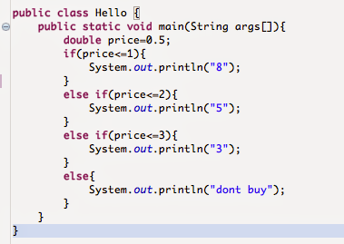
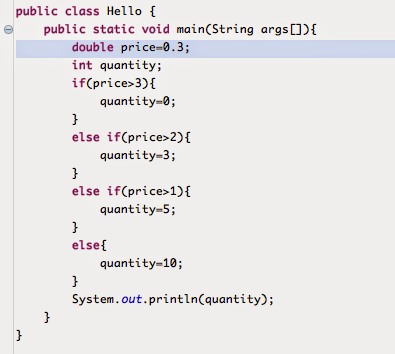
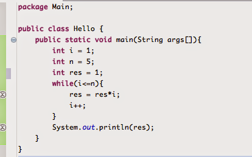
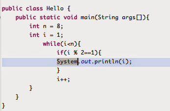
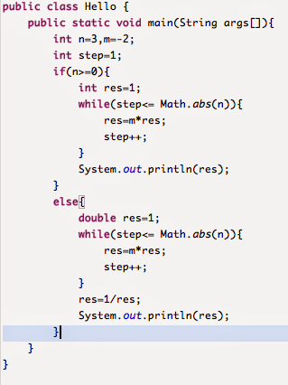
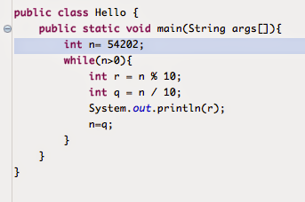
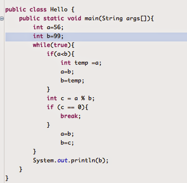
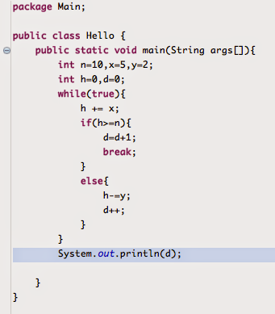

 

这几天看了一些教程 是关于Java的&nbsp;

由于说的很简单白话

很快我就看完了 搭建了开发环境

根据他给的思考题写了一些程式

为了电脑不储存垃圾&nbsp;

直接用截图截下我写的东西然后一张一张的复习。

 

我没有在写教学。此文纯属记录。

我只是记录一下这几天学的东西而已。

普通人别看，程式员轻喷。

 

 

好东西分享，视频链接 。

<a href="https://www.youtube.com/watch?v=vuc372q_nt8&amp;list=PLJGSOT6pEkt1VE-FcUJq1107vBpIHIUAR"><b>Java 简易教程 从0码起。</b></a>

 

 

 

 

 
 

 

这个是根据价格大小来决定买多少包子的例题

 

 

这个和前一个同样是买包子的例题 不过用另外一种写法 
 

这是while循环例题

 

这是If 例题 顺序显示

 
 

次方的计算器 包括负数一起设置 
 

将一组数字变成取出排列成一排（用的是除10 取余数） 
 

用辗转相除法 求最大公约数 的计算器&nbsp;

 

 

上面这个是 说的是蜗牛爬树 每天晚上休息的时候会下滑

然后多少天才能到朋友家的例题

 

 

 

