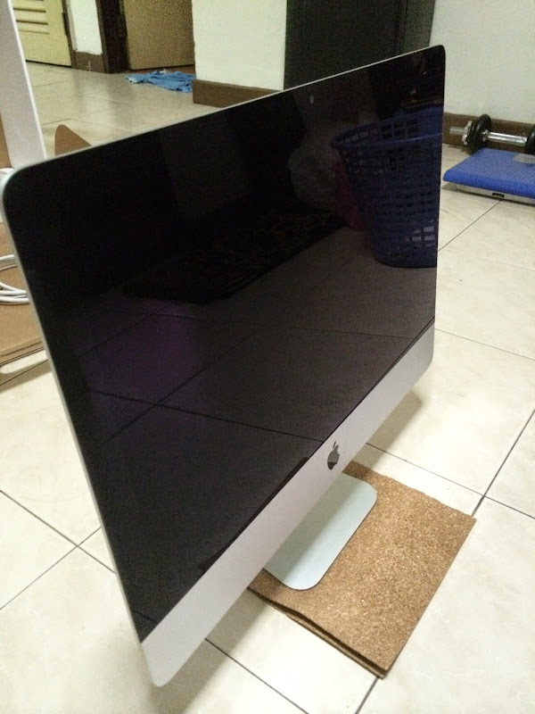

 
 
 
看到面前这台电脑了吗？ 
 

 
 
 
 
它代表了科技 
让我告诉你一个秘密。 
它！ 
没有你 
它 自己不会运行！ 
 
无论它计算速度多快！ 
没有你它就像装满弹夹的机关枪 却没有战士去操控！ 
从而失去了他的价值 
 
科技这样的东西，是看谁在操作而产生它的作用 
今天你只会用电脑 收集玩游戏 它就只是一个游戏机 
 
电脑这东西是帮助人计算 帮助人处理复杂的程序 增加你效率 
你错误使用 它会出错 让你痛苦难堪 
你不去学习它 驾驭它 你就会付出被淘汰的昂贵代价！ 
 
越是害怕接触 你就会失去它带给你的利益 
 
你越了解它 它就越能 帮助你 
甚至帮你赚钱！ 
 
互联网就是现代科技最大的一道宇宙飞艇 
承载着所有科技进入超光速隧道 
用极为恐怖的速度 把所有科技结合进化。 
 
互联网是现代人增加收入必须使用的科技工具 
 
营销模式已从 <a href="http://wiki.mbalib.com/wiki/B2C">B2C</a>&nbsp;&amp; &nbsp;<a href="http://wiki.mbalib.com/wiki/C2C">C2C</a>&nbsp;加入了&nbsp;<a href="http://wiki.mbalib.com/wiki/O2O%E8%90%A5%E9%94%80%E6%A8%A1%E5%BC%8F">O2O</a> (<a href="http://wiki.mbalib.com/wiki/O2O%E8%90%A5%E9%94%80%E6%A8%A1%E5%BC%8F">点击查看MBA百科</a>) 
 
不要再说我不会！ 
不要再说它很复杂 
只要你会上youtube 你就能看到别人怎么做。 
只要你学会英文 和中文就能找到大部分的教程 
只要你愿意 
 
世界 无难事 
 
Any thing is possible. 
 
上面是我自己学习到的 
下面单纯是推广链接 有兴趣去上课的可以点一点看看 
迟些我也会去上 
 
 
