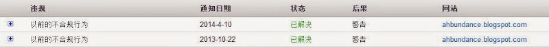

 
 
好久没上Adsense 查看报告了 
今天一上心惊胆跳 
看到了第二次的警告 
 
上一次是因为写了有关youtube 下载的内容 
内容详细说明我某个帖内容违规 
是从邮件收到警告删除页面就好了 
 
这次怎么没通知 都是四月10日的事了 早就过了3天... 
而且内容也没写清楚，就直接放了我主页地址为犯规点 
因为前些日子看到一些推广活动 
就直接推广广告咯 
嗯 
谷歌的却是有条款的 只是我没认真看...谁让它那么多文字了呢... 
写这篇文就提醒自己和大家 多多留意自己博客上的广告 
别乱放 免得真的被禁用账户那就不好 
呼吁大家 
 
<b>爱惜博客，远离违规。</b>