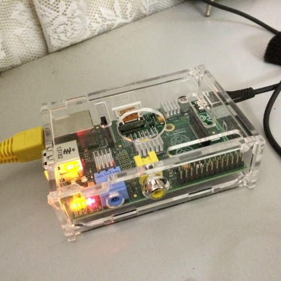
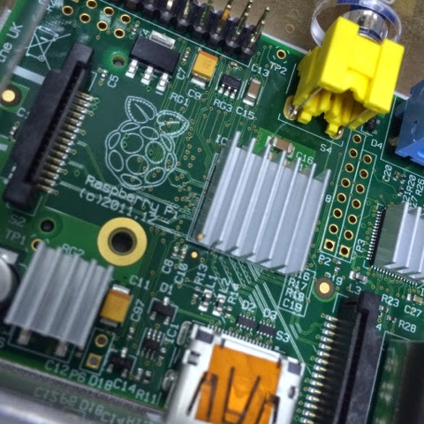
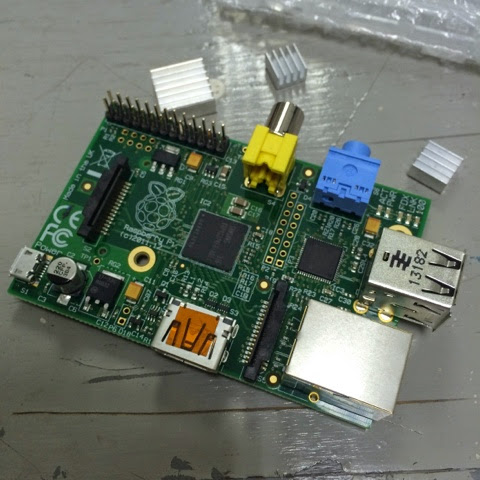
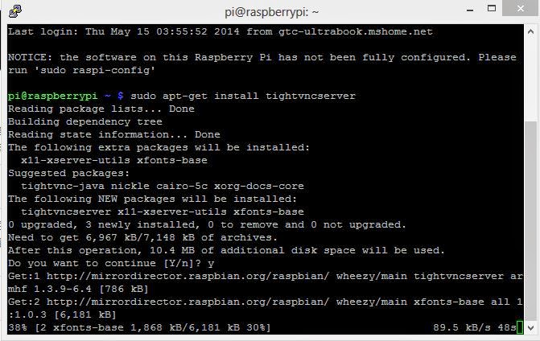
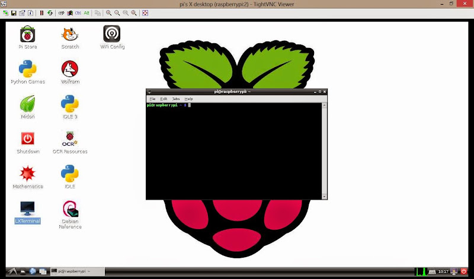

<a href="http://ahbundance.blogspot.com/2014/08/raspberry-pi-10.html"><b>点此进入【Raspberry PI】树莓派 的10个不可不知的用途</b></a> 
 
最近入手了一个叫做Raspberry Pi 信用卡大小的电脑 
<a href="http://baike.baidu.com/view/5730914.htm">“Raspberry Pi是一款针对电脑业余爱好者、教师、小学生以及小型企业等用户的迷你电脑，预装Linux系统，体积仅信用卡大小，搭载ARM架构处理器，运算性能和智能手机相仿。”取自百度百科</a> 
 

 
 
 

 
 
小白等级的内容： 
十多年前 在学校的电脑室 学的第一个电脑知识就是开关机。 
start&gt; shutdown 其实还是很简单的 
 
 
 
十多年后的今天却发现人们几乎反问为什么要关机了 
你有没有发现 最新的window8的开关按钮藏得很深？ 
用滑鼠或手指（触碰）在右边划出来&gt;setting&gt;power&gt;shutdown. 
步骤比起以前还复杂了。 
不知道你们有没有遇过一些朋友 还说这很难... 
不能怪他们...别看我好像做IT的 
对于这个关机操作 我还是问&nbsp;<a href="https://www.google.com/search?q=windows+8+shutdown&amp;oq=window8+sh&amp;aqs=chrome.1.69i57j0l5.6216j0j7&amp;sourceid=chrome&amp;es_sm=122&amp;ie=UTF-8">google</a>&nbsp;的... 毕竟颠覆了整个操作start 不见了... 
 
比起 Ipad 平板当年用的时候我还在想怎么关机...长按就行 
很快就发现根本没有关机的必要...除非你像我一般整天去折腾它咯 
试问一下,一般用户的你的平板多久没重启过了？...卡了吧 
 
树莓派关机还是要打 sudo halt 或者 sudo shutdown -h now 
 
因为很多高科技越来越方便，西方国家对编程的教育越来越重视了 
前台方便的背后总是有很多复杂的程序在运行 
而Raspberry Pi 这类迷你电脑就是为了教育而开发 让大家入门原始。 
真正的学习利器 
 
在线在科技那么方便的情况 Raspberry Pi 这些东西对大部分人来说都变得很写意了... 
可是就因为很多这种写意的高手,才给大家弄那么方便的东西呢! 
 
从学校起就对电脑有兴趣的我 当年因为种种障碍无法解除 
现在已经不同了 有能力自己探索 
也分享给大家 
 
 
省略了看着教程链接 Pi的操作部分 我这就开始玩了起来， 
不过看不懂上图的朋友别误会 &nbsp;我只是小白 
<b><a href="http://ahbundance.blogspot.com/2014/05/blog-post.html">不过是按照这个链接的教程在安装VNC软件而已</a></b> 
我没预算要买接银幕也不打算要花那个钱 只好就这样玩咯 
 
只有安装了这个我才能够通过&nbsp;<a href="http://zh.wikipedia.org/wiki/VNC">VNC</a> 进入图形操作 就是我们熟悉的Desktop. 

 

真正要了解Raspberry Pi (树莓派)只能到处找教程了 
以后我会将我找到的教程自己学习以后都写到自己的部落格 
一来方便自己寻找，二来加深记忆~ 
 
下面这个是我找到觉得最完整的配置图了 虽然感觉好像很多 

 
 

<a href="/assets/img/blog/27451400edb9.jpg" imageanchor="1" style="clear: left; float: left; margin-bottom: 1em; margin-right: 1em; text-align: left;"> </a>

其实就一根网线和供电 加个笔记本就ok了 
没有笔记本的就直接用电视和usb滑鼠键盘吧 
 
<a href="http://ahbundance.blogspot.com/2014/08/raspberry-pi-10.html"><b>点此进入【Raspberry PI】树莓派 的10个不可不知的用途</b></a> 
 