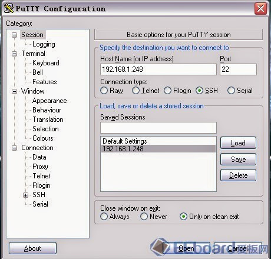
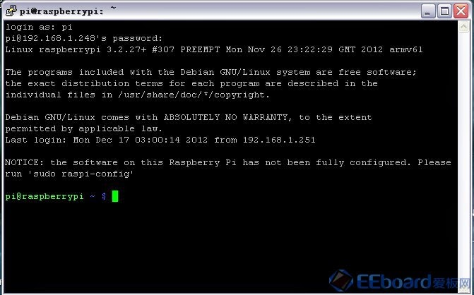
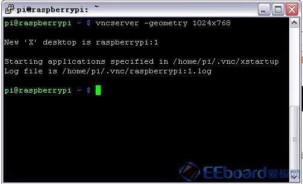
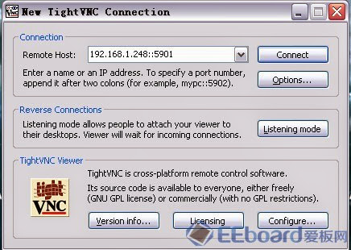
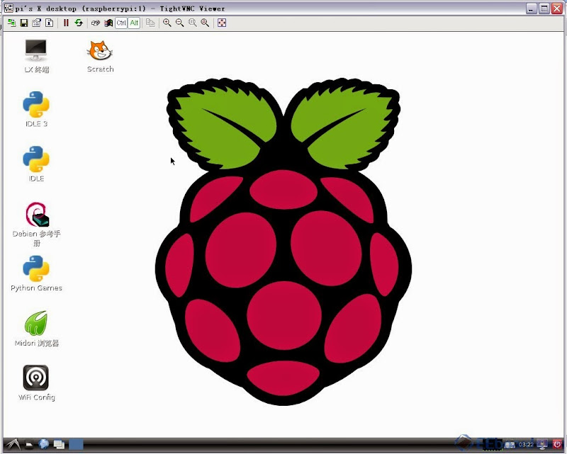
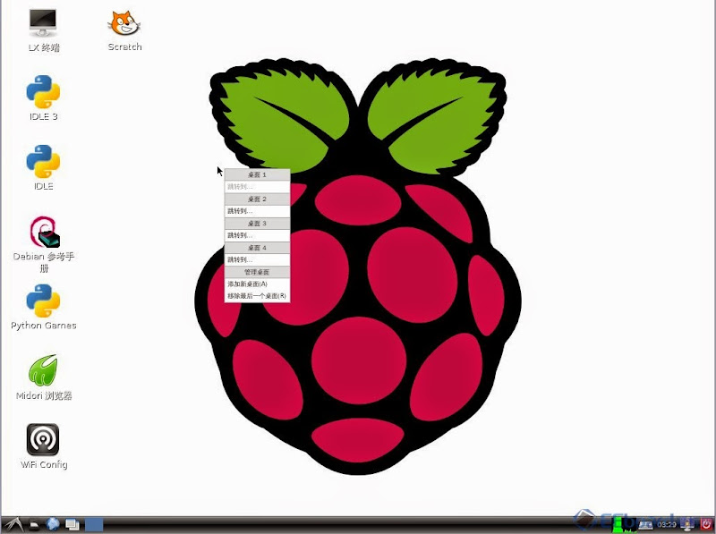

我作为一个无“屏”之人 
手中只有一台公司配给的笔记本和Iphone&nbsp; 
怎么玩？ 
这个教程是我从网上搜来那么多当中最好明白的&nbsp; 
当中也做了一些小修改&nbsp; 
 
内容包括： 
1. Q:树莓派怎么启动？ 
2. Q:没有屏幕，没有键盘，怎么玩树莓派？ 
3. Q:如何让你的电脑远程连接上树莓派桌面？ 
4. Q:如何使用无线网卡，让树莓派摆脱网线束缚? 
<b>5. Q:我不想用VNC，想用WINDOWS的远程桌面连接树莓派，如何实现？</b> 
 
 
 
 
原文教程取自 <a href="http://www.eeboard.com/bbs/thread-5191-1-1.html">爱板网</a>  这篇帖子我打算用Q&amp;A的方式来编写，这样大家更容易一目了然的看明整个帖子的内容，层次分明，调理清晰，以下均是我个人拿到树莓派之后实际使用中碰到的问题和解决办法。 
 
1. Q:树莓派怎么启动？ 

&nbsp; &nbsp; A:使用win32diskimager将系统镜img文件写入SD卡中，然后插到树莓派的卡槽中，上电，即可启动系统。需要注意的是，我最初使用的是TF小卡套上SD卡套来实现启动的，一开始也的确使用正常，后来在使用过程中发现系统无法启动，一度以为是RPI坏了，发回爱板网让小鸟帮我检测，得出结论是SD卡套的问题。这个卡套在电脑上读写的时候是正常的，但是树莓派却无法读出系统。因此建议各位还是尽量直接用SD卡，或者是用U大的TF转SD变形卡，比市面上2块钱的SD卡套质量要好的多.

 
 
2. Q:没有屏幕，没有键盘，怎么玩树莓派？ 

&nbsp; &nbsp; A:没有屏幕和键盘，只要你有一根最大负载至少750ma的5V电源适配器和一根网线，你就可以使用电脑通过SSH连上树莓派。这里，我要说明的是，树莓派官方系统Raspbian自2012-9-18版本之后，均设置了ssh服务随系统自动启动，我使用的是最新的2012-10-28版本的。插上SD卡，插上网线，上电，树莓派启动约30秒之后，应该就启动完成了。我们只需要一个SSH客户端来连接树莓派就可以。这里推荐putty.exe这个小巧的ssh客户端软件，整个程序就一个exe文件，很精简。 &nbsp;&nbsp;

 

 

 
 

&nbsp; &nbsp;&nbsp; &nbsp;IP地址填上树莓的IP，其他设置不用更改，点击OPEN。这时会提示需要输入账号和密码，树莓派的默认账号是pi,默认密码是raspberry,注意密码输入的时候是没有*号来告诉你输了几位的。ssh连接成功后如图所示

 

 

 
 
3. Q:如何让你的电脑远程连接上树莓派桌面？ 
&nbsp; &nbsp; A:树莓派的官方系统raspbian自带了x window，因此是可以使用它的类WIN风格的GUI界面的。但是ssh是不支持GUI图形界面的，因此我们这次要用到是vnc。首先按照问题2的操作，连接上树莓派。然后输入以下命令 

<ol style="margin: 0px 0px 0px 10px !important; padding: 0px !important; word-wrap: break-word;">
<li style="font-family: Monaco, Consolas, 'Lucida Console', 'Courier New', serif; font-size: 12px; line-height: 1.8em; list-style-type: decimal-leading-zero; margin: 0px 0px 0px 2em; padding: 0px 0px 0px 10px; word-wrap: break-word;">sudo apt-get install tightvncserver</li>
</ol>

复制代码

之后树莓派就会自动从网上下载vnc的服务器端，安装过程中会提示是否安装，按小写的y后回车，继续安装。安装完成后会让你设置一个VNC登陆的密码，输入密码后还会问你是否输入个只能观看不能操作的密码，一般选择n，也就是不设置。整个安装完成之后输入 

<ol style="margin: 0px 0px 0px 10px !important; padding: 0px !important; word-wrap: break-word;">
<li style="font-family: Monaco, Consolas, 'Lucida Console', 'Courier New', serif; font-size: 12px; line-height: 1.8em; list-style-type: decimal-leading-zero; margin: 0px 0px 0px 2em; padding: 0px 0px 0px 10px; word-wrap: break-word;">vncserver -geometry 1024x768</li>
</ol>

复制代码

后面那个参数就是你想显示的分辨率。命令成功执行后，ssh里会显示 
 

 

 
 
这里说明一点，每执行一次上面的命令，就打开了一个VNC的端口。VNC默认的端口是5901，也就是说，上面命令执行完成后的编号表示你当前可以连接的端口号。这时候VNC的服务端已经安装完成了，你需要一个客户端来连接这个服务端。这里可以使用tightvnc view或者RealVNC,这两个软件可以自行谷歌搜下。启动VNC view，这里以tightvnc举例 

 

 
IP是你的树莓派的IP，端口号就是上面ssh中New 'X' desktop is raspberrypi:1加上5900，因此现在可以连接的端口号是5901。当然你可以再次执行vncserver -geometry 1024x768，那么New 'X' desktop is raspberrypi:2，可以连接的端口号就是5901和5902，以此类推。点击连接按钮，需要输入前面设置过的VNC登陆密码，登陆成功后的效果 
 

 

 

 
这里有几个问题我需要说明下。有时候VNC连上去，不出来桌面，而是灰色的面板，整个时候滑动几下鼠标的滚轮，可能会解决问题，这个是无意中发现的，不保证一定有效。还有一个情况是，我使用tightvnc view和Realvnc view连上去，点鼠标右键出来的菜单不一样，到现在还不知道是什么原因，而且两个view都无法用界面上的按钮输入ctrl+alt+del来调出任务管理器。 
(根据我使用得知 vnc 遥控的时候 ctrl+alt+del 默认是原电脑的快速键 无法操控raspberry pi的界面 必须点遥控界面的虚拟ctrl+alt+del 键来调出 或者在全屏界面是可以正常使用的) 
 
搞到这里我才发现一个问题... 每次开机都要很挫IP scan 然后在PuTTY 链接SSH 输入指令手动开启VNC 
所以特地找了另外一个教程 是<a href="http://ahbundance.blogspot.com/2014/05/raspberry-pi-vnc-server.html">开机自动登入和启动VNCserver的教程</a> 
 
 

 

 
4. Q:如何使用无线网卡，让树莓派摆脱网线束缚? 
&nbsp; &nbsp;&nbsp;&nbsp;A:首先你要确定你的无线网卡驱动是Raspbian的驱动库里包含了的，可以上这个地址查看自己的无线网卡芯片是否是支持列表里面的（<a href="http://elinux.org/RaspberryPiBoardVerifiedPeripherals#USB WiFi Adapters">http://elinux.org/RaspberryPiBoardVerifiedPeripherals#USB WiFi Adapters</a>）。如果你的无线网卡可以支持，那么进入正题，配置无线上网。首先发一下我的参考配置的链接(<a href="http://omer.me/2012/04/setting-up-wireless-networks-under-debian-on-raspberry-pi/">http://omer.me/2012/04/setting-up-wireless-networks-under-debian-on-raspberry-pi/</a>),是老外写的，英文不好的朋友可以看我下面的讲解 
&nbsp; &nbsp;&nbsp;&nbsp;1，首先插上你USB无线网卡，插好SD卡，上电启动系统，通过外接屏幕和键盘或者SSH连接进入命令行。要注意的是，树莓派的USB供电有问题，启动系统以后如果直接插入USB设备会导致系统重启，避免这个问题的办法是用外接有源的USB HUD。进入命令行界面，输入如下命令 

<ol style="margin: 0px 0px 0px 10px !important; padding: 0px !important; word-wrap: break-word;">
<li style="font-family: Monaco, Consolas, 'Lucida Console', 'Courier New', serif; font-size: 12px; line-height: 1.8em; list-style-type: decimal-leading-zero; margin: 0px 0px 0px 2em; padding: 0px 0px 0px 10px; word-wrap: break-word;">sudo lsusb</li>
</ol>

复制代码

可以看到命令执行完成后，会显示所有挂载的USB设备，最后一行一般就是你的无线网卡，我自己测试的结果显示的是这样 

<ol style="margin: 0px 0px 0px 10px !important; padding: 0px !important; word-wrap: break-word;">
<li style="font-family: Monaco, Consolas, 'Lucida Console', 'Courier New', serif; font-size: 12px; line-height: 1.8em; list-style-type: decimal-leading-zero; margin: 0px 0px 0px 2em; padding: 0px 0px 0px 10px; word-wrap: break-word;">pi@raspberrypi ~ $ sudo lsusb</li>
<li style="font-family: Monaco, Consolas, 'Lucida Console', 'Courier New', serif; font-size: 12px; line-height: 1.8em; list-style-type: decimal-leading-zero; margin: 0px 0px 0px 2em; padding: 0px 0px 0px 10px; word-wrap: break-word;">Bus 001 Device 001: ID 1d6b:0002 Linux Foundation 2.0 root hub</li>
<li style="font-family: Monaco, Consolas, 'Lucida Console', 'Courier New', serif; font-size: 12px; line-height: 1.8em; list-style-type: decimal-leading-zero; margin: 0px 0px 0px 2em; padding: 0px 0px 0px 10px; word-wrap: break-word;">Bus 001 Device 002: ID 0424:9512 Standard Microsystems Corp.&nbsp;</li>
<li style="font-family: Monaco, Consolas, 'Lucida Console', 'Courier New', serif; font-size: 12px; line-height: 1.8em; list-style-type: decimal-leading-zero; margin: 0px 0px 0px 2em; padding: 0px 0px 0px 10px; word-wrap: break-word;">Bus 001 Device 003: ID 0424:ec00 Standard Microsystems Corp.&nbsp;</li>
<li style="font-family: Monaco, Consolas, 'Lucida Console', 'Courier New', serif; font-size: 12px; line-height: 1.8em; list-style-type: decimal-leading-zero; margin: 0px 0px 0px 2em; padding: 0px 0px 0px 10px; word-wrap: break-word;">Bus 001 Device 004: ID 0cf3:1006 Atheros Communications, Inc. TP-Link TL-WN322G v3 / TL-WN422G v2 802.11g [Atheros AR9271]</li>
</ol>

复制代码

最后一行就是我的无线网卡设备号，显然我的无线网卡已经被系统识别出来了。如果还不能确认的话，输入如下命令 

<ol style="margin: 0px 0px 0px 10px !important; padding: 0px !important; word-wrap: break-word;">
<li style="font-family: Monaco, Consolas, 'Lucida Console', 'Courier New', serif; font-size: 12px; line-height: 1.8em; list-style-type: decimal-leading-zero; margin: 0px 0px 0px 2em; padding: 0px 0px 0px 10px; word-wrap: break-word;">sudo lsmod</li>
</ol>

复制代码

返回的结果如下 

<ol style="margin: 0px 0px 0px 10px !important; padding: 0px !important; word-wrap: break-word;">
<li style="font-family: Monaco, Consolas, 'Lucida Console', 'Courier New', serif; font-size: 12px; line-height: 1.8em; list-style-type: decimal-leading-zero; margin: 0px 0px 0px 2em; padding: 0px 0px 0px 10px; word-wrap: break-word;">pi@raspberrypi ~ $ lsmod</li>
<li style="font-family: Monaco, Consolas, 'Lucida Console', 'Courier New', serif; font-size: 12px; line-height: 1.8em; list-style-type: decimal-leading-zero; margin: 0px 0px 0px 2em; padding: 0px 0px 0px 10px; word-wrap: break-word;">Module&nbsp; &nbsp;&nbsp; &nbsp;&nbsp; &nbsp;&nbsp; &nbsp;&nbsp; &nbsp;&nbsp; &nbsp;Size&nbsp; &nbsp;&nbsp; &nbsp;&nbsp; &nbsp;&nbsp; &nbsp;&nbsp;&nbsp;Used by</li>
<li style="font-family: Monaco, Consolas, 'Lucida Console', 'Courier New', serif; font-size: 12px; line-height: 1.8em; list-style-type: decimal-leading-zero; margin: 0px 0px 0px 2em; padding: 0px 0px 0px 10px; word-wrap: break-word;">snd_bcm2835&nbsp; &nbsp;&nbsp; &nbsp;12808&nbsp; &nbsp;&nbsp; &nbsp;&nbsp; &nbsp; 0&nbsp;</li>
<li style="font-family: Monaco, Consolas, 'Lucida Console', 'Courier New', serif; font-size: 12px; line-height: 1.8em; list-style-type: decimal-leading-zero; margin: 0px 0px 0px 2em; padding: 0px 0px 0px 10px; word-wrap: break-word;">snd_pcm&nbsp; &nbsp;&nbsp; &nbsp;&nbsp; &nbsp;&nbsp; &nbsp;&nbsp; &nbsp;74834&nbsp; &nbsp;&nbsp; &nbsp;&nbsp; &nbsp;1 snd_bcm2835</li>
<li style="font-family: Monaco, Consolas, 'Lucida Console', 'Courier New', serif; font-size: 12px; line-height: 1.8em; list-style-type: decimal-leading-zero; margin: 0px 0px 0px 2em; padding: 0px 0px 0px 10px; word-wrap: break-word;">snd_seq&nbsp; &nbsp;&nbsp; &nbsp;&nbsp; &nbsp;&nbsp; &nbsp;&nbsp; &nbsp;&nbsp;&nbsp;52536&nbsp; &nbsp;&nbsp; &nbsp;&nbsp; &nbsp;0&nbsp;</li>
<li style="font-family: Monaco, Consolas, 'Lucida Console', 'Courier New', serif; font-size: 12px; line-height: 1.8em; list-style-type: decimal-leading-zero; margin: 0px 0px 0px 2em; padding: 0px 0px 0px 10px; word-wrap: break-word;">snd_timer&nbsp; &nbsp;&nbsp; &nbsp;&nbsp; &nbsp;&nbsp; &nbsp;&nbsp;&nbsp;19698&nbsp; &nbsp;&nbsp; &nbsp;&nbsp; &nbsp;2 snd_seq,snd_pcm</li>
<li style="font-family: Monaco, Consolas, 'Lucida Console', 'Courier New', serif; font-size: 12px; line-height: 1.8em; list-style-type: decimal-leading-zero; margin: 0px 0px 0px 2em; padding: 0px 0px 0px 10px; word-wrap: break-word;">snd_seq_device&nbsp; &nbsp;&nbsp;&nbsp;6300&nbsp; &nbsp;&nbsp; &nbsp;&nbsp; &nbsp;&nbsp;&nbsp;1 snd_seq</li>
<li style="font-family: Monaco, Consolas, 'Lucida Console', 'Courier New', serif; font-size: 12px; line-height: 1.8em; list-style-type: decimal-leading-zero; margin: 0px 0px 0px 2em; padding: 0px 0px 0px 10px; word-wrap: break-word;">snd&nbsp; &nbsp;&nbsp; &nbsp;&nbsp; &nbsp;&nbsp; &nbsp;&nbsp; &nbsp;&nbsp; &nbsp;&nbsp;&nbsp;52489&nbsp; &nbsp;&nbsp; &nbsp;&nbsp; &nbsp;&nbsp; &nbsp; 5&nbsp; &nbsp;&nbsp; &nbsp;&nbsp; &nbsp;&nbsp; &nbsp;&nbsp; &nbsp;&nbsp;&nbsp;snd_seq_device,snd_timer,snd_seq,snd_pcm,snd_bcm2835</li>
<li style="font-family: Monaco, Consolas, 'Lucida Console', 'Courier New', serif; font-size: 12px; line-height: 1.8em; list-style-type: decimal-leading-zero; margin: 0px 0px 0px 2em; padding: 0px 0px 0px 10px; word-wrap: break-word;">snd_page_alloc&nbsp; &nbsp;&nbsp; &nbsp;4951&nbsp; &nbsp;&nbsp; &nbsp;&nbsp; &nbsp;&nbsp;&nbsp;1 snd_pcm</li>
<li style="font-family: Monaco, Consolas, 'Lucida Console', 'Courier New', serif; font-size: 12px; line-height: 1.8em; list-style-type: decimal-leading-zero; margin: 0px 0px 0px 2em; padding: 0px 0px 0px 10px; word-wrap: break-word;">arc4&nbsp; &nbsp;&nbsp; &nbsp;&nbsp; &nbsp;&nbsp; &nbsp;&nbsp; &nbsp;&nbsp; &nbsp;&nbsp; &nbsp;&nbsp;&nbsp;1187&nbsp; &nbsp;&nbsp; &nbsp;&nbsp; &nbsp;&nbsp;&nbsp;2&nbsp;</li>
<li style="font-family: Monaco, Consolas, 'Lucida Console', 'Courier New', serif; font-size: 12px; line-height: 1.8em; list-style-type: decimal-leading-zero; margin: 0px 0px 0px 2em; padding: 0px 0px 0px 10px; word-wrap: break-word;">ath9k_htc&nbsp; &nbsp;&nbsp; &nbsp;&nbsp; &nbsp;&nbsp; &nbsp;&nbsp;&nbsp;54918&nbsp; &nbsp;&nbsp; &nbsp;&nbsp; &nbsp;0&nbsp;</li>
<li style="font-family: Monaco, Consolas, 'Lucida Console', 'Courier New', serif; font-size: 12px; line-height: 1.8em; list-style-type: decimal-leading-zero; margin: 0px 0px 0px 2em; padding: 0px 0px 0px 10px; word-wrap: break-word;">mac80211&nbsp; &nbsp;&nbsp; &nbsp;&nbsp; &nbsp;&nbsp; &nbsp; 236178&nbsp; &nbsp;&nbsp; &nbsp; 1 ath9k_htc</li>
<li style="font-family: Monaco, Consolas, 'Lucida Console', 'Courier New', serif; font-size: 12px; line-height: 1.8em; list-style-type: decimal-leading-zero; margin: 0px 0px 0px 2em; padding: 0px 0px 0px 10px; word-wrap: break-word;">ath9k_common&nbsp; &nbsp;&nbsp;&nbsp;3181&nbsp; &nbsp;&nbsp; &nbsp;&nbsp; &nbsp;&nbsp;&nbsp;1 ath9k_htc</li>
<li style="font-family: Monaco, Consolas, 'Lucida Console', 'Courier New', serif; font-size: 12px; line-height: 1.8em; list-style-type: decimal-leading-zero; margin: 0px 0px 0px 2em; padding: 0px 0px 0px 10px; word-wrap: break-word;">ath9k_hw&nbsp; &nbsp;&nbsp; &nbsp;&nbsp; &nbsp;&nbsp; &nbsp;&nbsp;&nbsp;376754&nbsp; &nbsp;&nbsp; &nbsp; 2 ath9k_common,ath9k_htc</li>
<li style="font-family: Monaco, Consolas, 'Lucida Console', 'Courier New', serif; font-size: 12px; line-height: 1.8em; list-style-type: decimal-leading-zero; margin: 0px 0px 0px 2em; padding: 0px 0px 0px 10px; word-wrap: break-word;">ath&nbsp; &nbsp;&nbsp; &nbsp;&nbsp; &nbsp;&nbsp; &nbsp;&nbsp; &nbsp;&nbsp; &nbsp;&nbsp; &nbsp;&nbsp; &nbsp;16648&nbsp; &nbsp;&nbsp; &nbsp;&nbsp; &nbsp;3 ath9k_hw,ath9k_common,ath9k_htc</li>
<li style="font-family: Monaco, Consolas, 'Lucida Console', 'Courier New', serif; font-size: 12px; line-height: 1.8em; list-style-type: decimal-leading-zero; margin: 0px 0px 0px 2em; padding: 0px 0px 0px 10px; word-wrap: break-word;">cfg80211&nbsp; &nbsp;&nbsp; &nbsp;&nbsp; &nbsp;&nbsp; &nbsp;&nbsp;&nbsp;171957&nbsp; &nbsp;&nbsp; &nbsp; 3 ath,mac80211,ath9k_htc</li>
</ol>

复制代码

可以看到有mac80211，显示无线网卡已经被正确识别. 
 
&nbsp; &nbsp;&nbsp; &nbsp;2,现在可以测试你周围的无线网络了。输入如下命令 

<ol style="margin: 0px 0px 0px 10px !important; padding: 0px !important; word-wrap: break-word;">
<li style="font-family: Monaco, Consolas, 'Lucida Console', 'Courier New', serif; font-size: 12px; line-height: 1.8em; list-style-type: decimal-leading-zero; margin: 0px 0px 0px 2em; padding: 0px 0px 0px 10px; word-wrap: break-word;">sudo iwlist wlan0 scan</li>
</ol>

复制代码

如果搜索到了无线网络，会返回无线网络的MAC地址，SSID等相关信息。 
 
&nbsp; &nbsp;3,配置无线网络 
&nbsp; &nbsp;&nbsp;&nbsp;输入如下命令 

<ol style="margin: 0px 0px 0px 10px !important; padding: 0px !important; word-wrap: break-word;">
<ol>
<li style="font-family: Monaco, Consolas, 'Lucida Console', 'Courier New', serif; font-size: 12px; line-height: 1.8em; list-style-type: decimal-leading-zero; margin: 0px 0px 0px 2em; padding: 0px 0px 0px 10px; word-wrap: break-word;">sudo apt-get install wpasupplicant</li>
</ol>
</ol>

复制代码

安装wpasupplicant的，熟悉安卓的朋友估计看着很眼熟吧，安卓里想要让安卓连上AP热点，就得破解这个文件 
&nbsp; &nbsp;安装完成之后，创建一个配置文件，输入如下命令 

<ol style="margin: 0px 0px 0px 10px !important; padding: 0px !important; word-wrap: break-word;">
<li style="font-family: Monaco, Consolas, 'Lucida Console', 'Courier New', serif; font-size: 12px; line-height: 1.8em; list-style-type: decimal-leading-zero; margin: 0px 0px 0px 2em; padding: 0px 0px 0px 10px; word-wrap: break-word;">$ sudo nano /etc/wpa.conf</li>
<li style="font-family: Monaco, Consolas, 'Lucida Console', 'Courier New', serif; font-size: 12px; line-height: 1.8em; list-style-type: decimal-leading-zero; margin: 0px 0px 0px 2em; padding: 0px 0px 0px 10px; word-wrap: break-word;"> </li>
<li style="font-family: Monaco, Consolas, 'Lucida Console', 'Courier New', serif; font-size: 12px; line-height: 1.8em; list-style-type: decimal-leading-zero; margin: 0px 0px 0px 2em; padding: 0px 0px 0px 10px; word-wrap: break-word;">network={</li>
<li style="font-family: Monaco, Consolas, 'Lucida Console', 'Courier New', serif; font-size: 12px; line-height: 1.8em; list-style-type: decimal-leading-zero; margin: 0px 0px 0px 2em; padding: 0px 0px 0px 10px; word-wrap: break-word;">ssid="你用的WIFI的SSID"</li>
<li style="font-family: Monaco, Consolas, 'Lucida Console', 'Courier New', serif; font-size: 12px; line-height: 1.8em; list-style-type: decimal-leading-zero; margin: 0px 0px 0px 2em; padding: 0px 0px 0px 10px; word-wrap: break-word;">proto=RSN</li>
<li style="font-family: Monaco, Consolas, 'Lucida Console', 'Courier New', serif; font-size: 12px; line-height: 1.8em; list-style-type: decimal-leading-zero; margin: 0px 0px 0px 2em; padding: 0px 0px 0px 10px; word-wrap: break-word;">key_mgmt=WPA-PSK</li>
<li style="font-family: Monaco, Consolas, 'Lucida Console', 'Courier New', serif; font-size: 12px; line-height: 1.8em; list-style-type: decimal-leading-zero; margin: 0px 0px 0px 2em; padding: 0px 0px 0px 10px; word-wrap: break-word;">pairwise=CCMP TKIP</li>
<li style="font-family: Monaco, Consolas, 'Lucida Console', 'Courier New', serif; font-size: 12px; line-height: 1.8em; list-style-type: decimal-leading-zero; margin: 0px 0px 0px 2em; padding: 0px 0px 0px 10px; word-wrap: break-word;">group=CCMP TKIP</li>
<li style="font-family: Monaco, Consolas, 'Lucida Console', 'Courier New', serif; font-size: 12px; line-height: 1.8em; list-style-type: decimal-leading-zero; margin: 0px 0px 0px 2em; padding: 0px 0px 0px 10px; word-wrap: break-word;">psk="WIFI的密码"</li>
<li style="font-family: Monaco, Consolas, 'Lucida Console', 'Courier New', serif; font-size: 12px; line-height: 1.8em; list-style-type: decimal-leading-zero; margin: 0px 0px 0px 2em; padding: 0px 0px 0px 10px; word-wrap: break-word;">}</li>
</ol>

复制代码

接下来编辑你的网络配置文件，输入如下命令 

<ol style="margin: 0px 0px 0px 10px !important; padding: 0px !important; word-wrap: break-word;">
<li style="font-family: Monaco, Consolas, 'Lucida Console', 'Courier New', serif; font-size: 12px; line-height: 1.8em; list-style-type: decimal-leading-zero; margin: 0px 0px 0px 2em; padding: 0px 0px 0px 10px; word-wrap: break-word;">$ sudo nano /etc/network/interfaces</li>
</ol>

复制代码

以上将无线网卡的配置添加到网络配置中去了，这样启动的时候无线网卡就会按照你前面配置的SSID和密码连上无线网。需要更换无线网的时候只需要在wpa.conf中修改SSID和密码即可。 
 
&nbsp; &nbsp; 4,重启你的树莓派 

<ol style="margin: 0px 0px 0px 10px !important; padding: 0px !important; word-wrap: break-word;">
<li style="font-family: Monaco, Consolas, 'Lucida Console', 'Courier New', serif; font-size: 12px; line-height: 1.8em; list-style-type: decimal-leading-zero; margin: 0px 0px 0px 2em; padding: 0px 0px 0px 10px; word-wrap: break-word;">sudo reboot</li>
</ol>

复制代码

记得拔掉网线，将电脑连入无线网络，这样树莓就可以无线上网了 
 
现在你可以使用命令来查看无线网卡的状态了，输入如下命令 

<ol style="margin: 0px 0px 0px 10px !important; padding: 0px !important; word-wrap: break-word;">
<li style="font-family: Monaco, Consolas, 'Lucida Console', 'Courier New', serif; font-size: 12px; line-height: 1.8em; list-style-type: decimal-leading-zero; margin: 0px 0px 0px 2em; padding: 0px 0px 0px 10px; word-wrap: break-word;">ifconfig</li>
</ol>

复制代码

会返回有线网络和无线网络的MAC地址和IP地址状态 
<b style="color: #444444; font-family: Tahoma, 'Microsoft Yahei', Simsun; font-size: 14px; line-height: 21px;"> </b>
<b style="color: #444444; font-family: Tahoma, 'Microsoft Yahei', Simsun; font-size: 14px; line-height: 21px;">9.Q:我不想用VNC，想用WINDOWS的远程桌面连接树莓派，如何实现？</b> 
<b>&nbsp; &nbsp;A:办法已经有了，需要在raspbian下面安装一个服务xdrp,输入如下命令</b> 
<b>&nbsp; &nbsp; &nbsp; 不过VNC 更为方便的是 让手机VNC客户端可以登入。</b> 

<ol style="margin: 0px 0px 0px 10px !important; padding: 0px !important; word-wrap: break-word;">
<li style="font-family: Monaco, Consolas, 'Lucida Console', 'Courier New', serif; font-size: 12px; line-height: 1.8em; list-style-type: decimal-leading-zero; margin: 0px 0px 0px 2em; padding: 0px 0px 0px 10px; word-wrap: break-word;">sudo apt-get install xrdp</li>
</ol>

复制代码

然后就可以用win的远程桌面连接了，你的电脑和树莓派在一个局域网的时候没有问题，如果是想外网访问，跟需要做好端口3389的映射，具体见我另外一个帖 子<a href="http://www.eeboard.com/bbs/thread-5526-1-2.html" style="background-color: white; color: #336699; font-family: Tahoma, 'Microsoft Yahei', Simsun; font-size: 14px; line-height: 21px; word-wrap: break-word;" target="_blank">http://www.eeboard.com/bbs/thread-5526-1-2.html</a> 
 

首先连接

 

 
 

输入pi的用户密码，就是ssh连上去的用户名密码

 

 
 

这样就连上去了，跟用VNC效果一样

 

 

 
 

