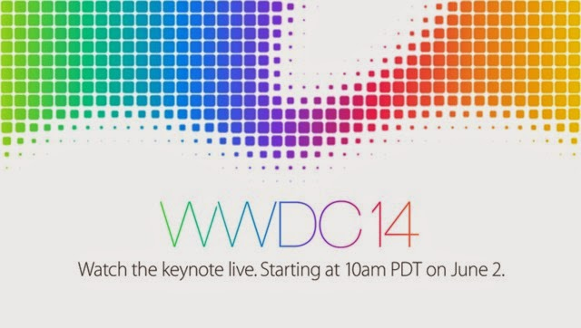

6月2日的凌晨1点 终于迎来新的 WWDC14 

<a href="/assets/img/blog/d3f1189435bb.jpg" imageanchor="1" style="margin-left: 1em; margin-right: 1em;"></a>

进入贴》 
 
<b>OS X Yosemite</b>

<b> </b> 
新一代的苹果电脑操作系统继续以风景区命名， 
而且这次的进化幅度要比去年 OS X Maverick 大得多（iOS 8 也是）： 
 
<ul>
<li>扁平化+毛玻璃特效，这个不意外对吧。而且从演示效果来看，比去年 iOS 7 刚拍扁时顺眼多了。</li>
<li>Spotlight 搜索功能大升级，除了文件搜索还能直接找餐馆、看地图、查维基百科什么的了。搜索框和结果也从右上角搬到了屏幕中心（Alfred 哭死）</li>
<li>通知中心支持 Widget 扩展，是不是把 Dashboard 挪那去了？</li>
<li>内置 iCloud Drive 网盘功能（也有 Windows 版），这个太方便了。邮件也可以发送超大附件了。</li>
<li>照片光平衡调节功能，自动+手动调节光暗 影子 等等。（无需专业技术也能好好zhuaguang）</li>
<li>MarkUp 标注识别功能，简单说就是你在图片上用鼠标简单画个箭头或文字气泡什么的，Mac 会识别过来并转换成正规的箭头和气泡。给图片或 PDF 文档添加标注时超方便。</li>
<li>Mac 和 iPhone 蓝牙连接后，直接在电脑上接打电话和收发短信。打个比方，iPhone 变成 Mac 的手机卡插槽。而且还有更多的同步融合功能，比如电脑上打开邮件应用，可以自动显示手机上写到一半的邮件接着写；Mac 上文档做到一半，出门打开 iPad 继续做 …… 苹果的平台整合大法继续发力。</li>
<li>Safari 浏览器做了很多改进，比如选中地址栏但还没输入网址时，自动弹出书签；还有标签滚动显示等等。</li>
</ul>
 
 
更多介绍，看苹果官网吧 http://www.apple.com/osx/preview/。强烈建议大家看发布会的演示视频，尤其是 Mac 和 iPhone 协同那一段。 
 
OS X Yosemite 系统今年秋天出正式版，免费。心急的话现在就可以下载 Beta 版试用，面向全体用户开放的，不是开发者也没问题（但强烈不建议普通用户刷测试版系统，别作死就不会死）。 
 
 

<strong>iOS 8</strong>

<ul class=" list-paddingleft-2" style="background-color: white; font-family: 宋体; font-size: 16px; line-height: 24px; list-style-image: initial; list-style-position: inside;">
<li>

可以从通知中心和锁屏界面直接回复短信或社交应用推送来的信息了。通知中心里还能安装 Widget 扩展功能。

</li>
<li>

短信应用大升级，支持群聊，支持按下直接录微信那样的语音 iMessage，甚至可以发视频和地理位置。（这个...如果它也开发所有平台 我就找不到理由安装其它的了）

</li>
<li>

输入法增加 QuickType 功能，自动推测你下面要输入什么内容，显示在候选栏里，点一下就行不用打字了（支持中文 稍微期待下吧）。

</li>
<li>

可以有第三方输入法了（这恐怕是我越狱唯一的动力了），指纹识别也可以让第三方应用调用了（以后paypal什么的刷指纹而不是输密码 最重要是无需担心安全问题）

</li>
<li>

AirDrop 终于支持 Mac 和 iOS 设备之间传输

</li>
<li>

一家人可以共享照片、日历等项目，熊孩子乱按乱买 App 的话，家长的手机上会提示是否确认购买。

</li>
</ul>

还有 支持应用之间数据互通，Spotlight 搜索增强（见上一段 Mac 那部分），Siri 支持听声音识别歌名，更多的照片美化功能，更强的游戏画面渲染功能，HomeKit 智能家居方案+CloudKit 云存储方案+Health 健康与运动数据方案（都是面向开发者的）…… 等等等等功能。看苹果官网介绍吧 http://www.apple.com/ios/ios8/ 

 

iOS 8 系统也是今年秋天正式发布，现在的 Beta 版只有苹果开发者可以下载。坏消息是：iPhone 4 被踢出可升级机型列表了。

 

最后，苹果还发布了新的编程语言：<b>Swift</b>。看起来比 Objective-C 简单得多。

 

发布会视频：

<ul class=" list-paddingleft-2" style="background-color: white; font-family: 宋体; font-size: 16px; line-height: 24px; list-style-image: initial; list-style-position: inside;">
<li>

在线版 <a href="http://www.apple.com/apple-events/june-2014/">http://www.apple.com/apple-events/june-2014/</a>

</li>
<li>

Podcast 下载 <a href="https://itunes.apple.com/cn/podcast/apple-special-event-wwdc-14/id275834665?i=313784629&amp;mt=2">https://itunes.apple.com/cn/podcast/apple-special-event-wwdc-14/id275834665?i=313784629&amp;mt=2</a>

</li>
</ul>

