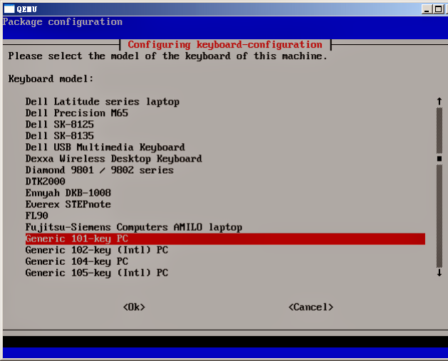
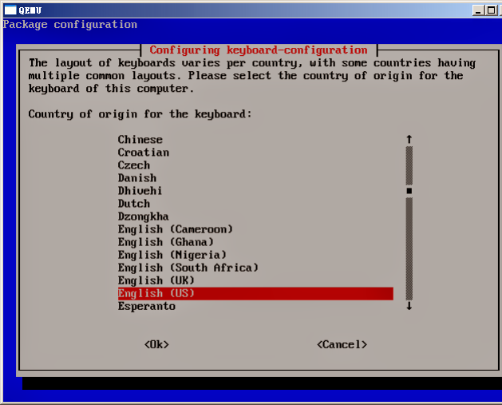
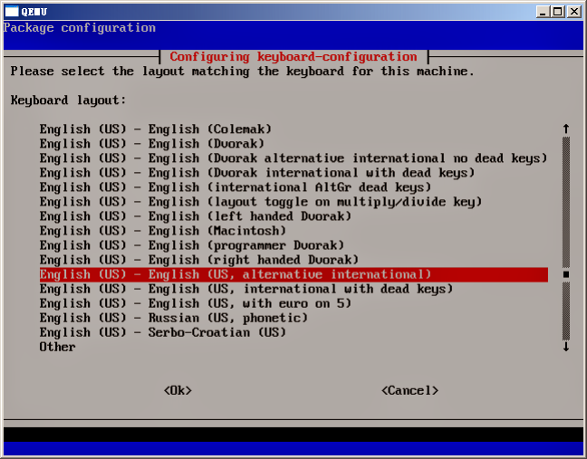
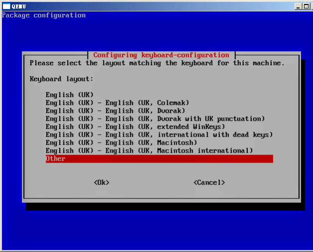

 

终于我无需远程遥控去控制树莓派了，

这时才发现无视已久的教程 设置键盘格式是有用的 ...

由于树莓派默认键盘是UK 而我们一般使用的都是US的

我们不得不对其做一些设置，否则...也没什么大不了 就一些符号打不出来咯！

 

更改键盘布局，命令如下：

 
 

sudo dpkg-reconfigure keyboard-configuration进入后，选通用的101键PC键盘

&nbsp;按tab键，到OK，按Enter确定在键盘layout选择中，选Other 

 

&nbsp;按tab键，到OK，按Enter确定然后在选项中，选English(US) 

按tab键，到OK，按Enter确定 
再选English(US, alternative international) 

按tab键，到OK，按Enter确定

然后一路按OK

退出后，重启系统

sudo reboot

重新启动时，由于修改了键盘布局，在读取键盘布局的阶段会比平常慢一些

OK了， 终于可以打出所有字符了

这一点，linux还是不太方便，windows比较人性化一些

不过付费与免费之间的差距 这也是必然存在的 
理解一下吧~

