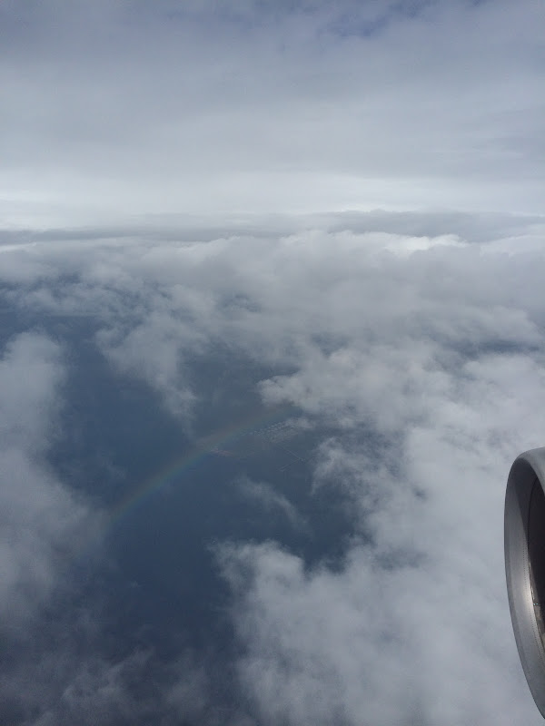

<a href="http://ahbundance.blogspot.com/2014/07/blog-post_20.html">上一章：《与你见面的日子》系列之《在韩国的情人》第二章倒数的两个月</a> 
 
直到来到这一天，7月8日 凌晨3点... 
 
我一个人拎着行李，心里抱着复杂的情绪 
兴奋、纠结、郁闷同时涌出。 
 
我的飞机是早上8点， 
一个人在麦当劳买了一个套餐， 
神志不清还把薯条整盒掉到地上了... 
 
 
 
发着呆看着手机视频等着时间。 
其它桌似乎好热闹 一群人快快乐乐去旅行， 
看到这一幕我忽然平静了。 
一个人坐着挺好的，无需等待照顾别人的感觉。 
打开音波音乐，自己冥想起来。 
 
哔哔哔哔... 
时间这一静就过去了，感觉我走神的功力又增强了 
手表定时已经响起。拖起行李慢悠悠的走到check in 的地方。 
马来西亚人从马来西亚进出，基本0延迟。 
机器刷一下就过去了。 
 
很快我就走到登记台， 
显然我早到了 
陆续有2-3人进来 
15分钟后竟然被人赶出来了说时间未到不能进来=.= 
他们自己把门开了 怎么能这样呢... 
就不纠结这小事了， 
去见爱人的心情怎么会在这种地方被破坏呢 
 
6小时飞机， 
一个飞机场， 
韩文的空姐广播， 
一切不熟悉的画面和感觉 
韩国并不在我向往的国家列表内， 
这也是一种意外， 
不是这次意外我大概不会去韩国吧 
毕竟这不是我喜欢的国家之一... 
尽管如此 还是有少许期待 不喜欢也是印象而已。 
 
上飞机后很快就进入时间飞逝状态，简单来说我睡觉了... 
当我第二次起来的时候已经快到韩国 飞机正在降落。 
第一次固然是被空姐叫起来吃饭咯。 
 

 
降落的途中我看到了彩虹， 
从上空看彩虹还是第一次， 
按耐不住这股幼稚的炫耀心情我只好拍下来做个留念。 
 
。。。跳过无数琐碎过关情节... 
 
出来了 出来了，好多人在等待接人呢... 
啊 我的小情人呢？...额？...不是吧...明明说在等 怎么不见人影... 
你去哪了啊？？？.... 
 
未完待续... 
 
转发请注明来自面包仙人居 作者：少灃&nbsp;