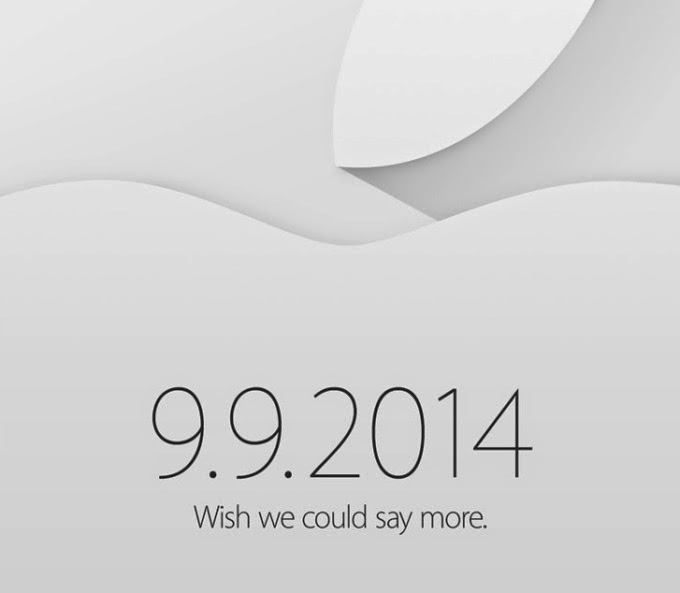

Wish we could say more 

 
 
这个是这次敬请函的标题 
坐落在9月9日2014年 
 
看来又会有一阵炒作 新闻风波了吧 
 
我是支持苹果的 
原因很简单 他们的东西够简单 
出错也少 当然相对的限制比较多 
不过现在开放也越来越多了 
 
相比微软的蓝色经典 
我用苹果3年尚未遇到过 
公司的window8 遇到3次都是在关键时刻和我开这个蓝色幽默 
就不吐槽了 
 
说回传闻 
虽然每次有准也有不对的地方 
不过大家都只记得对的吧 
 
我个人是不相信所指苹果会这次出穿戴手表的传闻 
小屏幕的玩具 除非可以产生立体影像 
不然也很难当主流产品了 
苹果一贯作风不这样 
况且三星不是给了个很好的例子么 
销量没差吧 
而且买了的各位真的用到吗 
嗯...不好意思又吐槽了 
 
我资质可能不好 
单纯是我想不透有什么价值存在的地方罢了 
 
我的想法是 推倒 伤（三）心（星）吧！ 
 
<a href="http://www.apple.com/live/">http://www.apple.com/live/</a> 
http://www.apple.com/live/ 
http://www.apple.com/live/ 
http://www.apple.com/live/ 
 

