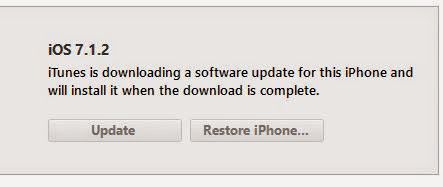
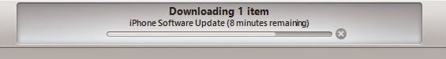
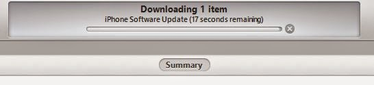
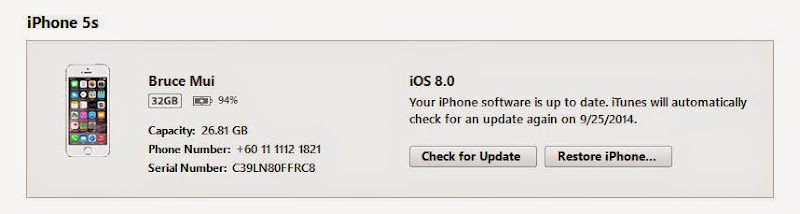
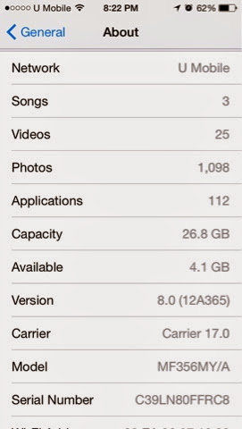
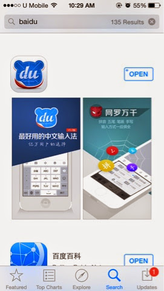
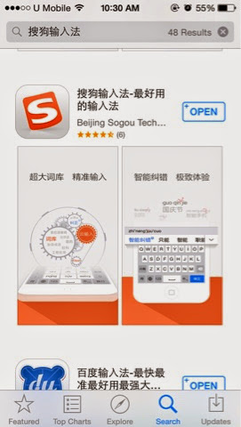
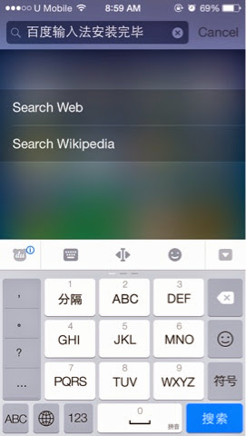
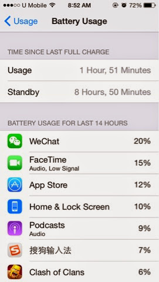
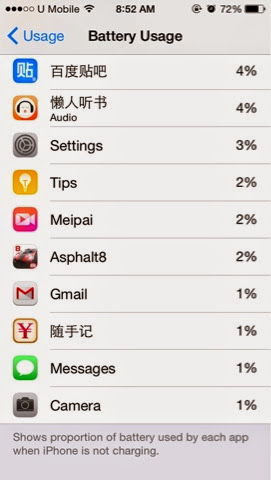

upgrade complete(忽然想起某游戏的音效)

 

9月19日 ios8 终于更新了

因为输入法是在太挫 我的版本也没有10key键盘

中文输入越来越少 聊天也都没劲了。

自从知道ios8支持第三方输入平台我就期待得不得了。

第三方插件意味着 搜狗 百度 谷歌这类中文输入法大头都可以使用了。

 

目前还未开放手机直接更新（貌似是太多人更新所以很卡）

连上 i tunes 直接就出提示 有的更新了~

 

果断yes!

 
 

 

下载中~ 
 

 
下载中~ 

 
手机自动重启数次以后 最后开机 
好了 
yeah 就是那么简单 

更新完成~~

 
然后呢？当然是去apps store 找插件咯 
 
输入了搜狗 百度输入法 
找到了输入法插件 
安装 根据提示开启输入法就可以使用了（和一般设置添加键盘的方法一样） 

果断移除自带中文输入法

终于可以泄恨了！！

 
登登登~ 

 

 
目前用了两种输入法， 
感觉搜狗的输入法 启动出来的时候明显有一些延迟 
所以转用了百度输入法 之前百度贴吧自带早已习惯这微妙的差异 
用起来顺手 也没有延迟问题 
 
大家可以自己下载试试再给告诉我你的想法~ 
 
另外电池测试，昨晚到现在没充电 
 
<b>下一篇 IOS 8电池使用情况~ 待更新。</b> 
 

 
 

