

 

在6.82补丁中地形的变化最受关注 因为它将导致了战场的新玩法。

下面是对地形有些变化，最大的差异还是Roshan的领地转移了。让我们来了解一下吧。

In patch 6.82, the terrains are changed. Below are some changes on terrains. We can see that Roshan’s new home changes the most. Let’s take a look at it.

 

<a href="/assets/img/blog/94d28ba41229.jpg" imageanchor="1" style="margin-left: 1em; margin-right: 1em;">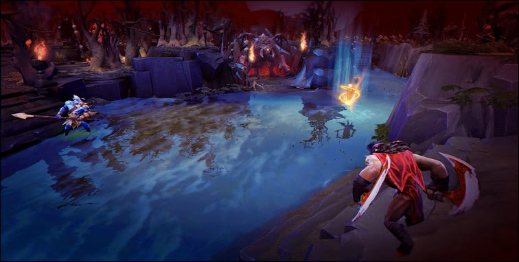</a>

 
 
 

<a href="/assets/img/blog/a83344b94c79.jpg" imageanchor="1" style="margin-left: 1em; margin-right: 1em;">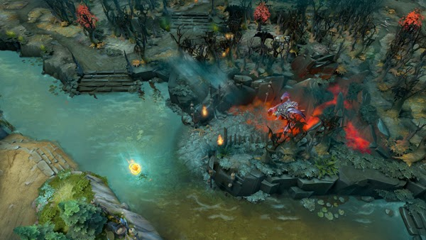</a>

 

<a href="/assets/img/blog/24c4825ad2f7.jpg" imageanchor="1" style="margin-left: 1em; margin-right: 1em;">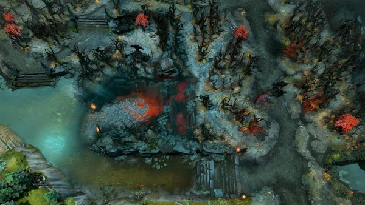</a>

 

<a href="/assets/img/blog/ffe43e90e8b7.jpg" imageanchor="1" style="margin-left: 1em; margin-right: 1em;">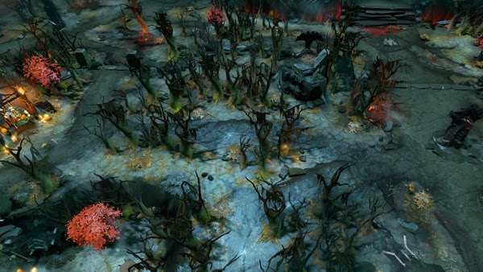</a>

 

<a href="/assets/img/blog/ff2dd09f594f.jpg" imageanchor="1" style="margin-left: 1em; margin-right: 1em;">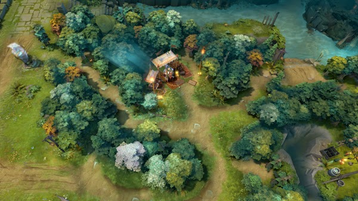</a>

 

<a href="/assets/img/blog/d3c2c98805bf.jpg" imageanchor="1" style="margin-left: 1em; margin-right: 1em;">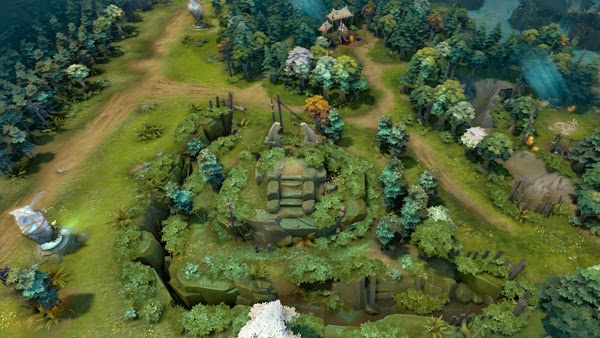</a>

 

<a href="/assets/img/blog/170e19d76362.jpg" imageanchor="1" style="margin-left: 1em; margin-right: 1em;">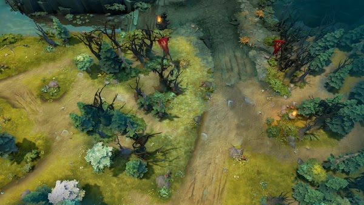</a>

 

<a href="/assets/img/blog/a43068c13d43.jpg" imageanchor="1" style="margin-left: 1em; margin-right: 1em;">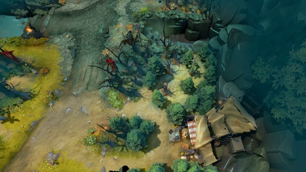</a>

<a href="/assets/img/blog/1a334723425b.jpg" imageanchor="1" style="margin-left: 1em; margin-right: 1em;">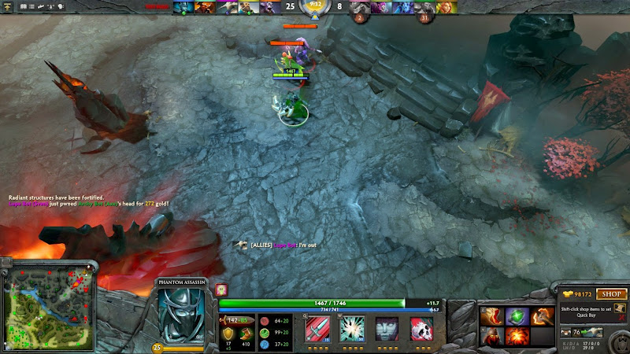</a>

 

<a href="/assets/img/blog/3ce0cf56a4fe.jpg" imageanchor="1" style="margin-left: 1em; margin-right: 1em;">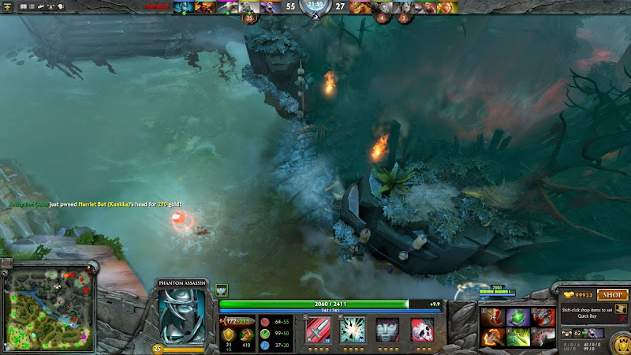</a>

 

<a href="/assets/img/blog/d3ff4208cbb4.jpg" imageanchor="1" style="margin-left: 1em; margin-right: 1em;">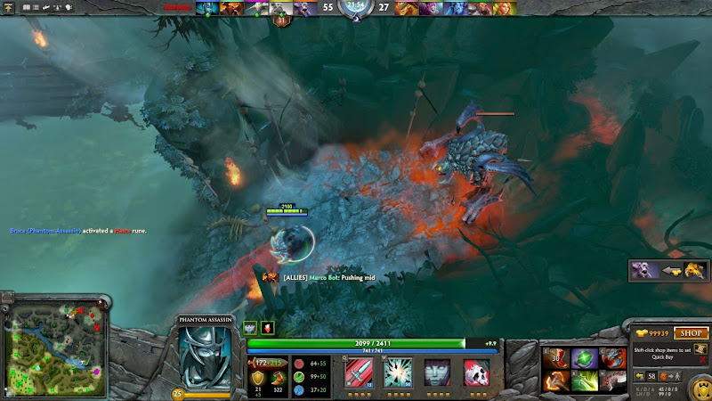</a>

 

<a href="/assets/img/blog/c3a057e83172.jpg" imageanchor="1" style="margin-left: 1em; margin-right: 1em;">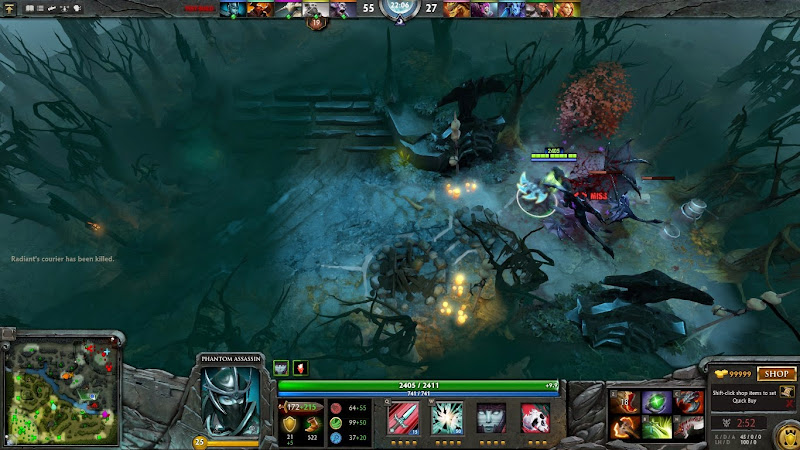</a>

 

 