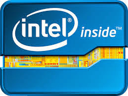
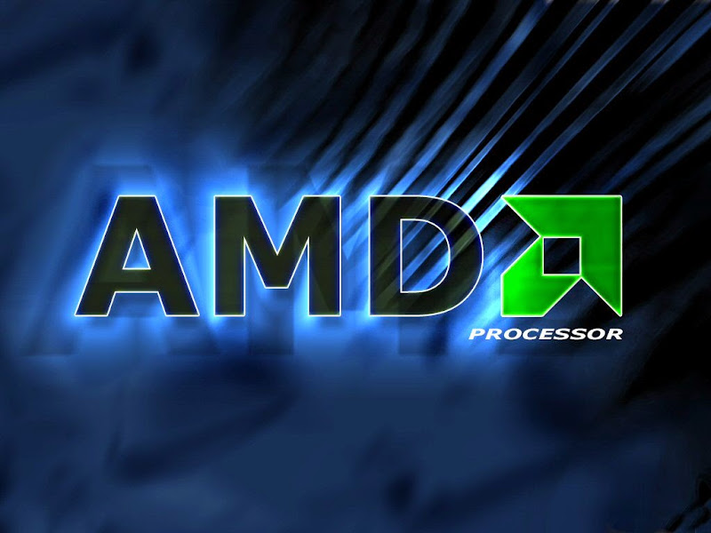
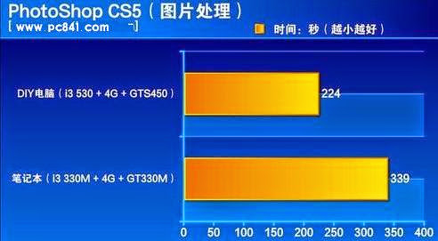
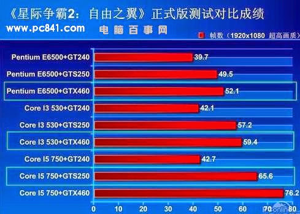
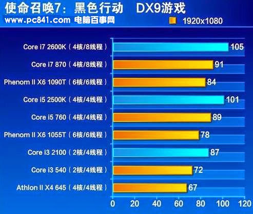

在大多数网友的印象中，CPU只是一个方形配件，正面是金属盖，背面是一些密密麻麻的针脚或触点，并不起眼、也没有美感可言。但这个小配件上却是无数人类智慧的结晶，我们今天能用电脑上网、办公、玩游戏等全都离不开它，而它性能优劣也直接影响用户体验。今天编辑为大家重点介绍的cpu的选购技巧，主要是以大家购买处理器cpu中的几个常见误区来介绍。

　前段时间也为大家介绍过一些大家比较关心的cpu问题，这里总结下链接，方便有兴趣的朋友查找。当然，要选好这个小配件，也是大有文章的，因此，我们针对初级用户，列出了选购CPU时的八大误区，供大家学习与参考。

 
 

<strong>cpu选购误区一：过度迷信某品牌</strong>

　经过多年的竞争，在PC市场的CPU品牌只剩下Intel和AMD两家了。以公司规模来说，Intel比AMD大得多，我们也常常在各种位置看到Intel的创意广告，所以即使不了解电脑的朋友，大多都知道Intel以及它旗下的酷睿系列处理器，导致他们非Intel产品不选。 

　AMD名气虽然小一些，但能与Intel竞争这么多年，产品上必然其过人之处，同价位CPU性价比更高，就是AMD主打的策略，也给很多用户留下了深刻印象。长期下来，也难免会一些有资历的用户认为AMD大多数CPU性价比就是比Intel的高，最常见的例子：XXX元以上买Intel，XXX元以下买AMD。总的来说在中低端产品上AMD处理器具有较高的性价比，而intel处理器主要是中高端产品上性能不俗，近来随着两大处理器巨头不断推出新品，外来局势或许也将发生微妙的变化，我们可以拭目以待。

　总的来说：定价相近Intel/AMD CPU必然有各自的优点，关键靠我们自己去查找资料挖掘，购买时应认准自己的应用需求（比如玩游戏），查询相关资料，看看哪个更适合自己。不要迷信某个品牌，听信别人说某某品牌处理器容易坏等，其实够用原则大家心理应该有个位置，迷信品牌买到的产品不一定是最适合自己的。

<strong>cpu选购误区二：笔记本电脑与台式同型号处理器容易误以性能为性能相当</strong>

　随着笔记本的普及，Intel和AMD两大CPU厂商都非常重视笔记本市场，为了简化CPU品牌，让消费者容易记忆，于是笔记本和台式机所采用的CPU采用了相同的品牌。比如说Intel Core i3、AMD A8 APU，只是在型号后面加一个M以区分，导致很多初级用户以为台式机和笔记本所采用的CPU是一样的，性能也相近的。其实这是非常错误的观点，很多时候两者差距很大，先来看一组笔记本与台式电脑同型号处理器性能对比图：

同型号笔记本与台式电脑处理器性能测试对比结果

　这里也就是说，笔记本电脑处理器与台式电脑处理器是有着很大的区别，即使系列相同（比如说都是Core i5），但笔记本和台式机的CPU实际性能并不相同、也不相近，笔记本的Core i7，综合性能也只是比台式机的Core i3稍强而已。笔记本的优势就是移动方便，而台式机强调性能与体验，如果很少移动，应购买台式机。

　所以当您在考虑购买电脑是选择笔记本电脑还是台式电脑时，你应该考虑的是预算，性能，携带性等综合因素，打个比方，如果电脑不需要经常携带，预算又不是很多，那么游戏用户首选DIY组装电脑，也就是说，笔记本电脑相对DIY电脑最大的优势只有携带方便性，性能与性价比方面明显落后。

<strong style="text-indent: 2em;">cpu选购误区三：选配件不看整体，只注重某些硬件</strong>

　游戏玩家都知道，要在最高特效下畅玩主流的3D游戏，一款高性能显卡是必须的。尽管游戏都提供特效设置，但高特效和中低特效往往会变成“两个游戏”，而要获得最好的游戏体验，唯一途径就是采用高性能显卡。所以一直以来玩游戏显卡都很重要，不过由于以讹传讹、加上一些厂商的夸张宣传，使得很多玩家认为，所有游戏，显卡都是最重要的，CPU不重要。其实这种观点是非常错误的，我们以一款目前比较热门的《星际争霸2》游戏为例：

　玩游戏显卡仍是很重要，这点是肯定的，但不代表CPU不重要。例如《星际争霸2》，Core i3 530 + GTX460的组合还不如Core i5 760 + GTS250的组合，要知道就显卡3D性能而言，GTX460性能是GTS250的1.5倍以上。所以要玩爽游戏，CPU和显卡合理搭配才是王道。

　另外电脑是一个整体，每个硬件都非常重要，所以我们所说的高性价比配置都是建议在均衡搭配上的，前几天编辑也为大家介绍过一篇类似的文章，建议大家去阅读下。

　很多对DIY不太了解的装机朋友攒机就容易产生木桶效应，一个硬件选择不当就会引起整机的木桶效应。譬如，处理器与主板搭配不恰当（主板供电不足），处理器会表现出温度偏高、不稳定、效能低等；一个入门级显卡搭配一个上千的处理器，结果导致整机性能还是维持在入门级性能，处理器性能发挥不完全。&nbsp;

<strong>cpu选购误区四：选处理器只看核心数？</strong>

　在2004年，由于提高频率遇到了瓶颈，于是Intel/AMD只能另辟途径来提升CPU性能，双核、多核CPU便应运而生。在当今多核CPU时代，核心数也就成为判断CPU性能高低的重要标准了。当然，自然有一些初级消费者会认为购买CPU只看核心数就行，反正越多越好。其实这种观点是错误的，还要看的东西很多，比如线程数量，制作工艺等，下面我们给出一组当前热门多核心处理器性能测试结果图给大家参考：

 

编辑观点：核心数是判断CPU性能的重要标准，但不是唯一标准。CPU微架构、频率、缓存大小、技术以及软件的优化度等等均会影响性能，所以出现四核比六核强并不奇怪。只有在相同品牌以及CPU参数相近的情况下，比较核心数才有意义。普通用户选购CPU，还是要看自己的具体应用，查找相关资料选购合适的产品。

<strong>cpu选购误区五：买CPU只看频率？</strong>

　曾几何时，频率可以看成是决定CPU性能的最重要指标，虽然CPU进入到多核心时代，影响CPU性能的参数变得多样，频率的重要性不如以前。但很多用户依然只关注CPU核心数和频率两个参数。

　编辑观点：与CPU核心数一样，频率同样不是衡量CPU性能的唯一标准。核心数多、主频高不见得就更强，因为上面提到CPU微架构、缓存大小、技术以及软件的优化度等等均会影响CPU性能。所以普通用户还是要看自己的具体应用，查找相关资料选购合适的产品。

<strong>cpu选购误区六：TDP热设计功耗等于实际功耗？</strong>

TDP的是“Thermal Design Power”的简称，即“热设计功耗”，它指的是CPU达到负荷最大的时候释放出的热量，单位是瓦特，它主要是给散热器厂商的参考标准。高性能CPU同时也带来了高发热量，比如Core i7 980X，其TDP达到了130W，而主流级的Core i3 2100只有65W，对散热器的要求显然不同。由于厂商只宣传TDP，造成很多人以为TDP就是实际功耗或最大功耗。

　编辑观点：CPU的TDP并不是CPU的实际功耗，CPU的实际功耗是通过初中学的物理知识来计算的：功率（P，单位W）＝电流（I，单位A）x 电压（U，单位V）。不要把TDP看成CPU的实际功耗，CPU的实际功耗必然小于TDP，只有这样才是安全设计。

<strong style="text-indent: 2em;">误区七：商家包超频、包开核的一定稳定？</strong>

　如何免费提升CPU性能？最常见的方法是“超频”，AMD方面除了超频的还有“开核”，这都是DIY用户耳熟能详、免费提升CPU性能的词汇。当然，由于CPU个体差异，无论超频还是开核，都要看运气，于是很多厂商打出包开核、包超频的字样来吸引用户，价格也比普通的贵几十元，那么开核或者超频真的稳定吗？其实笔者很早就建议大家新手朋友最好不要去选择开核或操作，因为两者都可能在一定程度上影响硬件使用寿命，操作不当很容易早成系统不稳定。

编辑观点：商家包超频、包开核的CPU，虽然都是商家经过测试，但都只是简单的跑一下烤机软件。资深的DIY玩家都知道，通过烤机软件不代表超频、开核稳定，还需要各种日常应用验证；而过不了烤机软件，就一定不稳定。所以商家只是过来第一步而已，并不能保证100%稳定，用户购买时应和商家协商好。

<strong>cpu选购误区八：cpu集成的显卡好用吗？</strong>

　CPU内置GPU已经成为CPU的发展趋势，无论从Intel的二代Core i系列还是AMD的APU上，都能看到这样的趋势。早在一年前还有很多人抗拒CPU内置GPU，直到现在还有不少用户有这样的观点，认为这样做增加了成本，消费者要买单；性能也很弱，仍需要购买独立显卡。

　编辑观点：CPU集成GPU已是不可逆转的趋势，其实CPU集成GPU是降低了用户的购机成本，毕竟对于不玩大型3D游戏的用户而言（实际上这部分用户非常庞大），无需购买独立显卡，CPU内置的高清高性能显卡即可满足多数要求。玩大型游戏的话，购买一张独立显卡即可。价格方面，CPU并没有因集成GPU而贵多少。笔者相信今后GPU成为免费附送的部件，就象当前很多人嘲笑集成声卡不行一样，但到如今谁购买电脑会买个独立声卡呢？随着处理器技术的发展，相信今后处理器集成的显卡性能上将有比较大的改进。

全文总结：正所谓“小块头有大智慧”，CPU汇聚了人类无数的智慧，并非简单能凭借一两个参数可以判断它的性能优劣，因此CPU的选购对于很多入门用户来说，也是一门值得研究的学问。从自己的预算和用途从发，两款CPU价格相近时查找相关资料，弄清楚优缺点，这样才能买到最适合自己、性价比最高的CPU。

 

以上都是为了我第一台组装而阅读的资料

目前已经组装好，欢迎大家点入查看 
<h3 class="post-title entry-title" itemprop="name" style="color: #221a2a; font-family: Arial, Tahoma, Helvetica, FreeSans, sans-serif; font-size: 18px; font-weight: normal; margin: 0px; position: relative; text-align: start; text-indent: 0px;">
<a href="http://ahbundance.blogspot.com/2014/10/diy.html" target="_blank">自家用mini ITX桌面型电脑DIY 第一篇：我和“小妾“的第一次接触</a></h3>

<!-- Blogger automated replacement: "https://images-blogger-opensocial.googleusercontent.com/gadgets/proxy?url=http%3A%2F%2F1.bp.blogspot.com%2F-Nw9jvxSOxAk%2FVC7AgADcg_I%2FAAAAAAAAHpI%2FyA50a8jCCcU%2Fs1600%2Fdownload.jpg&amp;container=blogger&amp;gadget=a&amp;rewriteMime=image%2F*" with "https://blogger.googleusercontent.com/img/b/R29vZ2xl/AVvXsEi49T3Sls67LJC6NeCFdhyphenhyphenLTjIHb6O-MVLm_5p0ilNEfjGudADBcmTmQXrRkyGLD1HA_2_F8MskyFDeqT1gu8r1roMYBnRckb5o3poyywExcE-S8CuqOJWBRRLdliqeFL2GCOkHWGi0usw/s1600/download.jpg" -->