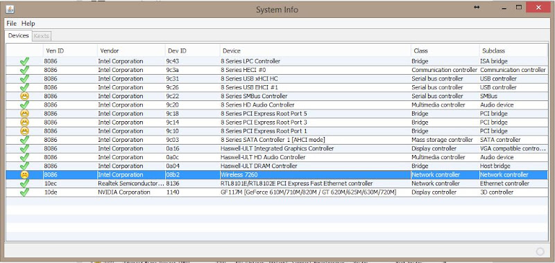
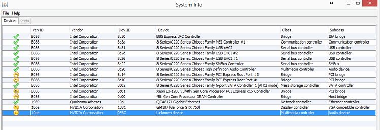

Ven ID 是制造商ID的意思，英文Vender有卖家和商家之意。 Device ID 是硬件的身份识别码。 一般来说，和Ven ID配合使用后就是全球唯一的硬件身份识别码，我们要确认自己的电脑硬件是否能装黑苹果，就是要通过Device ID来分辨它们是不是能被Mac兼容和驱动。

<b><u>下载检查硬件黑苹果兼容性的专用软件：&nbsp;</u></b><b><a href="http://goo.gl/FwGkon">http://goo.gl/FwGkon</a></b>

注意：需要&nbsp;<a href="http://sdlc-esd.sun.com/ESD6/JSCDL/jdk/6u27-b07/JavaSetup6u27.exe?AuthParam=1314619785_67262535c87bdc1b85ddb1622930ae92&amp;GroupName=JSC&amp;FilePath=/ESD6/JSCDL/jdk/6u27-b07/JavaSetup6u27.exe&amp;File=JavaSetup6u27.exe&amp;BHost=javadl.sun.com" style="color: #386d00; margin: 0px; padding: 0px; text-decoration: none;" target="_blank">java&nbsp; 运行环境</a>！如果没有他会提示下载直接进入下载链接

 

步骤：

1.点击菜单 File-Check hardware compatibility 联网检查硬件兼容性！

2.等待1-2分钟后，即可看到结果，笑脸和打钩代表可以兼容并驱动，

一般来说，能驱动显卡、声卡、网卡三大件就可以满足了，其它硬件不必强求，

毕竟是黑苹果，不是吗？

如果无线网卡不能驱动你还非得用它，去买个USB接口的无线网卡用就是了。

 

我笔记本的例子 无线网卡无法使用

 

我桌面电脑 显卡不能使用... 

不过有时候软件也不是那么灵光。到<a href="http://olarila.com/kexts/">http://olarila.com/kexts/</a>输入Device ID查询，把你关心的硬件的Device ID输入到网站的查询窗口中，记得选择查询类别为Device ID，这样就能知道确切结果了。