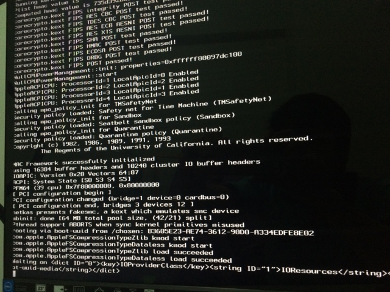
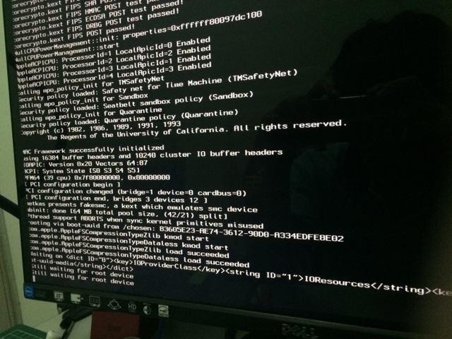
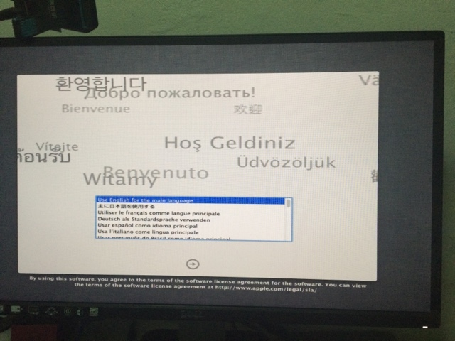
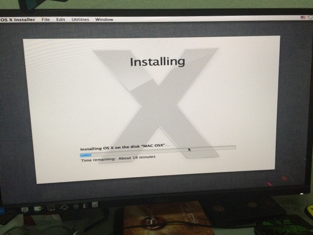
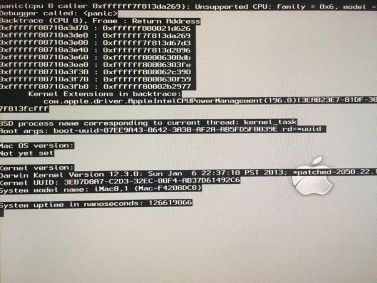

这应该是第二个星期继续折腾了吧 
问题遇到多解决得也多 
 
回顾一下一开始就遇到的问题吧虽然有些是自己粗心　 
但是也有很多是跟我看的教程有不同之处．．． 
每个问题都是折腾 到处搜索 找了一堆没用的最后才得到答案... 
如果这里有帮到你的 ...分享吧... 
 
 
 
我只简短的说明，因为能纠结到这里 这些大概你明白了 
各种教程都会有写 -v -x 这一类的boot flag 
Boot flag 是在启动的时候选择好盘后直接打字就会看到字在下面出来了 
（等我补了教程会在这里放链接） 
 
如果不明白 留言问吧 我在 我懂 我就回回答你。 
 
 
<b>１.变色龙安装引导没反应</b> 
解决:把system隐藏分区添加盘的符（只要不是A: C: D: 基本都ok 我放X）。 

 

 

 
<b>2.引导成功后进入不了安装盘 -v 卡在 PCI configuration begin 错误</b> 
解决:GTX 750 显示卡拆除后解决（硬件不兼容），我的i3 有集成显卡 其实够用了...

 
 
<b>3.Still Waiting for root device 错误</b> 
解决:不能用USB硬盘安装 

 
 
<b>4.黑苹果安装界面键盘滑鼠无法使用</b> 
解决: 用 boot flag：USBBusFix=Yes 或者直接用 PS2 头的键盘滑鼠（我电脑只有一个键盘ps2孔 可是我去那里找这古董啊=。=） 

眼睁睁看着却无法安装你懂吗 
终于安装完后又来&nbsp;

 

 
<b>5.System uptime in nanoseconds :</b> 
到现在为止我还是无法进入系统 面对的问题是安装完系统后启动的时候出现 的错误...

 
 
重装无数次后 
我决定换一个教程看重新再来安装新一点的版本......待续 下载要时间 而且…需要休息了 
 
百般折腾 果然还是应该按照配置购买才玩黑苹果或者直接白苹果比较好 
不过=。= 我已经折腾了那么久 就干脆折腾到底吧！ 
不放弃就能成功!

