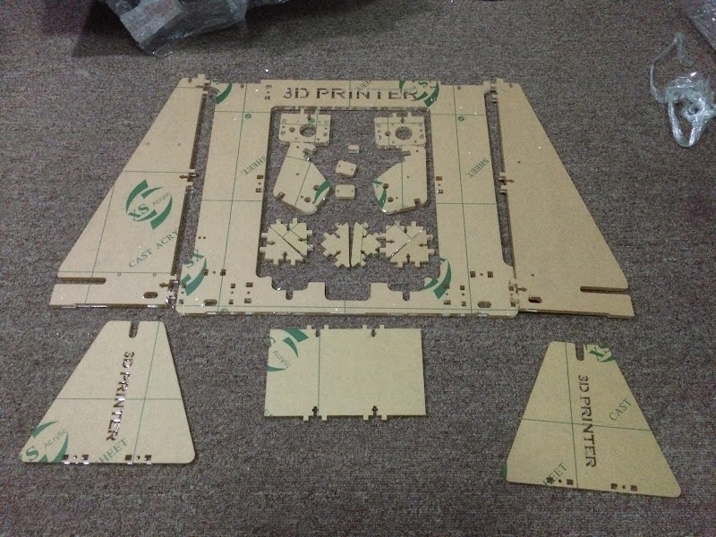
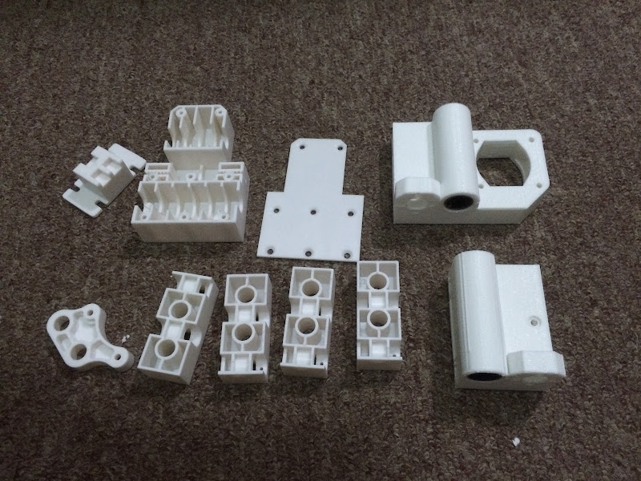
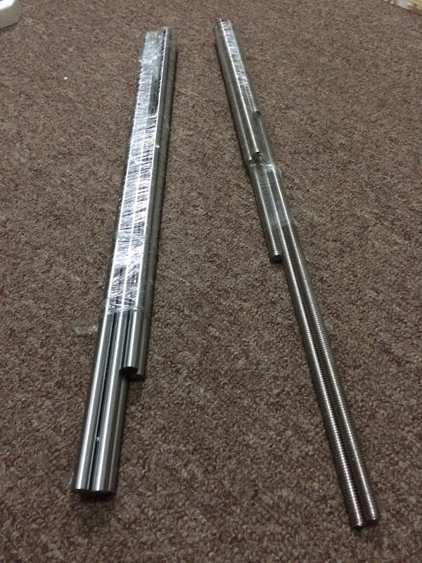
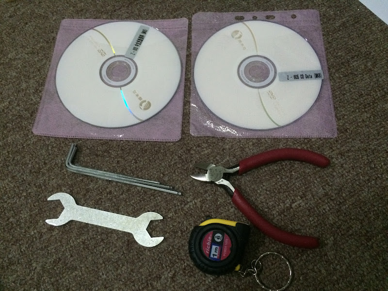
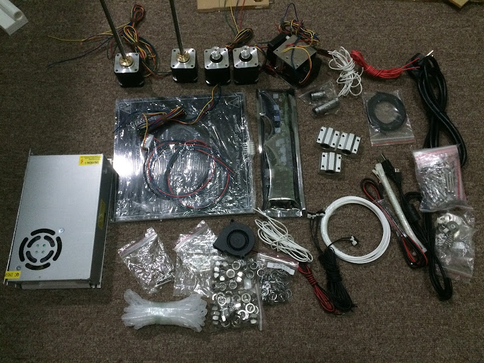
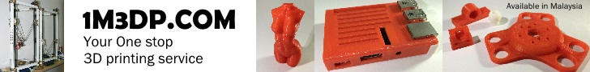

Project loading~~ 3D打印机来啦~

它是来自专业建筑模型公司my models Architectural 帅哥老板Kelvin的订单 
也是我首次组装学习的赞助，感谢老板给机会 感谢来查看的朋友们。

本篇日志记录我制作全过程 所有更新在本帖完成 不开新帖 免得链接混乱 
欢迎订阅我的youtube 视频~~ 感谢谢您阅读的时间

 

Day 0 2014年12月8日 1小时

DIY 记录 &nbsp;unboxing&nbsp;

今天要确定零件内容没少并且对每个零件产生记忆印象&nbsp;将说明书全部查阅一遍

 
今天够累的了早上下飞机就直接上班到现在  安装前准备已完成 正式组装明天继续 相关官方说明书今晚全看完就收工 … 休息恢复元气 明天加速~！ 

<iframe allowfullscreen='allowfullscreen' webkitallowfullscreen='webkitallowfullscreen' mozallowfullscreen='mozallowfullscreen' width='320' height='266' src='https://www.youtube.com/embed/f7tBryJ3Das?feature=player_embedded' frameborder='0'></iframe>

 
 
Day1&nbsp;2014年12月9日&nbsp;&nbsp;4小时

今天做的是龙门板 与Z 热床部分组装

<iframe allowfullscreen='allowfullscreen' webkitallowfullscreen='webkitallowfullscreen' mozallowfullscreen='mozallowfullscreen' width='320' height='266' src='https://www.youtube.com/embed/0KD5oWiRosE?feature=player_embedded' frameborder='0'></iframe>

 

Day2&nbsp;2014年12月10日 4小时 
 
今天要做除了电路线以外 X Y 摩托电子全部 部分组装 

<iframe allowfullscreen='allowfullscreen' webkitallowfullscreen='webkitallowfullscreen' mozallowfullscreen='mozallowfullscreen' width='320' height='266' src='https://www.youtube.com/embed/r-yV4LVTkU4?feature=player_embedded' frameborder='0'></iframe>

 

Day 3&nbsp;2014年12月11日 3小时 
 
 

今天组的是线路组装与 Cable management

<iframe allowfullscreen='allowfullscreen' webkitallowfullscreen='webkitallowfullscreen' mozallowfullscreen='mozallowfullscreen' width='320' height='266' src='https://www.youtube.com/embed/djDdv3wpJBs?feature=player_embedded' frameborder='0'></iframe>

 

Day 4&nbsp;2014年12月12日 3小时

6. 机器运行测试&nbsp;电脑连接 软件安装 摩多位置试调&nbsp;

7. 打印测试 - 本次测试由于皮带松懈导致模型本身有歪曲缺陷 
后续打印测试将移到my models Architectural 办公室继续。 
 

<object class="BLOGGER-youtube-video" classid="clsid:D27CDB6E-AE6D-11cf-96B8-444553540000" codebase="http://download.macromedia.com/pub/shockwave/cabs/flash/swflash.cab#version=6,0,40,0" data-thumbnail-src="https://i.ytimg.com/vi/q25N_-45Ct4/0.jpg" height="266" width="320"><param name="movie" value="https://www.youtube.com/v/q25N_-45Ct4?version=3&f=user_uploads&c=google-webdrive-0&app=youtube_gdata" /><param name="bgcolor" value="#FFFFFF" /><param name="allowFullScreen" value="true" /><embed width="320" height="266"  src="https://www.youtube.com/v/q25N_-45Ct4?version=3&f=user_uploads&c=google-webdrive-0&app=youtube_gdata" type="application/x-shockwave-flash" allowfullscreen="true"></embed></object>

 

More print 
 
 

全材料照片欣赏。

 

亚克力板部件

3D 打印部件

XY 支轴

 

说明书与工具

 

各种改电子零件和螺丝

 

树莓派的机壳打印~

http://ahbundance.blogspot.com/2014/12/how-do-i-block-game-requests-from.html 
 
 

 

