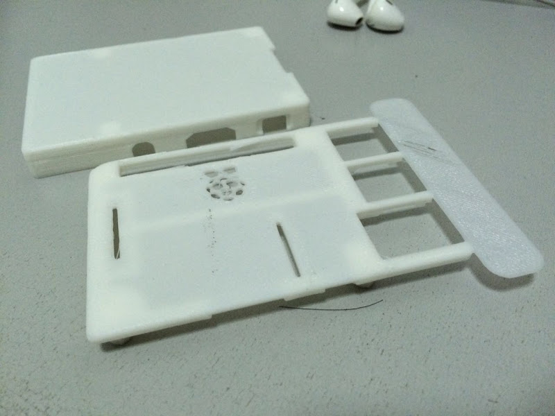
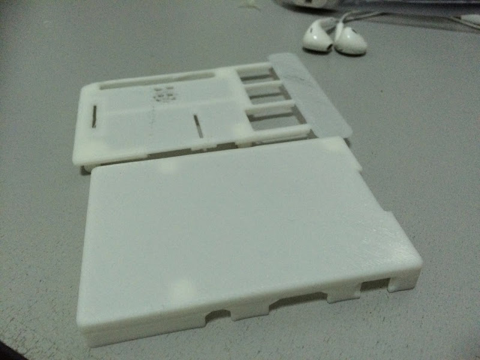
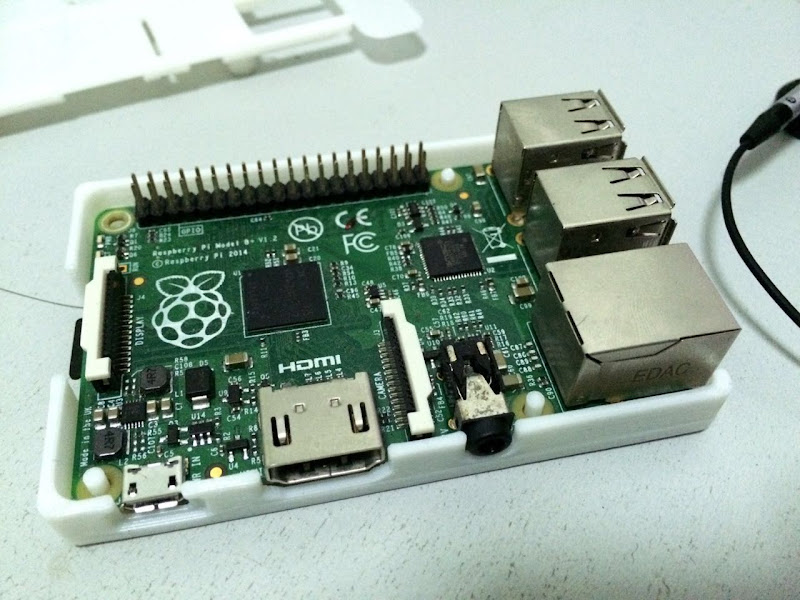
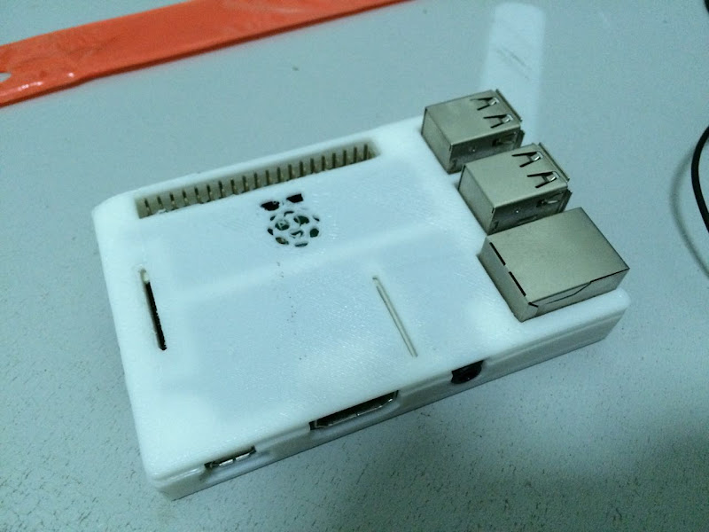
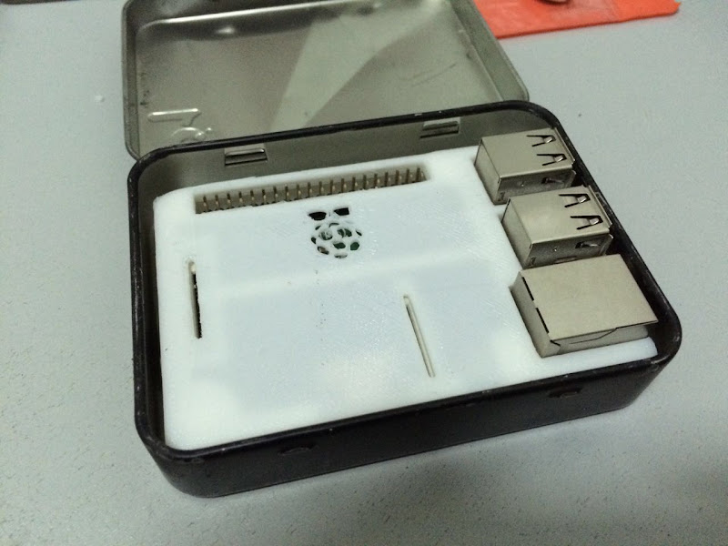
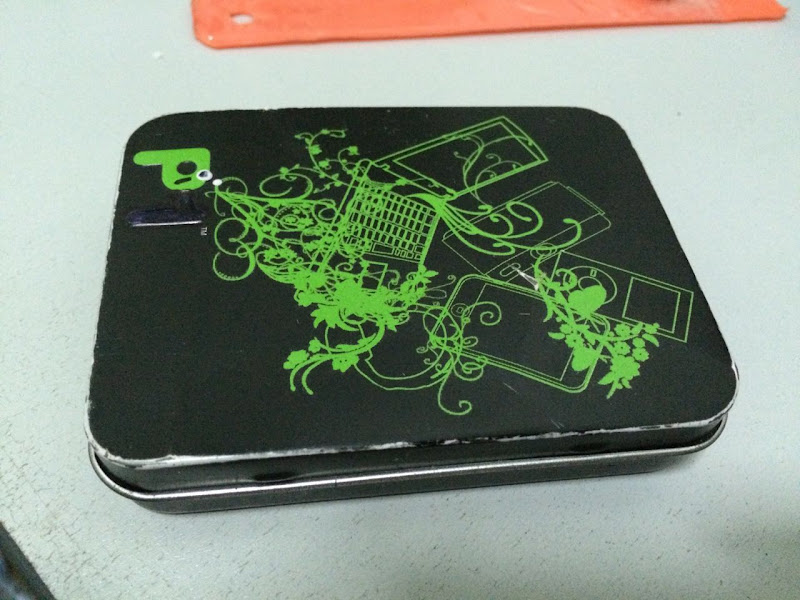
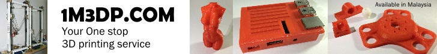

Day 5&nbsp;2014年12月12日 1小时44分

打印树莓派保护壳 Print Raspberry Pi Casing&nbsp;

 

花了几天时间组装的3D打印机总算有一个成品出来了

打印的书<a href="http://ahbundance.blogspot.com/2014/05/raspberry-pi.html" target="_blank">树莓派</a>的机壳&nbsp;

秀一秀~

<iframe allowfullscreen='allowfullscreen' webkitallowfullscreen='webkitallowfullscreen' mozallowfullscreen='mozallowfullscreen' width='320' height='266' src='https://www.youtube.com/embed/wBBuQmnAihM?feature=player_embedded' frameborder='0'></iframe>

<a href="https://www.youtube.com/playlist?list=PLP2pIWO1Ye65g_A_SWkEIiYZOULqgPyQI" target="_blank"><b>3D 打印机组装全过程 youtube playlist&nbsp;</b></a>

<a href="http://ahbundance.blogspot.com/2014/12/how-do-i-block-game-requests-from.html" style="font-family: Helvetica, Arial, 'lucida grande', tahoma, verdana, arial, sans-serif;" target="_blank"><b>3D打印机组装过程 点这里</b></a>

 
 

 

 

 

 

 

&nbsp;安装好最后还是回到原来我收藏树莓派的盒子里=。= 大小刚刚好 哈哈哈

 

更多展示也可以在我的<a href="http://instagram.com/p/wnNX91gkGG/?modal=true" target="_blank">instragram </a>看到~

 

 

 

