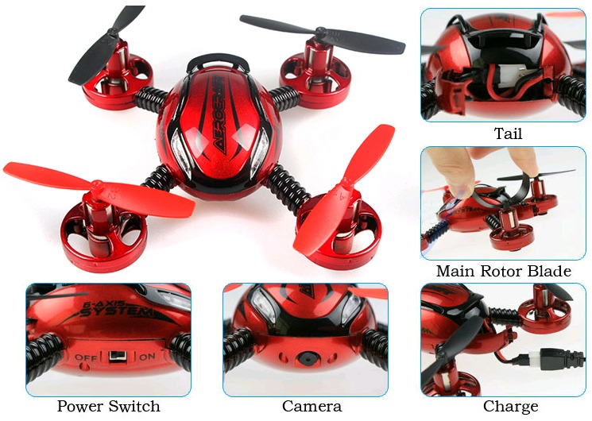
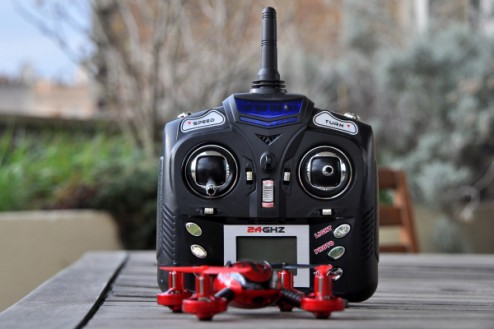

一年一度圣诞节总该送自己点什么吧（借口）

今年就找了一个quadcopter 给自己研究~

这款 JD392 迷你四轴直升机自带摄像头 能够摄影以及拍照 

价格不到马币100，以这个价格来说本来就没有抱着什么太大期望啦~

不过结果和效果倒是挺满意的 呵呵 

 

 

先来一段航拍视频~&nbsp;

 

<iframe allowfullscreen='allowfullscreen' webkitallowfullscreen='webkitallowfullscreen' mozallowfullscreen='mozallowfullscreen' width='320' height='266' src='https://www.youtube.com/embed/8F5lIqM262Q?feature=player_embedded' frameborder='0'></iframe>

 

 
小直升机一开始操作时感觉很困难 第一次操作可能都一样吧 

空中的遥控玩具感觉都是比较困难的，还是得多加练习。 

因为操纵杆很敏感 一下就往很高的地方一下就转过头等等。 
一开始在我房间试飞非常可真是狼狈的很，各种乱撞。耐撞这个也算是验证了吧... 
 
电量上只能飞5分钟就必须充电1小时这个可以算是遗憾。 
不过4千块的也只能飞15分钟...算是那样吧。 
实际上集中精神飞5分钟也够累的了。 
除非那一天已经操作熟悉吧~ 
有翻滚按钮 还没试过 
多加练习再算吧 哈哈 
 
下面是配置内容 有问题欢迎留言~ 
 
 

 

<a href="http://ahbundance.blogspot.com/2014/12/jdx-9322.html" target="_blank"><b>接着第二次的试飞</b></a>

 

