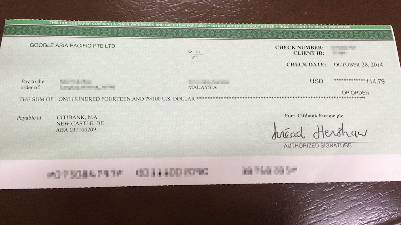
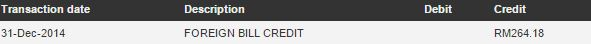

话说三个月前忽然发现自己的谷歌账号超过了100元美金&nbsp;

这忽然来的收入让我莫名兴奋，因为那是传说中的被动收入呢

不过奇怪的是部落格哪可怜的浏览 以及Youtube的记录 应该没有任何可以在一个月内能60美金的啊...

 

先别纠结数据&nbsp;

既然已经突破了取钱环节 当然就要试试取钱咯

 

设置了银行直接过账

结果10月份出现了过账失败的结果...

晕倒 到底我填错了什么啊T_T&nbsp;

 
 

直接改回改设置邮寄拿支票吧（之前已经做了验证）

 

此次顺利在11月尾拿到支票

看到Google的第一张支票的时候很激动呢&nbsp;

毕竟这是第一笔靠兴趣多年累积出来的 传说中的网络被动收入

 

 

天意弄人，去Maybank进支票 竟然获得消息说这支票要等一个月...

好吧

 

今天12月31日 2014年最后一天

我银行收到款项了....

进了户口过后却让我很“激”动...

我怎么算 兑换率应该是有马币400 块就手续费应该有300多啊

 

可是进账的只有264...什么情况! 什么情况啊 ？

2014年最后一天竟然给我这种遗憾

 

各位大大 有经验的朋友 如果知道为什么的也请您告诉我 T_T

 

