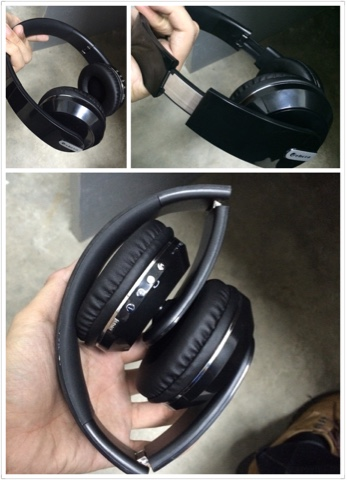

每天10点半后不能开喇叭怕吵到别人 这应当如何？

一直在找蓝牙耳机放在家里用的， 

我这个人特烦恼有电线缠绕的感觉=。=

可是即使在淘宝找 也是觉得又贵质量也不是很满意，<a href="http://ahbundance.blogspot.com/2014/04/elan-vital-sh05-review.html" target="_blank">（之前的一台评测链接点这里）</a>

 

这个竟然无意中在DIY看到的！！？

虽然大块头 但是功能齐全 每天能用几个小时我就满意了。 

当场试听。 额？还有bass 嗯 直接下手就买了。

价格马币65 很厚道了。 

 

认真评测一下吧~

<b>外观</b>

一般耳机样貌，这个价位我本来就要求不高 不过戴起来还算舒适。

看起来也不会太糟蹋 。其实红黑色的比较好看不过货品剩下的2个都质量有点缺 只好选个黑色的。如果您也有兴趣购买 请务必打开验货。

 

<b>耗电量</b>

参数是充电2.5小时 使用8小时。实际上也差不多。

没电的时候可以使用3.5接头变成有线耳机。对我来说这个挺实用的。

 

<b>音质</b>

我耳朵比较残，真的要求不高。但是这个听音乐我真心觉得够用了。

如果您用的是几百上千的耳机的朋友。请无视我的话 自己去测试吧。

 

音量&nbsp;

感觉有点夸张，下面奉上一个视频。这是我测试电台（FM）播放的声音

用iphone 5s录制的。 挂上耳机 开了50% 不到的音量就达到隔音效果了=。= 

 

<iframe allowfullscreen='allowfullscreen' webkitallowfullscreen='webkitallowfullscreen' mozallowfullscreen='mozallowfullscreen' width='320' height='266' src='https://www.youtube.com/embed/Lj9akkiuSTM?feature=player_embedded' frameborder='0'></iframe>

 

如果你也有好货介绍 告诉我啊~

 

 

 

