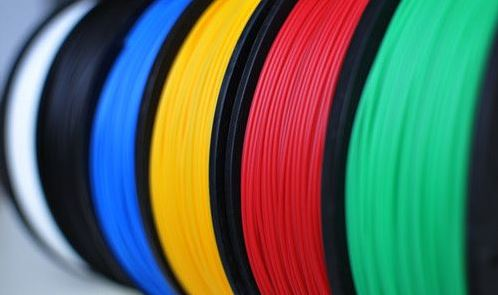
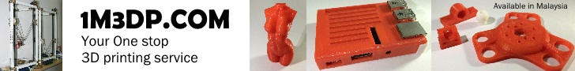

聚乳酸（PLA）是一种新型的生物降解材料，使用可再生的植物资源（如玉米）所提出的淀粉原料制成。机械性能及物理性能良好。聚乳酸适用于吹塑、热塑等各种加工方法，加工方便，应用十分广泛。相容性与可降解性良好。聚乳酸在医药领域应用也非常广泛，如可生产一次性输液用具、免拆型手术缝合线等，低分子聚乳酸作药物缓释包装剂等。

 
 
 
聚乳酸（PLA）除了有生物可降解塑料的基本的特性外，还具备有自己独特的特性。传统生物可降解塑料的强度、透明度及对气候变化的抵抗能力皆不如一般的塑料。聚乳酸（PLA）和石化合成塑料的基本物性类似，也就是说，它可以广泛地用来制造各种应用产品。聚乳酸也拥有良好的光泽性和透明度，和利用聚苯乙烯所制的薄膜相当，是其它生物可降解产品无法提供的。聚乳酸（PLA）具有最良好的抗拉强度及延展度，聚乳酸也可以各种普通加工方式生产，例如：熔化挤出成型，射出成型，吹膜成型，发泡成型及真空成型，与目前广泛所使用的聚合物有类似的成形条件，此外它也具有与传统薄膜相同的印刷性能。

 
ABS树脂是目前产量最大，应用最广泛的聚合物，它将PS，SAN，BS的各种性能有机地统一起来，兼具韧，硬，刚相均衡的优良力学性能。ABS是丙烯腈、丁二烯和苯乙烯的三元共聚物，A代表丙烯腈，B代表丁二烯，S代表苯乙烯。

ABS塑料一般是不透明的，外观呈浅象牙色、无毒、无味，兼有韧、硬、刚的特性，燃烧缓慢，火焰呈黄色，有黑烟，燃烧后塑料软化、烧焦，发出特殊的肉桂气味，但无熔融滴落现象。

 
ABS塑料具有优良的综合性能，有极好的冲击强度、尺寸稳定性好、电性能、耐磨性、抗化学药品性、染色性，成型加工和机械加工较好。ABS树脂耐水、无机盐、碱和酸类，不溶于大部分醇类和烃类溶剂，而容易溶于醛、酮、酯和某些氯代烃中。

打印ABS材料与打印PLA聚乳酸区別: 
<ul style="box-sizing: border-box; line-height: 28.7999992370605px; list-style: none; margin: 0px; padding: 0px;">
<li style="box-sizing: border-box; list-style: none; margin: 0px; padding: 0px;">打印PLA時气味为棉花糖气味，不像ABS那样刺鼻子的不良气味</li>
<li style="box-sizing: border-box; list-style: none; margin: 0px; padding: 0px;">PLA可以在沒有加热床情况下打印大型零件模型而边角不会翘起。</li>
<li style="box-sizing: border-box; list-style: none; margin: 0px; padding: 0px;">PLA加工温度是200℃，ABS在220℃以上</li>
<li style="box-sizing: border-box; list-style: none; margin: 0px; padding: 0px;">PLA具有较低的收缩率，即使打印较大尺寸的模型时也表现良好</li>
<li style="box-sizing: border-box; list-style: none; margin: 0px; padding: 0px;">PLA具有较低的熔体强度，打印模型更容易塑形，表面光泽性优异，色彩艳丽</li>
</ul>

 
PLA是晶体，ABS是一种非晶体。当你加热ABS时，会慢慢转换凝胶液体，不经过状态改变。PLA像冰冻的水一样，直接从固体到液体。因为没有相变，ABS不吸喷嘴的热能。部分PLA，使喷嘴堵塞的风险更大。

 
如何判断材料是PLA还是ABS?&nbsp;

从表面上很难判断,对比观察ABS呈亚光,而PLA很光亮. 加热到195度,PLA可以顺畅挤出,ABS不可以. 加热到220度,ABS可以顺畅挤出,.PLA会出现鼓起的气泡,甚至被碳化.碳化会堵住喷嘴,非常危险。

 
本源文来自http://www.vx.com/news/zsk2013_23.html 欢迎浏览 
 

 

