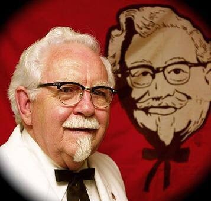

这是一个流传网络的个人故事。 
 
他一生中經歷了1009次失敗，一次成功就夠了！ 5歲時，他的父親病逝，沒有留下任何財產。母親外出做工。年幼的他在家照顧弟妹，並學會自己做飯。 12歲時，母親改嫁，繼父對他十分嚴厲，常在母親外出時痛打他。 ..&nbsp; 
 14歲時，他輟學離校，開始了流浪生活。 16歲時，他謊報年齡參加了遠征軍。因航行途中暈船厲害，被提前遣送回鄉。 18歲時，他娶了老婆。但只過幾個月，老婆就變賣了他所有的財產逃回娘家。 20歲時，他當電工、開輪渡，後來又當鐵路工人，卻沒有一樣工作順利。 30歲時，他在保險公司從事推銷工作，後因獎金問題與老闆鬧翻而辭職。 31歲時，他自學法律，並在朋友的鼓動下幹起了律師行當。一次審案時，竟在法庭上與當事人大打出手。 32歲時，他失業了，生活非常艱難。 35歲時，不幸又一次降臨到他的頭上。當他開車路過一座大橋時，大橋鋼繩斷裂。他連人帶車跌到河中，身受重傷，無法再乾輪胎推銷員工作。 40歲時，他在一個鎮上開了一家加油站，因掛廣告牌把競爭對手打傷，引來一場糾紛。 47歲時，他與第二任妻子離婚，三個孩子深受打擊。 61歲時，他競選參議員，但最後落敗。 65歲時，政府修路拆了他剛剛紅火的快餐館，他不得不低價出售了所有設備。 66歲時，為了維持生活，他到各地的小餐館推銷自己掌握的炸雞技術。 75歲時，他感到力不從心，因此轉讓了自己創立的品牌和專利。新主人提議給他1萬股，作為購買價的一部分，他拒絕了。後來公司股票大漲，他因此失去了成為億萬富翁的機會。 83歲時，他又開了一家快餐店，卻因商標專利與人打起了官司。 88歲時，他終於大獲成功，全世界都知道了他的名字。 他，就是肯德基的創始人——哈倫德•山德士。他說： “人們經常抱怨天氣不好，實際上並不是天氣不好。只要自己有樂觀自信的心情，天天都是好天氣。 你所付出的，最後都會回到你身上！ 
 

 
山德士这个人霸气十足 你看他拿自己的脸来做logo就知道了. 
很多时候我会在这类文章莫名的感动，主人公都是排除万难迈向成功... 
我虽然也是面对多次失败的一个人，但是比起失败更让我恐惧的是时间... 
要是我和此故事一样要到88岁才能成功过安乐的日子... 
姑且不说我有没有那么长命，要是一直找不到自己该做的事我觉得我是会崩溃的。 
现在的我 凭什么我想休息！ 
 