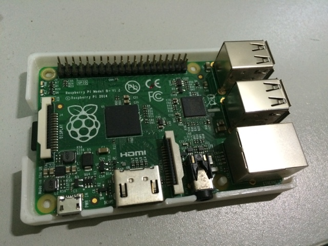
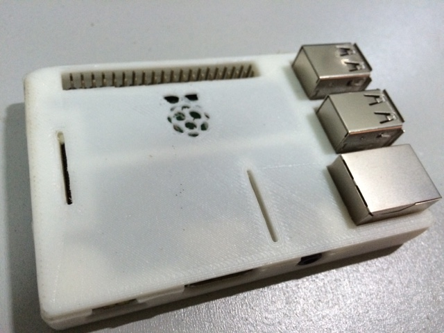

出售二手树莓派B+ 送<a href="http://ahbundance.blogspot.com/2014/12/diy-3d-3d-print-raspberry-pi-casing.html" target="_blank">3D打印的壳</a>一个。价格暂定RM100

只有一台。

 

你问我树莓派是什么？请看<a href="http://ahbundance.blogspot.com/2014/05/raspberry-pi.html" target="_blank">这里、这里、这里</a>

 

它可以要来做什么？请看<a href="http://ahbundance.blogspot.com/2014/08/raspberry-pi-10.html" target="_blank">这里</a>

如果你想看我拿来做什么你看 <a href="http://ahbundance.blogspot.com/2014/11/webiopi.html" target="_blank">这里</a>＆<a href="http://ahbundance.blogspot.com/2014/08/raspberry-piiii.html" target="_blank">这里</a>

 

 

 
 

 

