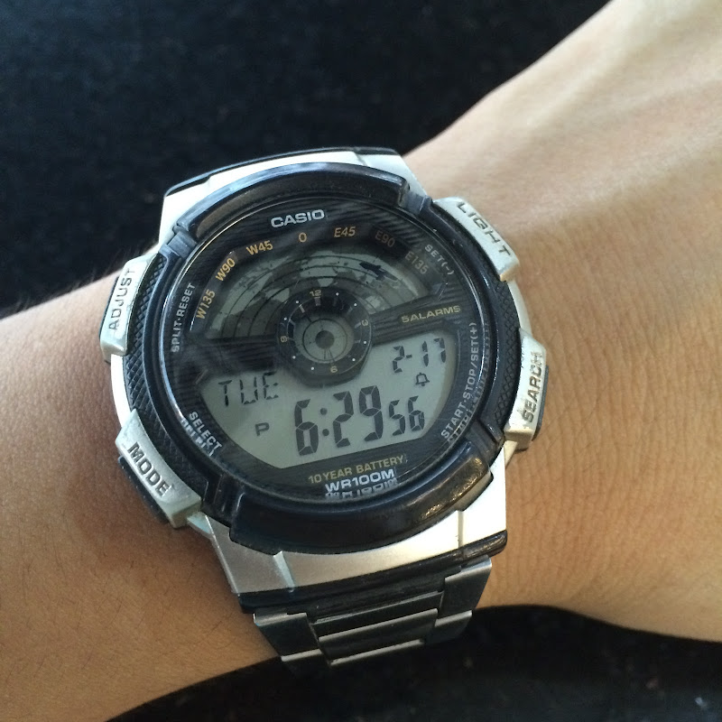

平时都把你带在身边 不懂得珍惜，

到失去了你才明白你是多么重要

每天不经意的看你

终于在上个月弄丢了你

才发现原来你不在了 我做任何事情都很无奈

 

我的Casio 手表啊

有你我就无需吧手机掏出来了&nbsp;

有了你工作上我做事更精准

有了你不同国家时差我也可以一键调整

有了你煮泡面也可以不超时

 

终于在今天失而复得

 

我会好好的珍惜你~ 请你再陪我10年

好让我证明...

...

...

你的电池真的可以耐10年

 

哈哈哈

 

附上一张我的宝贝casio&nbsp;

 