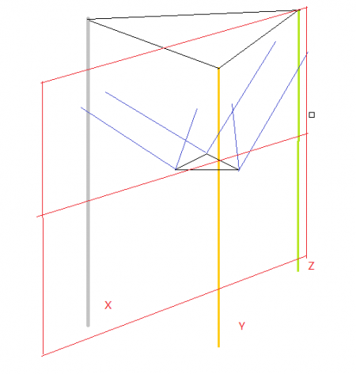
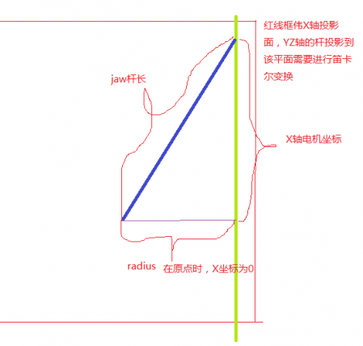
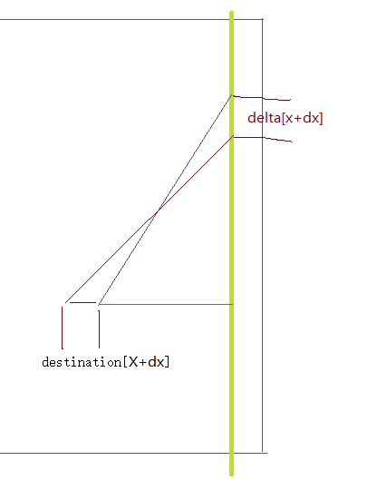

参考来源:百度&nbsp;作者: 鸭嘴兽 

一、前言

Delta机型是一种并联式运动结构的3d打印机，delta机型实际上是分为两大类，一种是工业上用的并联式机器人；另外一种是rostock 的运动结构。这两种结构做出来的打印机给人的感觉都是非常cool的。所以大伙都偏好这类型的打印机，目前主流的固件marlin 和repetier都支持rostock结构的3d打印机。这里鸭哥就谈谈自己对rostock机型的运动算法的理解，继而从运动算法中推算一下如何调试一台rostock的参数。

 
 

二、基础知识

要理解rostock的全部运动算法所要涉及的数学知识不是太多，如果不记得的话，是时候找高中数学老师喝喝茶吃个小饭啦。

1)三角函数 sin cos 这个是理解rostock计算过程的基础知识

2)笛卡尔空间坐标转换/线性代数，这个嘛是属于进阶内容，如果懂那就更好啦，如果不懂也没关系，在把所有的外界条件全部设置为理想情况下，这个笛卡尔空间坐标转换可以不用精通的。（包括鸭哥也不敢说对笛卡尔空间坐标转换和线性代数精通哦）

3)marlin程序的结构逻辑结构（对于arduino ide /arduino程序基本教程，这里就不展开了，不懂的小白们可以先学一下arduino的基础教程先，饭要一口一口得出，路要一步一步的走）

三、Marlin程序解读

这里鸭哥不打算讲marlin的整个loop（）函数的流程，讲讲delta机型的核心部分。对于marlin来说，delta机型和非delta机型在对于温控、看门狗、电机运动甚至空间坐标等方面都是一样的。区别在哪里呢？区别就在与delta多了一个笛卡尔坐标转换的函数

Marlin的loop()主体流程

Void loop ()

{

Get_command() ; //从sd卡或者串口获取gcode

Process_command(); //解析gcode并且执行代码

Manage_heater();//控制机器的喷头和热床的温度

Manage_inactivity();//

checkHitEndstops();//检查endstop的状态

Lcd_update(); //更新lcd 上面的信息

}

在这个过程中 process_command()是控制的核心，各位仔细研读一下process_command()的代码就发现arduino的厉害了。简单说一下process_command()的流程,说白了，process_command()就是一个巨大的case 结构，这里讲讲G1命令的大致逻辑（G1命令不知道的自己搜索去）：

Process_command()

{

Case 0: //g0-&gt;g1

Case 1 :

{

if(Stopped == false) {

get_coordinates(); // 获取当前的坐标，这里是指打印件的世界坐标哦，不是delta的xyz电机的坐标哦！普通结构的打印机则是一样的。

#ifdef FWRETRACT

if(autoretract_enabled)

if( !(code_seen('X') || code_seen('Y') || code_seen('Z')) &amp;&amp; code_seen('E')) { //获取 命令中 xyze轴的参数

Float echange=destination[E_AXIS]-current_position[E_AXIS]; //这里是算最小回抽值的，如果移动距离小于最小回抽值就不回抽了。这里是一个辅助功能。简单了解可以了。

if((echange&lt;-MIN_RETRACT &amp;&amp; !retracted) || (echange&gt;MIN_RETRACT &amp;&amp; retracted)) { //move appears to be an attempt to retract or recover

current_position[E_AXIS] = destination[E_AXIS]; //hide the slicer-generated retract/recover from calculations

plan_set_e_position(current_position[E_AXIS]); //AND from the planner

retract(!retracted);

return;

}

}

#endif //FWRETRACT

prepare_move(); //执行移动命令

return;

}

}

从上面的代码来看呢，对于运动类的Gcode，marlin会在process_command()函数中获取xyze各轴的参数后算出目标坐标（destination[_AXIS]），也会使用get_coordinates()来获取当前坐标（current_position[E_AXIS]）（再次强调，这个坐标是打印件的世界坐标），当我们知道了目标坐标和当前坐标以后，空间中移动的距离就可以算出来了（不会算的，请自觉请高中数学老师吃饭去），接下来marlin就使用perpare_move()来控制电机啦。

接下来呢很自然就要讲讲prepare_move()这个函数啦。先上代码先,代码鸭哥做了精简，只看关键的部分就是delta和普通结构的代码，先说一下plan_buffer_line(）这个函数的作用的把坐标数组current_position[i] 、 destination[i] 放到一个内存的一个缓存区里面，然后控制电机转多少圈这样一个作用的，具体代码可以自己去看，在一旦进入这个函数以后，delta和普通机型的代码都是一样的，也就是说delta和普通结构的电机控制其实是一样的。

Difference[i]数组 ：用来储存目标坐标和当前坐标之间的距离的，（这里是包含了xyze轴的数组）

Destination[i]数组：目标坐标的数值，是从process_command()函数中G1读取XYZE参数获取的。

Current_position[i]数组：当前坐标的数值，是从G1 命令中get_coordinates()传递过来的。如果是3个轴都归零的情况下，current_position就是储存三个坐标原点，如果开始运动了，这里的值就是上一个prepare_move()循环执行后上一次的destination[i]的值。（这个下面会有看到赋值语句）

Delta[i]数组：delta打印机的xyz三个电机要移动的距离

void prepare_move()

{

#ifdef DELTA // 设置机子是delta机型（rostock）

float difference[NUM_AXIS]; //定义目标距离，用于转换坐标用的过渡变量

for (int8_t i=0; i &lt; NUM_AXIS; i++) {

difference[i] = destination[i] - current_position[i];

} //计算世界坐标的距离值

//***开始计算笛卡尔距离 并且暴力直线插值来减少运算量***//

float cartesian_mm = sqrt(sq(difference[X_AXIS]) +

sq(difference[Y_AXIS]) +

sq(difference[Z_AXIS]));

if (cartesian_mm &lt; 0.000001) { cartesian_mm = abs(difference[E_AXIS]); }

if (cartesian_mm &lt; 0.000001) { return; }

float seconds = 6000 * cartesian_mm / feedrate / feedmultiply;

int steps = max(1, int(delta_segments_per_second * seconds));

for (int s = 1; s &lt;= steps; s++) {

float fraction = float(s) / float(steps);//直线插值

for(int8_t i=0; i &lt; NUM_AXIS; i++) {

destination[i] = current_position[i] + difference[i] * fraction;

}

//***结束计算笛卡尔距离 并且暴力直线插值来减少运算量***//

calculate_delta(destination);//将打印件的世界坐标转换为xyz电机轴的运动量

plan_buffer_line(delta[X_AXIS], delta[Y_AXIS], delta[Z_AXIS],

destination[E_AXIS], feedrate*feedmultiply/60/100.0,

active_extruder);

}

#endif // DELTA

。。。。。。。。。。。。

#if ! (defined DELTA || defined SCARA)

// Do not use feedmultiply for E or Z only moves

if( (current_position[X_AXIS] == destination [X_AXIS]) &amp;&amp; (current_position[Y_AXIS] == destination [Y_AXIS])) {

plan_buffer_line(destination[X_AXIS], destination[Y_AXIS], destination[Z_AXIS], destination[E_AXIS], feedrate/60, active_extruder); //直接将destination[i]的值发送去运动缓存里面

}

else {

plan_buffer_line(destination[X_AXIS], destination[Y_AXIS], destination[Z_AXIS], destination[E_AXIS], feedrate*feedmultiply/60/100.0, active_extruder);

}

#endif // !(DELTA || SCARA)

for(int8_t i=0; i &lt; NUM_AXIS; i++) {

current_position[i] = destination[i]; //更新当前坐标的值为刚执行的目标坐标值

}

}

好，看了一大段代码后小结一下。对于普通结构来说，G1 每次将新读取gcode代码参数传递给prepare_move()函数中destination[i]数组以后，prepare_move()就会将其传递到plan_buffer_line（）进行电机的运动。而delta结构呢，就相对复杂一点，G1命令读取了gcode代码参数后也是传递到prepare_move()函数中destination[i]，然后marlin要计算目标坐标与当前坐标的笛卡尔距离，然后通过固定时间间隔的方式来将笛卡尔距离分成若干个小直线，通过这样的方式来就减少cpu的浮点预算量，然后再通过calculate_delta[i]函数来将简化后的destination[i]换算成三个电机的运动坐标，并传递到delta[i]中，接下来就是plan_buffer_line（）了。

最后！到了最后了！来看看calculate_delta（）函数，这个函数的主要用途是将打印件的世界坐标转换为三个垂直的电机轴的运动坐标哦。注意：新的marlin支持SCARA结构的delta，那里也有个calculate_delta（）的函数，不过那个跟rostock有点差异。所以我们还是看rostock的吧。

void calculate_delta(float cartesian[3])

{

delta[X_AXIS] = sqrt(delta_diagonal_rod_2

- sq(delta_tower1_x-cartesian[X_AXIS])

- sq(delta_tower1_y-cartesian[Y_AXIS])

) + cartesian[Z_AXIS];

delta[Y_AXIS] = sqrt(delta_diagonal_rod_2

- sq(delta_tower2_x-cartesian[X_AXIS])

- sq(delta_tower2_y-cartesian[Y_AXIS])

) + cartesian[Z_AXIS];

delta[Z_AXIS] = sqrt(delta_diagonal_rod_2

- sq(delta_tower3_x-cartesian[X_AXIS])

- sq(delta_tower3_y-cartesian[Y_AXIS])

) + cartesian[Z_AXIS];

/*

SERIAL_ECHOPGM("cartesian x="); SERIAL_ECHO(cartesian[X_AXIS]);

SERIAL_ECHOPGM(" y="); SERIAL_ECHO(cartesian[Y_AXIS]);

SERIAL_ECHOPGM(" z="); SERIAL_ECHOLN(cartesian[Z_AXIS]);

SERIAL_ECHOPGM("delta x="); SERIAL_ECHO(delta[X_AXIS]);

SERIAL_ECHOPGM(" y="); SERIAL_ECHO(delta[Y_AXIS]);

SERIAL_ECHOPGM(" z="); SERIAL_ECHOLN(delta[Z_AXIS]);

*/

}

代码很简单delta[i]是指电机轴的运动坐标，cartesian[i]是指打印件的世界坐标，从上面的程序来看就是从prepare_move（）中经过插值简化的destination[i]。大伙随便看一个轴的换算

delta[X_AXIS] = sqrt(delta_diagonal_rod_2

- sq(delta_tower1_x-cartesian[X_AXIS])

- sq(delta_tower1_y-cartesian[Y_AXIS])

) + cartesian[Z_AXIS];

delta_diagonal_rod_2 是推杆长的平方

delta_tower1_x 是左前柱的x坐标值，是由radius这个参数算出来的

delta_tower1_y 是左前柱的y坐标值，是由radius这个参数算出来的

具体怎么算就看下面这个函数

void recalc_delta_settings(float radius, float diagonal_rod)

{

delta_tower1_x= -SIN_60*radius; // front left tower

delta_tower1_y= -COS_60*radius;

delta_tower2_x= SIN_60*radius; // front right tower

delta_tower2_y= -COS_60*radius;

delta_tower3_x= 0.0; // back middle tower

delta_tower3_y= radius;

delta_diagonal_rod_2= sq(diagonal_rod);

}

好了回顾一下marlin的delta机型参数是需要什么？

推杆的长度、电机轴上滑块的宽度、喷头支架的宽度，还有三个电机的圆半径。对不对？忘了？！不要紧，给你看看代码

//=================================================================

//========================Delta Settings =============================

//=================================================================

// Enable DELTA kinematics and most of the default configuration for Deltas

#define DELTA

// Make delta curves from many straight lines (linear interpolation).

// This is a trade-off between visible corners (not enough segments)

// and processor overload (too many expensive sqrt calls).

#define DELTA_SEGMENTS_PER_SECOND 200

// NOTE NB all values for DELTA_* values MUST be floating point, so always have a decimal point in them

// Center-to-center distance of the holes in the diagonal push rods.

#define DELTA_DIAGONAL_ROD 250.0 // mm //杆长

// Horizontal offset from middle of printer to smooth rod center.

#define DELTA_SMOOTH_ROD_OFFSET 175.0 // mm //电机轴的圆半径

// Horizontal offset of the universal joints on the end effector.

#define DELTA_EFFECTOR_OFFSET 33.0 // mm // 装喷嘴的平台的中心到杆连接处的距离

// Horizontal offset of the universal joints on the carriages.

#define DELTA_CARRIAGE_OFFSET 18.0 // mm //电机轴滑块的距离

// Effective horizontal distance bridged by diagonal push rods.

#define DELTA_RADIUS (DELTA_SMOOTH_ROD_OFFSET-DELTA_EFFECTOR_OFFSET-DELTA_CARRIAGE_OFFSET)

通过上述的参数可以算出一个DELTA_RADIUS ,这个delta_radius就是上面“delta_tower1_x 是左前柱的x坐标值，是由radius这个参数算出来的 ”里面的radius了。

至此所有有关与delta的运动的代码已经通读了一遍。下面就开始分析分析代码和运动的关系了。

四、Rostock运动分析

下面是Rostock的结构示意图，分析的第一步是简化整个结构，这里就需要将XY电机的两个竖轴投影到Z轴的平面上，下图中红色线框画出来的就是z轴的平面，同时我们可以不考虑XY电机的推杆的运动情况，因为可以XY电机轴的运动可以通过投影在z轴平面上的虚拟轴笛卡尔空间变换转换回去的。

 

投影好了以后接下来把z轴放平，那么单独考虑z轴情况，这个情况是在坐标原点的z电机轴与推杆的情况。为了简化过程，鸭哥已经把z轴滑块，喷头平台都设定为0 了。那么，z电机轴方向便形成了一个三角形，推杆、radius和z轴电机上的电机坐标，这个时候三角函数出来啦！ 推杆2 = radius 2+ 电机坐标 2 在这三角形中推杆是不变的，另外三角形始终都会是一个直角三角形。一定要记住这几个条件哦。

 

好，现在我们假设喷头只在x轴上运动，z轴y轴都不动。如果打印件的世界坐标移动dX距离，rostock需要考虑的问题就是怎么讲dX转换为z轴电机的移动距离了。下图就是用来表示这种情况。由于推杆长度是不变的，那么

推杆2 = radius 2+ 电机坐标 2 就变成下面这样

推杆2 = (radius +dX)2+ (电机坐标-dx) 2

Radius的距离换成destination[x]，电机坐标换成delta[x]

推杆2 = (destination[x +dX])2+ (delta[x-dx]) 2

 

Marlin中calculate_delta（）这个函数其实就是算

推杆2 = (destination[x +dX])2+ (delta[x-dx]) 2

这个等式明白啦，打印件X轴和Y轴的运动分析就明白啦。

另外，再看看打印件z轴的运动分析，还是看看源代码

delta[X_AXIS] = sqrt(delta_diagonal_rod_2

- sq(delta_tower1_x-cartesian[X_AXIS])

- sq(delta_tower1_y-cartesian[Y_AXIS])

) + cartesian[Z_AXIS];

Cartesian[z]是没有在sqrt函数里面的，而是直接加在delta[x]的值上面的。

所以，在调机的时候应该先调z轴，这里就是原因。因为在XYZ三个轴的坐标中只有Z轴是直接通过同步轮和电机脉冲就可以调准的。调准了z轴以后再调XY轴才是对的。

五、调机心得

下面是鸭哥的调机的一些心得，与大家分享一下。首先是调机的顺序：

1）选择同步轮可以选择GT2 20齿/40齿 。因为GT2是2mm齿距，整数齿可以使脉冲数为整数，同时也减少三角函数运算中浮点运算的压力，同时也简化自己的调整步骤。

2）调机时先调z轴运动方向的精度，这个是直接用同步轮和脉冲数就可以调好的。

3）z轴调好以后就调整x轴或者Y轴的，看看运动的路径是不是呈现平面状态，如果喷头运动路径是弧线这个时候就要调整radius了，增加或者减少radius的值来调整运动路径是一个平面

4）完成上述步骤以后就可以试打了，这个时候就可以看看XY轴的打印误差是多少了。如果杆长等硬件参数都比较准确的话那打印误差不会有多少的。如果XY轴有误差的话就要根据误差大小来等量调整radius这个变量。对应代码是

// Horizontal offset from middle of printer to smooth rod center.

#define DELTA_SMOOTH_ROD_OFFSET 175.0 // mm //电机轴的圆半径

等量修改，比如X轴偏大0.1mm，那么 调整量就是175.0-0.1 = 174.9 了哦。这样反复几次就基本调好了。

六、后记

本文是鸭哥的一些心得体会，是个人对marlin还有rostock的一些了解，当然也许会有这样那样的错误和不足，鸭哥非常欢迎大神高手批评指正。本文首发于珠海创客空间网站，欢迎转载，著名出处。欢迎修改，修改的地方用另外的文字著名就可以了。

完整下载地址：

 

<a href="http://www.3dsc.com/uploads/file/20141224/20141224154141_34384.doc" style="color: #0066ff; font-size: 12pt; font-style: italic; line-height: 34px; text-decoration: none;" target="_blank">Delta（rostock型)3d打印机算法解读及调试步骤</a>

