

<a href="/assets/img/blog/f228fe753d7a.jpg" imageanchor="1" style="margin-left: 1em; margin-right: 1em;">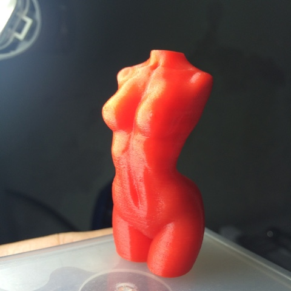</a>

先引狼入室~

 

前言: 
连续的忙绿快两星期了 
 
因为一些因素，我组装的打印机借回来了 
这台打印机最大的缺点就是底座是分开的， 
一旦移动位置就会变得不可理喻 要从新试调。 
在试调过程中也遇上了很多问题，这些问题也确实是很累人的。 
不过王天不负有心人，不放弃就能找到其中乐趣。 
 
经过一段时间的试调与测试。 
现在这台打印机已经可以高精度的持续工作。 
 
好了接下来是一些我测试过程所遇到的问题和总结。 
 
 
 
<b>打印机上手 别急着打印</b> 
<b> </b>打印前必须了解的包括打印机器运作，打印素材等相关资料的学习。 
这样可以减少无谓的浪费，如果连这点觉悟都没有的话...我也不知道该说什么了 
 
由于我也算是一个环保主义者，无可奈何下我只选相对环保的PLA。 
而且PLA 180 C° 就能打印相对算起来电量会省一些吧。 
我并未实际去算电源所需，但是尽可能节源就是了。 
况且ABS本身就是有毒的，也不适合在家使用。 
否则遭殃的还是自己。 
 
即使如此我还是因为面对种种问题而浪费了不少的素材... 
以下是打印失败以及试调用的耗材 总和是110g 这里不是少数啊 1卷耗材的 10分之一啊！ 
不过庆幸的是 试调完毕后连续打印都没问题 这才算是恶补了过失。 
 
<a href="/assets/img/blog/d1e9dce73cc8.jpg" imageanchor="1" style="margin-left: 1em; margin-right: 1em;">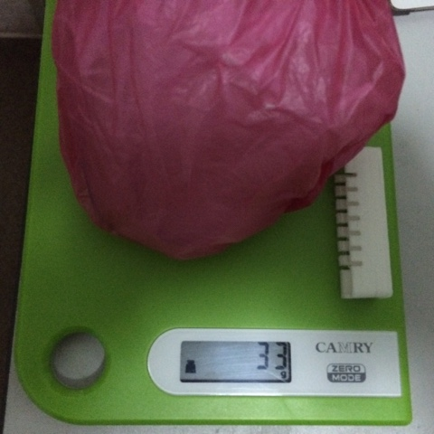</a><a href="/assets/img/blog/2cf97b9247b8.jpg" imageanchor="1" style="margin-left: 1em; margin-right: 1em;">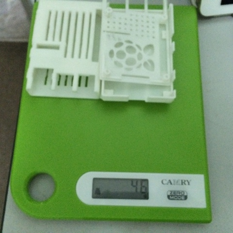</a><a href="/assets/img/blog/e9009e6b7438.jpg" imageanchor="1" style="margin-left: 1em; margin-right: 1em;">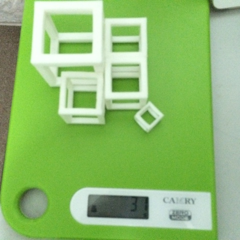</a> 

 
 
打印一边不均匀或不是正方形皆可可透过以下方法纠错。 
1.Z轴左右是否平衡 
2.热床是否平衡 
3.电机的齿轮是否松垮 
要是以上都没问题 再检查下面这两条 由于这个定义很复杂 
下面部分还是建议找专家去解决吧 免得赔了夫人又折兵。 
4.电机电量输出不足或过剩 
5.Gcode切片是否出错。（基本不可能，但是网上看到有人po过这个问题） 
 

<a href="/assets/img/blog/125bf0cfac9d.jpg" imageanchor="1" style="clear: left; float: left; margin-bottom: 1em; margin-right: 1em;">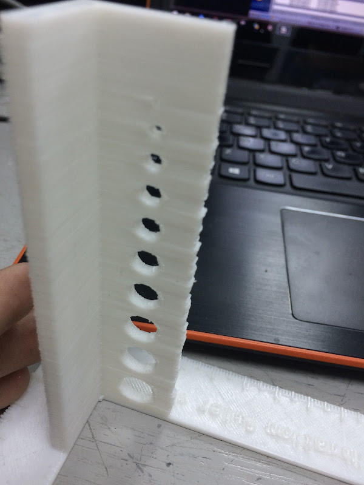</a>

 

<a href="/assets/img/blog/6dbafa6834f7.jpg" imageanchor="1" style="clear: left; float: left; margin-bottom: 1em; margin-right: 1em;">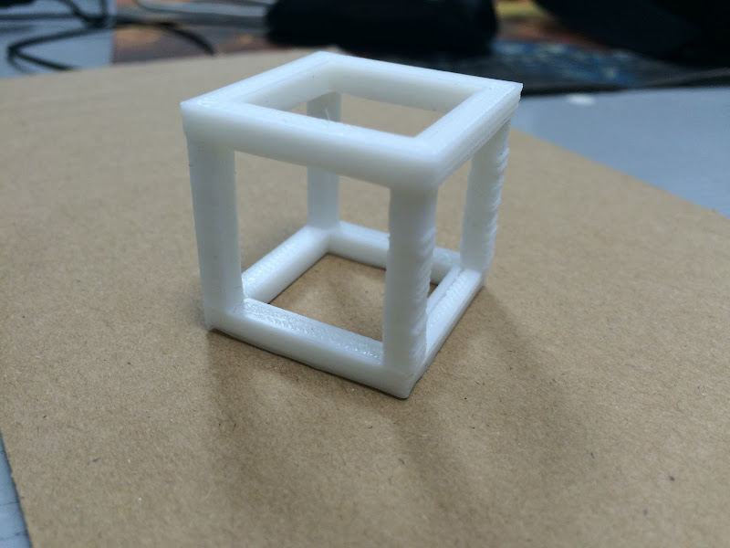</a>

 
 
 
 
 
 
 
 
 
 
 
 
 
 
 
我遇上的问题就是3 由于松得太轻微我甚至无法用肉眼观察。 
决定狠狠的锁上结果问题解决了=。= （丢脸） 
 
然后打印了这个5字夹 夹在皮带上 一切好说。 

<a href="/assets/img/blog/729ccb49fcb7.jpg" imageanchor="1" style="margin-left: 1em; margin-right: 1em;">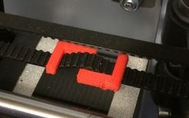</a>

<a href="http://www.thingiverse.com/thing:10082" target="_blank">Thing:10082</a> 
 
这个1.5cm的小鸟笼是我最后的试调品之一。 
虽然还有一些拉丝，但实际上具体以及清楚问题在于回抽和冷却上就不去在意了。 
 

<a href="/assets/img/blog/1d505e2f6d9c.jpg" imageanchor="1" style="margin-left: 1em; margin-right: 1em;">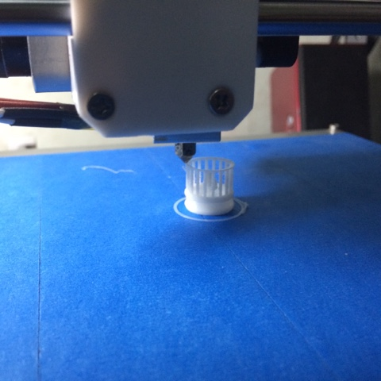</a>

<a href="/assets/img/blog/eea81bb8c44d.jpg" imageanchor="1" style="margin-left: 1em; margin-right: 1em;">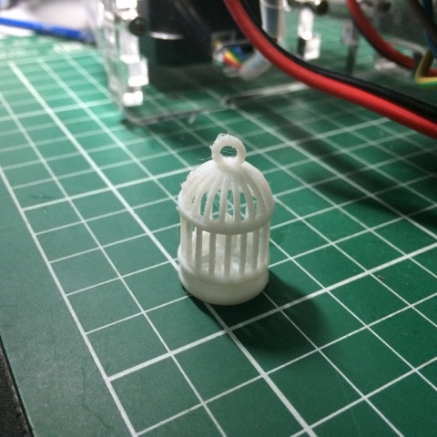</a>

 

试调好打印机 当然先任性一下来个养眼的饰品咯。

此艺术品约6CM高 ，我称它拇指美女（拇指大小嘛） 

 

实用物品之一 树莓派保护壳

<a href="/assets/img/blog/4928b4df2e20.jpg" imageanchor="1" style="margin-left: 1em; margin-right: 1em;">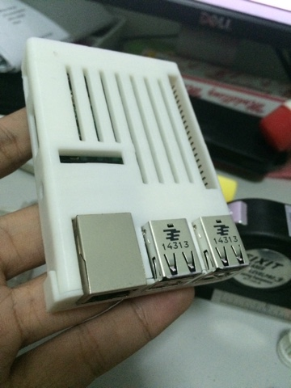</a><a href="/assets/img/blog/fb0c3959fefd.jpg" imageanchor="1" style="margin-left: 1em; margin-right: 1em;">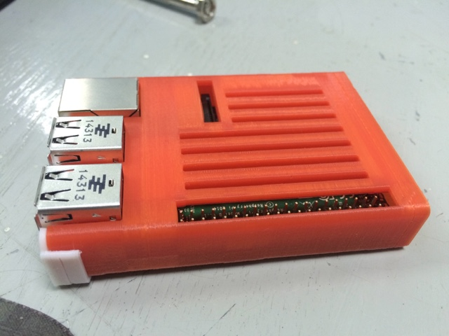</a>

 

*调整Z轴平行的窍门，途中龙门部分有两个小箭头， 指着的位置有螺丝

它们位置就是平行的标准。只要对准可以说是几乎没误差（除非人为误差咯）

<a href="/assets/img/blog/2951ad0c0987.jpg" imageanchor="1" style="margin-left: 1em; margin-right: 1em;">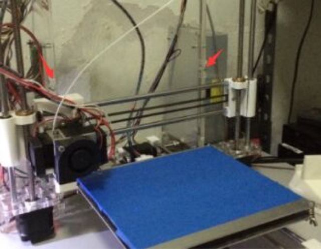</a>

 

以下就是操纵这一切的主谋。

3D打印界神板~&nbsp;

Reprap Meizi Version 2.3 内涵Micro SD 卡槽可供脱机打印

<a href="/assets/img/blog/3320cbf1d36c.jpg" imageanchor="1" style="margin-left: 1em; margin-right: 1em;">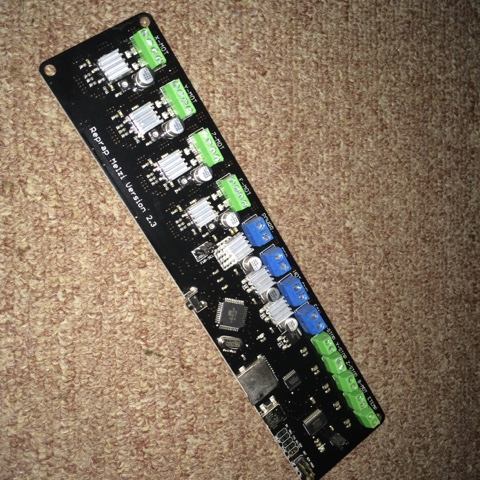</a>

 

其实延期了2星期才发的贴 嗯。。。 无言=。=

 

 

<a href="http://1m3dp.com/" target="_blank">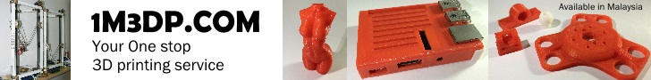</a>

 

 
 

