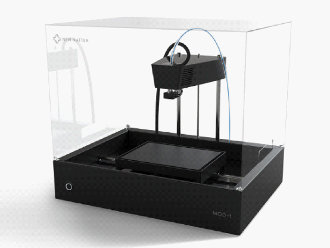
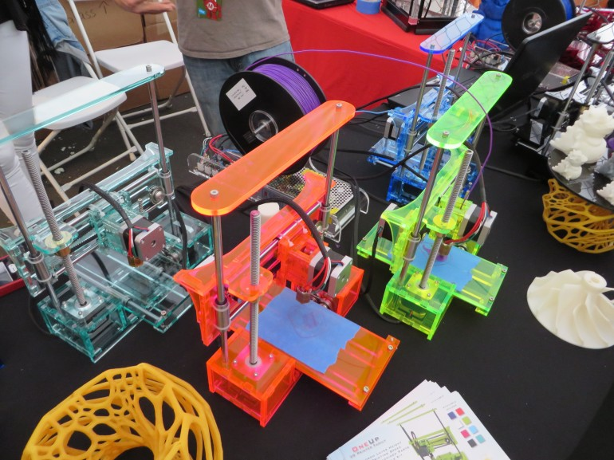
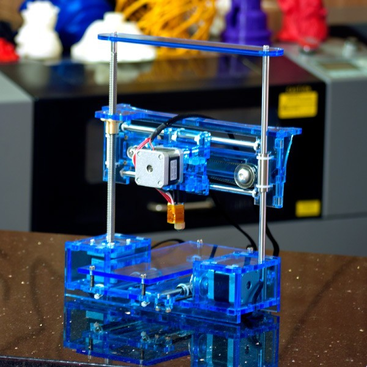
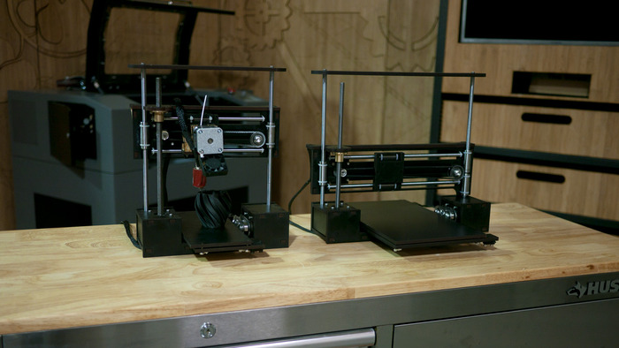
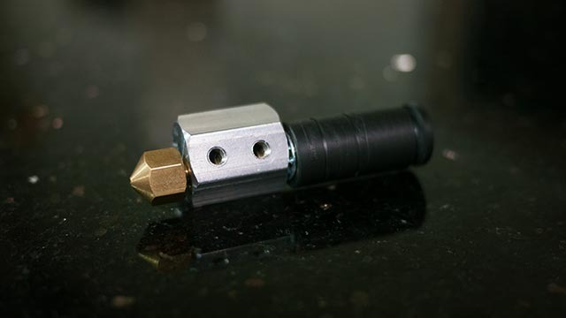
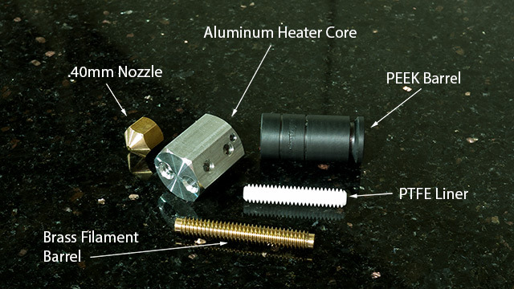
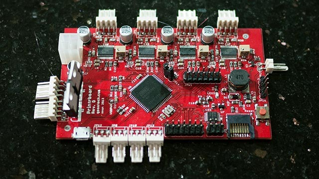
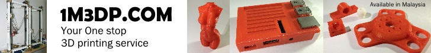

QU-BD One Up是一款开源的<a class="ps_cb" href="http://www.baidu.com/s?wd=3D%E6%89%93%E5%8D%B0%E6%9C%BA&amp;ie=gbk&amp;tn=SE_hldp00990_u6vqbx10" style="background-color: white; box-sizing: content-box; color: #653096; font-family: 'Helvetica Neue', Helvetica, Arial, sans-serif; font-size: 14px; line-height: 24px; outline: 0px; text-align: start; text-decoration: none;" target="_blank">3D打印机</a>，所有部件都是自由提供，公司曾承诺在众筹结束后公布其源文件。<a class="ps_cb" href="http://www.baidu.com/s?wd=Little%20Rock&amp;ie=gbk&amp;tn=SE_hldp00990_u6vqbx10" style="background-color: white; box-sizing: content-box; color: #653096; font-family: 'Helvetica Neue', Helvetica, Arial, sans-serif; font-size: 14px; line-height: 24px; outline: 0px; text-align: start; text-decoration: none;" target="_blank">Little Rock</a>表示，这款产品之所以能保持低价，从众多3D打印机中脱颖而出，关键原因是他们并没有进行其他装配，只保留了必要的零件。有没有觉得以后的孩子都会自己用这台玩具来打印玩具呢？

 
 

‘

一般的XYZ构造的3D打印机 都是5个电机为主。

主要是Z 轴会有两个 那么在Z移动的时候不会出现不均衡情况。 
可是此类廉价架构只有4个电机组成 Z明显只有一边。上面还有cable tide... 
个人觉得相对4电机的还是三角构造比较稳定。 
 

 

 

 

 

 

尽管个人不是很看好此款打印机，主板还是很吸引我的~&nbsp;

 

 

 