

话说几天前的其中一天是我的生日，

 

我哪在韩国的女朋友知道我喜欢DIY,&nbsp;

特地预约了这个戒指工作坊。

在我生日的当天就把我带到这里。

<a href="/assets/img/blog/6544726db397.jpg" imageanchor="1" style="clear: left; float: left; margin-bottom: 1em; margin-right: 1em;">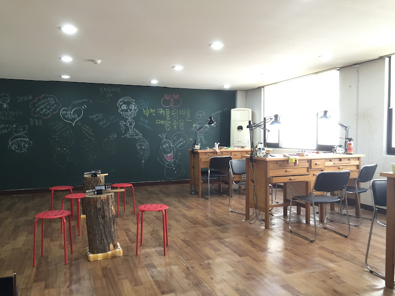</a><b style="margin-left: 1em; margin-right: 1em;"></b>

 

一来我们想要的戒指有了,二来我的生日礼物也解决了,&nbsp;

还正所谓一石二鸟啊！

 
 

<b>银片敲字</b>（内环的字）

情侣戒内环当然要有一些特别意义的文字啦。

这我两的秘密 大家就别窥探了 哈哈哈。

<a href="/assets/img/blog/510bb87536b0.jpg" imageanchor="1" style="margin-left: 1em; margin-right: 1em;"><b>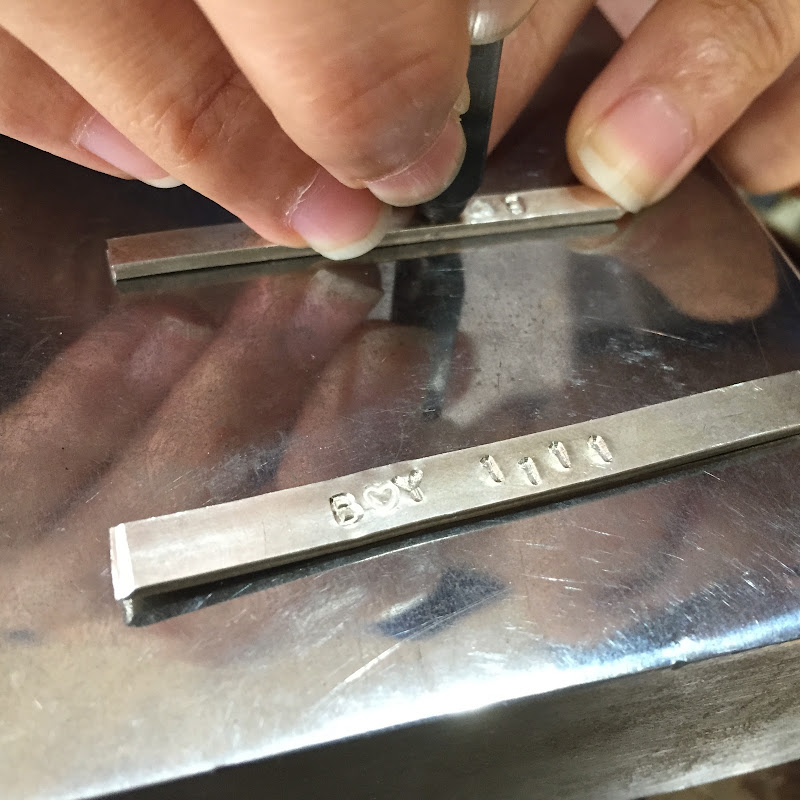</b></a>

<b> </b><iframe allowfullscreen="" class="YOUTUBE-iframe-video" data-thumbnail-src="https://i.ytimg.com/vi/oQqTwt6yFrE/0.jpg" frameborder="0" height="266" src="https://www.youtube.com/embed/oQqTwt6yFrE?feature=player_embedded" width="320"></iframe>

<b>这是敲字的工具，文字、数字&amp;符号。</b>

<a href="/assets/img/blog/6ba6e100f5e1.jpg" imageanchor="1" style="margin-left: 1em; margin-right: 1em;"><b>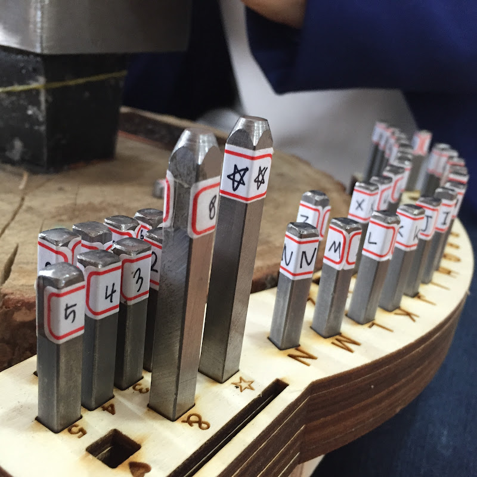</b></a>

<b> </b>

<b>敲银台 视乎在这个上面怎么敲都行@@</b>

<a href="/assets/img/blog/cd2a2860f1cf.jpg" imageanchor="1" style="margin-left: 1em; margin-right: 1em;"><b>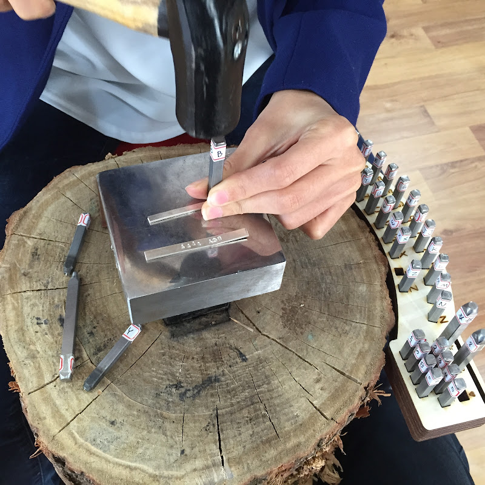</b></a>

<b> </b>
<b>犯二一下， 你看那个虐待狂 敲的很兴奋嘛</b> 

<a href="/assets/img/blog/a51fb5bf3653.jpg" imageanchor="1" style="margin-left: 1em; margin-right: 1em;"><b>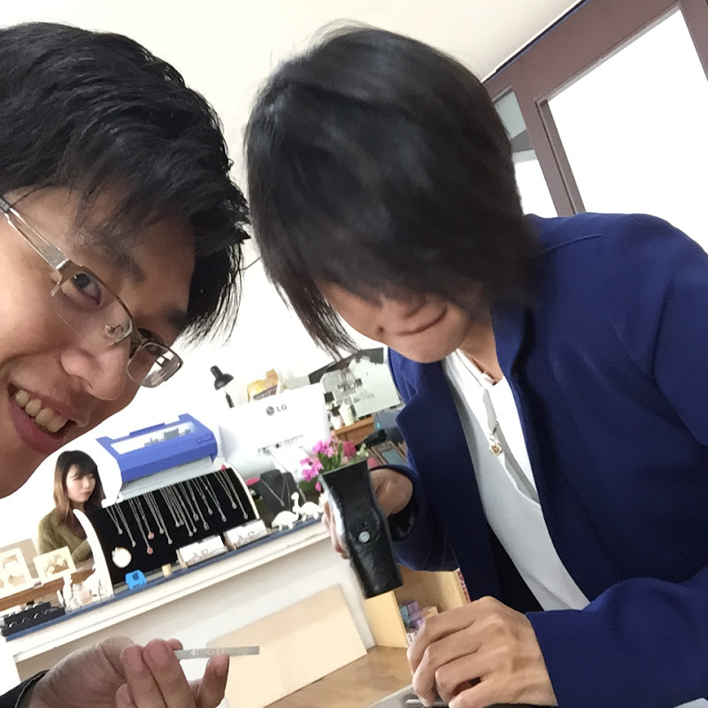</b></a>

<b> </b>
 

敲完内字后然后将就是将银片火烤，烤后是纯白色的。

烤后很容易弯曲，就乘着这个时候掰弯&nbsp;

然后在特殊棒子上卷成戒指形状。

<a href="/assets/img/blog/e4d518ae924a.jpg" imageanchor="1" style="margin-left: 1em; margin-right: 1em;">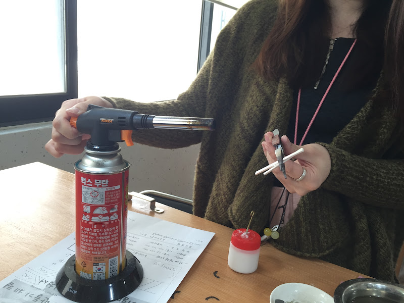</a>

下图这个是用来调整戒指大小的，

<a href="/assets/img/blog/5e0892c65397.jpg" imageanchor="1" style="margin-left: 1em; margin-right: 1em;"><b>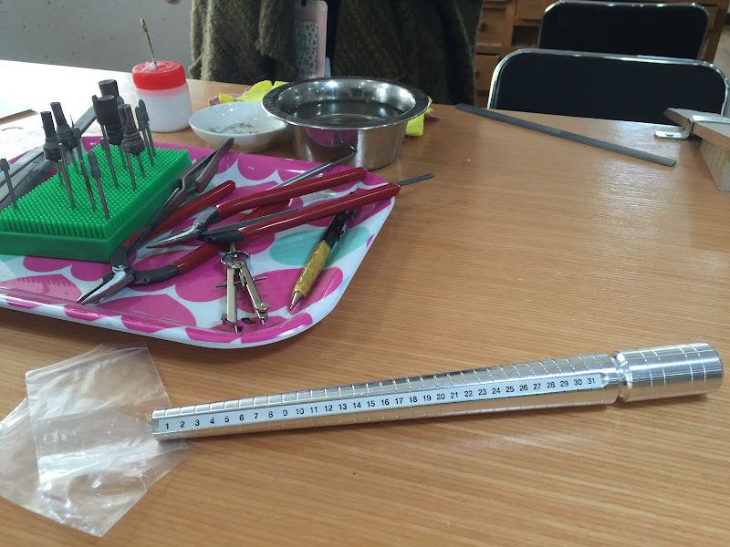</b></a>

<b>然后将环借口缝隙部分用融化胶 和小银片融在一起</b> 
 

<iframe allowfullscreen="" class="YOUTUBE-iframe-video" data-thumbnail-src="https://i.ytimg.com/vi/qwYmLwtdzBQ/0.jpg" frameborder="0" height="266" src="https://www.youtube.com/embed/qwYmLwtdzBQ?feature=player_embedded" width="320"></iframe>

 
<b>然后就是用打磨机打磨咯。</b> 
<b>先后从粗到细的打磨头。</b> 
<b>根据个人选择的款式 抛光（滑面粗面）等等</b> 

<a href="/assets/img/blog/33698d27b325.jpg" imageanchor="1" style="margin-left: 1em; margin-right: 1em;"><b>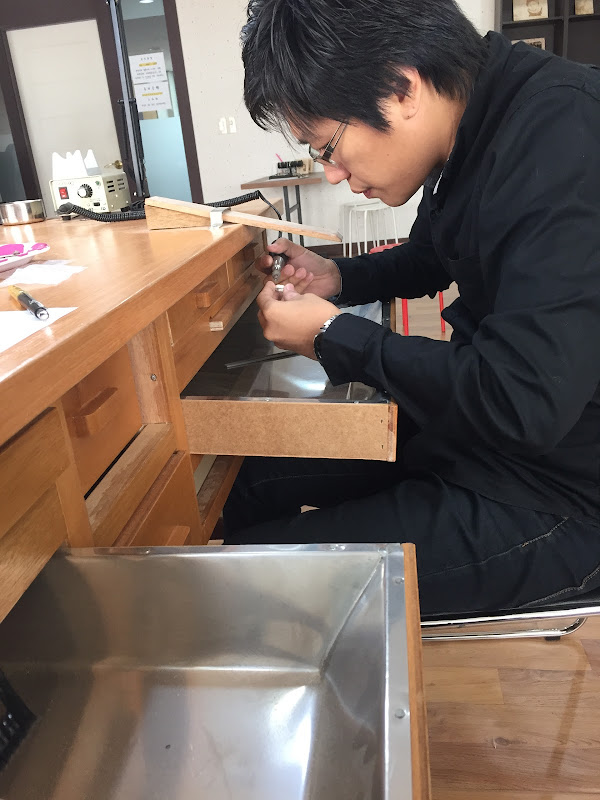</b></a>

 
然后利用机器刻字 上色 再磨干净 就好了. 

<a href="/assets/img/blog/283b5c38ec2a.jpg" imageanchor="1" style="margin-left: 1em; margin-right: 1em;"><b>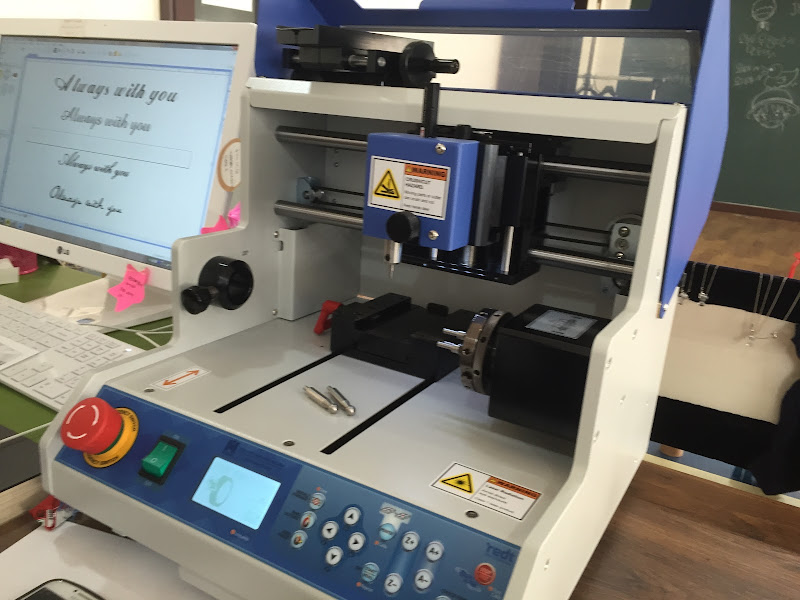</b></a>

<b> </b>
 

登登登~ 最后嗮下成品 谢谢收看

<a href="/assets/img/blog/5bbf2eb5c2d2.jpg" imageanchor="1" style="margin-left: 1em; margin-right: 1em;"><b>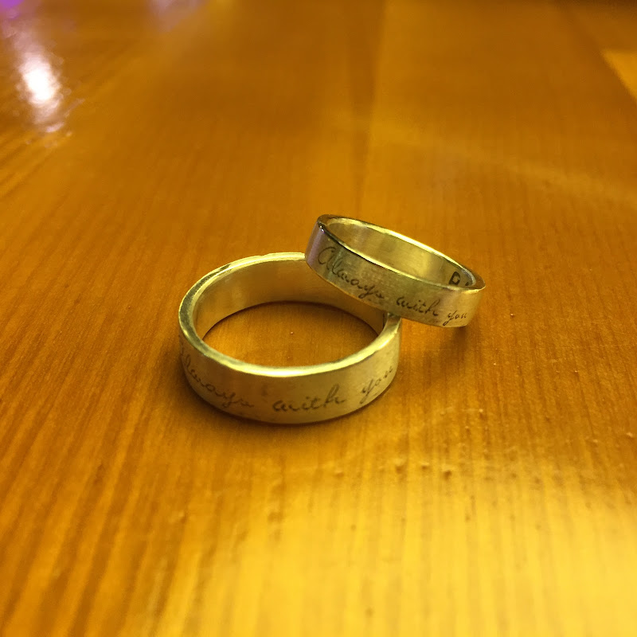</b></a><a href="/assets/img/blog/be3526b39f7e.jpg" imageanchor="1" style="margin-left: 1em; margin-right: 1em;">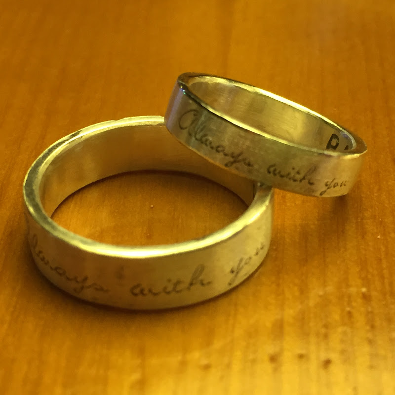</a>

<a href="/assets/img/blog/1b39d59b90c4.jpg" imageanchor="1" style="margin-left: 1em; margin-right: 1em;">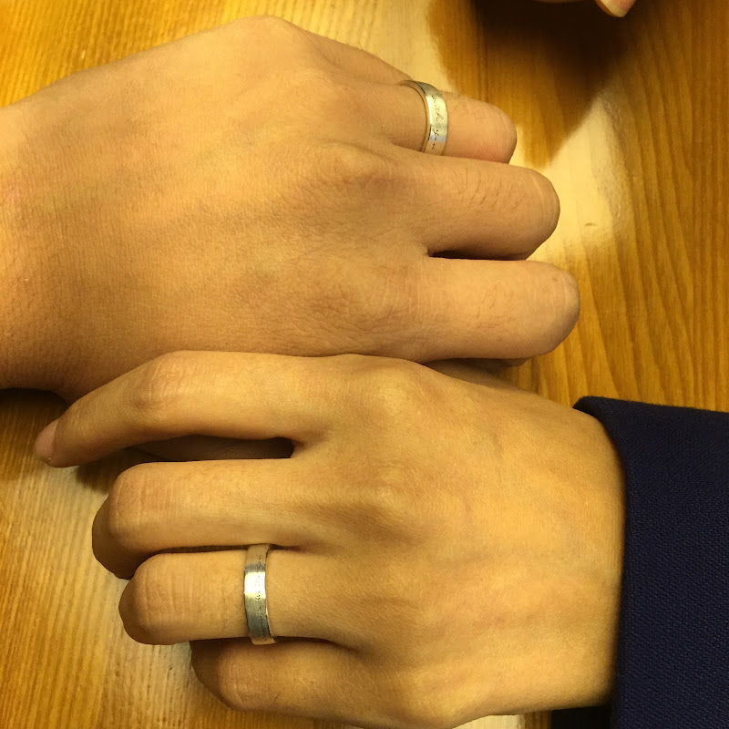</a>

<!-- Blogger automated replacement: "https://images-blogger-opensocial.googleusercontent.com/gadgets/proxy?url=http%3A%2F%2F2.bp.blogspot.com%2F-u0Oh3tDnu_s%2FVT8mXa1kg9I%2FAAAAAAAAMDI%2FA2rwV_Pt0jo%2Fs1600%2FIMG_6260.JPG&amp;container=blogger&amp;gadget=a&amp;rewriteMime=image%2F*" with "https://blogger.googleusercontent.com/img/b/R29vZ2xl/AVvXsEi2oiPTFE3zNMGcIpneU2Rw7yTWnN4H0F-wRczgdNPjjDHUrs3ZBXC-AUTFNUs5nCLZ6s-ycuBOzSTL5g1aOXKQr6lv5rlRGyS7aHvVyKu4GAUL8BisGgX2jAOBzTUnSt74ETvLw-Oe6M0/s1600/IMG_6260.JPG" --><!-- Blogger automated replacement: "https://images-blogger-opensocial.googleusercontent.com/gadgets/proxy?url=http%3A%2F%2F2.bp.blogspot.com%2F-8wLlcJoKMGU%2FVT8mX3I86-I%2FAAAAAAAAMDQ%2FJ0iFeW6rfhs%2Fs1600%2FIMG_6261.JPG&amp;container=blogger&amp;gadget=a&amp;rewriteMime=image%2F*" with "https://blogger.googleusercontent.com/img/b/R29vZ2xl/AVvXsEjrO8cP3hXdgXmJfAGyVsFiflUUBMaEcsoH6b4lLsVAq3p6V_njAMXV7HcauRgmNmdGfHIKr5CYtrLN9Ka33MAWKKQf_jSbCih5eYY0nKK6avde3GzQToEXs15b08d2CpNoAD4yeNbY8-M/s1600/IMG_6261.JPG" -->