

 

上回组装了一台<a href="http://ahbundance.blogspot.com/2014/12/diy3d-day1.html" target="_blank">Perusa I3&nbsp;</a> 

这回我来装装 <a href="https://www.google.com/search?q=Prusa+I3&amp;rls=com.microsoft:en-US:%7Breferrer:source?%7D&amp;tbm=isch&amp;tbo=u&amp;source=univ&amp;sa=X&amp;ei=Jko_Vaf8GYLiuQStsIDQBA&amp;ved=0CC4QsAQ&amp;biw=1366&amp;bih=653#rls=com.microsoft:en-US:%7Breferrer:source%3F%7D&amp;tbm=isch&amp;q=Delta+%E4%B8%89%E5%B9%B6%E8%81%94%E6%89%93%E5%8D%B0%E6%9C%BA" target="_blank">Delta 三角并联机</a>

 

由于资金问题，未能在上个月完成采购。

在采购硬件前，*电控 部分已经预先准备好。 
这足以表示了我的决心 ~ 笑 
 
（电控：Arduino MEGA 2560 +&nbsp;REPRAP 1.4A + LCD MicroController 2004A） 
<table align="center" cellpadding="0" cellspacing="0" class="tr-caption-container" style="margin-left: auto; margin-right: auto; text-align: center;"><tbody>
<tr><td style="text-align: center;"><a href="/assets/img/blog/2463d999eb9f.jpg" imageanchor="1" style="margin-left: auto; margin-right: auto;">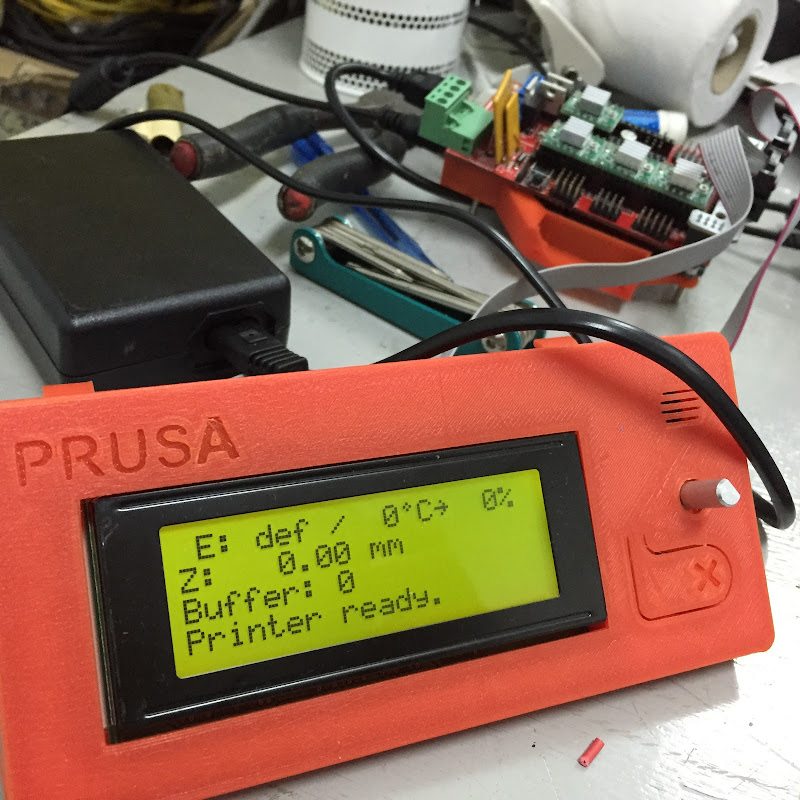</a></td></tr>
<tr><td class="tr-caption" style="text-align: center;">之前随便打印的壳</td></tr>
</tbody></table>
 

  

好不容易完成了采购 当然要好好的记录下。

 
这次邮购来的主要是硬件和电机部分， 
<table cellpadding="0" cellspacing="0" class="tr-caption-container" style="float: left; margin-right: 1em; text-align: left;"><tbody>
<tr><td style="text-align: center;"><a href="/assets/img/blog/cba2b9392c0d.jpg" imageanchor="1" style="clear: left; margin-bottom: 1em; margin-left: auto; margin-right: auto; text-align: left;">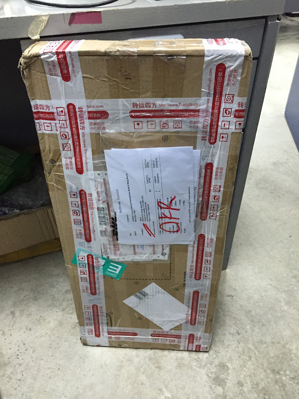</a></td></tr>
<tr><td class="tr-caption" style="text-align: center;"><table cellpadding="0" cellspacing="0" class="tr-caption-container" style="float: left; margin-right: 1em;"><tbody>
<tr><td class="tr-caption" style="font-size: 12.8000001907349px; text-align: center;">

里面各种小箱子 大小零件，包装还算ok。

不过单薄得很 不知道是怎么逃过运输人员的破坏力的。

</td></tr>
</tbody></table>

 

</td></tr>
</tbody></table>
 
 
 

<a href="/assets/img/blog/ed64893d8c9c.jpg" imageanchor="1" style="margin-left: 1em; margin-right: 1em;">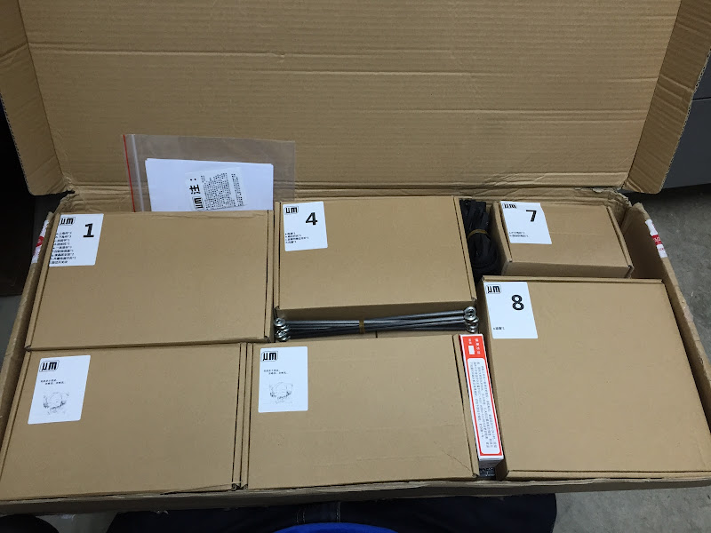</a>

 
淘开所有箱子 主要架构内容都在最底部。 

<a href="/assets/img/blog/d6c3f482da0f.jpg" imageanchor="1" style="margin-left: 1em; margin-right: 1em;">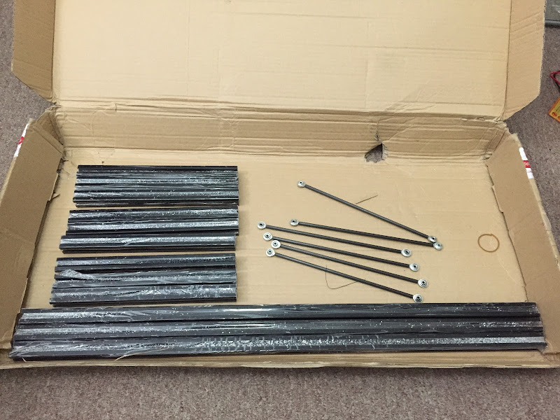</a>

 

<b>其他小箱子</b>装的是各种打印件。打印件部分我就不多说明了 看我在照片注释吧。 
<table cellpadding="0" cellspacing="0" class="tr-caption-container" style="float: left; margin-right: 1em; text-align: left;"><tbody>
<tr><td style="text-align: center;"><a href="/assets/img/blog/bf41d404c079.jpg" imageanchor="1" style="clear: left; margin-bottom: 1em; margin-left: auto; margin-right: auto;">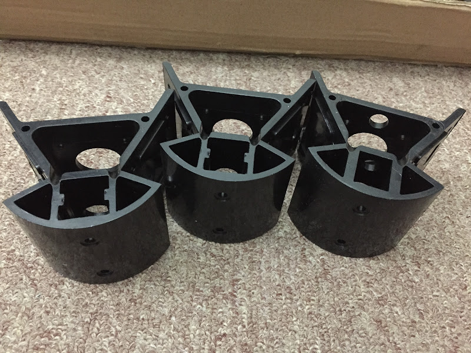</a></td></tr>
<tr><td class="tr-caption" style="text-align: center;">下角件</td></tr>
</tbody></table>
<table align="center" cellpadding="0" cellspacing="0" class="tr-caption-container" style="float: left; margin-right: 1em; text-align: left;"><tbody>
<tr><td style="text-align: center;"><a href="/assets/img/blog/34bd8b249877.jpg" imageanchor="1" style="clear: left; display: inline !important; margin-bottom: 1em; margin-right: 1em;">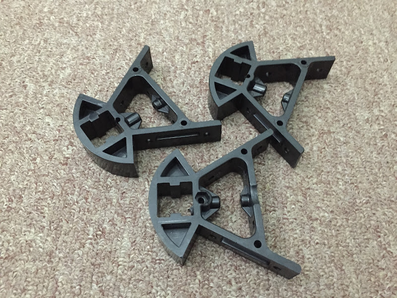</a></td></tr>
<tr><td class="tr-caption" style="text-align: center;">上角件</td></tr>
</tbody></table>

<table align="center" cellpadding="0" cellspacing="0" class="tr-caption-container" style="float: left; margin-right: 1em; text-align: left;"><tbody>
<tr><td style="text-align: center;"><a href="/assets/img/blog/ba54dda8f9d0.jpg" imageanchor="1" style="clear: left; display: inline !important; margin-bottom: 1em; margin-left: auto; margin-right: auto;">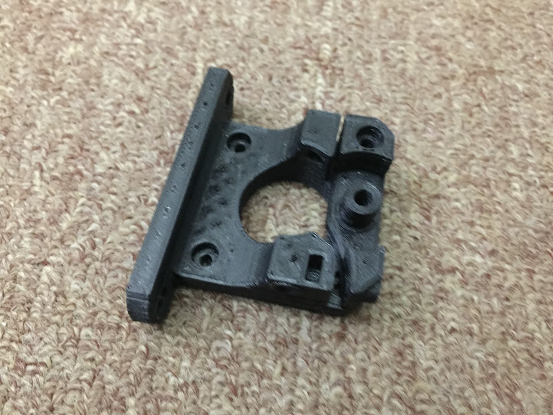</a></td></tr>
<tr><td class="tr-caption" style="text-align: center;">挤出机用的</td></tr>
</tbody></table>

<table cellpadding="0" cellspacing="0" class="tr-caption-container" style="float: left; margin-right: 1em; text-align: left;"><tbody>
<tr><td style="text-align: center;"><a href="/assets/img/blog/bcc9bd50d507.jpg" imageanchor="1" style="clear: left; margin-bottom: 1em; margin-left: auto; margin-right: auto; text-align: left;">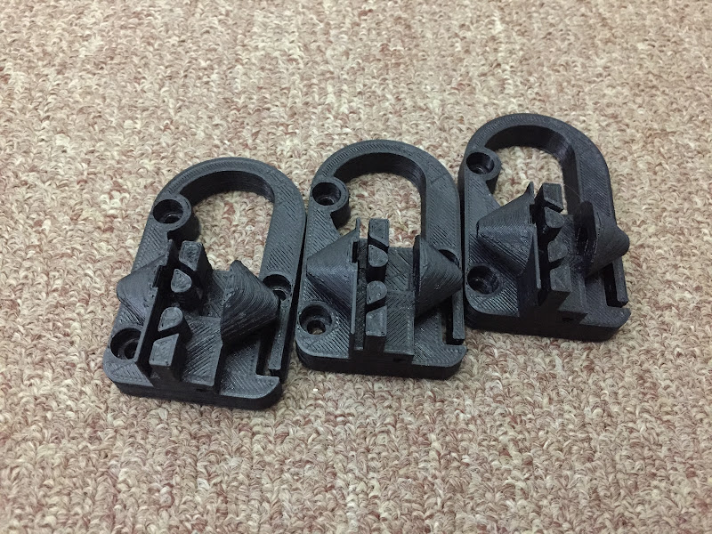</a></td></tr>
<tr><td class="tr-caption" style="text-align: center;">一体滑车 我个人还是比较喜欢分开的。</td></tr>
</tbody></table>
<table align="center" cellpadding="0" cellspacing="0" class="tr-caption-container" style="float: left; margin-right: 1em; text-align: left;"><tbody>
<tr><td style="text-align: center;"><a href="/assets/img/blog/0b7dc6fdb4d7.jpg" imageanchor="1" style="clear: left; display: inline !important; margin-bottom: 1em; margin-right: 1em;">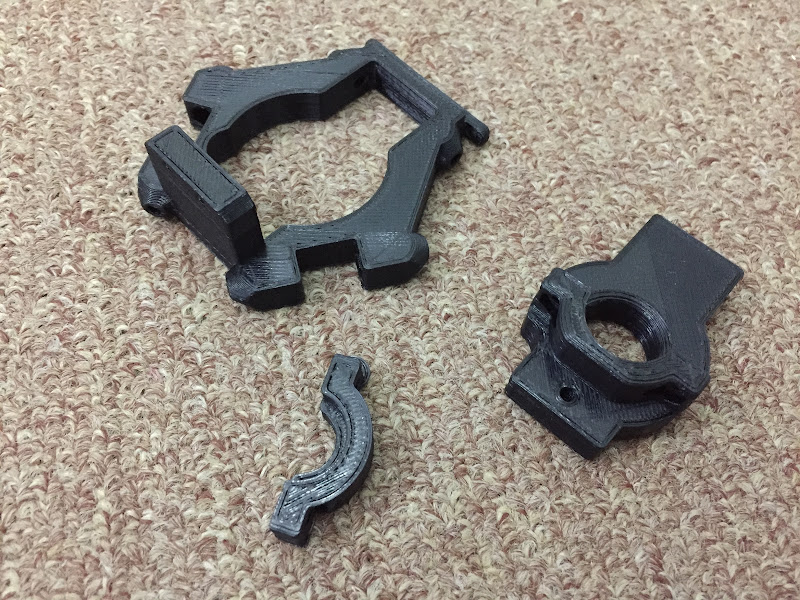</a></td></tr>
<tr><td class="tr-caption" style="text-align: center;">挤出头以及校音器（简易自动调平硬件）</td></tr>
</tbody></table>
<table cellpadding="0" cellspacing="0" class="tr-caption-container" style="float: left; margin-right: 1em; text-align: left;"><tbody>
<tr><td style="text-align: center;"><a href="/assets/img/blog/73cccd20e35c.jpg" imageanchor="1" style="clear: left; margin-bottom: 1em; margin-left: auto; margin-right: auto;">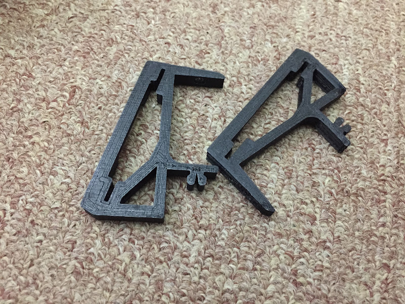</a></td></tr>
<tr><td class="tr-caption" style="text-align: center;">LCD 夹块</td></tr>
</tbody></table>
<table align="center" cellpadding="0" cellspacing="0" class="tr-caption-container" style="margin-left: auto; margin-right: auto; text-align: center;"><tbody>
<tr><td style="text-align: center;"><a href="/assets/img/blog/580426129878.jpg" imageanchor="1" style="margin-left: auto; margin-right: auto;">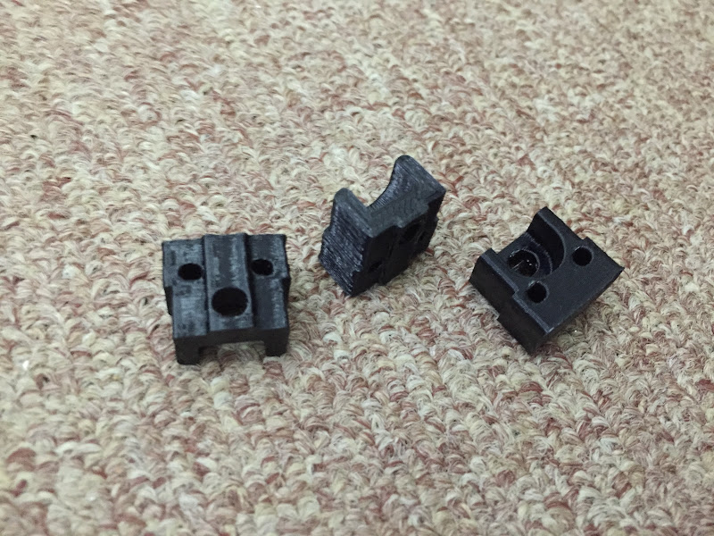</a></td></tr>
<tr><td class="tr-caption" style="text-align: center;">限位件，</td></tr>
</tbody></table>

 

<table align="center" cellpadding="0" cellspacing="0" class="tr-caption-container" style="float: left; margin-right: 1em; text-align: left;"><tbody>
<tr><td style="text-align: center;"><a href="/assets/img/blog/4d0dbce7a4b1.jpg" imageanchor="1" style="margin-left: auto; margin-right: auto;">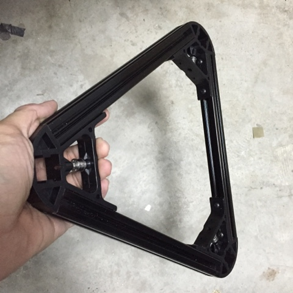</a></td></tr>
<tr><td class="tr-caption" style="text-align: center;">上角件的安装后是这样的。</td></tr>
</tbody></table>

 

<table align="center" cellpadding="0" cellspacing="0" class="tr-caption-container" style="float: left; margin-right: 1em; text-align: left;"><tbody>
<tr><td style="text-align: center;"><a href="/assets/img/blog/3f81402788a1.jpg" imageanchor="1" style="margin-left: auto; margin-right: auto;">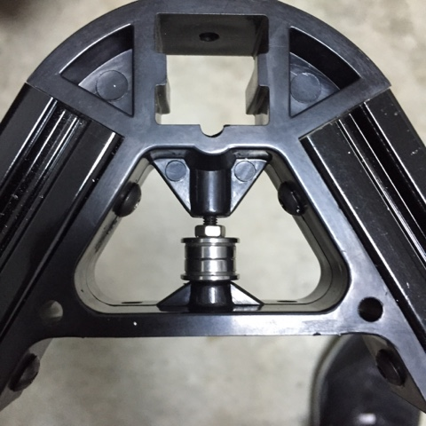</a></td></tr>
<tr><td class="tr-caption" style="text-align: center;">这是上角件的重点，皮带主要接口位置。</td></tr>
</tbody></table>

<table align="center" cellpadding="0" cellspacing="0" class="tr-caption-container" style="float: left; margin-right: 1em; text-align: left;"><tbody>
<tr><td style="text-align: center;"><a href="/assets/img/blog/a81a753a6c0a.jpg" imageanchor="1" style="margin-left: auto; margin-right: auto;">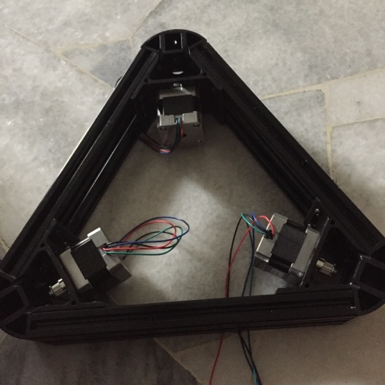</a></td></tr>
<tr><td class="tr-caption" style="text-align: center;">下角尖安装成品</td></tr>
</tbody></table>

<table align="center" cellpadding="0" cellspacing="0" class="tr-caption-container" style="float: left; margin-right: 1em; text-align: left;"><tbody>
<tr><td style="text-align: center;"><a href="/assets/img/blog/f2d80953ab7a.jpg" imageanchor="1" style="margin-left: auto; margin-right: auto;">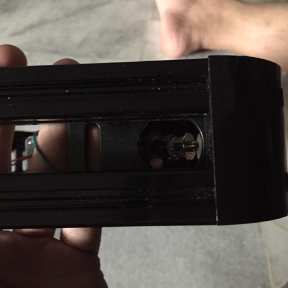</a></td></tr>
<tr><td class="tr-caption" style="text-align: center;">接铝块前先把电机装好。</td></tr>
</tbody></table>
 
<table align="center" cellpadding="0" cellspacing="0" class="tr-caption-container" style="float: left; margin-right: 1em; text-align: left;"><tbody>
<tr><td style="text-align: center;"><a href="/assets/img/blog/593eb9c6fae2.jpg" imageanchor="1" style="margin-left: auto; margin-right: auto;">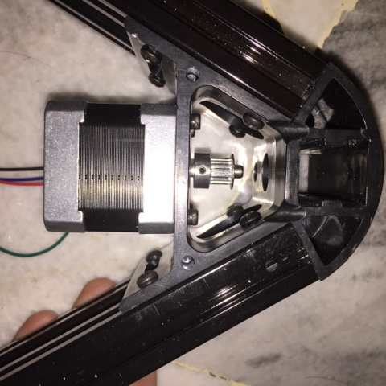</a></td></tr>
<tr><td class="tr-caption" style="text-align: center;">下角件重点</td></tr>
</tbody></table>

<table cellpadding="0" cellspacing="0" class="tr-caption-container" style="float: left; margin-right: 1em; text-align: left;"><tbody>
<tr><td style="text-align: center;"><a href="/assets/img/blog/de0c9561f6dc.jpg" imageanchor="1" style="clear: left; margin-bottom: 1em; margin-left: auto; margin-right: auto;">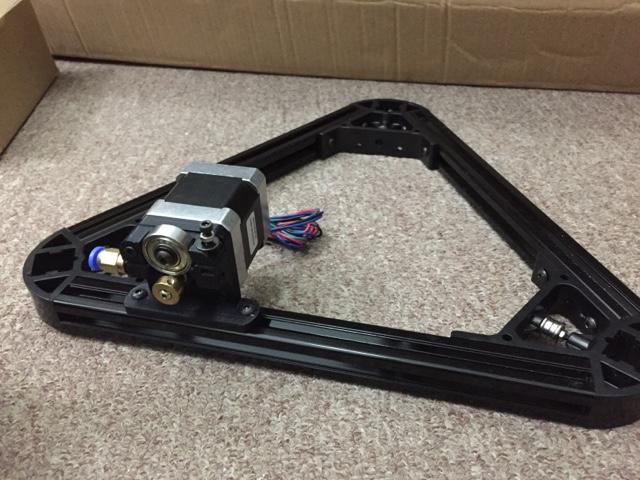</a></td></tr>
<tr><td class="tr-caption" style="text-align: center;">上角件挤出机的安装。</td></tr>
</tbody></table>
 
<table cellpadding="0" cellspacing="0" class="tr-caption-container" style="float: left; margin-right: 1em; text-align: left;"><tbody>
<tr><td style="text-align: center;"><a href="/assets/img/blog/59e290e92b9b.jpg" imageanchor="1" style="clear: left; margin-bottom: 1em; margin-left: auto; margin-right: auto;">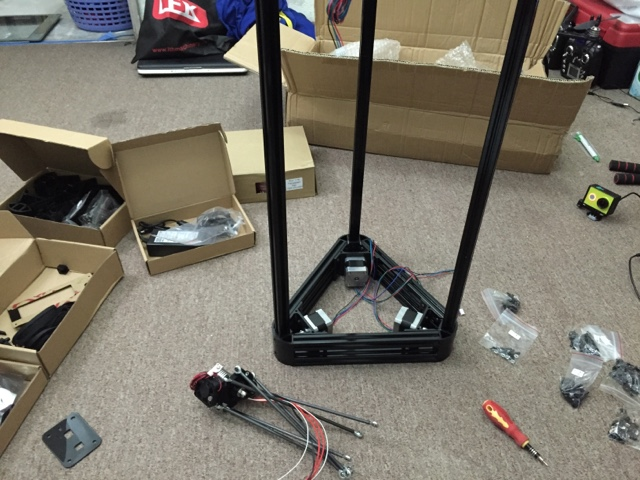</a></td></tr>
<tr><td class="tr-caption" style="text-align: center;">下角件中间部分安装</td></tr>
</tbody></table>
<table align="center" cellpadding="0" cellspacing="0" class="tr-caption-container" style="float: left; margin-right: 1em; text-align: left;"><tbody>
<tr><td style="text-align: center;"><a href="/assets/img/blog/f92d8943a4f6.jpg" imageanchor="1" style="margin-left: auto; margin-right: auto;">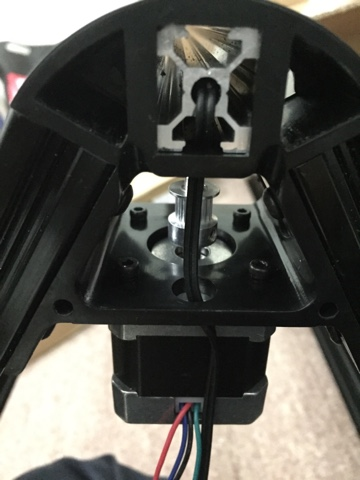</a></td></tr>
<tr><td class="tr-caption" style="text-align: center;">为了好看 吧电线塞进孔里 省的电线满天飞。</td></tr>
</tbody></table>
<table cellpadding="0" cellspacing="0" class="tr-caption-container" style="float: left; margin-right: 1em; text-align: left;"><tbody>
<tr><td style="text-align: center;"><a href="/assets/img/blog/361c9caa3e58.jpg" imageanchor="1" style="clear: left; margin-bottom: 1em; margin-left: auto; margin-right: auto;">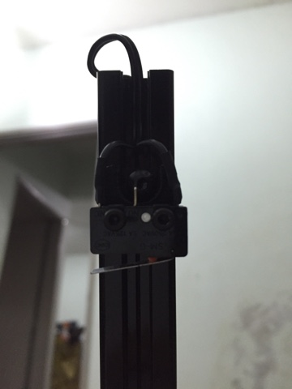</a></td></tr>
<tr><td class="tr-caption" style="text-align: center;">这个锁起之前记得先装好滑车 不然就得拆开了</td></tr>
</tbody></table>
 
 
 
<table align="center" cellpadding="0" cellspacing="0" class="tr-caption-container" style="float: left; margin-right: 1em; text-align: left;"><tbody>
<tr><td style="text-align: center;"><a href="/assets/img/blog/6372aae21818.jpg" imageanchor="1" style="margin-left: auto; margin-right: auto;">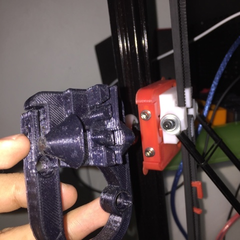</a></td></tr>
<tr><td class="tr-caption" style="text-align: center;">因为不满意别人打印的零件，自己换了一个高精度的。</td></tr>
</tbody></table>
<table cellpadding="0" cellspacing="0" class="tr-caption-container" style="margin-left: 1em; margin-right: 1em; text-align: left;"><tbody>
<tr><td style="text-align: center;"><a href="/assets/img/blog/44e48302a6ad.jpg" imageanchor="1" style="clear: left; margin-bottom: 1em; margin-left: auto; margin-right: auto;">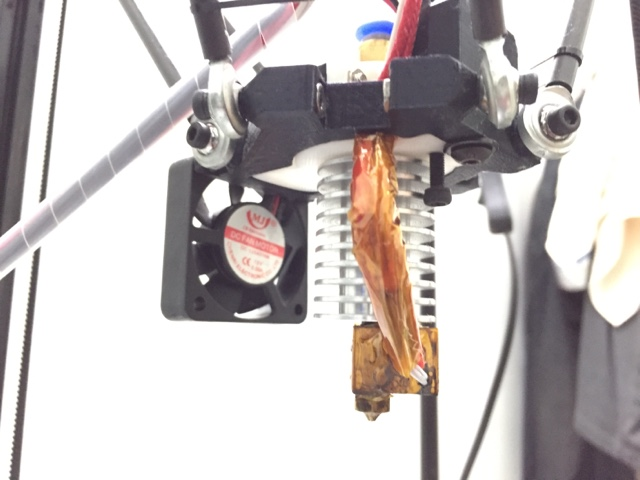</a></td></tr>
<tr><td class="tr-caption" style="text-align: center;">挤出机部分 细节忘了拍照，将来再组装的时候补吧 &gt;.&lt; 

 
 </td></tr>
</tbody></table>
<table align="center" cellpadding="0" cellspacing="0" class="tr-caption-container" style="float: left; margin-right: 1em; text-align: left;"><tbody>
<tr><td><a href="/assets/img/blog/88b4a9771241.jpg" imageanchor="1" style="margin-left: auto; margin-right: auto;">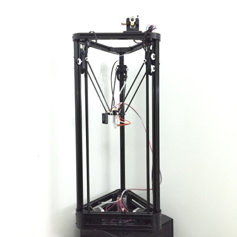</a></td></tr>
<tr><td class="tr-caption" style="font-size: 12.8000001907349px;">这是第一台整体完成图 恩 忘了加入银幕 也是2个月前的事了。</td></tr>
</tbody></table>
 

<table cellpadding="0" cellspacing="0" class="tr-caption-container" style="float: left; margin-right: 1em; text-align: left;"><tbody>
<tr><td style="text-align: center;"><a href="/assets/img/blog/7e4647d79763.jpg" imageanchor="1" style="clear: left; margin-bottom: 1em; margin-left: auto; margin-right: auto;">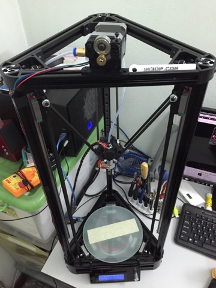</a></td></tr>
<tr><td class="tr-caption" style="text-align: center;">这是昨天花了5小时组装好的 强化滑轨版。替朋友组装的。上面是我的网址 1m3dp.com 有兴趣可以去看看~</td></tr>
</tbody></table>
 
 
 
 
 
 
 
 
 
 
 
 
 
 
 
 
 
 
 
 
 
 
 
 
 
 
 
 
 
 
 
 
 
 
 
 
 
 
 
 
 
 
 
 
 
 
 
好了，秀图就到这里。欢迎各位朋友讨论哈~ 
有疑问 或者也想自己组装或者遇到问题的也欢迎询问。

