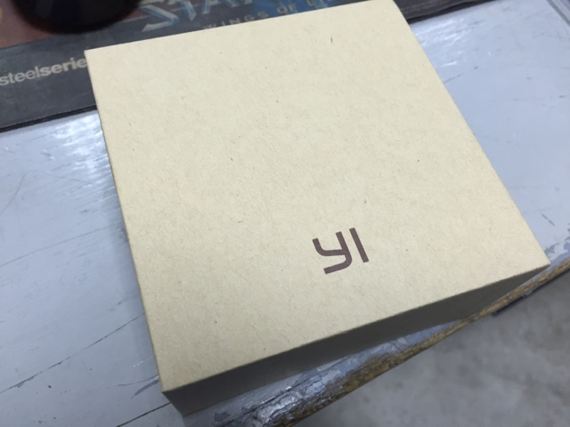
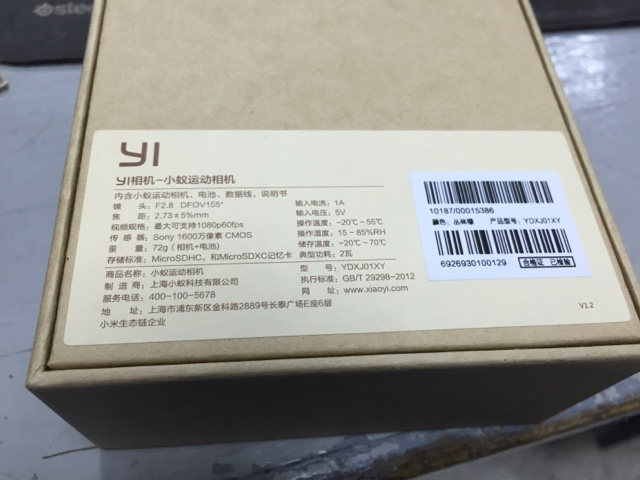
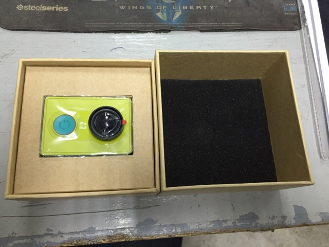
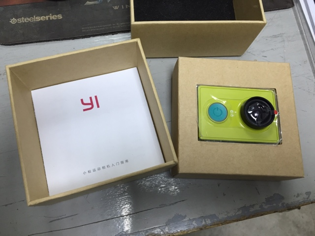
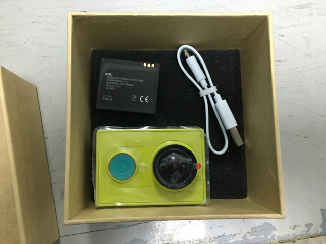
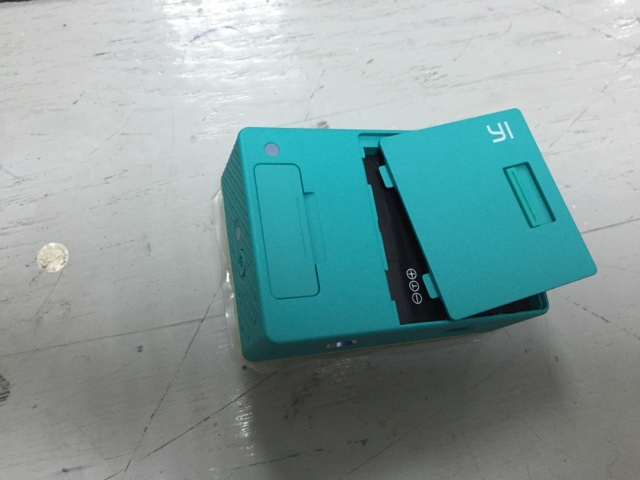
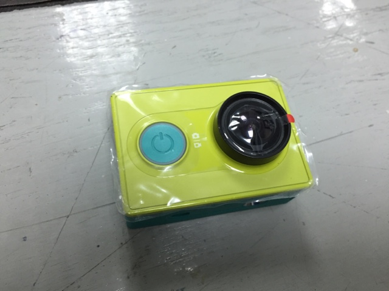
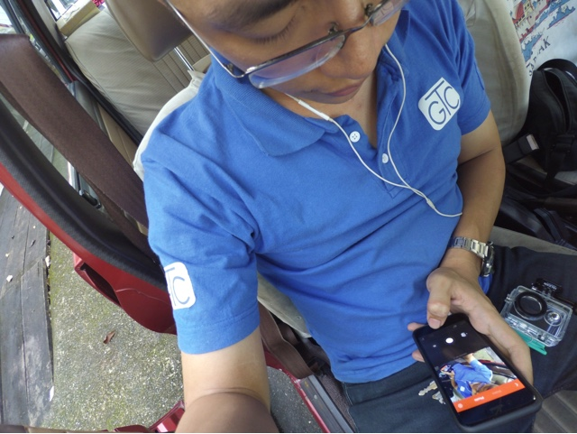

☆礼物Get☆ 小蟻運動相機開箱&nbsp;

XiaoMi Yi action camera Unboxing.

 
想必我应该不用怎么介绍吧小米公司的产品小蚁运动相机。 

它就是一个很简单的概念low cost gopro...

 
簡單的盒子只有yi字 
 
 

 

打開就是一個相機&nbsp;

挖開后有一本薄薄的說明書，想完美打開這個說明書取出還有一點技巧

然後裝相機夾層裏面可以找到電池和電線 

打開背殼 放入電池

前後就是那樣 沒有多餘的屏幕…也沒有必要的屏幕

 

打開就到這裏 沒啥想說的，效果以後看我的youtube 頻道吧大概很快就有高空飞翔的视频吧。

這裏來一張用手機連 同時的自拍…

 

 
初次打开，感觉有点微妙的汗颜，虽然说是我的第一台运动相 但是我竟然有差点耐不足想拆开的感觉...我忍。 
 

 

不过。初步测试，其实是怎么都不可能赢过go pro啦. 
 
 

<iframe allowfullscreen="" class="YOUTUBE-iframe-video" data-thumbnail-src="https://i.ytimg.com/vi/OVDFR6MRxgw/0.jpg" frameborder="0" height="266" src="https://www.youtube.com/embed/OVDFR6MRxgw?feature=player_embedded" width="320"></iframe>

 