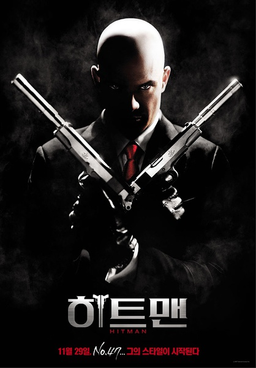

<h2 style="background-color: white; color: #007722; font-family: Arial, Helvetica, sans-serif; font-size: 15px; font-stretch: normal; font-weight: normal; line-height: 22.5px; margin: 24px 0px 3px; padding: 0px;">
 </h2>
 
导演:&nbsp;<a href="http://movie.douban.com/celebrity/1045180/" rel="v:directedBy" style="color: #666699; cursor: pointer; text-decoration: none;">泽维尔·吉恩斯</a> 
编剧:&nbsp;<a href="http://movie.douban.com/celebrity/1301255/" style="color: #666699; cursor: pointer; text-decoration: none;">斯基普·伍兹</a>主演:&nbsp;<a href="http://movie.douban.com/celebrity/1044704/" rel="v:starring" style="color: #666699; cursor: pointer; text-decoration: none;">蒂莫西·奥利芬特</a>&nbsp;/&nbsp;<a href="http://movie.douban.com/celebrity/1036368/" rel="v:starring" style="color: #666699; cursor: pointer; text-decoration: none;">多格雷·斯科特</a>&nbsp;/&nbsp;<a href="http://movie.douban.com/celebrity/1035654/" rel="v:starring" style="color: #666699; cursor: pointer; text-decoration: none;">欧嘉·柯瑞兰寇</a>&nbsp;/&nbsp;<a href="http://movie.douban.com/celebrity/1010576/" rel="v:starring" style="color: #666699; cursor: pointer; text-decoration: none;">罗伯特·克耐普</a>&nbsp;/&nbsp;<a href="http://movie.douban.com/celebrity/1036598/" rel="v:starring" style="color: #666699; cursor: pointer; text-decoration: none;">乌尔里奇·汤姆森</a>类型:&nbsp;剧情&nbsp;/&nbsp;动作&nbsp;/&nbsp;惊悚&nbsp;/&nbsp;犯罪制片国家/地区:&nbsp;法国 / 美国语言:&nbsp;英语 / 俄语 / 塞尔维亚克罗地亚语上映日期:&nbsp;2007-11-21(美国)片长:&nbsp;89 分钟&nbsp;/ 90 分钟(未分级版)又名:&nbsp;杀手47 
 
  
<h2 style="background-color: white; color: #007722; font-family: Arial, Helvetica, sans-serif; font-stretch: normal; font-weight: normal; line-height: 22.5px; margin: 24px 0px 3px; padding: 0px;">
杀手：代号47的剧情简介&nbsp;&nbsp;·&nbsp;&nbsp;·&nbsp;&nbsp;·&nbsp;&nbsp;·&nbsp;&nbsp;·&nbsp;&nbsp;·</h2>
 

　　代号47（蒂莫西•奥利分特 饰）是一个利用基因技术制作的复制人，受雇于名为“The Agency”的组织进行刺杀活动，47是他颈背条码的最后两个数字，也是他的名字。因为卷入了政治阴谋，47在东欧遭到了国际刑警和俄国军队的双重追杀。在追查真凶的过程中，他遇上了一个致命的女人（欧嘉•克瑞兰蔻 饰）。杀手的冷酷无情渐渐被女人瓦解，但是生命也正在受到威胁……

&nbsp;豆瓣的电影资料到此为止。下面是我的观后感

此作为暴力血腥游戏改编的电影，血沫横飞动不动一堆人以各种post中枪扑街。 很实际的说一句。我对这个还真没有什么感想=。= 所以我在想，如果让我再看一次的话我会做一件很无聊的事  算算这部电影里面到底死了多少个人....  够无聊吧 ！ 哈哈哈 然而我看这电影就只有这感想了。 一枪一个 叶问来100个都没用 哈哈哈

 

 

