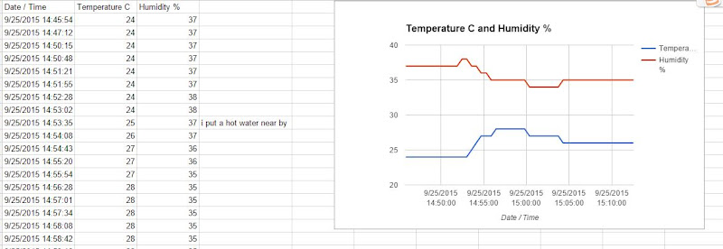

今天早上做的一个小小练习 
用树莓派结合温度湿度计 让它自动上传到google 服务器再产生图形 
Real time Temperature &amp; Humidity logger, monitoring with Raspberry Pi 
Update to google drive every 30 second with Graph. 
 
点图可以进去查看 
<table align="center" cellpadding="0" cellspacing="0" class="tr-caption-container" style="margin-left: auto; margin-right: auto; text-align: center;"><tbody>
<tr><td style="text-align: center;"></td></tr>
<tr><td class="tr-caption" style="text-align: center;"> 
<a href="https://docs.google.com/spreadsheets/d/1sflSCYbL9ZbgzRDzCDY14bl7iNjWU27KMjhVsKG-AtI/edit#gid=0" target="_blank"> </a></td></tr>
</tbody></table>
<a href="https://docs.google.com/spreadsheets/d/1sflSCYbL9ZbgzRDzCDY14bl7iNjWU27KMjhVsKG-AtI/edit#gid=0">https://docs.google.com/spreadsheets/d/1sflSCYbL9ZbgzRDzCDY14bl7iNjWU27KMjhVsKG-AtI/edit#gid=0</a> 
 
 
如果你也想学 可以点这里进去查看。 
If you interested to make can view here. 
<a href="https://learn.adafruit.com/downloads/pdf/dht-humidity-sensing-on-raspberry-pi-with-gdocs-logging.pdf">https://learn.adafruit.com/downloads/pdf/dht-humidity-sensing-on-raspberry-pi-with-gdocs-logging.pdf</a> 
 
其实东西都很简单，有心做的话 &nbsp;教程一堆。 
 
*树莓派关机了温度更新暂停，直到我新的网络回来为止 ~&gt;.&lt;