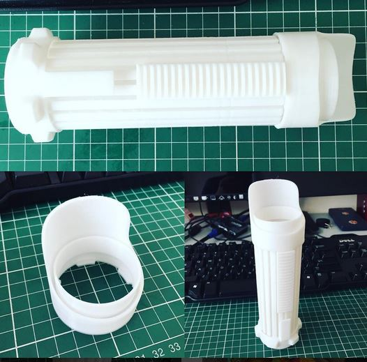
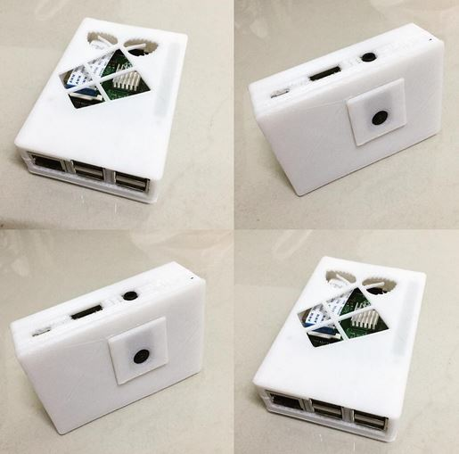
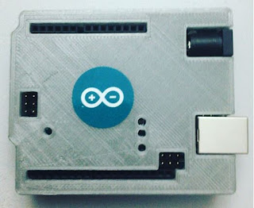
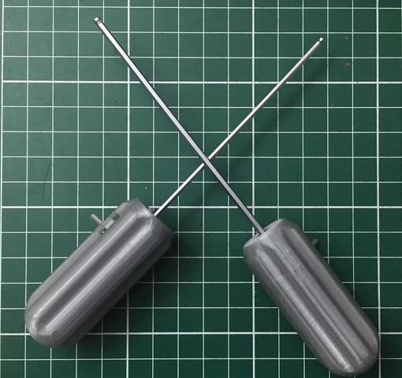
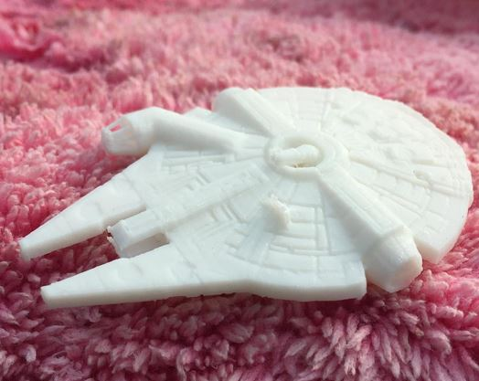

最近接到一个这样的质疑， 
你做的打印机能用吗？..... 
嗯 好问题。 
这里有个链接<a href="https://www.instagram.com/invabun/" target="_blank"> https://www.instagram.com/invabun/</a> 
对！是我的 Instragram 
我也上传几张最近打印的东西在下面 
其它的去Instragram 看吧。 
如果你还想询问是否我做的 ? 
没错 那是开源的知识 我学 同时我制作。 
你可以在我的youtube 频道看到我上传的一些压缩视频。 
对了 
能否不要一边质疑一边问相关知识？ 
我也算是正在卖打印机的商人。分享任何知识都没问题。 
不过至少也帮我买一台再问吧。 
我也需要资金才能制作更多不同类型的打印机来研究啊。 

<iframe allowfullscreen="" class="YOUTUBE-iframe-video" data-thumbnail-src="https://i.ytimg.com/vi/9ftXwn1YCiU/0.jpg" frameborder="0" height="266" src="https://www.youtube.com/embed/9ftXwn1YCiU?feature=player_embedded" width="320"></iframe>

 
 
 
 
Recently received a question， 
The printer you make can use ? 
Humm is a good question . 
I got a link here. 
https://www.instagram.com/invabun/ 
Yeah that is my instragram. 
Few upload latest print as below 
for more go my Instragram. 
If you ask is that printer really build by myself ? 
ok that is opensource. I got part I learn and I build. 
check my youtube channel for some Time lapse video as above. 
 
<table align="center" cellpadding="0" cellspacing="0" class="tr-caption-container" style="margin-left: auto; margin-right: auto; text-align: center;"><tbody>
<tr><td style="text-align: center;"></td></tr>
<tr><td class="tr-caption" style="text-align: center;">lignt saber 50% part not finish yet</td></tr>
</tbody></table>
 
<table align="center" cellpadding="0" cellspacing="0" class="tr-caption-container" style="margin-left: auto; margin-right: auto; text-align: center;"><tbody>
<tr><td style="text-align: center;"></td></tr>
<tr><td class="tr-caption" style="text-align: center;">Raspberry pi 2B camera case</td></tr>
</tbody></table>
 
<table align="center" cellpadding="0" cellspacing="0" class="tr-caption-container" style="margin-left: auto; margin-right: auto; text-align: center;"><tbody>
<tr><td style="text-align: center;"></td></tr>
<tr><td class="tr-caption" style="text-align: center;">Arduino Nano case</td></tr>
</tbody></table>
 
<table align="center" cellpadding="0" cellspacing="0" class="tr-caption-container" style="margin-left: auto; margin-right: auto; text-align: center;"><tbody>
<tr><td style="text-align: center;"></td></tr>
<tr><td class="tr-caption" style="text-align: center;">Tools Handle</td></tr>
</tbody></table>
 
<table align="center" cellpadding="0" cellspacing="0" class="tr-caption-container" style="margin-left: auto; margin-right: auto; text-align: center;"><tbody>
<tr><td style="text-align: center;"></td></tr>
<tr><td class="tr-caption" style="text-align: center;">Star wars Millennium falcon</td></tr>
</tbody></table>
 