

最近上映了星際大戰，

內容的話有類似“超立方” “谷阿莫”一類的大神介紹了

 

估計大家也自己去看了，

我就不對劇情廢話了。

 

星際大戰里最酷的 莫過於光劍。

因為太帥了，我一直在尋找收藏品。

可是在市場上的 都是進千馬幣的...

作為收藏品 實在有點買不下手T_T

 

直到這個月的某一天

我看到這個貼》》<a href="http://ultim.kr/1nsrl64" target="_blank">鏈接</a>

 

某大神把設計圖放上網了！

不會畫圖的我 當然是撿到寶了~&nbsp;

 

動手把光劍收集到手~

yeah&nbsp;

 

 

製作開始：

STEP 1：3D打印 3D Print

沒法將所有Timelapse 一次過錄完，

部分因為充電鬆了相機沒電直接沒錄到。

且花了幾天來打印不同的part。

<a href="/assets/img/blog/2f7e4d915103.jpg" imageanchor="1" style="margin-left: 1em; margin-right: 1em;">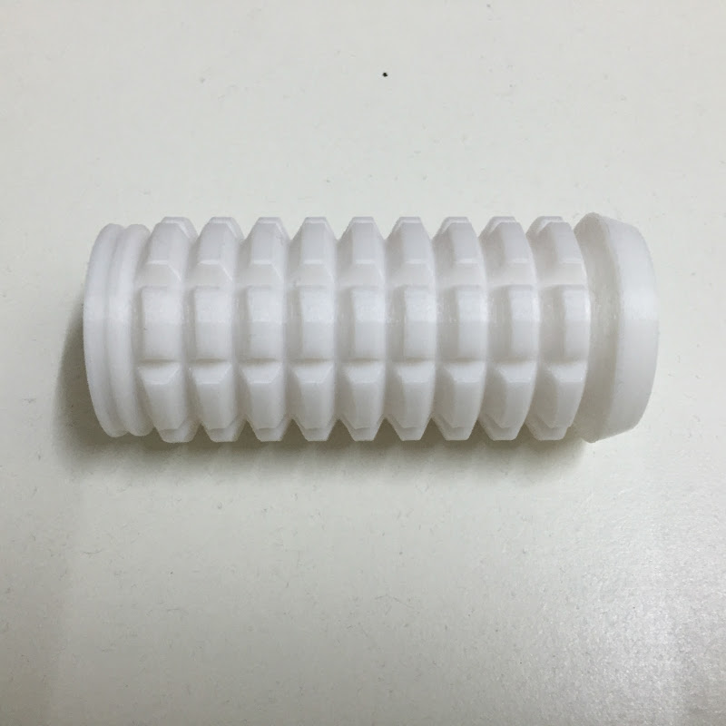</a>

 
 

這個設計非常好 幾乎所有都按照3D打印機原理來設計的。

雖然有14部分之多 但是打印一切順利。

除了一個小Pin 實在太難打印了，所以乾脆直接用竹籤代替了。.

 

<a href="/assets/img/blog/575b7dc0d748.jpg" imageanchor="1" style="margin-left: 1em; margin-right: 1em;">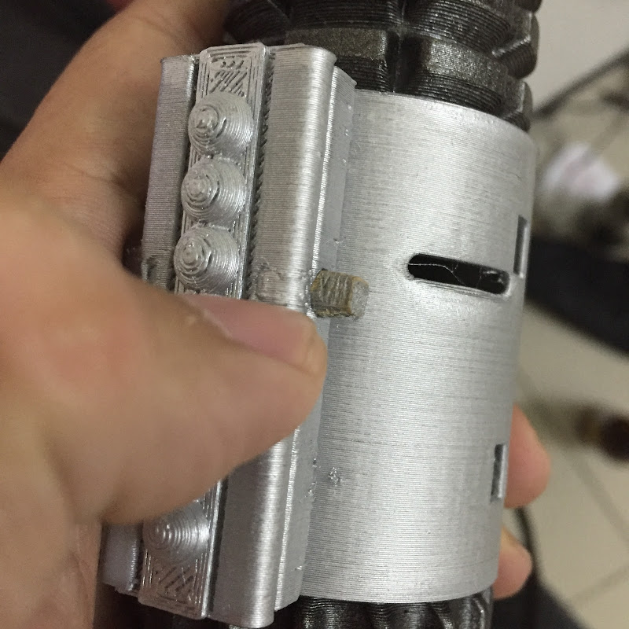</a>

 

還有就是其中一個接口斷了。

稍微用力就會斷掉T_T

 

<a href="/assets/img/blog/6a1fa2172b75.jpg" imageanchor="1" style="margin-left: 1em; margin-right: 1em;">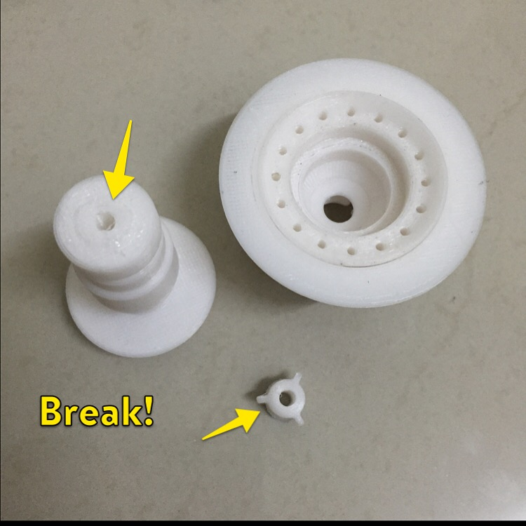</a>.

 

因為是3D 打印 即使斷了重新打印Part就好， 科科

 

<a href="/assets/img/blog/409da2719c8a.jpg" imageanchor="1" style="margin-left: 1em; margin-right: 1em;">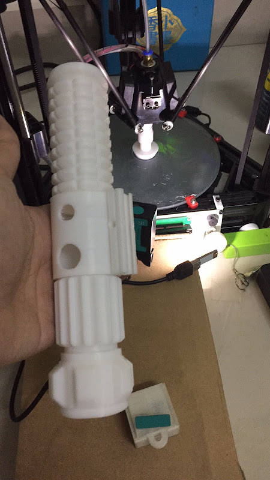</a>

 

下面是Timelapse video.

 

<iframe allowfullscreen="" class="YOUTUBE-iframe-video" data-thumbnail-src="https://i.ytimg.com/vi/GI2Lea4t40s/0.jpg" frameborder="0" height="266" src="https://www.youtube.com/embed/GI2Lea4t40s?feature=player_embedded" width="320"></iframe>

 

STEP 1：上色 Post Processing

雖然有此大師級的上色教學》》<a href="http://www.redicubricks.com/3d-printed-lightsaber-painting-tutorial/" target="_blank">鏈接&nbsp;</a>.

我還是沒有那能耐心去試，畢竟手中沒有相關工具，

鏈接先存著，以後再和朋友借工具試好了。 

先從之前用剩的噴漆吧~&nbsp;

正好黑色、銀色、金色都有可以上色了。

 

 

我是在房間打印的，漆味有點重...

不過我也沒什麼地方可以用了。

拔了一個紙盒拿來做噴漆工作，

畢竟不能隨便在地上噴嘛。

然後就是用了一些鐵線 讓Part 掉在中間 ，

那麼噴起來不會粘著底，顯得比較均勻。

 

 

<iframe allowfullscreen="" class="YOUTUBE-iframe-video" data-thumbnail-src="https://i.ytimg.com/vi/JFx4B2AWP2A/0.jpg" frameborder="0" height="266" src="https://www.youtube.com/embed/JFx4B2AWP2A?feature=player_embedded" width="320"></iframe> 

 

<a href="/assets/img/blog/42068739f8e0.jpg" imageanchor="1" style="margin-left: 1em; margin-right: 1em;">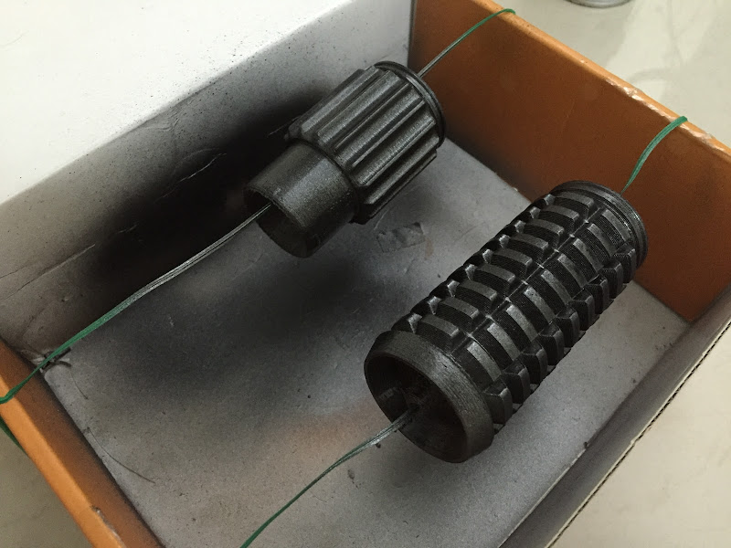</a>

 

<a href="/assets/img/blog/5e6609b258fb.jpg" imageanchor="1" style="margin-left: 1em; margin-right: 1em;">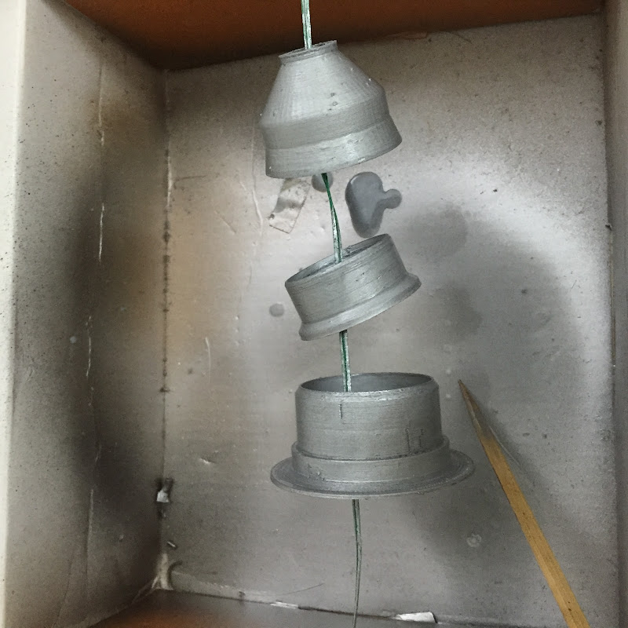</a>

 

<a href="/assets/img/blog/cccc5e930e5a.jpg" imageanchor="1" style="margin-left: 1em; margin-right: 1em;">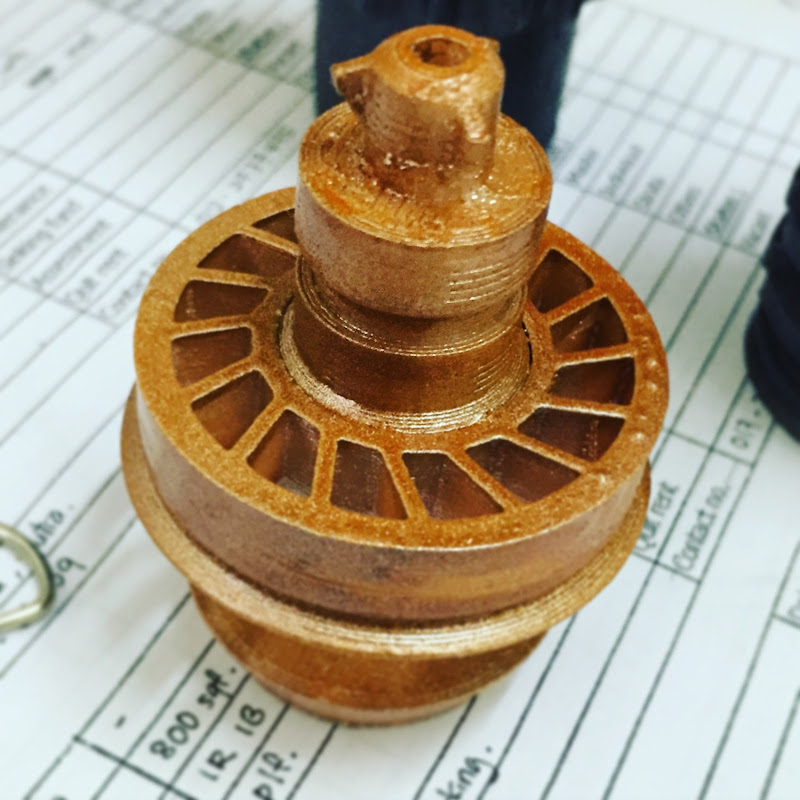</a>

 

<a href="/assets/img/blog/eda28e1c62f8.jpg" imageanchor="1" style="margin-left: 1em; margin-right: 1em;">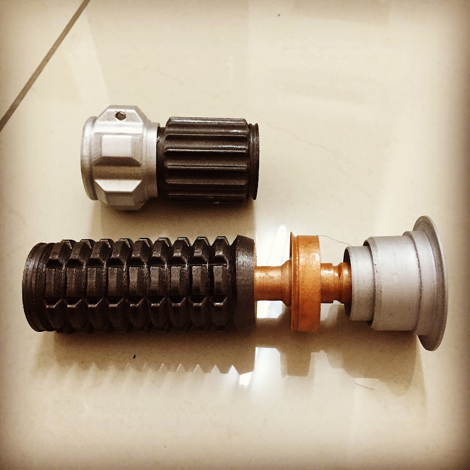</a>

 
這個頂的部分有點不整齊， 
暫時只能這樣，如果認真處理 還得加石膏或者底漆類似鋪平的東西吧。 
 

<a href="/assets/img/blog/31a41b5fabb8.jpg" imageanchor="1" style="margin-left: 1em; margin-right: 1em;">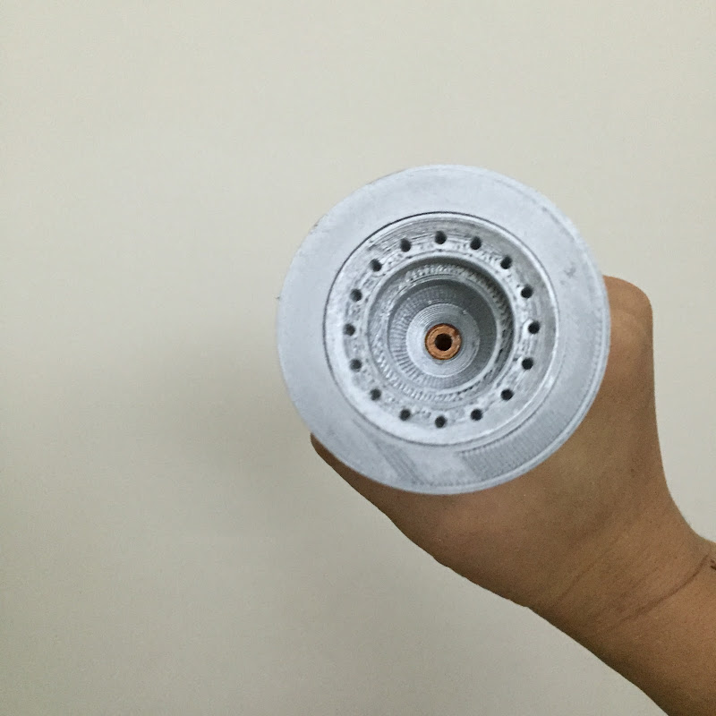</a>

 

<b>STEP&nbsp;3: 組裝 Assemble&nbsp;</b>

組裝部分一點都不困難，

因為設計者已經很貼心的吧教學放到網上了~&nbsp;

 

跟著裝就行

不過如上面所說的接口要小心&nbsp;

不然就會出現我我這個斷開的問題。

 

 

 

<b>STEP 4: 把玩 Play</b>

雖然打印有些瑕疵，但是看起來還是很漂亮。

吸引得很啊！

可惜 身邊的朋友只看到 光劍 光呢？

。。。 
不好意思 原力還沒裝上。所以此乃擺設品 並非把玩物。 
cosplay 掛著身體還行，拿來打的話 會斷的啦T_T 

<a href="/assets/img/blog/00af08b97ed5.jpg" imageanchor="1" style="margin-left: 1em; margin-right: 1em;">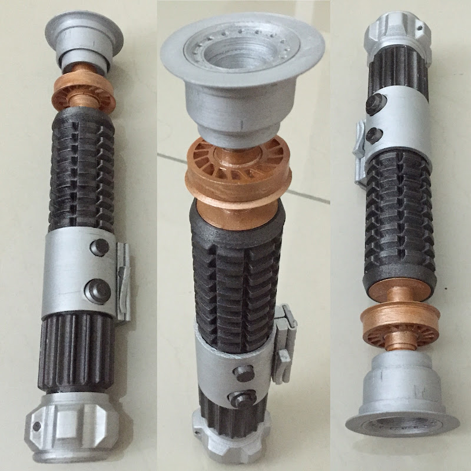</a>

 
 
不折不扣的 攻擊力1 耐久度1 &nbsp;科科! 

<a href="/assets/img/blog/6d4189e49ecf.png" imageanchor="1" style="margin-left: 1em; margin-right: 1em;">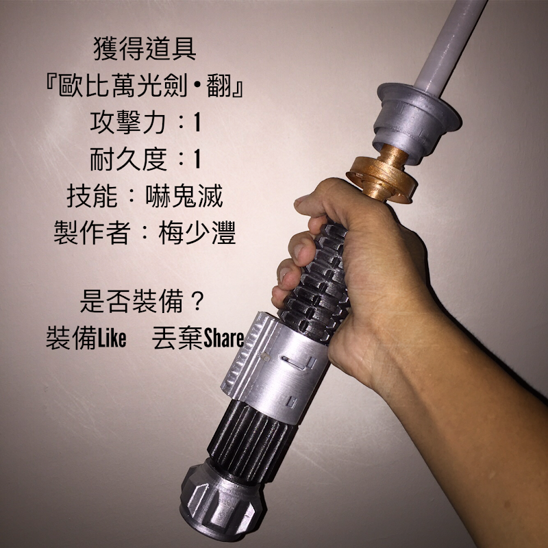</a>

 
<b>STEP 5 ：光和音效　Light &amp; Sound</b> 
這個由於零件還沒有budget 去買 先留著~ 以後有了再更新。 

 

补上 &nbsp;观众要的光。。。 

 

 

 

 

