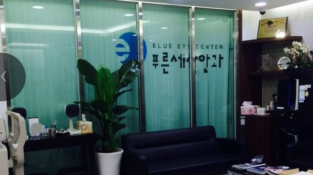
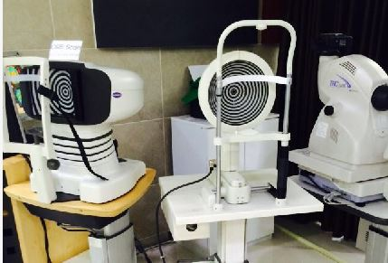
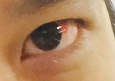

"睡了一覺醒來戴上眼鏡睜開眼睛，忽然發現怎麼戴眼鏡反而模糊了。 
脫下眼睛卻看的異常清楚...." 
蜘蛛俠電影上有這樣的一幕。而今天起床的我，也上映了這一幕......... 
 
***注意 本文以個人經歷為主，手術情況和類型是根據自身情況檢查后醫生建議的。可能你的情況和我不一樣。 
 

<iframe allowfullscreen="" class="YOUTUBE-iframe-video" data-thumbnail-src="https://i.ytimg.com/vi/Hm4BxQen6SM/0.jpg" frameborder="0" height="266" src="https://www.youtube.com/embed/Hm4BxQen6SM?feature=player_embedded" width="320"></iframe>

<b>沒看過蜘蛛俠的可以看一下這一幕。可惜我就差身材沒有變成那樣 哈哈。</b> 
 
 
<b>一,前言</b> 
記憶殘存中 自小學以來，眼鏡就一直是我的夥伴。 
除了睡覺以外眼鏡的壓力根本不可能離開鼻樑。 
我近視不高，大概就在300度 和350 左右。 
左右眼的視力不均勻一直左右眼互相調整的加深 
從 左右 
100 50 
200 100 
250 200 
300 350 ... 
然後穩定直到數十年后的今天我決定做鐳射手術。 
心情就是要唱起 “脫掉，脫掉，脫掉&nbsp;眼鏡脫掉” 的感覺。 
 
眾所周知，我常去韓國。 
因為我未婚妻在那裡。 
這次去韓國 就計劃了要把眼鏡脫掉。 
選擇韓國 單純是因為韓國手術的科技比較先進。 
比起馬來西亞...這個也沒什麼好質疑的吧。 
<b> </b>
<b>二，來到整容街</b> 
跟著媳婦來到這裡，忽然發現這裡竟然是出名的整容街。 
一條街上到底有多少整容醫院我也算不出 ，當中還有中文字。 
哪意味著中國人生意他們也做不少吧 。 科科 
 

<a href="/assets/img/blog/367bbd24129b.jpg" imageanchor="1" style="clear: left; float: left; margin-bottom: 1em; margin-right: 1em; text-align: left;"> </a>

<table cellpadding="0" cellspacing="0" class="tr-caption-container" style="float: left; margin-right: 1em; text-align: left;"><tbody>
<tr><td style="text-align: center;"></td></tr>
<tr><td class="tr-caption" style="text-align: center;"><b>診所的名字 我到寫這篇部落格才注意到是藍眼睛中心... (亞洲人眼睛又不是藍色的=.= )</b></td></tr>
</tbody></table>

 

我是來做眼鏡鐳射的...不是來整容的啦... 
可能幾乎做鐳射的醫院都在這裡吧... 
 
到了醫院（準確來說應該是診所吧） 
能發現門口擺放了幾個韓國明星的牌子。 
簡單說 就是他們也在那裡做的。 
不過 從不哈韓的我 還真一個都不認識。科科 
 
<b>三，檢查</b> 
所有手術前都必須先進行檢查， 
檢查前會會先填寫一個表格，表格都是韓文的。 
然後透過機器一系列的檢查。 
有近視的朋友，配眼鏡的時候那種機器大概都用過吧。 
檢查就是有10臺左右類似的機器。 
除了測量近視以外，眼睛各種測量比如角膜厚度什麼的。 
因為我的韓文水平太差，我媳婦翻譯技巧又太爛... 
（她能說中文韓文，就是沒法充當翻譯的角色。） 
我只理解到我眼角膜稍微有點薄，不過還在可以安全進行手術的範圍。 
<table cellpadding="0" cellspacing="0" class="tr-caption-container" style="float: left; margin-right: 1em; text-align: left;"><tbody>
<tr><td style="text-align: center;"></td></tr>
<tr><td class="tr-caption" style="text-align: center;"><b>各種檢查用的儀器</b></td></tr>
</tbody></table>
 

 

 

 
 
 
 
 
 
 
 
 
 
 
 
 
 
我老早就查遍了一堆又一堆的資料。 
基本上不知道醫生在說什麼我也基本大概猜測他想說的話了。 
確定沒問題后 就直接進去做手術了。 
 
在韓國做 一對眼睛 我的是馬幣3000左右， 
這個價格貌似依據個情況手術難度改變。 
 
<b>四，手術</b> 
來時就決定做了，就直接當場做了沒有排隊。 
我做的是恢復較快的 LASIK 基本術後一天就可以正常使用眼睛了 
不過還是得注意不要進水 滴眼藥水和有一個月不能游泳這類的保養。 
&nbsp;(想知道分別可以在文章最下面點連接去看) 
 
手術流程基本如下： 
1.套上手術衣+ 消毒+護士講解手術眼睛要一直盯著上方綠色的燈，就算黑了 也要保持不動。 
2.進手術室躺下貼上一片貌似固定用的膠布。 
3.眼藥麻醉 撐開眼皮。 
4.割開眼角膜。（會感覺到一些眼睛上有壓力壓下） 
5.鐳射啟動，算10秒（揭開瞬你可以感覺到黑暗的恐懼頂上的光瞬間暗滅。在這裡完全可體會盲人是怎麼一回事了...同時我聞到鐳射上獨有的燒焦味了T_T ） 
6.眼角膜蓋回去。醫生在眼睛上撫平眼角膜（貼合的重要過程 。） 
7.晃眼睛 然後回到3-6. 
 
其實手術的過程是說起來還是有點恐怖的。 
尤其是第4部分 ， 
可能我對麻醉藥有感覺點免疫， 
因為媳婦去做的時候說這部分沒感覺。 
右眼還好基本沒感覺但是能感覺撐開眼皮的架子放入的不舒適感。 
左眼割開一瞬間我甚至能感覺刀割的疼痛。 
卻不得不控制自己別動。因為亂動會很危險的。 
在眼角膜揭開瞬間忽然的黑暗讓腦中不受控制的不斷閃過各種可能變盲的恐懼。 
這瞬間讓我理解到我擁有眼睛這件事是多麼幸福，哪怕它有一點缺陷（紅綠輕微色盲）。 
 
*順道一提，色盲是無法透過鐳射醫治的。 
 
我在youtube 搜索過這個過程。完全能依靠常識知道醫生在幹什麼， 
再重新恢復光亮的時候心裡 
 
不過眼睛撐至圓形割開本來就恐怖... 
不鼓勵心理素質低又打算做的朋友去看。 
有自信不被影響的 可以自行到youtube 輸入lasik 自己查看。 
 
 
<b>五，術後 15天</b> 
術後下床 眼睛就像貼了膠水似的，白茫茫一片。 
瞇著眼睛都不敢撐開。 
在醫生護士再三督促不要揉眼睛，不要洗頭怕進水等保養注意后手術就結束了。 
 
距離我住的地方差不多2小時的電動車。 
（不得不說韓國公共交通真的很發達 基本遍佈所有地方 而且一張卡通行 太方便了） 
 
睡了一覺醒來，起床后習慣性帶上眼鏡睜開眼睛，忽然發現戴眼鏡反而模糊了。 
嗯 我並沒有被蜘蛛咬，只是單純做完了Lasik 手術。 
 
眼睛有兩塊淤青，這個好像是因人而異的。 
不過這兩塊淤青第二天複診的時候醫生說一星期會自行消失。 
基本大約3-4天后 就完全消失了。 
 
至於視力情況 
到寫這篇文章為止 是術後第15天 
現在還是左右不平衡 左眼視力1.2 (非常好) 右眼視力1.0(一般沒近視的度數) 
兩眼睜開基本感覺不大。 
而右眼在晚上或偏暗地方還是會有一些重影。左眼卻沒有這個情況 
在一星期的複診醫生說眼睛很乾淨，恢復得很好。 
完全康復期是一個月重影情況會慢慢改善。 
 
所以30天后我會在此文下面更新情況和個人經驗總結建議。 
 
<table cellpadding="0" cellspacing="0" class="tr-caption-container" style="float: left; margin-right: 1em; text-align: left;"><tbody>
<tr><td style="text-align: center;"><b style="margin-left: auto; margin-right: auto;"></b></td></tr>
<tr><td class="tr-caption" style="text-align: center;"><b>手術后3天眼睛有如被打黑青一般的痕跡 （忘了特地拍下，這是搞怪照片中放大的 所以歪一邊）</b></td></tr>
</tbody></table>
 
 
 
 
 
 
 
 
 
 
 
 
 
最後分享一下我術前查看的一篇文章解釋得蠻清楚的。 
http://www.nobelgroup.com.tw/lasikeye/eyehealth/03.html